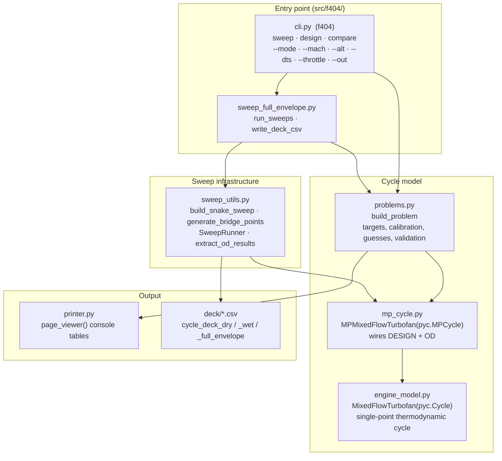

[](https://github.com/Jhawk414/F404#current-status)
[](https://github.com/Jhawk414/F404/commits/main)
[](https://github.com/Jhawk414/F404/issues)

# F404

A GE F404 twin-spool, low-bypass, mixed-flow, afterburning turbofan cycle model
with design-point sizing and off-design flight sweeps, built on
[NASA Glenn's pyCycle](https://github.com/OpenMDAO/pyCycle) and
[OpenMDAO](https://openmdao.org/).

Given a target thrust and component parameters (fan and HPC pressure ratios,
component efficiencies, cooling bleed fractions), the model sizes the engine
at sea-level-static conditions and sweeps flight Mach, altitude, ambient
temperature offset and throttle to generate an off-design performance deck.
The deck records every requested point, with or without convergence.

**Status:** In development. One sized engine, with DESIGN at sea-level-static
dry mil power, operated both dry (military power and below) and wet
(afterburning) on one off-design point of the same model. Also:
Mach/altitude/dTs/throttle sweep infrastructure, and an `f404` command line for
sweeps and single design points. See [Current status](#current-status) for
convergence coverage and [Roadmap](#roadmap) for planned work. Not yet
validated against public F404 performance data; the public reports are
archived and indexed in
[`docs/unclassified_perf_data/`](docs/unclassified_perf_data/README.md). The
general aerothermal methods the model uses (e.g. the augmentor-loss
correlation) are in [`docs/references/`](docs/references/README.md).

## Table of contents

- [Repo layout](#repo-layout)
- [Cycle architecture](#cycle-architecture)
- [Software architecture and data flow](#software-architecture-and-data-flow)
- [Installation](#installation)
- [Usage](#usage)
- [Testing](#testing)
- [Current status](#current-status)
- [Roadmap](#roadmap)
- [Acknowledgments](#acknowledgments)
- [License](#license)

## Repo layout

F404 application code lives under `src/f404/`, separate from the
vendored upstream `pycycle` library at the repo root (see
[#4](https://github.com/Jhawk414/F404/issues/4)).

| Path | Role |
|---|---|
| `src/f404/engine_model.py` | `MixedFlowTurbofan(pyc.Cycle)`: single-point thermodynamic cycle (fan, HPC, burner, HPT/LPT, mixer, afterburner, nozzle), plus `AugmentorControl` (afterburner command and pressure loss) and `NozzleSchedule` (A8) |
| `src/f404/mp_cycle.py` | `MPMixedFlowTurbofan(pyc.MPCycle)`: one DESIGN point (dry mil) feeding one off-design point, `OD`, for dry and wet alike, with map scalars, station areas and the nozzle throat; the augmentor-loss constants |
| `src/f404/problems.py` | `build_problem()`: design targets, the max-AB calibration, initial guesses and input validation |
| `src/f404/sweep_utils.py` | Sweep infrastructure: snake-pattern sweep grid, bridge-point warm-starting, `SweepRunner` (with its fail-fast Newton cap, ADR-0003), result extraction |
| `src/f404/cli.py` | `f404` command line: `sweep`, `design` and `compare` subcommands, `min,max,step` range parsing (`--mach`, `--alt`, `--dts`, `--throttle`) and validation |
| `src/f404/sweep_full_envelope.py` | Sweep driver: default grid, `run_sweeps()` for dry, wet, or both modes, and the cycle-deck CSV writer |
| `src/f404/printer.py` | Console table formatter for DESIGN/OD results |
| `src/f404/compare_decks.py` | Column-by-column deck comparison behind `f404 compare` |
| `tests/` | pytest suite, one `<module>_test.py` per module ([#5](https://github.com/Jhawk414/F404/issues/5)) |
| `deck/` | Cycle-deck output CSVs |
| `docs/` | System architecture diagrams (`f404_cycle.typ`, `f404_cycle.svg`), architecture decision records (`adr/`), planning docs (`improvements/`), and reference material: `unclassified_perf_data/` (an [index and cross-study reference map](docs/unclassified_perf_data/README.md) of published F404 performance data) and `references/` (an [index](docs/references/README.md) of general aerothermal methods the model uses, e.g. Kumar 1980 for the augmentor loss). Both keep source PDFs in `pdf/` and Obsidian-compatible markdown conversions with their figures in `md/` |
| `AGENTS/` | Session handoff notes |
| `meta/` | Vendored-library provenance (`LICENSE.txt`) |
| `pycycle/`, `setup.py`, `pyproject.toml`, `example_cycles/` | Vendored upstream `pyCycle` library |

## Cycle architecture

The thermodynamic cycle model in `engine_model.py` (`MixedFlowTurbofan`) represents the twin-spool, mixed-flow, augmented F404 turbofan engine:


*Diagram source maintained in [`docs/f404_cycle.typ`](docs/f404_cycle.typ).*

Key cycle components and mechanical couplings:
- **Low Pressure (LP) Spool**: 3-stage fan driven by the single-stage LP turbine via `lp_shaft` (10,000 rpm).
- **High Pressure (HP) Spool**: 7-stage HP compressor driven by the single-stage HP turbine via `hp_shaft` (14,000 rpm, 250 hp customer power extraction).
- **Cooling Bleeds**: HPC interstage bleed (`cool1`, 5.07% flow) cools the LPT; compressor discharge bleed (`cool3`, 11.0% flow) cools the HPT.
- **Mixed Exhaust & Augmentor**: Core flow and bypass flow mix in a confluent mixer, then pass through the afterburner and expand through a variable convergent-divergent nozzle (`mixed_nozz`). Off-design, the afterburner is always a combustor: a commanded Tt7 at or below its inlet temperature (0 included) is dry, with zero fuel. Its pressure loss is a flameholder drag loss (2.1%, dry and wet, also in the DESIGN sizing) plus a Rayleigh loss that grows with heat addition (6.6% in total at SLS max AB), after Kumar (1980) ([#33](https://github.com/Jhawk414/F404/issues/33)).
- **One engine, two modes**: the engine is sized once, at SLS dry mil (11,000 lbf, Tt4 3100 R). Dry and wet run on one off-design point. When dry, it uses the DESIGN nozzle throat (A8). When wet, A8 opens by choked-throat continuity, just enough to pass the hotter flow, so the gas generator stays within about 0.25% BPR of where dry put it at that flight condition ([#8](https://github.com/Jhawk414/F404/issues/8), wet half). Max AB is Tt7 3598.35 R, calibrated to 17,700 lbf SLS. See [ADR-0001](docs/adr/0001-single-engine-sizing.md) for the sizing and [ADR-0002](docs/adr/0002-single-od-topology.md) for the single OD topology, the loss and the A8 law.

## Software architecture and data flow

Current data flow from CLI invocation to output CSV.



`mp_cycle.py` instantiates `MixedFlowTurbofan` twice:

- with `design=True`: the DESIGN point, solved once to size the engine, with
  the afterburner as a duct;
- with `design=False`: `OD`, with the afterburner as a combustor.

It passes converged map scalars, station areas and the nozzle throat from
DESIGN into `OD`, so off-design calculations use the one sized engine
geometry. `aug_ctrl.Tt7_cmd` sets the mode: a dry sweep holds it at 0 and
throttles Tt4, and a wet sweep holds Tt4 at mil and throttles Tt7.

## Installation

This repository vendors OpenMDAO's `pyCycle` library. Install in editable mode
from a local clone:

```bash
git clone git@github.com:Jhawk414/F404.git
cd F404
pip install -e .[all]
```

Requires Python 3.9+ and OpenMDAO 3.10.0+.

## Usage

`pip install -e .[all]` installs an `f404` command (re-run it in an existing
checkout to pick up the entry point). `python -m f404` is equivalent
and needs no install beyond the package being importable.

```bash
f404 sweep                      # dry + wet, default grid, decks in the cwd
f404 sweep --mode wet           # one mode only
f404 sweep --mach 0             # static only (flown at Mach 0.001)
f404 sweep --alt 0 --dts -20,20,10   # one altitude, a dTs range
f404 design                     # solve and print DESIGN, and OD at mil and max AB
f404 compare old.csv new.csv    # % change of every deck column, new vs old
f404 --help                     # and `f404 sweep --help`, `f404 design --help`
                                # (rich panels; plain argparse text for usage errors)
```

### `f404 sweep`

Sweeps the sized engine over flight Mach, altitude, temperature offset and
throttle, and writes `cycle_deck_dry.csv` / `cycle_deck_wet.csv` (plus
`cycle_deck_full_envelope.csv` for `--mode both`). With no range flags the
grid is the default one below, so the output matches the committed decks in
`deck/`.

Every requested point is a row, failed ones included
([#27](https://github.com/Jhawk414/F404/issues/27)):

- The deck leads with the inputs: `mode, converged, alt, dTs, MN, T4_cmd, T7_cmd`.
- `T4_cmd`/`T7_cmd` are the commanded burner and augmentor exit temperatures: dry is `(Tt4, 0)`, wet is `(3100, Tt7)`.
- A failed row has blank outputs, and its last column, `failure`, says why:
  - `AnalysisError`: Newton failed;
  - `RuntimeError`: singular Jacobian;
  - `bound:<state>`: a balance state saturated at its bound;
  - `target`: T4/T7 missed.
- `df[df.converged]` is the converged deck.

| Flag | Meaning | Default |
|---|---|---|
| `--mode {dry,wet,both}` | afterburner mode | `both` |
| `--mach MIN,MAX,STEP` | flight Mach, below 1 | `0.001, 0.2, 0.4, 0.6, 0.8, 0.95` |
| `--alt MIN,MAX,STEP` | altitude, ft | `0,5000,2500` |
| `--dts MIN,MAX,STEP` | ISA temperature offset, R | `-50,50,10` |
| `--throttle MIN,MAX,STEP` | Tt4 (dry) or Tt7 (wet), R | `2500,3100,200` dry, `2998.35,3598.35,200` wet |
| `--out DIR` | deck directory, created if missing | `.` |

```bash
# Wet sweep: T7 from max AB (3598.35 R) down in 200 R steps (Tt4 held at mil, 3100 R)
f404 sweep --mode wet --alt 0,10000,2500 --dts 0,20,10 --out /tmp/run1
```

The wet default steps down from the calibrated max AB, `MAX_Tt7`. Decks from
before [ADR-0002](docs/adr/0002-single-od-topology.md) used 3608 → 3008 R; to
compare against one point for point, add `--throttle 3008,3608,200`.

- Each range is one `min,max,step` triple, inclusive of `max`, bare or
  bracketed (`--alt [0,10000,1000]`). The order is fixed.
- A single value holds the axis constant (`--alt 0`, `--throttle 3100`).
  Step 0 is not a constant axis; it is an error.
- A range may start with a negative number (`--dts -20,20,10`). `main()` joins
  it to its flag before argparse, which would otherwise read it as a flag
  ([#22](https://github.com/Jhawk414/F404/issues/22)).
- Axes are walked in the order the solver's warm-starting expects, whatever
  the flag order: `--dts` hot side first (0, +10 … then −10 …), `--throttle`
  high power to low, `--mach` ascending. Nesting is throttle → Mach → alt →
  dTs. Each Mach step walks the alt/dTs block back the way it came, so
  consecutive points stay neighbours.
- `--throttle` needs `--mode dry` or `--mode wet`: it is a different
  temperature in each.
- Mach 0 is flown at 0.001 (`STATIC_MN`): at exactly 0 the flow solve
  gives NaN. Mach 1 and above is rejected, because the inlet's fixed ram
  recovery is subsonic only ([#38](https://github.com/Jhawk414/F404/issues/38)).

A malformed flag stops the run before any model is built, with a message
naming the problem: a range that isn't exactly three finite numbers, a
non-positive step, `min` above `max`, a step that doesn't divide `max − min`
evenly (so the sweep would silently stop short of `max`), an unusable
`--throttle` or `--out`. Exit status 2 for bad arguments.

### `f404 design`

Sizes the engine and prints the DESIGN result tables, then those of `OD` at
mil (dry) and at max AB at sea-level static, without sweeping. There is one engine, so
there is no `--mode`. Three flags override the targets:

- `--fn-target`: dry mil sizing thrust.
- `--mil-tt4`: core burner exit temperature.
- `--max-tt7`: max-AB afterburner exit temperature.

A non-converging solve exits 1 with the solver's message. A `--max-tt7` at or
below the SLS-mil augmentor inlet temperature (~1502 R) would leave the
afterburner dry, so it exits 2 with `MaxTt7TooLowError`.

`python -m f404.sweep_full_envelope [--mode ...]` still works and is
the same as `f404 sweep`.

### `f404 compare`

Compares two decks, `NEW` against `BASE`, and prints a markdown report:
- which points converge in only one of them;
- for every shared column, over the points converged in both, the min and max % change, the largest |%|, and the point where it occurs.

```bash
f404 compare deck/cycle_deck_wet.csv /tmp/run1/cycle_deck_wet.csv
f404 compare old.csv new.csv --cols Fn,TSFC,BPR --changed-only
```

- **Matching.** Rows match on the inputs: (mode, alt, dTs, MN, T4_cmd,
  T7_cmd).
  - alt, dTs and MN match at 1e-6, so fractional grids stay distinct. The
    commands match to 1 R.
  - Full-envelope decks (both modes) compare too.
  - Points in only one deck are listed.
  - Decks from before #27 have no command columns. Their solved T4 (dry) or
    T7 (wet) stands in.
- **Convergence.** The report lists points converged only in base
  (regressions) and only in new (gains), and counts points failed in both.
- **Errors (exit 2).** Two rows on one key, and `--cols` naming a column
  either deck lacks.
- **Near-zero base values.** Points whose base value is ~0 (dry `FAR_ab`, a
  zero loss) are compared in absolute terms, on a separate `(abs)` row.
- **Missing values.** Blank or non-finite values are reported on an
  `(invalid)` row and the command exits 1. A missing result never reads as
  "no change".
- **Proof for a model change.** Sweep before and after, then compare. Decks
  are read back at round-trip precision, so a 0 means bit-identical.

## Testing

```bash
pytest tests                    # full suite, ~2 min
pytest tests -m "not slow"      # structural and unit tests only, ~7 s
```

One `tests/<module>_test.py` per module ([#5](https://github.com/Jhawk414/F404/issues/5)).
Tests marked `slow` build and solve a full `om.Problem`; the rest either use
pure functions or build a model without solving it. `pytest` needs no prior
install — `pythonpath` in `pyproject.toml` puts `src/` on the path.

CI ([#31](https://github.com/Jhawk414/F404/issues/31)): a PR runs only the fast
tests (`-m "not slow"`, Ubuntu 3.12, about a minute). The full suite on Ubuntu
(3.9, 3.12) and macOS (3.12) runs on every push to `main`, on manual dispatch,
and on a PR carrying the `full-ci` label. Apply that label when the PR is about
to merge: the golden baselines and convergence regressions are all `slow`.

237 tests (196 fast), 97% coverage. The driver and
CLI are importable and covered; what remains uncovered is mostly
`sweep_utils.py`'s solver-failure paths and the one-line `__main__` shims.

## Current status

Latest full-envelope sweep (`--mode both`, OpenMDAO 3.39.0). It took 2 h 5 min; since
[#40](https://github.com/Jhawk414/F404/issues/40) the same sweep, with bit-identical decks, takes about 1 h.
- Grid: MN ∈ {0.001, 0.2, 0.4, 0.6, 0.8, 0.95}, alt ∈ {0, 2500, 5000} ft, dTs ∈ {0, ±10 … ±50} R, and 4 throttle levels per mode.
- That is 792 points per mode, all on the one sized engine.

| Mode | Converged | Throttle sweep |
|---|---|---|
| Dry | 642 / 792 | Tt4 3100 → 2500 R |
| Wet | 657 / 792 | Tt7 3598.35 → 2998.35 R (Tt4 fixed at 3100 R MIL) |

Converged by Mach (each cell out of 132):

| MN | 0.001 | 0.2 | 0.4 | 0.6 | 0.8 | 0.95 |
|---|---|---|---|---|---|---|
| Dry | 120 | 118 | 120 | 115 | 97 | 72 |
| Wet | 96 | 100 | 117 | 128 | 120 | 96 |

Decks: [`deck/cycle_deck_dry.csv`](deck/cycle_deck_dry.csv),
[`deck/cycle_deck_wet.csv`](deck/cycle_deck_wet.csv).

- **Precision.** Every value is written at full float64 precision (shortest round-trip repr).
- **Size.** At ~650 KB each, the decks are over GitHub's 512 KB limit for rendering a CSV as a table, so GitHub shows them as raw text.
- **Blank cells.** A failed row's outputs are empty fields, which pandas reads as `NaN`.
- **Rows.** Every requested point is a row, so these counts come straight from the deck: `df.groupby(['mode', 'MN']).converged.sum()`.
- **Columns.**
  - `INPUT_COLUMNS` (mode, converged, alt, dTs, MN, T4_cmd, T7_cmd).
  - Then `DECK_COLUMNS` in `sweep_utils.py`: the original 19 performance columns, then fan and HPC operating point and stall margin, T3/T45/T5, augmentor inlet state and loss, and the nozzle inlet and exit states.
  - Then `failure`.

At SLS std day, from static to M 0.95:

| | Fn (lbf) | Fg (lbf) | W (lbm/s) |
|---|---|---|---|
| Dry mil | 11,045 → 9,262 | 11,050 → 15,510 | 145 → 190 |
| Max AB | 17,745 → 18,831 (minimum 16,939 at M 0.4) | 17,750 → 25,075 | 145 → 190 |

Where the failures are, tracked in
[issue #3](https://github.com/Jhawk414/F404/issues/3), and readable from the
`failure` column:

- **Dry part power (Tt4 2500 R) gets worse with Mach.**
  - Converged out of 33: 30 static, 18 at M 0.6, 3 at M 0.95.
  - BPR climbs toward its 1.0 bound (15 `bound:balance.BPR` failures, mostly at 2500–2700 R). This is the part-power BPR problem in [#25](https://github.com/Jhawk414/F404/issues/25).
- **Dry and wet mil fail on the cold side.** That cold corner shrinks with Mach up to 0.6 (24 → 32 of 33 converged), then grows again by 0.95.
  - Wet fails at the same conditions as dry mil, across all four Tt7 levels: the A8 law holds the wet gas generator at the dry-mil operating point. Every wet failure is at dTs < 0.
- **Airflow ceiling.** Six cold-day points at M 0.95 fail on the OD airflow bound (`bound:balance.W`, 200 lbm/s; [#38](https://github.com/Jhawk414/F404/issues/38)).
- **Static rows match the pre-Mach decks.** Every point that converged before still converges, and the values agree to Newton tolerance (≤ 0.0024 %). Wet gains one point (2500 ft, −20 R, 3398 R). `f404 sweep --mach 0` reproduces the pre-Mach decks bit for bit.

## Roadmap

Planned work is tracked in [GitHub issues](https://github.com/Jhawk414/F404/issues).
The recommended order for taking it on is in the latest `AGENTS/HANDOFF_*.md`,
and design decisions are recorded in [`docs/adr/`](docs/adr/). What has shipped
is in the git history and the merged pull requests.

Next up: [#40](https://github.com/Jhawk414/F404/issues/40) (fail fast on
non-converging sweep points), [#37](https://github.com/Jhawk414/F404/issues/37)
(one static Mach) and [#16](https://github.com/Jhawk414/F404/issues/16)
(YAML run config).

## Acknowledgments

This repo is a fork of NASA Glenn's
[pyCycle](https://github.com/OpenMDAO/pyCycle) (`om-pycycle` on PyPI),
built on the [OpenMDAO](https://openmdao.org/) framework. The `pycycle/`
library code, `setup.py`, and `example_cycles/` are vendored upstream
scaffolding, not F404-specific.

If you use pyCycle itself, please cite:

> E. S. Hendricks and J. S. Gray, "pyCycle: A Tool for Efficient
> Optimization of Gas Turbine Engine Cycles," *Aerospace*, vol. 6, iss. 87,
> 2019. doi:10.3390/aerospace6080087

## License

Apache License 2.0. See [`meta/LICENSE.txt`](meta/LICENSE.txt).
