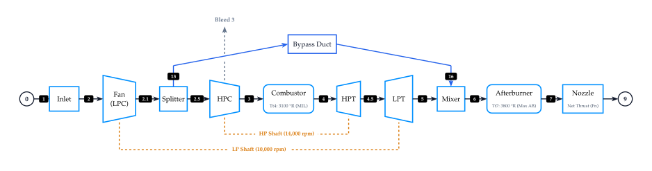
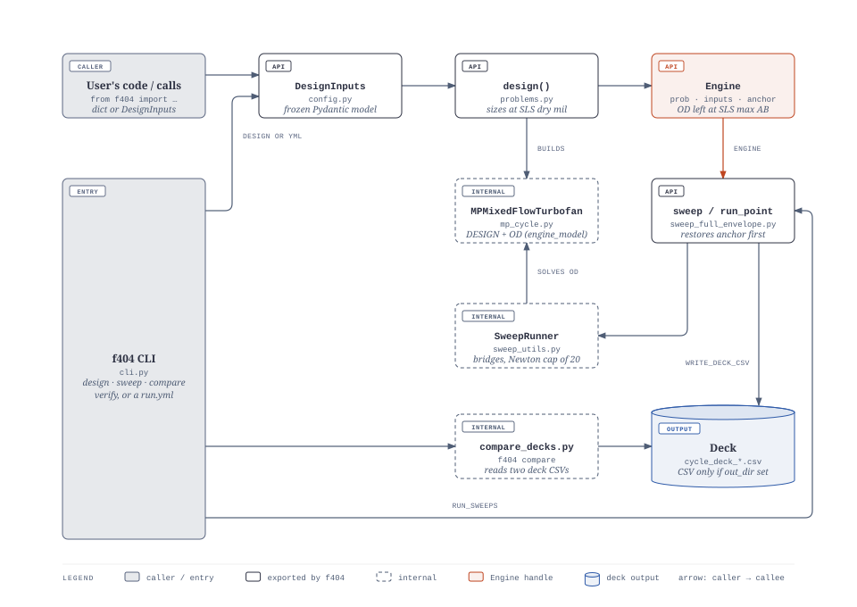

[](docs/status.md)
[](https://github.com/Jhawk414/F404/commits/main)
[](https://github.com/Jhawk414/F404/issues)
[](LICENSE.txt)

# F404

A GE F404 twin-spool, low-bypass, mixed-flow, afterburning turbofan cycle model,
built on [NASA Glenn's pyCycle](https://github.com/OpenMDAO/pyCycle) and
[OpenMDAO](https://openmdao.org/).

Given a target thrust and component parameters (fan and HPC pressure ratios,
component efficiencies, cooling bleed fractions), the model sizes the engine at
sea-level static (SLS) conditions. It then sweeps flight Mach, altitude,
temperature offset and throttle to build an off-design performance deck, with
one row per requested point, converged or not.

**Status:** in development. The model is one engine, sized at SLS dry mil power,
and runs dry and wet as one off-design point. It has not been validated against
public F404 data. The sources are archived in
[`docs/unclassified_perf_data/`](docs/unclassified_perf_data/README.md), and the
methods the model uses are in [`docs/references/`](docs/references/README.md).
Convergence coverage is in [`docs/status.md`](docs/status.md).

## Cycle



*Source: [`docs/f404_cycle.typ`](docs/f404_cycle.typ).*

The engine is sized once, at SLS dry mil (11,000 lbf, Tt4 3100 R). Max AB is Tt7
3607.68 R, calibrated to 17,700 lbf at SLS. Component details are in
[`docs/architecture.md`](docs/architecture.md#cycle-model), with the reasoning in
[ADR-0001](docs/adr/0001-single-engine-sizing.md) and
[ADR-0002](docs/adr/0002-single-od-topology.md).

## Architecture



The CLI and Python calls share one path through `config`, `problems` and the sweep
modules. See [`docs/architecture.md`](docs/architecture.md) for the repo layout and
the life of an `Engine`.

## Installation

```bash
git clone git@github.com:Jhawk414/F404.git
cd F404
pip install -e .[all]
```

This also installs the vendored pyCycle. It needs Python 3.9+ and OpenMDAO
3.17.0+. Check the install with:

```bash
f404 verify    # ~3 s
```

`verify` solves DESIGN, SLS dry mil and SLS max AB, and compares the results to
shipped reference values at a relative tolerance of 1e-6
([ADR-0004](docs/adr/0004-verify-install-check.md)).

## Usage

Run the default sweep from the committed [`run.yml`](run.yml), or size the engine
and sweep it from Python:

```bash
f404 run.yml                              # dry + wet grid; decks in deck/
f404 sweep --pla 31,130,33                # unified dry-to-max-AB PLA sweep
f404 sweep --mode wet --alt 0,10000,2500  # a custom temperature-driven sweep
f404 design                               # size the engine and print the results
f404 compare old.csv new.csv              # % change per shared column, points converged in both
```

```python
from f404 import DesignInputs, PlaSchedule, design, run_point, sweep

eng = design(DesignInputs(hpc_PR=7.0))
row = run_point(eng, alt=5000, mach=0.8, dts=-30, pla=87)
deck = sweep(eng, mach=[0.001, 0.4], alt=0, dts=0, pla=[130, 92.5, 87, 31])
```

Flags, range rules and YAML keys are in the [CLI guide](docs/guide/cli.md). The
[Python guide](docs/guide/python.md) covers the API.

## Development

```bash
pytest tests -m "not slow"    # fast tests, ~7 s
pytest tests                  # full suite, ~3 min
```

CI runs `f404 verify` and the fast tests on every PR to `main`. Details are in
[`docs/testing.md`](docs/testing.md). Planned work is in the
[GitHub issues](https://github.com/Jhawk414/F404/issues), with the suggested order
in the latest [`AGENTS/HANDOFF_*.md`](AGENTS/). Next up are `f404.studio`
([#46](https://github.com/Jhawk414/F404/issues/46)) and single-source bounds
([#57](https://github.com/Jhawk414/F404/issues/57)).

## Acknowledgments

This repo is a fork of NASA Glenn's [pyCycle](https://github.com/OpenMDAO/pyCycle)
(`om-pycycle` on PyPI), built on [OpenMDAO](https://openmdao.org/). The `pycycle/`
library and `example_cycles/` are vendored upstream code. To cite this model, use
[`CITATION.cff`](CITATION.cff). If you use pyCycle itself, please cite:

> E. S. Hendricks and J. S. Gray, "pyCycle: A Tool for Efficient
> Optimization of Gas Turbine Engine Cycles," *Aerospace*, vol. 6, iss. 87,
> 2019. doi:10.3390/aerospace6080087

## License

Apache License 2.0. See [`LICENSE.txt`](LICENSE.txt).
