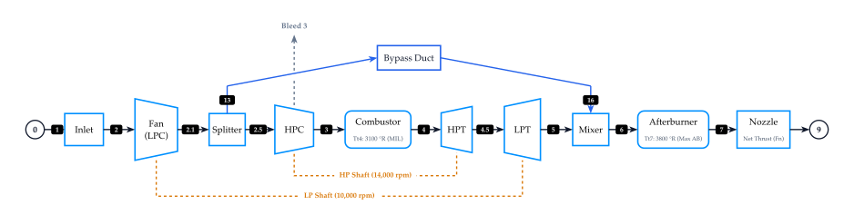
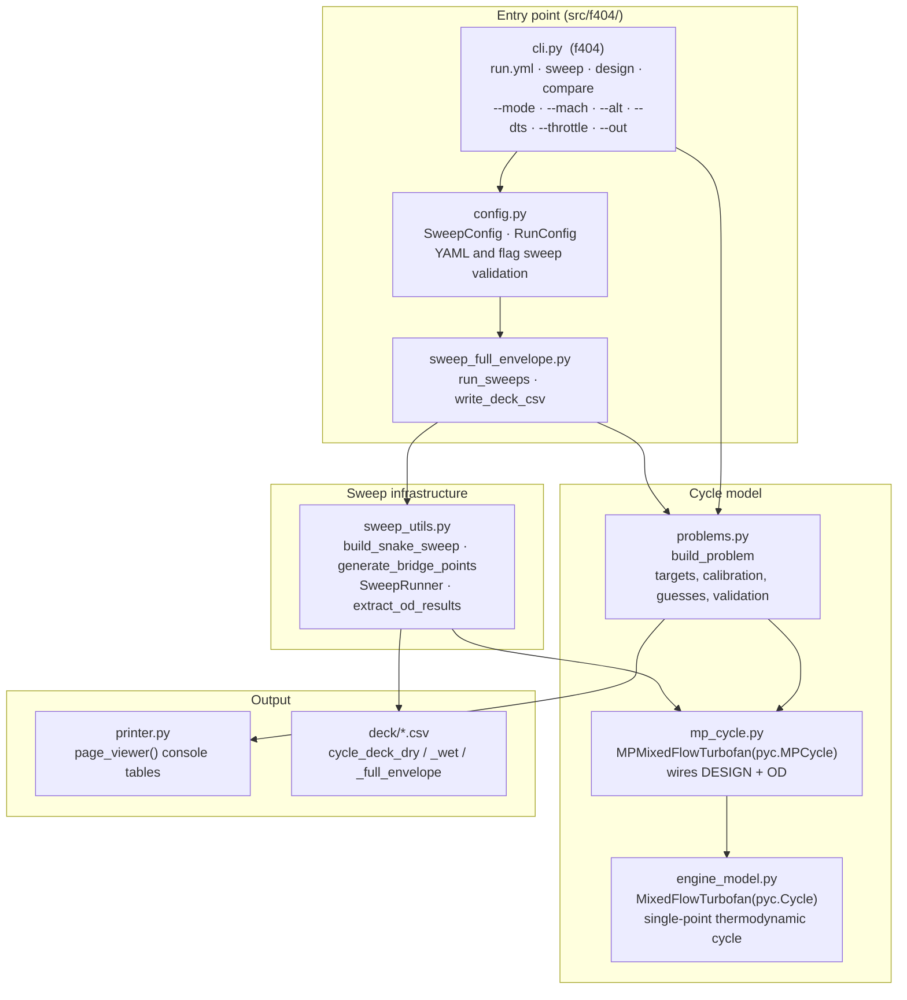

[](https://github.com/Jhawk414/F404#current-status)
[](https://github.com/Jhawk414/F404/commits/main)
[](https://github.com/Jhawk414/F404/issues)

# F404

A GE F404 twin-spool, low-bypass, mixed-flow, afterburning turbofan cycle model
with design-point sizing and off-design flight sweeps, built on
[NASA Glenn's pyCycle](https://github.com/OpenMDAO/pyCycle) and
[OpenMDAO](https://openmdao.org/).

Given a target thrust and component parameters (fan and HPC pressure ratios,
component efficiencies, cooling bleed fractions), the model sizes the engine
at sea-level-static conditions.

It then sweeps flight Mach, altitude, ambient temperature offset and throttle
to generate an off-design performance deck. The deck records every requested
point, converged or not.

**Status:** In development. One sized engine, with DESIGN at sea-level-static
dry mil power, run dry (military power and below) and wet (afterburning) as one
off-design point of the same model. It includes sweep infrastructure and an
`f404` command line. Convergence coverage is in [Current status](#current-status)
and planned work in [Roadmap](#roadmap).

Not yet validated against public F404 performance data; public technical reports
and test cell telemetry runs are archived and indexed in
[`docs/unclassified_perf_data/`](docs/unclassified_perf_data/README.md). The
general aerothermal methods the model uses (e.g. the augmentor-loss
correlation) are in [`docs/references/`](docs/references/README.md).

## Table of contents

- [Repo layout](#repo-layout)
- [Cycle architecture](#cycle-architecture)
- [Software architecture and data flow](#software-architecture-and-data-flow)
- [Installation](#installation)
- [Usage](#usage)
- [Testing](#testing)
- [Current status](#current-status)
- [Roadmap](#roadmap)
- [Acknowledgments](#acknowledgments)
- [License](#license)

## Repo layout

F404 application code lives under `src/f404/`, separate from the vendored
upstream `pycycle` library at the repo root (see
[#4](https://github.com/Jhawk414/F404/issues/4)).

```text
F404/
├── src/f404/                   # F404 application code
│   ├── engine_model.py         # MixedFlowTurbofan cycle (fan, HPC, burner, HPT/LPT, mixer, afterburner, nozzle), AugmentorControl, NozzleSchedule (A8)
│   ├── mp_cycle.py             # MPMixedFlowTurbofan: one DESIGN (dry mil) feeding one OD point for dry and wet; augmentor-loss constants
│   ├── problems.py             # build_problem(): design targets, max-AB calibration, initial guesses, input validation
│   ├── sweep_utils.py          # snake sweep grid, bridge warm-starting, SweepRunner (fail-fast Newton cap, ADR-0003), result extraction
│   ├── sweep_full_envelope.py  # default grid, run_sweeps() for dry, wet or both, cycle-deck CSV writer
│   ├── config.py               # YAML loading, Pydantic sweep validation, shared range parsing
│   ├── cli.py                  # f404 command: YAML runs, design, sweep, compare
│   ├── compare_decks.py        # column-by-column deck comparison behind f404 compare
│   └── printer.py              # console tables for DESIGN/OD results
├── run.yml                     # reproducible default sweep configuration
├── tests/                      # pytest suite, one <module>_test.py per module (#5)
├── deck/                       # cycle-deck output CSVs
├── docs/
│   ├── guide/                  # user guides (CLI), mirrored read-only to the GitHub wiki
│   ├── adr/                    # architecture decision records
│   ├── improvements/           # planning docs
│   ├── unclassified_perf_data/ # published F404 performance data: index, pdf/, md/
│   ├── references/             # general aerothermal methods (e.g. Kumar 1980): index, pdf/, md/
│   └── f404_cycle.{typ,svg}    # cycle diagram and its source
├── AGENTS/                     # session handoff notes
├── meta/                       # vendored-library provenance (LICENSE.txt)
├── pycycle/, example_cycles/   # vendored upstream pyCycle
└── setup.py, pyproject.toml     # shared packaging and F404 test configuration
```

The [performance-data index](docs/unclassified_perf_data/README.md) is a
cross-study reference map; the [references index](docs/references/README.md)
lists the equations and correlations taken from each paper. Both keep source
PDFs in `pdf/` and Obsidian-compatible markdown conversions, with figures, in
`md/`.

## Cycle architecture

The thermodynamic cycle model in `engine_model.py` (`MixedFlowTurbofan`) represents the twin-spool, mixed-flow, augmented F404 turbofan engine:



*Diagram source maintained in [`docs/f404_cycle.typ`](docs/f404_cycle.typ).*

Key cycle components and mechanical couplings:
- **Low Pressure (LP) Spool**: 3-stage fan driven by the single-stage LP turbine via `lp_shaft` (10,000 rpm).
- **High Pressure (HP) Spool**: 7-stage HP compressor driven by the single-stage HP turbine via `hp_shaft` (14,000 rpm, 250 hp customer power extraction).
- **Cooling Bleeds**: HPC interstage bleed (`cool1`, 5.07% flow) cools the LPT; compressor discharge bleed (`cool3`, 11.0% flow) cools the HPT.
- **Mixed Exhaust & Augmentor**: Core flow and bypass flow mix in a confluent mixer, then pass through the afterburner and expand through a variable convergent-divergent nozzle (`mixed_nozz`). Off-design, the afterburner is always a combustor: a commanded Tt7 at or below its inlet temperature (0 included) is dry, with zero fuel. Its pressure loss is a flameholder drag loss (2.1%, dry and wet, also in the DESIGN sizing) plus a Rayleigh loss that grows with heat addition (6.6% in total at SLS max AB), after Kumar (1980) ([#33](https://github.com/Jhawk414/F404/issues/33)).
- **One engine, two modes**: the engine is sized once, at SLS dry mil (11,000 lbf, Tt4 3100 R). Dry and wet run on one off-design point. When dry, it uses the DESIGN nozzle throat (A8). When wet, A8 opens by choked-throat continuity, just enough to pass the hotter flow, so the gas generator stays within about 0.25% BPR of where dry put it at SLS (up to 0.43% across the swept envelope) ([#8](https://github.com/Jhawk414/F404/issues/8), wet half). Max AB is Tt7 3607.68 R, calibrated to 17,700 lbf SLS. See [ADR-0001](docs/adr/0001-single-engine-sizing.md) for the sizing and [ADR-0002](docs/adr/0002-single-od-topology.md) for the single OD topology, the loss and the A8 law.

## Software architecture and data flow

Current data flow from CLI invocation to output CSV.



`mp_cycle.py` instantiates `MixedFlowTurbofan` twice:

- with `design=True`: the DESIGN point, solved once to size the engine, with
  the afterburner as a duct;
- with `design=False`: `OD`, with the afterburner as a combustor.

It passes converged map scalars, station areas and the nozzle throat from
DESIGN into `OD`, so off-design calculations use the one sized engine
geometry. `aug_ctrl.Tt7_cmd` sets the mode: a dry sweep holds it at 0 and
throttles Tt4, and a wet sweep holds Tt4 at mil and throttles Tt7.

## Installation

This repository vendors OpenMDAO's `pyCycle` library. Install in editable mode
from a local clone:

```bash
git clone git@github.com:Jhawk414/F404.git
cd F404
pip install -e .[all]
```

Requires Python 3.9+ and OpenMDAO 3.10.0+. Sweep configuration uses
Pydantic v2 and PyYAML, installed with the package.

## Usage

`pip install -e .[all]` installs an `f404` command (re-run it in an existing
checkout to install the new Pydantic/PyYAML dependencies). `python -m f404` is equivalent
and needs no install beyond the package being importable. Full flag tables,
range rules and error behaviour are in the [CLI guide](docs/guide/cli.md).
`f404 --help`, `f404 design --help` and so on print the same flag summaries.

### YAML run configuration

The committed [`run.yml`](run.yml) reproduces the default sweep grid. Copy it
and edit the sweep settings, or print a runnable commented example:

```bash
f404 run.yml                  # default dry + wet grid; output in deck/
f404 --example-yaml           # runnable example, with per-key descriptions
f404 --example-yaml > custom.yml
```

See the [CLI guide](docs/guide/cli.md#yaml-run-configuration) for required keys,
axis forms/order, and the per-mode resolved snapshots written beside the decks.

### `f404 design`

Sizes the engine and prints the DESIGN result tables, then those of `OD` at
mil (dry) and at max AB at sea-level static, without sweeping.

```bash
f404 design [--fn-target LBF] [--mil-tt4 DEGR] [--max-tt7 DEGR]
f404 design
```

No flag is required.

- `--fn-target LBF`: SLS dry mil thrust that sizes the engine (default 11000).
- `--mil-tt4 DEGR`: core burner exit temperature (default 3100).
- `--max-tt7 DEGR`: max-AB afterburner exit temperature (default 3607.68).

### `f404 sweep`

Sweeps the sized engine over flight Mach, altitude, temperature offset and
throttle, and writes `cycle_deck_dry.csv` / `cycle_deck_wet.csv` (plus
`cycle_deck_full_envelope.csv` for `--mode both`). With no range flags the
grid matches the committed decks in `deck/`. Every requested point is a row,
failed ones included, with `converged` and `failure` columns.

```bash
f404 sweep [--mode {dry,wet,both}] [--mach MIN,MAX,STEP] [--alt MIN,MAX,STEP] \
           [--dts MIN,MAX,STEP] [--throttle MIN,MAX,STEP] [--out DIR]
f404 sweep --mode wet --alt 0,10000,2500 --dts 0,20,10 --out /tmp/run1
```

No flag is required. A range is `MIN,MAX,STEP`; a single value holds that axis constant.

- `--mode`: dry (mil power and below), wet (afterburning) or both (default both).
- `--mach`: flight Mach, below 1; 0 is flown at 0.001.
- `--alt`: altitude, ft.
- `--dts`: ISA temperature offset, R.
- `--throttle`: Tt4 in dry mode, Tt7 in wet mode, R; needs `--mode dry` or `wet`.
- `--out DIR`: directory for the decks, created if missing (default `.`).

### `f404 compare`

Compares two decks, `NEW` against `BASE`, and prints a markdown report of the
points that converge in only one deck and the % change of every shared column.

```bash
f404 compare [--cols A,B,...] [--changed-only] BASE NEW
f404 compare old.csv new.csv --cols Fn,TSFC,BPR --changed-only
```

`BASE` and `NEW` are required; the flags are optional.

- `--cols A,B,...`: compare only these columns (default every shared column).
- `--changed-only`: omit columns that match exactly.

## Testing

```bash
pytest tests                    # full suite, ~3 min
pytest tests -m "not slow"      # structural and unit tests only, ~7 s
```

One `tests/<module>_test.py` per module ([#5](https://github.com/Jhawk414/F404/issues/5)).
Tests marked `slow` build and solve a full `om.Problem`; the rest either use
pure functions or build a model without solving it. `pytest` needs no prior
install — `pythonpath` in `pyproject.toml` puts `src/` on the path.

CI ([#31](https://github.com/Jhawk414/F404/issues/31)): a PR runs only the fast
tests (`-m "not slow"`, Ubuntu 3.12, about a minute). The full suite on Ubuntu
(3.9, 3.12) and macOS (3.12) runs on every push to `main`, on manual dispatch,
and on a PR carrying the `full-ci` label. Apply that label when the PR is about
to merge: the golden baselines and convergence regressions are all `slow`.

325 tests (281 fast), 97% coverage. The driver and
CLI are importable and covered; remaining gaps are mainly uncommon input/IO
errors, solver-failure paths, and the one-line `__main__` shims.

## Current status

Latest full-envelope sweep (`--mode both`, OpenMDAO 3.39.0): 792 points per
mode on the one sized engine, DESIGN and OD at the same static Mach 0.001
([#37](https://github.com/Jhawk414/F404/issues/37)). It takes about 35 min per
mode, dry and wet in parallel.

| Mode | Converged | Throttle sweep |
|---|---|---|
| Dry | 643 / 792 | Tt4 3100 → 2500 R |
| Wet | 663 / 792 | Tt7 3607.68 → 3007.68 R (Tt4 fixed at 3100 R MIL) |

Converged by Mach (each cell out of 132):

| MN | 0.001 | 0.2 | 0.4 | 0.6 | 0.8 | 0.95 |
|---|---|---|---|---|---|---|
| Dry | 120 | 118 | 120 | 115 | 97 | 73 |
| Wet | 95 | 100 | 120 | 128 | 120 | 100 |

Decks: [`deck/cycle_deck_dry.csv`](deck/cycle_deck_dry.csv),
[`deck/cycle_deck_wet.csv`](deck/cycle_deck_wet.csv). Every requested point is a
row at full float64 precision, and a failed row's outputs are blank (`NaN` in
pandas), so the counts above are
`df.groupby(['mode', 'MN']).converged.sum()`. The columns are `INPUT_COLUMNS`,
`DECK_COLUMNS` (in `sweep_utils.py`), then `failure`. At ~650 KB each, GitHub
shows the decks as raw text.

At SLS std day, static to M 0.95: dry mil Fn 11,000 → 9,224 lbf; max AB Fn
17,700 → 18,792 lbf (minimum 16,899 at M 0.4).

Where the failures are, tracked in
[issue #3](https://github.com/Jhawk414/F404/issues/3) and readable from the
`failure` column:

- **Dry part power (Tt4 2500 R) gets worse with Mach.** BPR climbs toward its 1.0 bound ([#25](https://github.com/Jhawk414/F404/issues/25)); 3 of 33 converge at M 0.95.
- **Dry and wet mil fail on the cold side (dTs < 0).** Wet fails where dry mil does, because the A8 law holds the wet gas generator at the dry-mil operating point. The one exception is 2500 ft, static, dTs −20 R, T7 3007.68 R, where dry mil converges.
- **Airflow ceiling.** One cold-day point at M 0.95 hits the 200 lbm/s OD airflow bound (six before #37 sized the engine 0.4 % smaller) ([#38](https://github.com/Jhawk414/F404/issues/38)).

Against the pre-#37 decks (sized at Mach 0.01), dry points, and wet points at the same T7, have thrust, airflow and A8 0.40 % lower; TSFC and BPR move by under 0.01 %. The default wet grid also moved up 9.33 R, so its levels compare at 0.16–0.26 % lower thrust and 0.20–0.30 % higher TSFC.

## Roadmap

Planned work is tracked in [GitHub issues](https://github.com/Jhawk414/F404/issues).
The recommended order for taking it on is in the latest `AGENTS/HANDOFF_*.md`,
and design decisions are recorded in [`docs/adr/`](docs/adr/). What has shipped
is in the git history and the merged pull requests.

Next up: [#30](https://github.com/Jhawk414/F404/issues/30) (define PLA), then
continue [#17](https://github.com/Jhawk414/F404/issues/17) beyond sweep-run
configuration into design inputs, sweep points, and shared bounds.

## Acknowledgments

This repo is a fork of NASA Glenn's
[pyCycle](https://github.com/OpenMDAO/pyCycle) (`om-pycycle` on PyPI),
built on the [OpenMDAO](https://openmdao.org/) framework. The `pycycle/`
library code and `example_cycles/` are vendored upstream scaffolding.
`setup.py` also carries the F404 package, CLI entry point, and dependencies.

If you use pyCycle itself, please cite:

> E. S. Hendricks and J. S. Gray, "pyCycle: A Tool for Efficient
> Optimization of Gas Turbine Engine Cycles," *Aerospace*, vol. 6, iss. 87,
> 2019. doi:10.3390/aerospace6080087

## License

Apache License 2.0. See [`meta/LICENSE.txt`](meta/LICENSE.txt).
