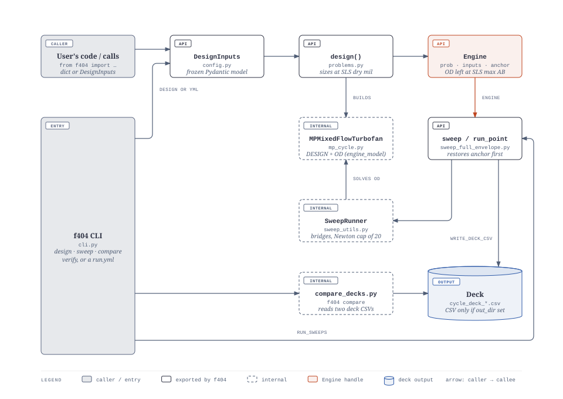
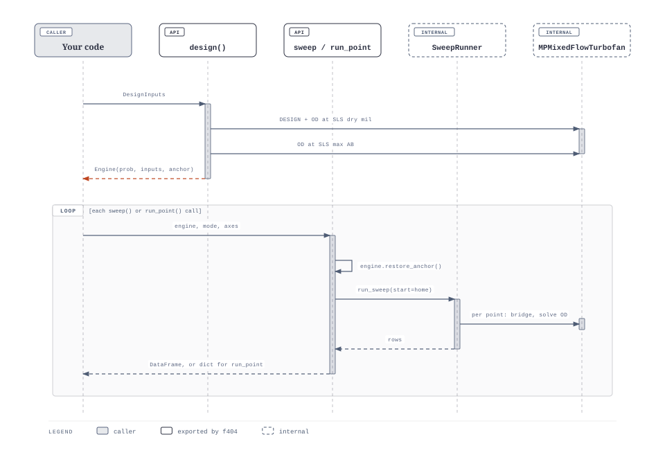

# Architecture

How the `f404` package is laid out, how the cycle model is wired, and how a call
moves through it. The cycle diagram is in the [README](../README.md). Decision
records are in [`adr/`](adr/).

## Repo layout

F404 application code lives in `src/f404/`, apart from the vendored upstream
`pycycle` library at the repo root ([#4](https://github.com/Jhawk414/F404/issues/4)).

```text
F404/
├── src/f404/                   # F404 application code
│   ├── engine_model.py         # MixedFlowTurbofan cycle, AugmentorControl, NozzleSchedule (A8)
│   ├── mp_cycle.py             # MPMixedFlowTurbofan: DESIGN (dry mil) feeding one OD point; augmentor-loss constants
│   ├── problems.py             # design() -> Engine: applies DesignInputs, sizes the engine, solves SLS mil and max AB
│   ├── sweep_utils.py          # snake grid, bridge warm-starting, SweepRunner, result extraction
│   ├── sweep_full_envelope.py  # sweep(), run_point(), run_sweeps() CLI driver, deck CSV writer
│   ├── config.py               # Pydantic input models, YAML loading, range parsing
│   ├── cli.py                  # f404 command: YAML runs, design, sweep, compare, verify
│   ├── compare_decks.py        # column-by-column deck comparison behind f404 compare
│   ├── verify.py               # install check behind f404 verify (verify_reference.json holds the expected values)
│   └── printer.py              # console tables for DESIGN and OD results
├── tests/                      # pytest suite, one <module>_test.py per module
├── deck/                       # cycle-deck CSVs; example/ holds sample resolved run configs
├── docs/                       # guides, ADRs, diagrams, planning notes, reference data
├── AGENTS/                     # session handoff notes
├── run.yml                     # default sweep configuration
├── pycycle/, example_cycles/   # vendored upstream pyCycle
└── setup.py, pyproject.toml    # packaging and test configuration
```

Under `docs/`, `guide/` holds the user guides (mirrored read-only to the GitHub
wiki), `adr/` the decision records, and `improvements/` planning notes.
[`unclassified_perf_data/`](unclassified_perf_data/README.md) indexes published F404 performance data,
and [`references/`](references/README.md) lists the aerothermal methods the model uses.
Both keep source PDFs in `pdf/` and Obsidian-compatible markdown conversions,
with figures, in `md/`.

## Modules and public API



`printer.py` prints the console tables for `verbose=True` and is left off the
diagram. The package exports `DesignInputs`, `Engine`, `design`, `run_point`
and `sweep` ([ADR-0005](adr/0005-public-python-api.md)).

## DESIGN and OD

`mp_cycle.py` instantiates `MixedFlowTurbofan` twice:

- with `design=True`: the DESIGN point, solved once to size the engine, with the
  afterburner as a duct;
- with `design=False`: `OD`, with the afterburner as a combustor.

It passes converged map scalars, station areas and the nozzle throat from
DESIGN into `OD`, so off-design calculations use the one sized engine geometry.
`aug_ctrl.Tt7_cmd` sets the mode. A dry sweep holds it at 0 and throttles Tt4.
A wet sweep holds Tt4 at mil and throttles Tt7.

## Cycle model

`MixedFlowTurbofan` in `engine_model.py` models the twin-spool, mixed-flow,
afterburning F404 turbofan.

- **Spools:** the fan and LP turbine share `lp_shaft` (10,000 rpm). The HP
  compressor and HP turbine share `hp_shaft` (14,000 rpm). The model has no
  stage counts. The real engine has a 3-stage fan, a 7-stage HP compressor and
  single-stage turbines.
- **Power extraction:** the 250 hp customer extraction is set and not yet
  applied, because the shaft balances ignore it ([#60](https://github.com/Jhawk414/F404/issues/60)).
- **Cooling bleeds:** the HPC interstage bleed (`cool1`, 5.07% of HPC flow)
  cools the LPT. The compressor discharge bleed (`cool3`, 11.0%) cools the HPT.
- **Mixer and afterburner:** core and bypass flow mix in a confluent mixer, pass
  through the afterburner, then expand through a variable convergent-divergent
  nozzle (`mixed_nozz`). Off-design, the afterburner is always a combustor. A
  commanded Tt7 at or below its inlet temperature (0 included) is dry, with zero
  fuel. Its pressure loss is a flameholder drag loss (2.1%, dry and wet, also in
  the DESIGN sizing) plus a Rayleigh loss that grows with heat addition (6.6% in
  total at SLS max AB), after Kumar (1980) ([#33](https://github.com/Jhawk414/F404/issues/33)).
- **One engine, two modes:** the engine is sized once, at SLS dry mil (11,000 lbf,
  Tt4 3100 R). Dry and wet run on one off-design point. Dry uses the DESIGN nozzle
  throat (A8). Wet opens A8 by choked-throat continuity, just enough to pass the
  hotter flow, which keeps the gas generator within 0.22% BPR of the dry state at
  SLS max AB (0.43% at worst across the swept envelope)
  ([#8](https://github.com/Jhawk414/F404/issues/8), wet half). Max AB is Tt7
  3607.68 R, calibrated to 17,700 lbf at SLS. See
  [ADR-0001](adr/0001-single-engine-sizing.md) for the sizing and
  [ADR-0002](adr/0002-single-od-topology.md) for the single OD topology, the loss
  and the A8 law.

## Life of an `Engine`

`design()` sizes the engine once. `sweep()` and `run_point()` then reuse it,
restoring the SLS max-AB anchor before every call so earlier calls don't steer
later ones. The restore also resets pyCycle's static-pressure guess caches,
which live outside the model's vectors
([#59](https://github.com/Jhawk414/F404/issues/59)), so results don't depend on
call history.


