{0}------------------------------------------------

**AD-A164 562**

**THE GENERAL ELECTRIC F404 - ENGINE OF THE RAAF'S NEW FIGHTER(U) AERONAUTICAL RESEARCH LABS MELBOURNE (AUSTRALIA) D FRITH JUL 85 ARL-AERO-PROP-TM-426**

**1/1**

**UNCLASSIFIED**

**F/G 21/5**

**NL**

|                                |  |  |  |  |  |  |  |  |  |  |  |
|--------------------------------|--|--|--|--|--|--|--|--|--|--|--|
|                                |  |  |  |  |  |  |  |  |  |  |  |
|                                |  |  |  |  |  |  |  |  |  |  |  |
|                                |  |  |  |  |  |  |  |  |  |  |  |
|                                |  |  |  |  |  |  |  |  |  |  |  |
| 
END FILMED DTIC
 |  |  |  |  |  |  |  |  |  |  |  |

{1}------------------------------------------------

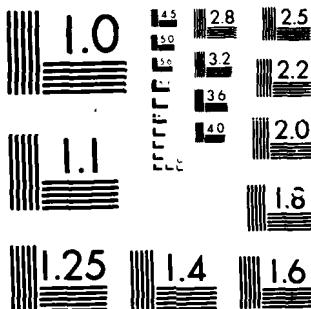

1.0  
45  
2.8  
2.5  
50  
56  
3.2  
2.2  
36  
40  
2.0  
1.1  
1.8  
1.25  
1.4  
1.6

A visual acuity test layout displaying groups of vertical and horizontal parallel lines of varying sizes, each accompanied by a numerical label indicating the visual acuity fraction or size.

Technical illustration: Visual acuity test chart with horizontal and vertical line patterns and numerical labels.

MICROCOPY RESOLUTION TEST CHART  
NATIONAL BUREAU OF STANDARDS 1963 A

{2}------------------------------------------------

UNCLASSIFIED

(12)

AJL-AERO-PROP-TH-426

AR-004-033

Seal of Australia featuring a kangaroo and a emu supporting a shield with a star above it, and the word 'AUSTRALIA' below.

## **DEPARTMENT OF DEFENCE DEFENCE SCIENCE AND TECHNOLOGY ORGANISATION AERONAUTICAL RESEARCH LABORATORIES**

MELBOURNE, VICTORIA

**AD-A164 562**

**Aero Propulsion Technical Memorandum 426**

**THE GENERAL ELECTRIC F404 - ENGINE OF THE  
RAAF'S NEW FIGHTER**

by  
**Denis Frith**

**DTIC  
ELECTE  
FEB 24 1986  
D**

**Approved For Public Release**

THE UNITED STATES NATIONAL  
TECHNICAL INFORMATION SERVICE  
IS AUTHORISED TO  
REPRODUCE AND SELL THIS REPORT

**(C) COMMONWEALTH OF AUSTRALIA 1985**

**JULY 1985**

**THIS FILE COPY**

**UNCLASSIFIED**

**88 2 21 008**

{3}------------------------------------------------

Aero Propulsion Technical Memorandum 426

# **THE GENERAL ELECTRIC F404 - ENGINE OF THE RAAF'S NEW FIGHTER**

by  
Denis Frith

# **SUMMARY**

The F404 engine in the F/A-18 is representative of a new generation of military turbofan engines. The features of the engine that govern its performance and contribute to its maintainability are discussed. The intention is to give the non-specialist an appreciation of those factors materially affecting the operation of this type of engine.

Lecture to Melbourne Branch, ROYAL AERONAUTICAL SOCIETY  
11 JUNE 1985

Seal of the Australian Science and Technology Organisation, featuring a map of Australia and a star in the center, surrounded by the text 'AUSTRALIAN SCIENCE AND TECHNOLOGY ORGANISATION'.

(C) COMMONWEALTH OF AUSTRALIA 1985

---

**POSTAL ADDRESS:** Director, Aeronautical Research Laboratories,  
P.O. Box 4331, Melbourne, Victoria, 3001, Australia.

{4}------------------------------------------------

# CONTENTS

|                       | <u>Page No.</u> |
|-----------------------|-----------------|
| INTRODUCTION          | 1               |
| DEVELOPMENT           | 2               |
| FEATURES              | 4               |
| OPERATION             | 7               |
| CONCLUSION            | 8               |
| ACKNOWLEDGEMENTS      |                 |
| FIGURES               |                 |
| DISTRIBUTION LIST     |                 |
| DOCUMENT CONTROL DATA |                 |

|                    |                      |
|--------------------|----------------------|
| Accession For      |                      |
| NTIS CRA&I         | ☒                    |
| DTIC TAB           | ☐                    |
| Unannounced        | ☐                    |
| Justification      |                      |
| By                 |                      |
| Distribution/      |                      |
| Availability Codes |                      |
| Dist               | Avail and/or Special |
| A-1                |                      |

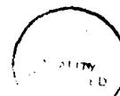

{5}------------------------------------------------

# INTRODUCTION

The new RAAF fighter, the McDonnell Douglas F/A-18 can regularly be seen in the skies over Avalon and will be a common sight around Williamtown and Tindal Air Force Bases well into the 21st Century. This aircraft means different things to different people, even to those in the defence aerospace industry. To the pilot it is a powerful and complex flying machine full of modern gadgetry to be dutifully mastered. To the strategic planner it is a versatile and flexible weapons platform with tremendous potential. The electronics engineer can proclaim that it is a manifestation of the influence of rapidly developing micro computer technology although he will be quick to point out that the hardware is already outdated. The aerodynamicists can point to the influence of the cleanliness of the design on the manoeuvring and range performance of the aircraft. The control man will counter with the importance of the programmable, fly-by-wire control system to operation and behaviour. Materials and structures personnel will emphasise that all this is only possible through judicious choice of advanced materials and structural concepts. The propulsion engineer sees it as symbol of the subtle importance of the engine. After all, the jet engine ushered in the era of the high speed aircraft and effective airliners.

The RAAF F/A-18 Hornets are powered by two General Electric F404-GE-400 augmented turbofan engines, Figure 1. The operation of this engine can be described by referring to Figure 2. The 3-stage fan, driven by the low-pressure turbine, compresses inlet air that subsequently divides into the bypass and core flows. Variable inlet guide vanes schedule the direction of the flow into the fan as a function of rotational speed. The core flow is further compressed for entry to the annular combustor by the compressor, driven by the high-pressure turbine. Variable inlet guide and two rows of stators adjust the flow direction as a function of corrected compressor speed. After expansion through the turbines, the high temperature gas from the combustion process is mixed with the bypass air to form the high speed jet out of the exhaust nozzle. When operating in afterburning mode, the speed of this jet is increased by additional combustion in the afterburner. The exhaust nozzle has variable area to allow afterburning without materially affecting the operation of the core engine. Nozzle area is also varied during non-afterburning operation to obtain optimum performance.

This engine produces over 10,000 lb of thrust in non-afterburning operation while the maximum thrust is in the 16000 lb class. These and other leading figures are listed in Figure 3. For the convenience of those not familiar with the principal characteristics of large, military engines, the values for the Pratt & Whitney TF30, the engine in the F111c, are listed for comparison. In making such a comparison, it should be remembered that the designers of the F404 had the advantage of some fifteen years of advances in the science and technology of engine design over their TF30 counterparts. In addition, they designed against a specification that put greater accent on reliability, durability and maintainability than previously. Figure 3 shows the bald facts. The two engines are comparable in thrust even though the TF30 is 12% longer, 9% greater in diameter, 88% heavier and uses 2% more fuel.

It is natural to wonder how much this affects the operation of an aircraft like the F/A-18. The TF30 could not be fitted into this aircraft because of its size and weight so we can only arrive at a reasonable comparison by considering a hypothetical, scaled-down version of the TF30 for alternative propulsion of the F/A-18. This engine which we may call the TFH30 - the H standing for hypothetical - is presumed to work to the same cycle parameters as the parent engine but reduced in size by 12% to fit the aircraft. Its characteristics are compared with those for the F404 in Figure 4. The most noteworthy point is the reduction in thrust in non-afterburning operation by 20%. The effects of the installation of these hypothetical engines in the F/A-18 are listed in Figure 5. A comparison of this type is based upon a lot of assumptions so I hope that experts will not take issue with the detail: the intention is to give some indication of how much effect the progress in engine design over the past fifteen years has had on the capability of fighters.

{6}------------------------------------------------

You can see that the range performance of a typical F/A-18 configuration is 6% better with the F404 than with the TFH30. 4% of this is due to the lighter weight of the F404 and 2% because of its better fuel economy, as represented by the sfc, the specific fuel consumption.

The range performance is only part of the story. Fighters are reliant upon their maximum speed to a large extent. A typical configuration of the F/A-18 with F404 would reach a maximum Mach Number about 12% greater than that achievable by the TFH30 powered version when the engines are operating in non-afterburning mode. A lot of this difference in performance is attributable to the difference in power to weight ratio of the two versions. It is shown in Figure 5 that the TFH30 powered version has a 25% lower ratio than the real version.

These figures show the superiority of the F404 over the TFH30 as a propulsor. It is expected that the F404 will also show superior operability, reliability, maintainability and durability over previous engines because of design requirements. An interesting question is what attributes of its design contribute to these qualities. I shall attempt to provide some answers to this question.

# DEVELOPMENT

Before doing so it is appropriate to look at the genesis of this engine as it has an important influence on its characteristics. It started out as the YJ101, the General Electric contender for the propulsor for the US Air Force lightweight fighter. Included in the design objectives were stall-free operation, particularly under extreme transient manoeuvres, and afterburner light off and operation throughout the aircraft operating envelope. The performance was optimised for maximum thrust at subsonic altitude combat conditions while a chance was taken in deciding to use three stages in the fan rather than four because of the potential weight and cost advantages. A single-stage, low pressure turbine was selected instead of two stages for similar reasons. The Preliminary Flight Rating Test (PFRT) of December 1973 came after only 1000 hours of running, rather than the more normal 3000 hours, due to the careful definition of the development program. Seven engines were produced for flight testing in 1974 of the YF-17, the fore-runner of the F/A-18. A significant factor in the ensuring 288 flights was the absence of in-flight stalls and blowouts. This test program provided continuously recorded data on engine power usage which yielded, on analysis, information on time at temperature as well as transient throttle movements: information important in establishing life usage of engine components due to low cycle fatigue.

In the period between the YF-17 program and the selection of the F/A-18 as the new US Navy strike fighter, General Electric availed themselves of the opportunity to redesign the engine, to simplify it, to improve reliability and to improve maintainability. An example of what was accomplished is illustrated in Figure 6. 21 fewer parts were employed in the revised C-sump with savings in weight, cost and maintenance complexity. The US Navy then adopted a new approach in setting the requirements for the subsequent full-scale development program. In placing emphasis on operational suitability, reliability and maintainability rather than performance and weight, Figure 7, they included some new elements in the development plan:

- engine power usage definition
- 150 hr. Endurance Test
- Simulated Mission Endurance Test (SMET)
- Accelerated Service Test (AST)
- Failure Modes Effects and Criticality Analysis (FMECA)
- In-flight Engine Condition Monitoring System (IECMS)

{7}------------------------------------------------

The YF-17 flight test program had yielded the first continuously recorded data on engine power usage. The value of this in achieving the desired durability was recognised in formulating the F404 Full Scale Development (FSD) program. The Endurance Test, conducted in the altitude test cell at NAPC, was scheduled to include those regimes important to the F/A-18, including Mach 1.6 operation at 35000 feet, the regime representing maximum severity to engine hot parts. The SMET, based on design mission profiles, was used to demonstrate engine durability and was completed on schedule in July 1980. The AST encompassed 1000 hours of in-flight operation and was intended to prove reliability and maintainability whilst establishing actual mission profiles. The application of FMECA during initial design of the F404 enabled critical problems to be defined and corrected. Reliability features designed into the engine are summarised in Figure 8.

Comprehensive testing of the engine was carried out in sea-level and altitude test cells during this development program. Much of it was devoted to tuning the control system to achieve optimum engine operation and to establishing inlet/engine compatibility. Both steady and dynamic distortion patterns were generated at NAPC, the latter by the Random Frequency Generator, to simulate the flow into the engine under extreme operating conditions. However, fuel pulsing had to be employed to cause the engine to stall under these conditions and recovery was automatic. This work complemented the extensive wind tunnel testing carried out in developing the intake for the F/A-18 to produce little distortion during high angle of attack operation at low speeds while having good pressure recovery during supersonic operation. Inlet/engine compatibility has received a lot of attention following the problems encountered with the F111 in the early 1960s. The subsequent F/A-18 flight trials, beginning November 1978, confirmed that engine operation was stall free over the design manoeuver envelope. The results of these trials are summarised in Figure 9. Note that an aircraft attitude exceeding 90 degrees was temporarily attained without causing engine stall. The data on afterburner operation confirms expectations for a low bypass engine.

The AST was set back when the aircraft being used crashed at Farnborough in late 1981. However, the program recommenced with another aircraft and it has served to show how the operation of the aircraft, and the engines, can differ appreciably from what was anticipated, with important implications in relation to logistic and durability factors. For example, time at maximum temperature was found to be about 60% more than that used in the original life analyses. Further, afterburner light-ups were up 60% as well. US Navy and Canadian operational experience has tended to confirm these trends. The AST program is now being supported by a Lead the Fleet program (figure 10) in which accelerated field usage is obtained on selected engines that are closely monitored for failure, wear and life usage. This is backed by a factory program for proving the durability of components.

The F/A-18 entered service with the US Navy in early 1981, the CF18 with the Canadian Defence Forces in 1983 and the RAAF are starting pilot training at 2OCU about now. The program status is summarised in Figure 10 while that of the F404 is given in Figure 11. These figures were current last September so the engine probably has about 250,000 flight hours up now. The planned production of the F404 is shown in Figure 12. Assembly of engines down at CAC will be at a rate of about 20 per annum.

## **FEATURES**

The F404 has a bypass ratio of 0.34:1. That is, the flow through the bypass duct is 34% of that through the core engine. A high bypass ratio improves the fuel economy, as evidenced by the high ratios of the large civil engines in such aircraft as the Boeing 747, DC10, L1011 and Airbus. Even the TF30 has a ratio of 1.1:1. Thus the bypass ratio of the F404 is low even by military standards. In fact it is often called a leaky turbojet rather than a turbofan. The consequential loss in fuel economy is offset by the rapid response to throttle operation and more reliable afterburner light up that are fundamental characteristics of low bypass engines. Figure 15 notes the expectation of General Electric of the influence of these characteristics on the operational suitability of the engine. There are reasons to believe that these expectations are justified. These features make the F404 more suitable for fighter aircraft while the TF30 is better suited to strike aircraft where range is of prime importance.

{8}------------------------------------------------

The pressure ratio is another important parameter as it has a significant effect on the performance through its influence on the thermal efficiency. However it is limited by operability and mechanical considerations. The F404 achieves the high pressure ratio of 25:1 in 3 fan stages and 7 compressor stages, shown in Figure 16. In contrast, the TF30 needs 16 stages overall to achieve a pressure ratio of 17:1. That is, the F404 has an average stage temperature rise of 52 C compared to about 30 C for typical military engines of the previous generation. This stage temperature rise is a measure of the amount of energy the compressor blading is able to impart to each unit of flow through the compressor. It is a combination of the aerodynamic design of the blading and of the speed of rotation of the rotors. As an ex specialist in compressor aerodynamics, I found it interesting to note the developments in the aerodynamic design of both fan and compressor of the F404, including such aspects as wide chord blades and the three-dimensional, rather than quasi two-dimensional, design of the fan. Figure 17 brings this point out clearly. However, I would be giving a biased view if I did not comment upon the importance of the materials employed - largely Titanium - and of the advances in mechanical design to the attainment of this high rate of compression. To illustrate, the TF30 has a maximum tip speed of 1488 ft/sec while 1592 ft/sec is attained in the F404. Both the stage temperature rise and the centrifugal stresses are proportional to the tip speed squared!

In the design process, there is generally a requirement to compromise between the operating pressure rise and the stall margin, as illustrated in Figure 18 which depicts the speed characteristic of the fan. The selection of the stage pressure rise to match with other stages has to be a judicious choice between getting the most out of the blading and retaining a reasonable margin between the operating point and the stall line. In view of the high pressure rise per stage, it came as a surprise to find that both the fan and the compressor have good stall margins and so are able to withstand disturbances emanating from in front - the aircraft intake - and behind - pressure pulses from the afterburner - with equanimity, as demonstrated in tests, in flight trials and in operations.

The annular combustor employed is an adaption of the well proven design in the CF6 series of civil engines. Eighteen fuel nozzles supply fuel directly into the forward part of the combustion liner (Figure 19) which contains matching swirlers to facilitate atomization of the fuel. A pattern of inner and outer louvers and dilution holes in the liner causes the cooling air (Figure 20) to mix with the products of combustion.

The other main parameter of the gas turbine performance cycle is the turbine inlet temperature - the temperature of the hot efflux from the combustor. There is a requirement to maximise this value within applicable constraints in order to get high thermal efficiency and specific thrust. The major constraint is the achievement of good durability of the hot end components - nozzle guide vanes, rotor blades, disks and seals. The F404 has a turbine inlet temperature higher than any other operational military engine yet the durability of its hot end components is predicted to far exceed that for earlier engines. This is achieved by a combination of a complex cooling system for these components with the use of advanced materials - powdered super alloys and directionally solidified blading material. The cooling flow through the engine is shown in Figure 21 while Figure 22 illustrates the complexity of the cooling passages in the high pressure turbine blading. Convection, impingement and film cooling is utilised. All the blading in the turbine stages, high pressure and low pressure, stationary and rotating, are cooled, as well as rotors, cooling plates, blade and vane platforms and shrouds. To further illustrate the importance of cooling, some 11% of the air out of the compressor is used to cool the high pressure nozzle guide vanes. Because of the high pressure ratio, this air is rather hot - 520 C - so its cooling effectiveness is more dependent upon quantity than quality!

{9}------------------------------------------------

I expect that a number of you have noted that this engine is quite unusual in that it has only one high pressure turbine stage, Figure 23, and one low pressure stage, Figure 24. As mentioned earlier, this was done to keep the parts count down in order to reduce costs and improve maintainability. In part it caused a reduction in turbine efficiency with its consequential effect on performance. However, it would not have been possible without significant advances in material characterisation, mechanical design, heat transfer and turbine aerodynamics, including boundary layer development. For example, Figure 25 shows the improvement expected by substituting DSR80 for Rene 125 in the high pressure turbine blades. This is equivalent to doubling the life of these blades.

One of the most important developments has been an appreciation of the influence of low cycle fatigue on the life of such engine components as turbine rotor blading, disks and seals. This has led to the development of design methods that enable extended usage to be obtained from such components, despite the severity of their usage. For example, these turbine blades are subject to high centrifugal and, in particular, thermal loads as the engine is cycled through a range of throttle settings. The condition of the blades is inferred by counts accumulated in the aircraft mission computer using an algorithm based on the temperature of the turbine exhaust gas. When the count, called Equivalent Full Thermal Cycles, reaches the prescribed limit the blades are replaced. In the case of the Rene 125 blades, this is equivalent to approximately 1000 hours of average engine operation. However, if mission severity is harsh, the prescribed number of EFTC could come up in appreciably fewer hours. It is expected that the DSR80 directionally solidified blades will have about twice the life of their predecessors.

This example is typical of the twenty odd components of the F404 whose life usage is assessed by counts calculated in the mission computer and monitored by maintenance personnel. However, most of these components have an average life of about 4000 hours which is equivalent to over 10 years of operation. I will comment further on condition monitoring shortly.

Returning to the characteristics of the engine, it is noteworthy that the sfc for non-afterburning operation is similar for the F404 and TF30. The high pressure ratio and turbine inlet temperature of the former off setting the high bypass ratio of the latter. However, the use of single stage turbines have also had their effect. The saving in weight and complexity has been obtained at the cost of a reduced turbine efficiency, with its consequent effect upon the sfc.

Turning now to the afterburner, the low bypass ratio aids light up and modulation of thrust. This is further improved by employing circumferential modulation rather than the more common radial form, which can be unreliable due to the influence of the cold bypass air. The pilot and main spray bars can be seen in Figure 26. The six pilot spray bars are equally spaced and protrude through the afterburner case and liner and extend into the flameholder. The 24 main spray bars are also equally spaced and extend radially through the afterburner case and liner and beyond the flameholder into the turbine exhaust. Fuel is pumped out of the pilot spray bars until the Light Off Detector indicates that combustion has been established when the main spray bars come into play, the number utilised being dependent upon the degree of afterburning called for by the Power Lever Angle. Fuel circulating in the main fuel manifold during non-afterburning operation cools the distributor valves, so reducing the fill time when afterburner operation is initiated.

As noted earlier, the nozzle opens up with the degree of afterburning. This is just one function of the control system which consists of a hydro-mechanical unit for control at powers less than Intermediate Rated Power (IRP), maximum non-afterburning operation. For IRP or afterburning operation, the Electronic Control Unit takes over. These units are mounted on the lower front of the engine. Figure 27 shows the layout as viewed from underneath. In this way the infeasible complexity of a full authority hydro-mechanical system in this type of variable geometry engine is avoided. Sufficient research has been done on Full Authority Digital Electronic Control (FADEC) systems to indicate that they will be employed on future engines. However, at the time of the F404 development the reliability of electronic control units in the harsh environment on the engine casing was insufficiently proven: the hydro-mechanical unit provides a get-home capability in the event of failure of the ECU.

{10}------------------------------------------------

Some functions carried out by the control system are:

- limitation on corrected fan speed to prevent stall margin erosion
- flow restriction in supersonic flight to maintain intake performance
- fuel dip and variable geometry resetting during rocket firing
- scheduling of nozzle area to limit turbine inlet temperature
- scheduling fuel flow to limit maximum fan speed
- limiting back pressure on core engine during afterburner operation
- limiting maximum and minimum combustor casing pressures
- scheduling fuel flow for engine acceleration and deceleration

The main control operating modes in both dry and afterburning operation are shown in Figure 28. Figure 29 shows the scheduled variation at IRP of exhaust gas temperature (T5) and fan speed (N1) with inlet temperature (T1) to prevent stall margin erosion for T1 less than 440 deg R, to limit compressor maximum pressure at low altitudes between 410 and 530, to limit the turbine inlet temperature between 500 and 650 and to limit actual fan speed between 570 and 620.

To a large extent, the role of material properties and structural design concepts have only been implied in examining the features of this engine. These factors are summarised in Figures 30 and 31 which serve to illustrate the range of materials required to meet the varying, stringent requirements and to highlight some of the structural features.

# **OPERATION**

The driver of a motor car generally expects to be able to ignore the engine of his vehicle. This is also a desirable feature for the fighter pilot. He would like to be able to use the throttle to assist in the manoeuvring of his aircraft without having to bear in mind operability limitations. The F404 is not yet fully proven but there is reason to believe that it meets the requirements listed in Figure 32. It is certainly a very responsive engine and the features built into its control system ensure that it will not have the problems in operation in the high-altitude, cold conditions over Darwin that have characterised the Atar in Mirage. Figure 33 shows the operating mode of the engine at IRP under the 1% extreme conditions at Darwin. Under cold conditions at altitude - Darwin and Panama have the coldest altitude conditions in the world - the corrected fan speed is limited to 104.4% for low Mach Numbers and reduces for the higher speeds. During hot day operation at low level, the limiting factor is turbine inlet temperature for all practical speeds.

This engine is designed for On Condition Maintenance, a concept defined in Figure 34. It is a novel concept for the RAAF. It embraces an In-flight Engine Condition Monitoring (IECMS) - Figure 35 - to provide data to assess the life usage of engine components due to low cycle fatigue, the performance status of the engines and the cause of exceedances of engine parameters. The RAAF have contracted CAC to put into place a Maintenance Data & Service Life Monitoring System (MD&SLMS) to process this monitoring data to provide meaningful information to the maintenance and engineering personnel. ARL are involved in the definition and proving of procedures to be incorporated in this system.

The information extracted in the MD&SLMS from the IECMS data will supplement information on the condition of the engines provided by:

- borescope inspections
- analysis of the debris on chip detectors
- vibration signatures
- spectrometric oil analysis

{11}------------------------------------------------

Figure 36 shows the number of borescope ports available. Most of these are accessible with the engine installed in the aircraft. The location of the chip detectors is shown in Figure 37 while Figure 38 shows the location of vibration accelerometers on the engine for testing in a cell. The one marked ECMS is also on the installed engine and serves to give warning of excessive vibration in flight.

The maintainability of the engine is further facilitated by its modular construction. Figure 39 lists the potential advantages while Figure 40 depicts the six modules. The impact of modular maintenance can be expected to vary from user to user due to the different parameters in the logistic relations.

# **CONCLUSION**

The F404 is a relatively new engine. As it has only about 250,000 hours up, it has a long way to go before it reaches maturity at one million hours. Nevertheless, the tasks being dealt with in the Component Improvement Program seem to indicate that it does not suffer any of the major, fundamental problems that have so inhibited earlier engines. There is good reason to believe that it will set new standards for military engines as regards operability, availability, reliability and maintainability. However, there is no reason to believe that it will be exceptional in that regard. Newer engines are predicted to follow this improved trend.

I will be interested to hear lectures in due course from RAAF and CAC personnel on experience in operating and maintaining this engine. Certainly there is much to be learnt about engine operation and its influence on maintenance from thge vaste amount of condition monitoring data being acquired through the MD&SLMS. Doubtless there will also be problems but I will be surprised if the overall view is unfavourable.

# **ACKNOWLEDGEMENTS**

Aircraft Engine Business Group, General Electric Company supplied most of the information used in this lecture, which was authorised by the Director, Aeronautical Research Laboratories.

{12}------------------------------------------------

## F404-GE-400 Augmented Turbofan Engine

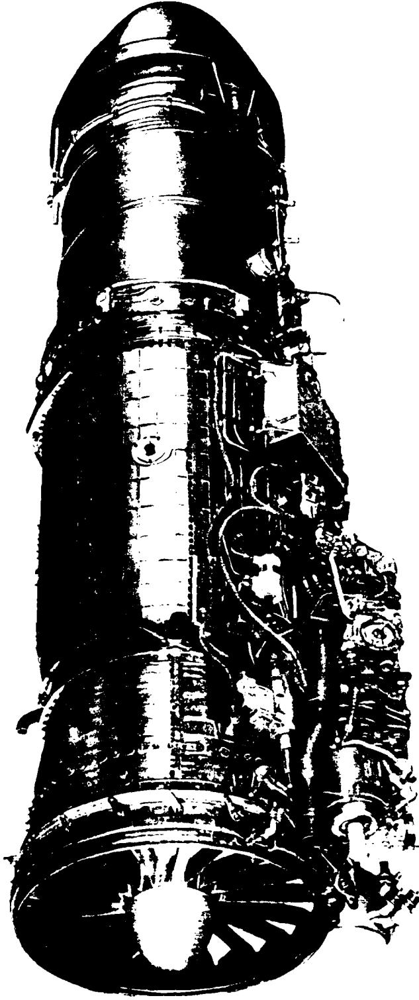

A high-contrast black-and-white photograph of a rocket engine, showing the turbomachinery section with a large fan at the base and the rocket nozzle at the top.

Photo: Rocket engine with turbomachinery and nozzle assembly.

|               |               |                |          |
|---------------|---------------|----------------|----------|
| ● Thrust      | 16,000 Lb     | ● Bypass Ratio | 0.34     |
| ● SFC Max A/B | 1.85 Lb/Hr/Lb | ● Weight       | 2,180 Lb |
| ● SFC IRP     | 0.81 Lb/Hr/Lb | ● Length       | 159 In.  |
| ● Airflow     | 142 Lb/Sec    | ● Diameter     | 35 In.   |

FIG. 1

{13}------------------------------------------------

### F404-GE-400 Engine

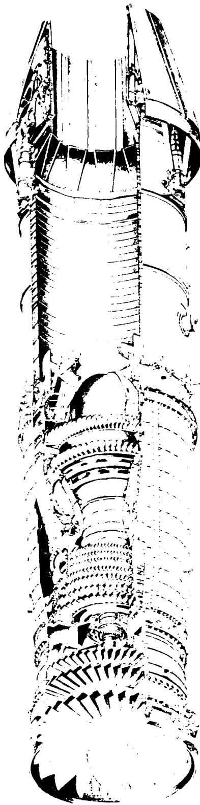

A black-and-white technical illustration showing a longitudinal cross-section of a vertical shaft with multiple stages of turbine or compressor blades and casings.

Illustration: Cross-sectional illustration of a multi-stage turbine or compressor rotor assembly.

FIG. 2

{14}------------------------------------------------

|                              | F404-GE-400 F404-GE 400 | TF30 P 3     |
|------------------------------|----------------------------|--------------|
| LENGTH, IN.                  | 159                        | 178 (+12%)   |
| DIAMETER, IN.                | 35                         | 38 (+9%)     |
| WEIGHT, LB.                  | 2180                       | 4100 (+88%)  |
| THRUST/WEIGHT                | 7.3                        | 4.9 (-67%)   |
| MASS FLOW, LB/SEC.           | 142                        | 240 (+69%)   |
| BY-PASS RATIO                | .34                        | 1.1          |
| PRESSURE RATIO               | 25                         | 17           |
| TURBINE INLET TEMPERATURE, C | 1390                       | 1270         |
| THRUST, MAX, A/B             | 16000                      | 20000 (+25%) |
| " , MAX. NON-A/B             | 10600                      | 10750 (+1%)  |
| SFC, MAX. A/B, LB/HR/LB.     | 1.84                       | 1.80 (-2%)   |
| " , MAX. NON-A/B "           | 0.78                       | 0.80 (+2%)   |
| FAN-STAGES                   | 3                          | 3            |
| PRESSURE RATIO               | 4.1                        | 2.0          |
| SPEED, RPM                   | 13270                      | 9500         |
| COMPRESSOR-STAGES            | 7                          | 6 + 7        |
| PRESSURE RATIO               | 6.0                        | 8.5          |
| SPEED, RPM                   | 16810                      | 9500, 14500  |

FIG. 3

{15}------------------------------------------------

|                               | F404-GE-400 | TFH-30      |
|-------------------------------|-------------|-------------|
| LENGTH, IN.                   | 159         | 159         |
| DIAMETER, IN.                 | 35          | 34 (-3%)    |
| WEIGHT, LB.                   | 2180        | 2908 (33%)  |
| THRUST/WEIGHT                 | 7.3         | 5.5         |
| MASS FLOW, LB/SEC.            | 142         | 191 (35%)   |
| BY-PASS RATIO                 | .34         | 1.1         |
| PRESSURE RATIO                | 25          | 17          |
| TURBINE INLET TEMPERATURE, c. | 1390        | 1270        |
| THRUST, MAX. A/B              | 16000       | 15900 (-1%) |
| " , MAX. NON-A/B              | 10600       | 8550 (-20%) |
| SFC, MAX. A/B, LB/HR/LB       | 1.84        | 1.80 (-2%)  |
| " , MAX. NON-A/B, "           | 0.78        | .80 (+2%)   |
|                            |             |             |
| FAN-STAGES                    | 3           | 3           |
| PRESSURE RATIO                | 4.1         | 2.0         |
| SPEED, RPM                    | 13270       | 10640       |
|                            |             |             |
| COMPRESSOR-STAGES             | 7           | 6 + 7       |
| PRESSURE RATIO                | 6.0         | 8.5         |
| SPEED, RPM                    | 16810       | 16240       |

FIG. 4

{16}------------------------------------------------

## HYPOTHETICAL PERFORMANCE OF F/A-18 WITH 2 x TFH30

(COMPARISON WITH F/A-18 WITH 2 x F404)

|                      |      |
|----------------------|------|
| THRUST/WEIGHT        | -25% |
| RANGE PERFORMANCE    | -6%  |
| DUE TO ENGINE WEIGHT | -4%  |
| DUE TO SFC           | -2%  |
| MAXIMUM MACH NUMBER  | -12% |

FIG. 5

{17}------------------------------------------------

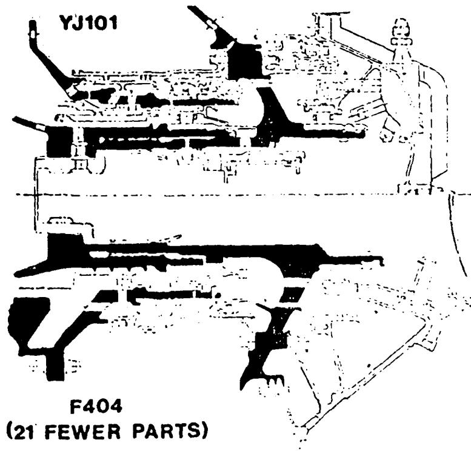

The image shows a technical illustration of a YJ101 engine, a complex multi-spool turbofan. Below it, a simplified version of the engine is shown, labeled F404, with the text '(21 FEWER PARTS)' indicating a reduction in complexity.

Technical illustration of a YJ101 engine and its F404 counterpart.

C-Sump Design Comparison

FIG. 6

{18}------------------------------------------------

### **Design/Development Emphasis**

- **Operational Suitability**      **Most Important**
- **Reliability**
- **Maintainability**
- **Cost**
- **Performance**
- **Weight**

FIG. 7

{19}------------------------------------------------

### F404-400 Reliability Features

### Disciplined Test-and-Fix Program During Development

**Durable Machined-Ring Combustor**

**State-of-the-Art  
Bearings and Seals**

**Advanced Turbine Blade Design**

**Durable Afterburner Liner**

**Bears and Seals**

**Durable Afterburner Liner**

**Full Inlet Anti-Icing**

**Lube and VEN Oil Filter Bypass Indicators**

**Self-Contained Lube System**

**Fuel Filter Bypass Indicators**

**Solid State Electrical Control**

**Flame Sensor to Prevent Hard Lights**

**Self-Contained VEN Hydraulic System**

A black and white photograph of a jet engine, shown from a side-on perspective. The engine is a long, cylindrical assembly with a pointed nose and a complex rear section. Several callout lines point to different parts of the engine, each with a label describing a specific feature or system.

- Corrosion Resistance
- Demonstrated Rotor Containment
- All Casings Pressure-Tested
- All Components Fire-Tested
- Overspeed/Overtemperature Protection

{20}------------------------------------------------

### Operation Compatibility

### F/A-18 Maneuvering Experience

- Mach .15-.4
- 35-40,000 Feet
- Aircraft No. 6
- Outstanding Inlet Compatibility

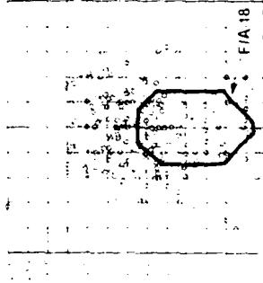

A large, hand-drawn hexagon is drawn over a section of the document, obscuring some text. The hexagon is roughly centered on the page.

### Spooldown Airstarts

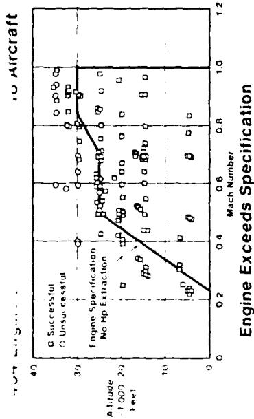

10 Aircraft  
Successful  
Unsuccessful  
Engine Specification  
No Hp Extraction  
Engine Exceeds Specification

x: Mach Number, 0.2 to 1.2; y: Altitude 1 000 feet, 0 to 40

| Mach Number | Engine Specification | No Hp Extraction |
|-------------|----------------------|------------------|
| 0.2         | ~38                  | ~38              |
| 0.4         | ~28                  | ~28              |
| 0.6         | ~18                  | ~18              |
| 0.8         | ~8                   | ~8               |
| 1.0         | ~0                   | ~0               |

A line chart showing altitude in thousands of feet decreasing as Mach number increases, with data points categorized as successful, unsuccessful, engine specification, and no hp extraction.

Line chart: Altitude test results versus Mach number for an aircraft engine.

### F/A-18/F404 Afterburner Operation Flight Test Experience

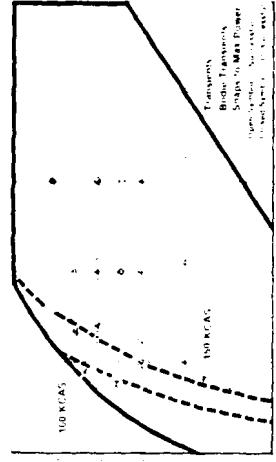

Transparency  
Bridge Transparency  
Slope to Max Power  
[illegible]  
100 KGAS  
100 KGAS  
100 KGAS

x: Bridge Transparency, Slope to Max Power; y: Transparency

| x  | Solid line | Dashed line |
|----|------------|-------------|
| ~0 | ~0.1       | ~0.1        |
| ~1 | ~0.2       | ~0.15       |
| ~2 | ~0.3       | ~0.2        |

A line plot showing two curves, one solid and one dashed, rising from the bottom left towards the top right, with scattered data points plotted across the area.

Line chart: Plot of transparency versus bridge transparency and slope to max power.

Successful A/B Lights Throughout Envelope

FIG. 9

{21}------------------------------------------------

### Rotor "Lead the Fleet" Plan

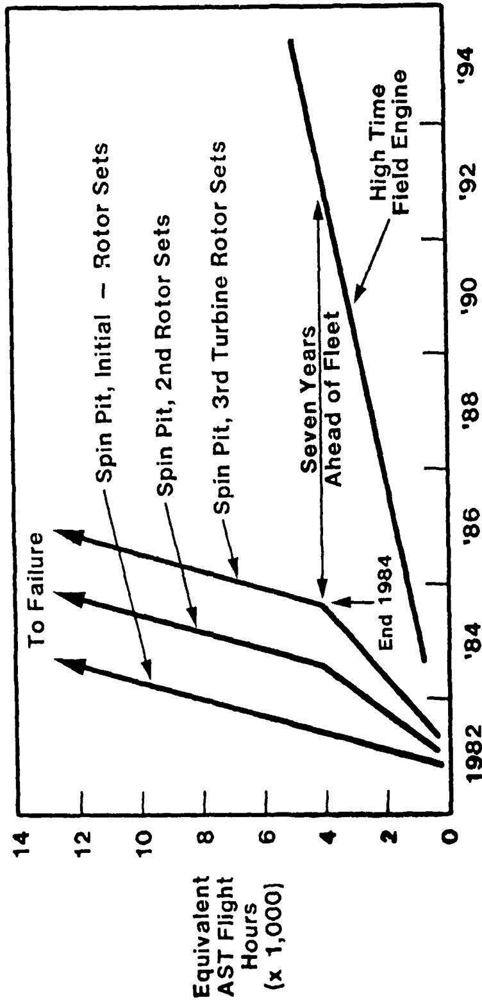

To Failure  
Spin Pit, Initial - Rotor Sets  
Spin Pit, 2nd Rotor Sets  
Spin Pit, 3rd Turbine Rotor Sets  
Seven Years  
Ahead of Fleet  
End 1984  
High Time  
Field Engine

x: Year, 1982 to '94; y: Equivalent AST Flight Hours (x 1,000), 0 to 14

| Year     | Spin Pit, Initial - Rotor Sets | Spin Pit, 2nd Rotor Sets | Spin Pit, 3rd Turbine Rotor Sets | High Time Field Engine |
|----------|--------------------------------|--------------------------|----------------------------------|------------------------|
| 1982     | ~13.0                          | ~10.0                    | ~7.0                             | ~0.0                   |
| End 1984 | ~4.0                           | ~4.0                     | ~4.0                             | ~0.0                   |
| '90      | ~0.0                           | ~0.0                     | ~0.0                             | ~0.0                   |
| '92      | ~0.0                           | ~0.0                     | ~0.0                             | ~0.0                   |
| '94      | ~0.0                           | ~0.0                     | ~0.0                             | ~0.0                   |

A line chart showing equivalent AST flight hours decreasing from 1982 to End 1984, where all rotor sets converge at 4,000 hours, followed by a steep drop to zero by 1985.

Line chart: Equivalent AST flight hours to failure for rotor sets over time.

FIG. 10

{22}------------------------------------------------

### Program Status

- **USN/USMC Operational Sites**
  - Lemoore NAS
  - Pt. Mugu NAS
  - China Lake NWC
  - El Toro MCAS
- **CAF Operational Site**
  - Cold Lake
- **Over 170,000 EFH**
- **Over 600 Production Engines Shipped**
- **High Time Engine 926 EFH**
- **Production Fleet Engine Average Age**
  - USN — 369 EFH
  - Canada — 179 EFH

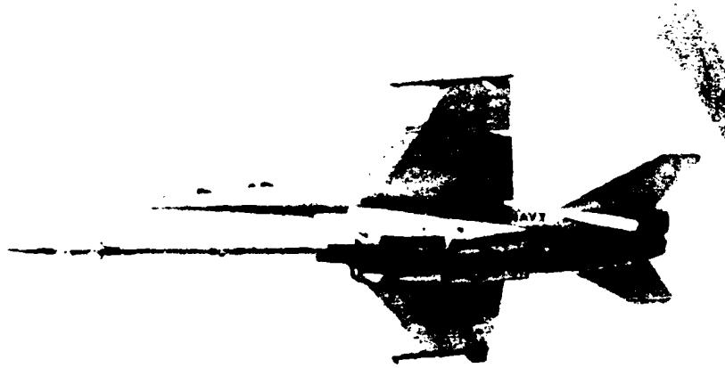

A high-contrast, black and white photograph of a naval fighter jet, likely an F-14, in flight. The aircraft is angled towards the left, and its tail code 'NAV' is visible on the rear fuselage.

FIG. 11

{23}------------------------------------------------

### **F404 Status**

- **Over 550 Engines Shipped Since December 1979**
  - 96 Percent First Run Acceptance Rate
- **Currently Tooled For 26/Month Rate**
- **Over 160,000 F/A-18 Engine Flight Hours**
- **Reliability . . . Better Than Goal**
  - 281 MTBF Versus 264 Goal At 24,000 Fleet Engine Flight Hours
- **No Trim Verified**
  - Engine Change
  - Module/Component Change

{24}------------------------------------------------

### F404 Production Plan

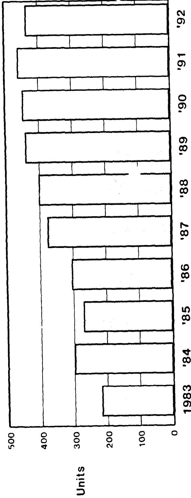

x: Year, 1983 to '92; y: Units, 0 to 500

| Year | Units |
|------|-------|
| 1983 | ~220  |
| '84  | ~300  |
| '85  | ~250  |
| '86  | ~300  |
| '87  | ~420  |
| '88  | ~400  |
| '89  | ~430  |
| '90  | ~430  |
| '91  | ~450  |
| '92  | ~430  |

A vertical bar chart showing the number of units from 1983 to 1992, with values fluctuating between 200 and 450.

Bar chart: Units by year from 1983 to 1992.

- Performance Margin — Thrust 3%  
— SFC 2%
- Weight Margin — 23 Lb
- Production Engine Cost (Constant Dollars)  
Reduced By 34% — 1981 To 1984

FIG. 13

{25}------------------------------------------------

## F404-GE-400

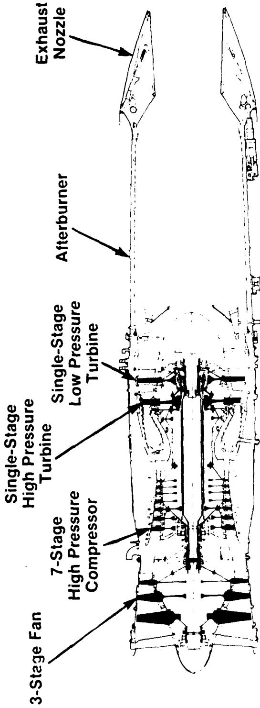

A detailed cross-sectional diagram of a jet engine. The components are labeled from left to right: **3-Stage Fan** at the front, followed by the **7-Stage High Pressure Compressor**, then the **Single-Stage High Pressure Turbine**, and the **Single-Stage Low Pressure Turbine**. The **Afterburner** section is shown in the middle, and the **Exhaust Nozzle** is at the rear. Arrows indicate the direction of airflow through the engine.

Technical illustration of a jet engine's internal components, showing the flow of air from the fan through the compressor, turbines, and out the nozzle.

- **142 lb/sec Airflow**
- **0.34 Bypass Ratio**
- **7.5 Thrust/Weight Ratio Class**

{26}------------------------------------------------

### The Fighter Turbofan With Turbojet Characteristics

A line drawing of the F404 engine casing. Arrows point from text labels to specific features: 'Exceptionally Stall-Free' to the front, 'Reliable Air Starts' to the middle, 'Inlet Distortion Tolerance' to the front edge, 'Superior Augmentor Light Capability And Stability' to the top, and 'No Smoke' to the rear.

**No Throttle Restrictions**  
**<4 Seconds Acceleration**  
**(Idle To IRP)**

- **High Thrust Without Afterburner**
  - **Supersonic Capability**
  - **Low Combat SFC**

{27}------------------------------------------------

### **Compressor**

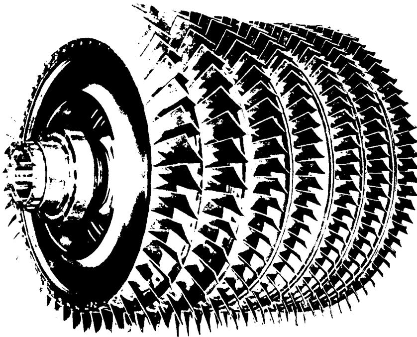

A high-contrast, black and white illustration of a turbine rotor. The rotor is shown from a side-on perspective, revealing a series of blades arranged in rows. The blades are depicted with sharp, angular edges, and the overall structure is complex, with multiple stages of blades visible. The illustration is rendered in a bold, graphic style, emphasizing the mechanical nature of the component.

Illustration of a turbine rotor with multiple rows of blades.

**Inertia Welded  
Pressure Ratio 6.3:1**

{28}------------------------------------------------

### Fan

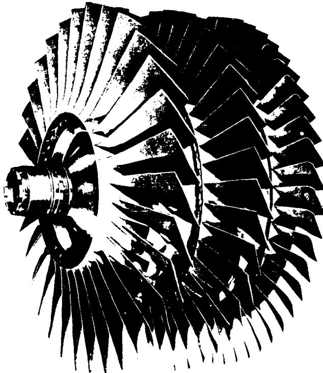

A high-contrast black-and-white image of a multi-bladed impeller or turbine wheel, showing the central hub and shaft on the left and the curved rows of blades extending outward.

Photo: High-contrast black and white photograph of a turbine or compressor impeller.

**Pressure Ratio 4:1**

FIG. 17

{29}------------------------------------------------

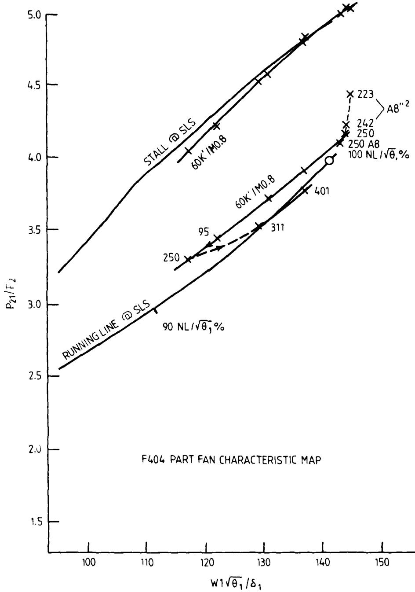

STALL @ SLS  
60K'/M0.8  
60K'/M0.8  
401  
95  
311  
250  
223  
242  
250  
250 A8  
100 NL/\sqrt{\theta},%  
RUNNING LINE @ SLS  
90 NL/\sqrt{\theta},%  
F404 PART FAN CHARACTERISTIC MAP

x: W1\sqrt{\theta\_1}/\delta\_1, 100 to 150; y: P\_{21}/F\_2, 1.5 to 5.0

| W1\sqrt{\theta_1}/\delta_1 | STALL @ SLS | 60K'/M0.8 | RUNNING LINE @ SLS |
|----------------------------|-------------|-----------|--------------------|
| 100                        | ~3.4        |           | ~2.7               |
| 110                        | ~3.9        |           | ~2.9               |
| 120                        | ~4.3        | ~4.2      | ~3.1               |
| 130                        | ~4.6        | ~4.5      | ~3.4               |
| 140                        | ~4.9        | ~4.8      | ~3.7               |

A fan characteristic map plotting P21/F2 against W1\*sqrt(theta1)/delta1, featuring stall and running line curves at SLS, along with performance points and efficiency contours.

Line chart: F404 part fan characteristic map showing P21/F2 versus W1\*sqrt(theta1)/delta1.

FIG. 18

{30}------------------------------------------------

### **Combustor**

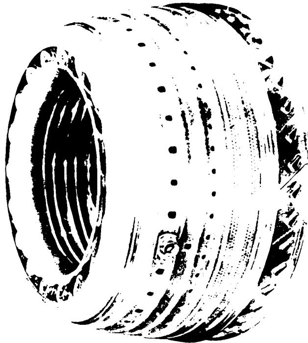

A high-contrast, binarized photograph showing a close-up perspective of a tire tread and sidewall, with the inner rim visible through the center.

Photo: High-contrast black and white photograph of a vehicle tire.

- **Machined Ring**
- **Low Pattern Factor**

FIG. 19

{31}------------------------------------------------

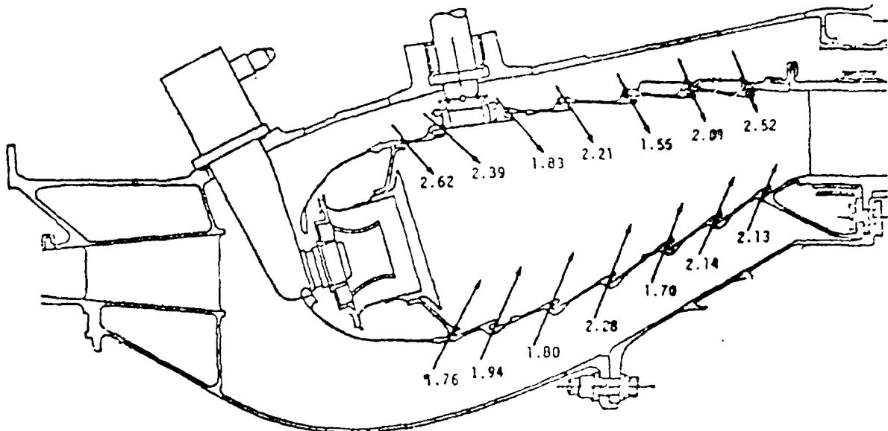

A technical line drawing of a ship's hull cross-section. Numerous points along the hull are marked with arrows and labeled with numerical values. The values are arranged in two main groups: an upper group along the top of the hull and a lower group along the bottom of the hull. The values are: 2.52, 2.09, 1.55, 2.21, 1.83, 2.39, 2.62, 2.13, 2.14, 1.70, 2.28, 1.80, 1.94, and 1.76.

Technical illustration of a ship's hull cross-section showing various measurement points with numerical values.

$W_3$  = LM/SEC

LINER SHELL COOLING FLOWS - %  $W_a$  3.0

QT CONFIGURATION

FIG. 20

{32}------------------------------------------------

![A high-contrast, black and white photograph of a large, complex industrial machine, likely a steam engine or a similar heavy-duty apparatus. The machine is oriented vertically in the frame. It features a large, dark, curved component, possibly a flywheel or a large valve, and a series of smaller, rectangular components arranged in a row. A long, dark pipe or rod runs along the left side of the machine. The background is dark and grainy, suggesting a photograph taken in a dimly lit industrial setting. The overall image has a vintage, high-contrast aesthetic.](images/ada164562/08dce7ad4c512fdf0c0cde60415fade6_img.jpg)

A high-contrast, black and white photograph of a large, complex industrial machine, likely a steam engine or a similar heavy-duty apparatus. The machine is oriented vertically in the frame. It features a large, dark, curved component, possibly a flywheel or a large valve, and a series of smaller, rectangular components arranged in a row. A long, dark pipe or rod runs along the left side of the machine. The background is dark and grainy, suggesting a photograph taken in a dimly lit industrial setting. The overall image has a vintage, high-contrast aesthetic.

## F4C4 AIRFLOW

|  |                                                |                    |
|--|------------------------------------------------|--------------------|
|  | COMBUSTION AND EXHAUST GASES                   | AIRFRAME BLEED AIR |
|  | BALANCE PIGION AIR                             |                    |
|  | HIGH PRESSURE MAIN AIRFLOW AND IMP COOLING AIR |                    |
|  | LOW PRESSURE MAIN AIR FLOW BYPASS AIR          |                    |
|  | COMPRESSOR HOTGIR COOLING AIR                  |                    |
|  | VALVE & COMPRESSOR CLEANS AIR                  |                    |
|  | AND JET LOADING AIR                            |                    |
|  | SEAL FAN AIR                                   |                    |

FIG. 21

{33}------------------------------------------------

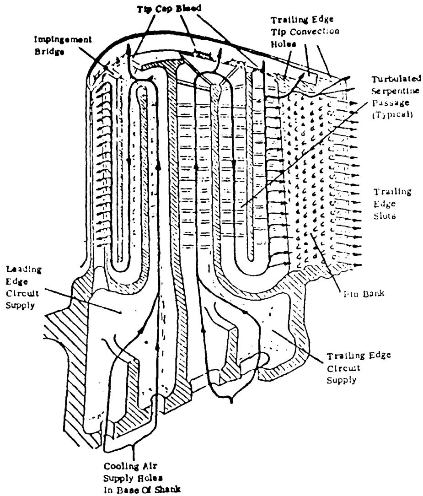

Tip Cap Blood  
Trailing Edge  
Tip Convection  
Holes  
Impingement  
Bridge  
Turbulated  
Serpentine  
Passage  
(Typical)  
Trailing  
Edge  
Slots  
Pin Bank  
Leading  
Edge  
Circuit  
Supply  
Trailing Edge  
Circuit  
Supply  
Cooling Air  
Supply Holes  
In Base Of Shank

A technical cross-section of a turbine blade airfoil, illustrating internal cooling air circuits, impingement bridge, serpentine passages, and trailing edge slots with flow direction arrows.

Technical illustration: Cross-sectional diagram of a turbine airfoil showing internal cooling passages and flow.

Cutaway Schematic of HPT Blade Cooling System

FIG. 22

{34}------------------------------------------------

### High Pressure Turbine

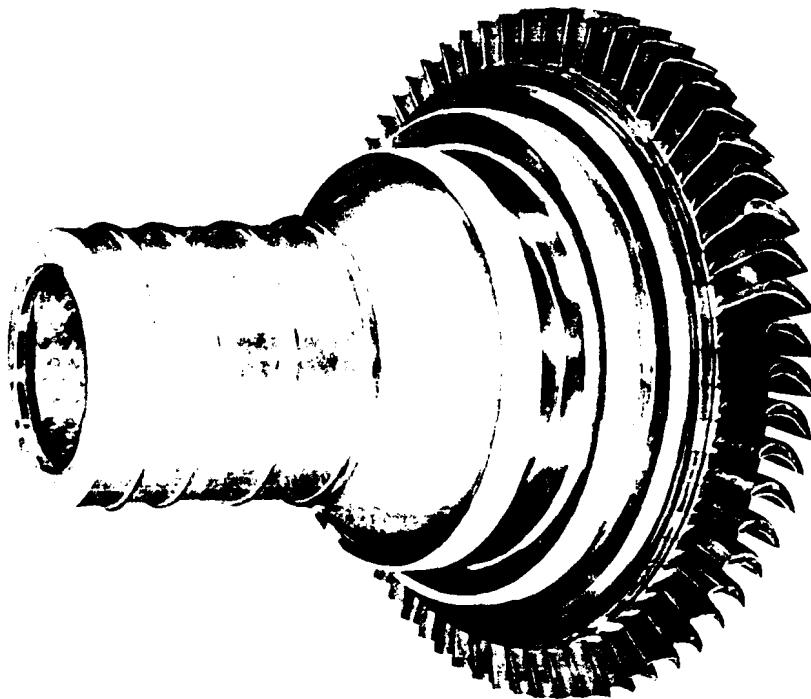

A high-contrast, black and white illustration of a large, metallic, bevel gear. The gear is shown from a side-on perspective, revealing its circular teeth and the central shaft it is mounted on. The illustration is rendered in a style that emphasizes the texture and form of the metal, with heavy black shading and white highlights. The gear is the sole focus of the image, with no other elements or text present.

Illustration of a large, metallic, bevel gear with a central shaft.

- **Single Stage**

FIG. 23

{35}------------------------------------------------

### Low Pressure Turbine

Illustration of a car tire tread pattern, showing a complex, multi-directional design with deep grooves and sipes.

- **Single Stage**

FIG. 24

{36}------------------------------------------------

### Typical Life/Temperature Characteristic

Life  
(Time at  
Maximum  
Temperature)

Metal Temperature

DSR80

Mono

R125

50° F

100° F

A graph showing three parallel, upward-sloping lines representing the life of different materials at maximum temperature versus metal temperature. The lines are labeled DSR80, Mono, and R125 from top to bottom. Arrows point to the lines at 50°F and 100°F, indicating the life at these temperatures.

**Hot Section Life is Sustained by Advancing Material Technology**

FIG. 25

{37}------------------------------------------------

### Afterburner

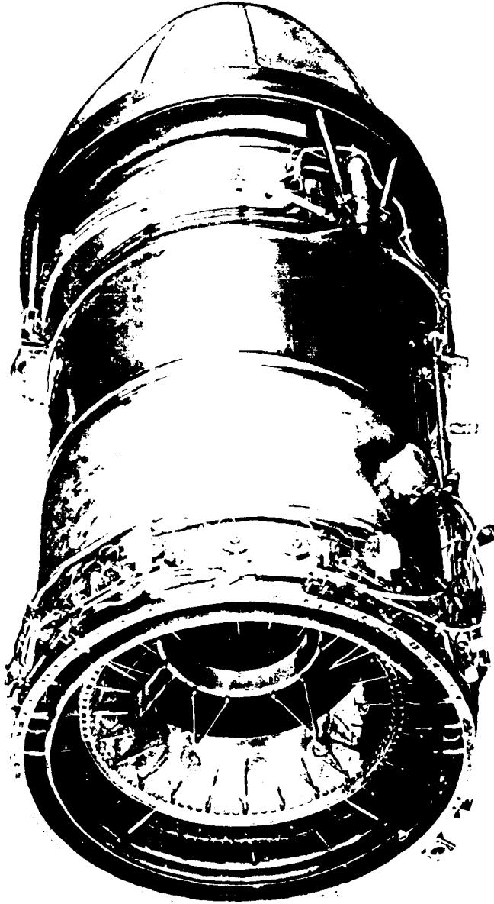

A high-contrast black-and-white photograph showing the front view of a jet engine, featuring the fan blades at the front, cylindrical body sections, and a rounded nose.

Photo: High-contrast black and white photograph of a jet engine.

- 2-Stage Mixed Flow
- Soft Light-Off

FIG. 26

{38}------------------------------------------------

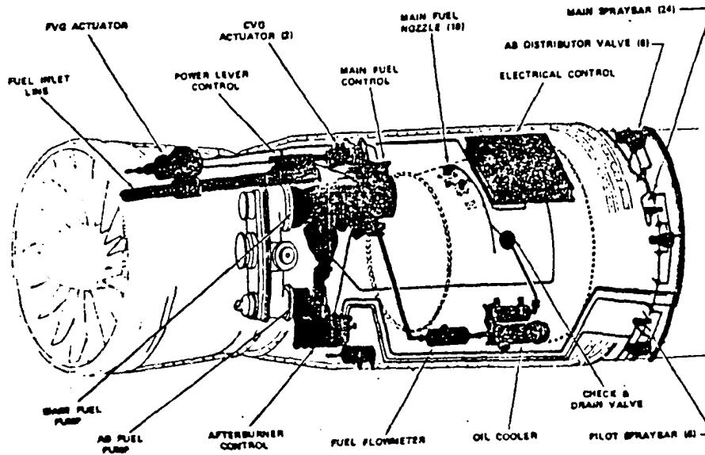

A detailed cross-sectional diagram of a jet engine, showing the internal components and their arrangement. The labels identify the following parts:

- FVG ACTUATOR
- CVG ACTUATOR (2)
- MAIN FUEL NOZZLE (10)
- MAIN SPRAYBAR (24)
- AB DISTRIBUTOR VALVE (8)
- ELECTRICAL CONTROL
- POWER LEVER CONTROL
- MAIN FUEL CONTROL
- FUEL INLET LINE
- CHECK & DRAIN VALVE
- BASE FUEL PUMP
- AFTERBURNER CONTROL
- FUEL FLOWMETER
- OIL COOLER
- PILOT SPRAYBAR (6)
- AB FUEL PUMP

Technical illustration of a jet engine's internal components with labels for various actuators, valves, and controls.

FUEL SYSTEM COMPONENTS

FIG. 27

{39}------------------------------------------------

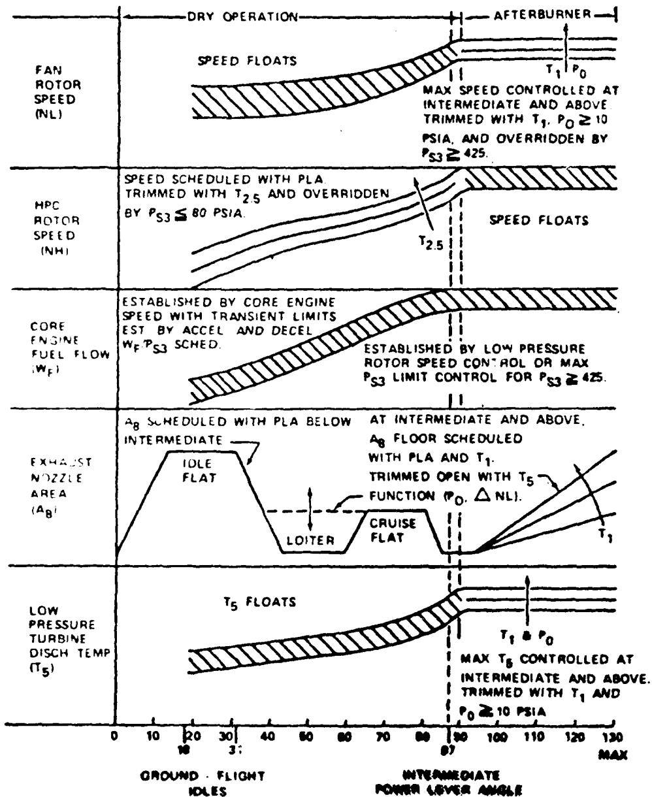

DRY OPERATION  
AFTERBURNER  
FAN  
ROTOR  
SPEED  
(NL)  
SPEED FLOATS  
T1 P0  
MAX SPEED CONTROLLED AT  
INTERMEDIATE AND ABOVE  
TRIMMED WITH T1, P0 ≥ 10  
PSIA, AND OVERRIDDEN BY  
PS3 ≥ 425.  
HPC  
ROTOR  
SPEED  
(NH)  
SPEED SCHEDULED WITH PLA  
TRIMMED WITH T2.5 AND OVERRIDDEN  
BY PS3 ≤ 80 PSIA.  
SPEED FLOATS  
T2.5  
CORE  
ENGINE  
FUEL FLOW  
(WF)  
ESTABLISHED BY CORE ENGINE  
SPEED WITH TRANSIENT LIMITS  
EST BY ACCEL AND DECEL  
WF'PS3 SCHED.  
ESTABLISHED BY LOW PRESSURE  
ROTOR SPEED CONTROL OR MAX  
PS3 LIMIT CONTROL FOR PS3 ≥ 425.  
EXHAUST  
NOZZLE  
AREA  
(AB)  
AB SCHEDULED WITH PLA BELOW  
INTERMEDIATE  
IDLE  
FLAT  
AT INTERMEDIATE AND ABOVE,  
AB FLOOR SCHEDULED  
WITH PLA AND T1.  
TRIMMED OPEN WITH T5  
FUNCTION (P0, Δ NL).  
LOITER  
CRUISE  
FLAT  
T1  
LOW  
PRESSURE  
TURBINE  
DISCH TEMP  
(T5)  
T5 FLOATS  
T1 & P0  
MAX T5 CONTROLLED AT  
INTERMEDIATE AND ABOVE.  
TRIMMED WITH T1 AND  
P0 ≥ 10 PSIA  
0 10 20 30 40 50 60 70 80 90 100 110 120 130  
18 31  
GROUND - FLIGHT  
IDLES  
INTERMEDIATE  
POWER LEVER ANGLE  
MAX

A multi-row technical diagram illustrating the control schedules of fan rotor speed, HPC rotor speed, core engine fuel flow, exhaust nozzle area, and low pressure turbine discharge temperature across ground-idle, flight-idle, and intermediate power lever angles.

Technical illustration: Control schedules for fan, HPC, core engine, nozzle area, and low pressure turbine.

## CONTROL OPERATING MODES

FIG. 28

{40}------------------------------------------------

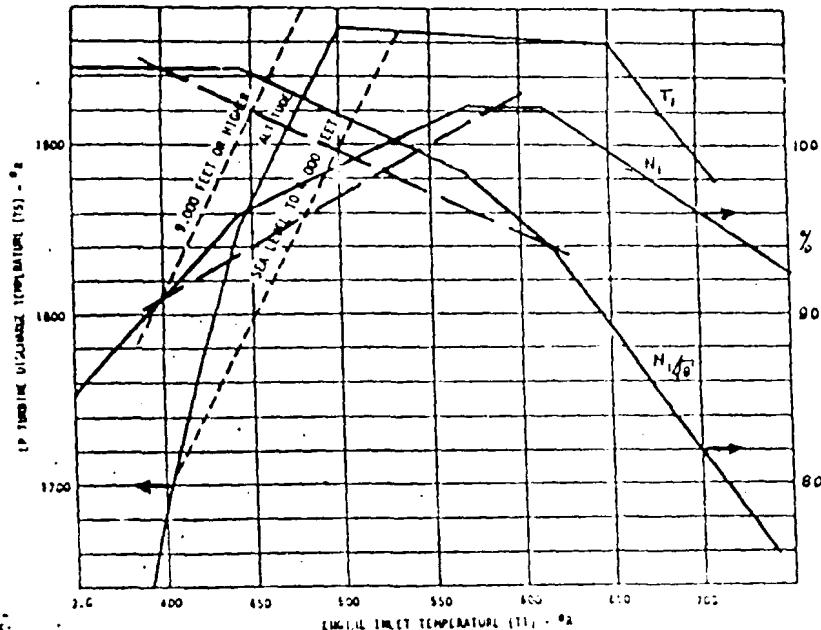

9,000 FEET OR HIGHER  
ALTITUDE  
SEA LEVEL TO 9,000 FEET  
T\_1  
N\_1  
N\_1\sqrt{\theta}

x: ENGINE INLET TEMPERATURE (T\_{I\_1} - ^\circ R), 2.0 to 700; y: CP THERM. DISCHARGE TEMPERATURE (T\_2) - ^\circ R, 1700 to 1900; y2: %, 80 to 100

| ENGINE INLET TEMPERATURE (T_{I_1} - ^\circ R) | T_1   | N_1   | N_1\sqrt{\theta} |
|-----------------------------------------------|-------|-------|------------------|
| ~300                                          | ~1900 | ~1750 | ~1750            |
| 400                                           | ~1900 | ~1810 | ~1700            |
| 450                                           | ~1900 | ~1860 | ~1810            |
| 500                                           | ~1900 | ~1890 | ~1890            |
| 550                                           | ~1900 | ~1910 | ~1860            |
| 600                                           | ~1900 | ~1890 | ~1810            |
| 610                                           | ~1890 | ~1870 | ~1790            |
| 700                                           | ~1860 | ~1830 | ~1720            |

A multi-curve line chart plotting engine discharge temperature, rotational speed, and corrected speed against engine inlet temperature, with dashed lines indicating altitude ranges.

Line chart: Engine performance curves showing discharge temperature, altitude, and thrust versus inlet temperature.

## NOTES:

- (1) Between 4,000 and 9,000 feet (Pressure Altitude),  $T_5$  is determined by linear interpolation between dash lines up to the solid line.
- (2) Exact values at any condition  $T_1$  can be obtained from the specification computer
- (3) Turbine discharge temperature is reset as a function of core engine fuel flow

FIG. 29

{41}------------------------------------------------

## F404 Structures

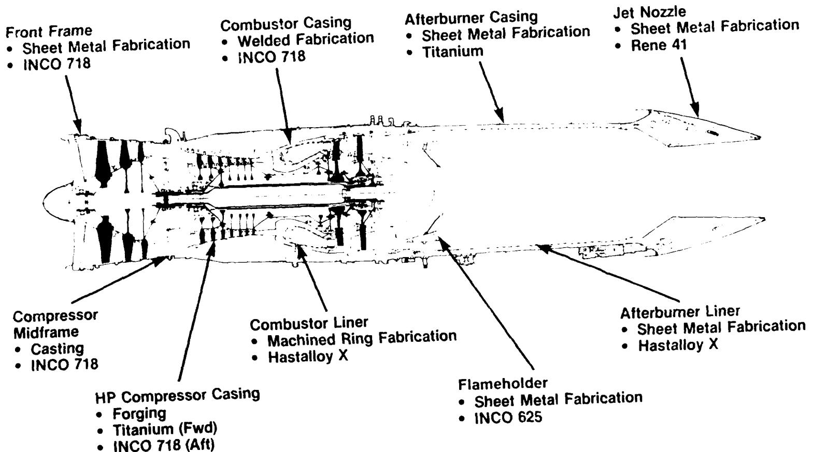

The diagram is a cross-sectional illustration of a jet engine, showing the internal components and the materials used in their fabrication. The labels and their descriptions are as follows:

- Front Frame**
  - Sheet Metal Fabrication
  - INCO 718
- Combustor Casing**
  - Welded Fabrication
  - INCO 718
- Afterburner Casing**
  - Sheet Metal Fabrication
  - Titanium
- Jet Nozzle**
  - Sheet Metal Fabrication
  - Rene 41
- Compressor Midframe**
  - Casting
  - INCO 718
- Combustor Liner**
  - Machined Ring Fabrication
  - Hastalloy X
- Afterburner Liner**
  - Sheet Metal Fabrication
  - Hastalloy X
- HP Compressor Casing**
  - Forging
  - Titanium (Fwd)
  - INCO 718 (Aft)
- Flameholder**
  - Sheet Metal Fabrication
  - INCO 625

Technical illustration of a jet engine with labels for various components and their fabrication methods.

FIG. 30

{42}------------------------------------------------

### F404 Turbomachinery

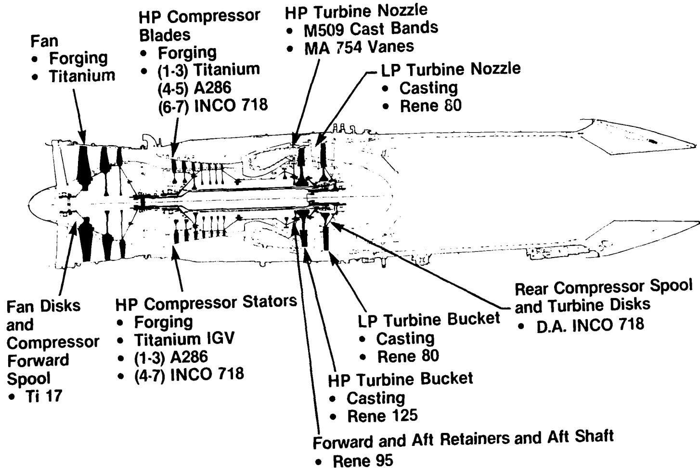

The diagram is a cross-sectional view of a jet engine. It shows the internal components from the front (left) to the rear (right). Labels with arrows point to specific parts:

- Fan:**
  - Forging
  - Titanium
- HP Compressor Blades:**
  - Forging
  - (1-3) Titanium
  - (4-5) A286
  - (6-7) INCO 718
- HP Turbine Nozzle:**
  - M509 Cast Bands
  - MA 754 Vanes
- LP Turbine Nozzle:**
  - Casting
  - Rene 80
- Fan Disks and Compressor Forward Spool:**
  - Ti 17
- HP Compressor Stators:**
  - Forging
  - Titanium IGV
  - (1-3) A286
  - (4-7) INCO 718
- LP Turbine Bucket:**
  - Casting
  - Rene 80
- HP Turbine Bucket:**
  - Casting
  - Rene 125
- Rear Compressor Spool and Turbine Disks:**
  - D.A. INCO 718
- Forward and Aft Retainers and Aft Shaft:**
  - Rene 95

Technical illustration of a jet engine cross-section with labels for various components and their materials.

FIG. 31

{43}------------------------------------------------

### Excellent Operability

### - **A Turbofan with Turbojet Characteristics**

- **High Combat Thrust without Lighting the Afterburner**
  - Saves Fuel — Longer Mission Capability
- **Stall-Free Operation Throughout Flight Envelope**
  - Rocket/Gun Firings
  - Extreme Aircraft Maneuvers
  - Outstanding Inlet Compatibility
- **Unrestricted Throttle Movements Throughout Flight Envelope**
- **Rapid Acceleration/Deceleration**

### --- A Fighter Pilot's Engine

FIG. 32

{44}------------------------------------------------

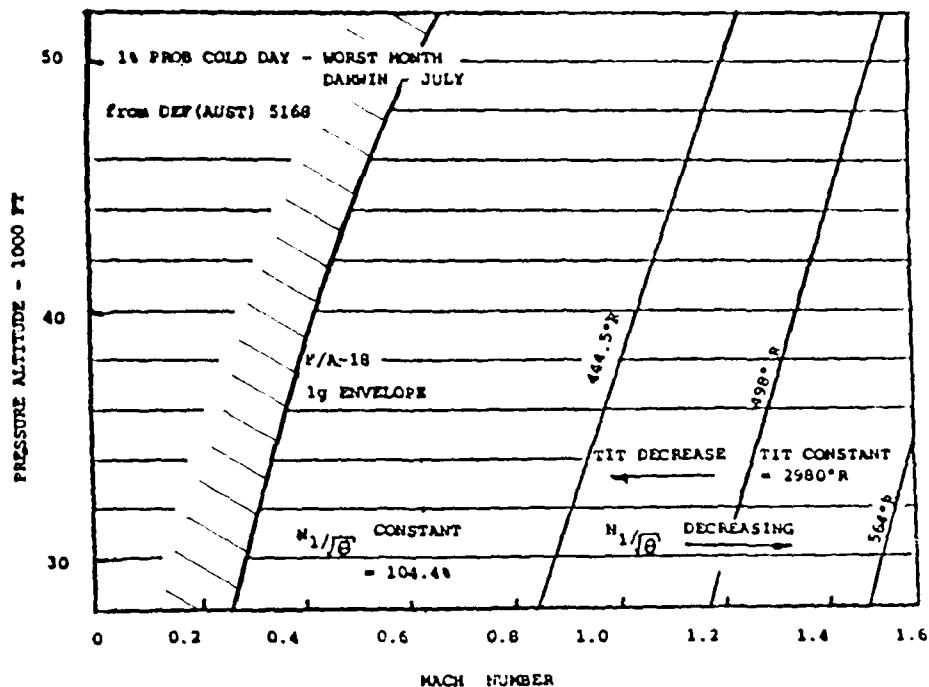

1% PROB COLD DAY - WORST MONTH  
DAKWIN JULY  
from DEF(AUST) 5168  
F/A-18  
1g ENVELOPE  
444.5°R  
498°R  
564°R  
TIT DECREASE  
TIT CONSTANT  
= 2980°R  
CONSTANT  
 $N_1/\sqrt{\theta}$   
= 104.4%  
 $N_1/\sqrt{\theta}$   
DECREASING

x: MACH NUMBER, 0 to 1.6; y: PRESSURE ALTITUDE - 1000 FT, 30 to 50

| MACH NUMBER | 1g ENVELOPE Lower Limit | 1g ENVELOPE Upper Limit |
|-------------|-------------------------|-------------------------|
| 0.2         | ~28                     | ~28                     |
| 0.4         | ~32                     | ~32                     |
| 0.6         | ~36                     | ~36                     |
| 0.8         | ~40                     | ~40                     |
| 1.0         | ~44                     | ~44                     |
| 1.2         | ~48                     | ~48                     |
| 1.4         | ~52                     | ~52                     |

A line chart showing the 1g envelope boundaries of pressure altitude versus Mach number, with constant and decreasing  $N_1/\sqrt{\theta}$  limits and temperature limits.

Line chart: Pressure altitude versus Mach number envelope for F/A-18.

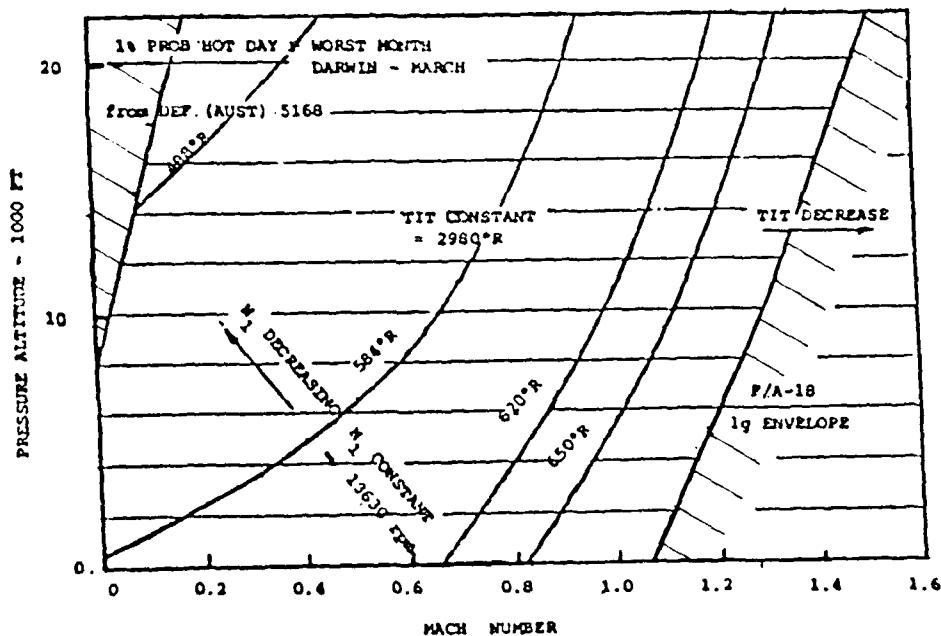

1% PROB HOT DAY & WORST MONTH  
DARWIN - MARCH  
from DEP. (AUST) 5168  
1000°R  
TIT CONSTANT  
= 2980°R  
TIT DECREASE  
M1 DECREASING  
584°R  
620°R  
F/A-18  
1g ENVELOPE  
M1 CONSTANT  
23630 FT  
650°R

x: MACH NUMBER, 0 to 1.6; y: PRESSURE ALTITUDE - 1000 FT, 0. to 20

| MACH NUMBER | 1g ENVELOPE Lower Boundary | 1g ENVELOPE Upper Boundary |
|-------------|----------------------------|----------------------------|
| ~0.2        | ~0.                        | ~14.5                      |
| ~0.4        | ~3.5                       | ~20.                       |
| ~0.6        | ~6.5                       | ~20.                       |
| ~0.8        | ~9.5                       | ~20.                       |
| ~1.0        | ~12.5                      | ~20.                       |
| ~1.2        | ~15.5                      | ~20.                       |
| ~1.4        | ~18.5                      | ~20.                       |

A line chart showing the 1g envelope boundaries of pressure altitude against Mach number, with constant TIT and decreasing M1 curves, and a hatched region above the upper envelope.

Line chart: Pressure altitude versus Mach number envelope for F/A-18.

FIG. 33

{45}------------------------------------------------

## **"On-Condition" — Definition**

"On-Condition" is directed at a **specific** unit (e.g., engine S/N XXX) in order to determine the "health" of **that** unit. The philosophy of On-Condition is to allow the life of a unit to be determined by the condition of the unit in comparison with a pre-determined standard, instead of some arbitrary hour limitation. It is "before-the-fact" maintenance.

{46}------------------------------------------------

## I E C M S IN-FLIGHT ENGINE CONDITION MONITORING SYSTEM

### RECORDS FOR POST-FLIGHT ANALYSIS

- LIFE USAGE INDICATORS
- MALFUNCTION INDICATORS
- PRE-POST EVENT RECORD
- PERFORMANCE TREND RECORD

+

- FLIGHT INCIDENT RECORD

{47}------------------------------------------------

A line drawing of a ship's deck and superstructure. Several vertical arrows point to specific locations on the ship, each labeled with a time. The times are 05:30, 11:30, 12:00, 02:30, 05:00, 07:00, 09:30, 06:00, and 06:00. The 12:00, 02:30, 05:00, 07:00, and 09:30 times are grouped together at the top right.

CLOCK POSITIONS,  
AFT LOOKING FORWARD

### BORESCOPE PORT LOCATION

FIG. 26

{48}------------------------------------------------

![Technical illustration of a complex mechanical assembly, likely a marine or industrial engine, with various components labeled. The labels include 'ACCESSORY GEARBOX AFT CHIP DETECTOR', 'A' SUMP CHIP DETECTOR, 'B' SUMP CHIP DETECTOR, 'C' SUMP SCAVENGE CHIP DETECTOR, 'C' SUMP GRAVITY DRAIN CHIP DETECTOR, 'NOAP SAMPLE FITTING', 'OIL TANK CHIP DETECTOR', and 'ACCESSORY GEARBOX FWD. CHIP DETECTOR'. The illustration shows a detailed view of the engine's internal components, including gears, shafts, and fluid lines.](images/ada164562/12c19090355e19922e23044633b9d1ea_img.jpg)

ACCESSORY GEARBOX  
AFT CHIP DETECTOR

"A" SUMP  
CHIP DETECTOR

"B" SUMP  
CHIP DETECTOR

"C" SUMP SCAVENGE  
CHIP DETECTOR

"C" SUMP GRAVITY  
DRAIN CHIP DETECTOR

NOAP  
SAMPLE FITTING

OIL TANK  
CHIP DETECTOR

ACCESSORY GEARBOX  
FWD. CHIP DETECTOR

Technical illustration of a complex mechanical assembly, likely a marine or industrial engine, with various components labeled. The labels include 'ACCESSORY GEARBOX AFT CHIP DETECTOR', 'A' SUMP CHIP DETECTOR, 'B' SUMP CHIP DETECTOR, 'C' SUMP SCAVENGE CHIP DETECTOR, 'C' SUMP GRAVITY DRAIN CHIP DETECTOR, 'NOAP SAMPLE FITTING', 'OIL TANK CHIP DETECTOR', and 'ACCESSORY GEARBOX FWD. CHIP DETECTOR'. The illustration shows a detailed view of the engine's internal components, including gears, shafts, and fluid lines.

CHIP DETECTOR LOCATIONS

FIG. 37

{49}------------------------------------------------

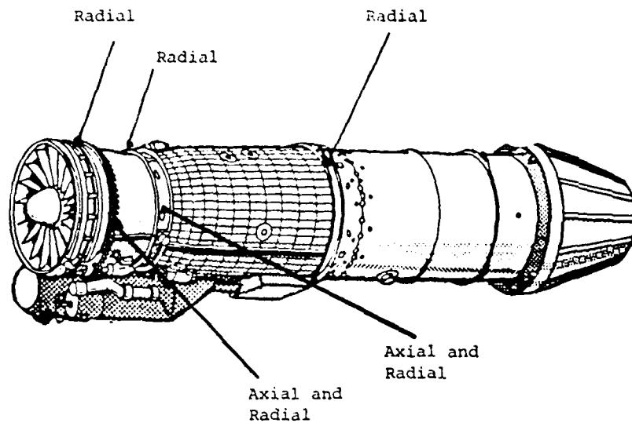

A detailed line drawing of a jet engine, showing the fan, compressor, and turbine sections. Five labels with leader lines point to different parts of the engine:

- "Radial" points to the front fan hub.
- "Radial" points to the front compressor casing.
- "Radial" points to the mid-section of the engine.
- "Axial and Radial" points to the rear turbine casing.
- "Axial and Radial" points to the exhaust nozzle.

The labels indicate the primary stress directions (radial and axial) at various locations within the engine structure.

Technical illustration of a jet engine with labels indicating stress directions.

NOTE : ECMS and a  
Mount-ring accelerometer  
are on the starboard  
side.

F - 404 ENGINE : ACCELEROMETER LOCATIONS ( ARL TEST )

{50}------------------------------------------------

### Advantages Of Modular Program

- **Improved Aircraft Readiness Rate**
  - Reduced Shop Turnaround Time
  - No Aircraft "Open Hole" During Module Repair Cycle
- **Reduced Spare Engine Requirements**
  - Module Procurement Substitutes For Engine Procurement
  - Reduced Engine Pipelines
- **Ratio Of Modules Optimized**
  - Module Levels Procured Can Conform To Reliability Achieved For Each Module (MTBR)

{51}------------------------------------------------

### F404 Engine Modules

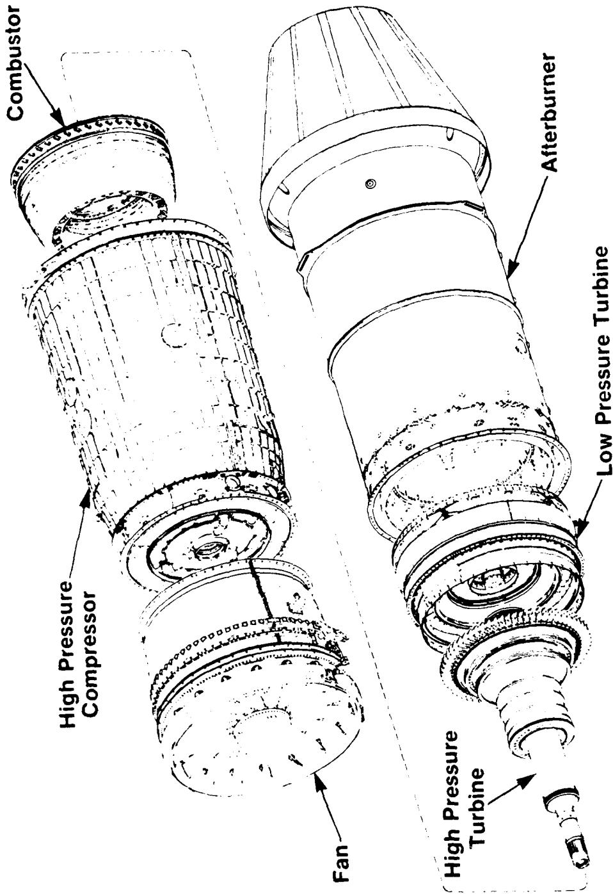

A technical line drawing of a jet engine, showing its main components. The components are labeled with arrows pointing to them:

- Combustor**: Located at the top of the left section.
- High Pressure Compressor**: The main cylindrical section of the left part.
- Fan**: The bottom section of the left part, which is the largest in diameter.
- Afterburner**: The top section of the right part.
- Low Pressure Turbine**: The section below the afterburner on the right.
- High Pressure Turbine**: The bottom section of the right part, which is the smallest in diameter.

Technical illustration of a jet engine's components, showing the High Pressure Compressor, Combustor, Fan, Afterburner, Low Pressure Turbine, and High Pressure Turbine.

FIG. 40

{52}------------------------------------------------

# DISTRIBUTION LIST

## AUSTRALIA

## DEPARTMENT OF DEFENCE

### Defence Central

|                                                         |          |
|---------------------------------------------------------|----------|
| Chief Defence Scientist                                 | )        |
| Deputy Chief Defence Scientist                          | )        |
| Superintendent, Science and Program                     | ) 1 copy |
| Administration                                          | )        |
| Controller, External Relations,                         | )        |
| Projects & Analytical Studies                           | )        |
| Defence Science Adviser (UK) (Doc Data sheet only)      |          |
| Counsellor, Defence Science (USA) (Doc Data sheet only) |          |
| Defence Science Representative (Bangkok)                |          |
| Defence Central Library                                 |          |
| Document Exchange Centre, DISB (18 copies)              |          |
| Joint Intelligence Organisation                         |          |
| Librarian H Block, Victoria Barracks, Melbourne         |          |

### Aeronautical Research Laboratories

Director  
Library  
Superintendent - Aero Propulsion  
Divisional File - Aero Propulsion  
Author: D. Frith

### Materials Research Laboratories

Director/Library

#### Defence Research Centre

Library

#### Navy Office

Navy Scientific Adviser  
RAN Aircraft Maintenance and Flight Trials Unit  
Directorate of Naval Aircraft Engineering  
Directorate of Naval Aviation Policy  
Superintendent, Aircraft Maintenance and Repair

#### Army Office

Scientific Adviser - Army  
Engineering Development Establishment, Library  
Royal Military College Library

{53}------------------------------------------------

#### Air Force Office

Air Force Scientific Adviser  
Aircraft Research and Development Unit  
Scientific Flight Group  
Library  
Technical Division Library  
Director General Tactical Fighter Project Office  
Director General Aircraft Engineering - Air Force  
Director General Operational Requirements - Air Force  
HQ Operational Command (SMAINTSO)  
HQ RAAF Base Williamtown (3 copies)  
HQ Support Command (SLENGO)  
RAAF Academy, Point Cook

#### Central Studies Establishment

Information Centre

#### Government Aircraft Factories

Manager  
Library

## **DEPARTMENT OF AVIATION**

Library  
Flight Standards Division

## **INDUSTRY**

Trans-Australia Airlines, Library  
Qantas Airways Limited  
Ansett Airlines of Australia, Library  
Commonwealth Aircraft Corporation, Library  
Hawker de Havilland Aust. Pty Ltd, Bankstown, Library  
Rolls Royce of Australia Pty Ltd, Mr C.G.A. Bailey

### **UNIVERSITIES AND COLLEGES**

|           |                                                           |
|-----------|-----------------------------------------------------------|
| Adelaide  | Barr Smith Library Professor of Mechanical Engineering |
| Flinders  | Library                                                   |
| La Trobe  | Library                                                   |
| Melbourne | Engineering Library                                       |
| Monash    | Hargrave Library                                          |
| Newcastle | Library                                                   |
| Sydney    | Engineering Library                                       |

{54}------------------------------------------------

NSW

Physical Sciences Library  
Professor R.A.A. Bryant  
Mechanical Engineering

Queensland

Library

Tasmania

Engineering Library

Western Australia

Library  
Associate Professor, J.A. Cole,  
Mechanical Engineering

RMIT

Library

SPARES (10 copies)  
TOTAL (90 copies)

{55}------------------------------------------------

# DOCUMENT CONTROL DATA

|                                                                                                                                                                                                                                                                                                                                                                       |                                               |                                                                                     |                                     |
|-----------------------------------------------------------------------------------------------------------------------------------------------------------------------------------------------------------------------------------------------------------------------------------------------------------------------------------------------------------------------|-----------------------------------------------|-------------------------------------------------------------------------------------|-------------------------------------|
| 1 a. AH No AR-004-033                                                                                                                                                                                                                                                                                                                                              | 1 b. Establishment No ARL-AERO-PROP-TM-423 | 2 Document Date JULY 1985                                                        | 3 Task No AIR 82/46              |
| 4. Title THE GENERAL ELECTRIC F404 - ENGINE OF THE RAAF'S NEW FIGHTER                                                                                                                                                                                                                                                                                           |                                               | 5 Security a. document: UNCLASSIFIED b. title c. abstract: U U          | 6. No Pages 9 7. No Refs - |
| 8. Author(s) D.A. FRITH                                                                                                                                                                                                                                                                                                                                            |                                               | 9. Downgrading Instructions -                                                    |                                     |
| 10. Corporate Author and Address  Aeronautical Research Laboratories P.O. Box 4331, Melbourne, Vic 3000                                                                                                                                                                                                                                                   |                                               | 11. Authority (as appropriate) a. Sponsor b. Security c. Downgrading d. Approval |                                     |
| 12. Secondary Distribution (of this document) Approved for Public Release                                                                                                                                                                                                                                                                                          |                                               |                                                                                     |                                     |
| Overseas enquirers outside stated limitations should be referred through ASDIS, Defence Information Services Branch, Department of Defence, Campbell Park, CANBERRA ACT 2601                                                                                                                                                                                          |                                               |                                                                                     |                                     |
| 13. a. This document may be ANNOUNCED in catalogues and awareness services available to ... No limitations                                                                                                                                                                                                                                                         |                                               |                                                                                     |                                     |
| 13. b. Citation for other purposes (ie casual announcement) may be (select) unrestricted/or) as for 13 a.                                                                                                                                                                                                                                                             |                                               |                                                                                     |                                     |
| 14. Descriptors Turbofan engines F404-GE-400 engine F/A-18 aircraft                                                                                                                                                                                                                                                                                          |                                               | 15. COSATI Group 21050                                                           |                                     |
| 16. Abstract The F404 engine in the F/A-18 is representative of a new generation of military turbofan engines. The features of the engine that govern its performance and contribute to its maintainability are discussed. The intention is to give the non-specialist an appreciation of those factors materially affecting the operation of this type of engine. |                                               |                                                                                     |                                     |
| <b>16. Abstract (Contd)</b>                                                                                                                                                                                                                                                                                                                                           |                                               |                                                                                     |                                     |
| <b>17. Imprint</b>  Aeronautical Research Laboratories, Melbourne.                                                                                                                                                                                                                                                                                              |                                               |                                                                                     |                                     |
| <b>18. Document Series and Number</b>  Aero Propulsion Technical Memorandum 426                                                                                                                                                                                                                                                                                 | <b>19. Cost Code</b>  47 1865           | <b>20. Type of Report and Period Covered</b>                                        |                                     |
| <b>21. Computer Programs Used</b>                                                                                                                                                                                                                                                                                                                                     |                                               |                                                                                     |                                     |
| <b>22. Establishment File Ref(s)</b>                                                                                                                                                                                                                                                                                                                                  |                                               |                                                                                     |                                     |

{56}------------------------------------------------

This page is to be used to record information which is required by the Establishment for its own use but which will not be added to the DISTIS data base unless specifically requested.

{57}------------------------------------------------

**END**

**FILMED**

4-86

**DTIC**

---

## Related documents

- [[Powel 1990 - On the Leading Edge, Combining Maturity and Advanced Technology on the F404 Turbofan Engine|Powel 1990]] - GE overview of F404 design and growth
- [[Exhaust-Gas P & T Survey of F404-GE-400 engine|Exhaust-Gas]] - NASA F404-GE-400 exhaust survey
- [[NASA TP 3001 - Evaluation of Various Thrust Calibration Techniques on an F404 Engine (April 1990)|NASA TP 3001]] - NASA F404 thrust calculation methods
