{0}------------------------------------------------

# --- **Exhaust-Gas Pressure and Temperature Survey of F404-GE-400 Turbofan Engine** ---

James T. Walton and Frank W. Burcham, Jr.

---

(NASA-TH-88273) EXHAUST-GAS PRESSURE AND  
TEMPERATURE SURVEY OF F404-GE-400 TURBOFAN  
ENGINE (NASA) 32 p CSCL 21E

N88-20307

Unclas  
G3/07 0136191

December 1986

NASA

A black-and-white graphic displaying the word NASA in a bold, stylized, sans-serif font.

Logo: NASA logo in bold stylized lettering.

National Aeronautics and  
Space Administration

{1}------------------------------------------------

# --- **Exhaust-Gas Pressure and Temperature Survey of F404-GE-400 Turbofan Engine** ---

James T. Walton and Frank W. Burcham, Jr.  
Ames Research Center, Dryden Flight Research Facility, Edwards, California

1986

NASA

A black-and-white graphic displaying the stylized, bold, sans-serif text 'NASA' in all capital letters.

Logo: NASA wordmark logo.

National Aeronautics and  
Space Administration

**Ames Research Center**

Dryden Flight Research Facility  
Edwards, California 93523-5000

{2}------------------------------------------------

## SUMMARY

An exhaust-gas pressure and temperature survey of the General Electric F404-GE-400 turbofan engine was conducted in the altitude test facility of the NASA Lewis Propulsion System Laboratory. Traversals by a survey rake were made across the exhaust-nozzle exit to measure the pitot pressure and total temperature. Tests were performed at Mach 0.87 and a 24,000-ft altitude and at Mach 0.30 and a 30,000-ft altitude with various power settings from intermediate to maximum afterburning. Data yielded smooth pressure and temperature profiles with maximum jet pressures approximately 1.4 in. inside the nozzle edge and maximum jet temperatures from 1 to 3 in. inside the edge. A low-pressure region located exactly at engine center was noted. The maximum temperature encountered was 3800°R.

## INTRODUCTION

The pressure and the temperature in a jet engine exhaust are important factors in the design of a thrust-vectoring engine nozzle. In particular, the flow gradient, the pressure, and the temperature near the edge of the exhaust jet determine the design criteria needed for nozzle flaps or thrust-deflecting vanes because the nozzle additions reside in this region. A thrust-deflecting vane system is being considered for use in the NASA F-18 flight research program.

To develop a data base for the conceptual design of thrust-deflecting vanes and vectoring nozzles, a test program was conducted by NASA Lewis Research Center and the Dryden Flight Research Facility of NASA Ames Research Center. The test was conducted on a General Electric F404-GE-400 afterburning turbofan engine in the NASA Lewis Propulsion System Laboratory (PSL). (The F404-GE-400 engine is being used in such aircraft as the F-18, F-20, and X-29A. The particular engine tested was also calibrated in the PSL for thrust and airflow for the X-29A program.) The evaluations conducted at the PSL in January 1986 measured temperature and pressure at the exhaust exit. A five-probe rake consisting of two thermocouples and three pressure probes was used in horizontal traverses across the exhaust jet. Tests were performed at four power settings and two simulated flight conditions for more than 200 pressure and temperature data points. This document presents a discussion of the tests, the data compilation, and the tests results. The results are compared to the values predicted by the in-flight thrust (IFT) deck of the engine manufacturer.

## NOMENCLATURE

|          |                                                                                       |
|----------|---------------------------------------------------------------------------------------|
| A8       | nozzle area at throat, in2                                                 |
| A9       | nozzle area at exit, in2                                                   |
| A9/A8    | nozzle expansion ratio, the ratio of area at nozzle exit to area at nozzle throat     |
| FVG      | fan guide vanes                                                                       |
| HPC      | high-pressure compressor                                                              |
| HPVG     | high-pressure compressor variable geometry                                            |
| IFT      | manufacturer-supplied in-flight-thrust calculation program                            |
| LPT      | low-pressure turbine                                                                  |
| M        | Mach number                                                                           |
| M9       | Mach number, station 9                                                                |
| N1       | fan speed, rpm                                                                        |
| PAMB     | static pressure of test cell, lb/in2                                       |
| PIR      | pitot pressure (measured) at rake station R, lb/in2                        |
| PIRA     | pitot pressure (measured) at rake station R, probe position A, lb/in2      |
| PIRC     | pitot pressure (measured) at rake station R, probe position C, lb/in2      |
| PIRE     | pitot pressure (measured) at rake station R, probe position E, lb/in2      |
| PLA      | power lever angle, deg                                                                |
| PSL      | Propulsion System Laboratory, NASA Lewis Research Center                              |
| PSNOZ    | static pressure (ambient) at nozzle exhaust, lb/in2                        |
| PS0      | static pressure (free-stream) at station 0, lb/in2                         |
| PS3      | static pressure at compressor exit station 3, lb/in2                       |
| PS9      | static pressure at exhaust nozzle exit station 9, lb/in2                   |
| PT1      | total pressure at engine-inlet station 1, lb/in2                           |
| PT5.58   | total pressure at turbine exit station 5.58, lb/in2                        |
| PT9      | total pressure at nozzle exhaust station 9, lb/in2                         |
| PT9A     | total pressure (calculated) at station 9, probe position A, lb/in2         |
| PT9C     | total pressure (calculated) at station 9, probe position C, lb/in2         |
| PT9E     | total pressure (calculated) at station 9, probe position E, lb/in2         |
| R        | survey rake station                                                                   |
| TTCOR    | total-temperature radiative correction factor, °R                                     |
| TTR      | total temperature (uncorrected) at rake station R, °R                                 |
| TTRB     | total temperature (uncorrected) at rake probe position B, °R                          |
| TTRD     | total temperature (uncorrected) at rake probe position D, °R                          |
| TT0      | total temperature (free-stream) at station 0, °R                                      |
| TT1      | total temperature at engine-inlet station 1, °R                                       |
| TT5      | total temperature at turbine discharge station 5, °R                                  |
| TT9      | total temperature (radiation-corrected) at station 9, °R                              |
| TT9B     | total temperature (radiation-corrected) at station 9, probe position B, °R            |
| TT9D     | total temperature (radiation-corrected) at station 9, probe position D, °R            |
| WFAB     | afterburner fuel flow                                                                 |
| WFE      | main engine fuel flow                                                                 |
| WFP      | afterburner pilot fuel flow                                                           |
| XSRL     | lateral or horizontal distance from engine nozzle center to rake probe position C, in |
| XSRV     | vertical distance from engine nozzle center to rake probe position C, in              |
| $\gamma$ | ratio of specific heats                                                               |

{3}------------------------------------------------

{4}------------------------------------------------

## DESCRIPTION OF APPARATUS

### Engine Description

The F404-GE-400 afterburning turbofan engine (fig. 1) is an augmented low-bypass engine in the 16,000-lb thrust class. The engine incorporates a three-stage fan driven by a single-stage turbine and a seven-stage high-pressure compressor driven by a single-stage turbine. Approximately one-quarter of the fan discharge air is bypassed to the afterburner for combustion and cooling. Variable geometry is available on the fan guide vanes and on the high-pressure compressor stators to direct the inlet air at the best angle for the existing engine operation. Compressor discharge air and atomized fuel are mixed and ignited in the combustion chamber. These gases then pass through the compressor and fan drive turbines. Afterburner operation burns additional fuel in the combustion discharge gases and the bypass fan discharge air to produce additional thrust. The afterburner is fully modulated from minimum to maximum afterburning and uses fan discharge air and an afterburner liner to maintain a low outer-skin temperature on the engine. The hinged-flap cam-linked exhaust nozzle is hydraulically actuated (ref. 1). A schematic view of the F404-GE-400 engine with station designations is shown in figure 2. The engine used in the exhaust survey is F404-GE-400 serial number 215209, one of the preproduction engines assigned to the X-29A program.

{5}------------------------------------------------

Engine control system. — The engine is controlled by a single throttle input. The engine control system regulates exhaust-nozzle area, turbine speeds, temperature levels, and fuel flow for augmented and nonaugmented operation. The electronic engine control unit is a modular solid-state component, mounted on the engine, supplied with power from the engine alternator, and cooled by fuel from the main fuel pump. It accepts various engine signals and computes engine schedules and maintains limits (ref. 1).

Afterburner. — The afterburner of the F404-GE-400 engine consists of 6 pilot spraybars and 24 main spraybars installed in the forward end of the afterburner casing (ref. 1). The six pilot spraybars are equally spaced and extend into the flameholder. Each pilot spraybar, with its own pressure-flow valve, is connected to a pilot fuel manifold to which fuel is metered and supplied by the afterburner control. The 24 main spraybars are equally spaced and extend radially beyond the flameholder into the turbine exhaust-gas path. Afterburner fuel flow is distributed to the 24 main spraybars by six distributor valves connected to an afterburner fuel manifold to which fuel is also metered and supplied by the afterburner control. When the afterburner is not operating, fuel is circulated in the main fuel manifold by a separate fuel line. The circulating fuel cools the distributor valves and reduces the fill time when initiating afterburner operation. The afterburner casing-mounted flame sensor provides a signal to the electronic engine control unit that releases a hold on the exhaust-nozzle area and afterburner control. This permits more than minimum afterburning fuel flow when a positive lightoff is sensed.

Variable exhaust nozzle. — The variable exhaust nozzle provides the exit for hot gases from the turbine and the afterburner section and provides the contour for the external airflow. The primary nozzle area is controlled to provide the proper back-pressure for the fan and to control total temperature TT5 for the low-pressure turbine discharge at station 5 during intermediate and afterburning power operation. The F404-GE-400 exhaust nozzle uses 12 sectored hinge seals and 12 forward primary flap hinges assembled to the aft inner flange of the afterburner casing. During engine operation, the nozzle position transmitter, which is connected to the exhaust nozzle, returns a signal to the electronic engine control unit to determine nozzle area. The ratio of the area at the nozzle exit to that at the nozzle throat, A9/A8, which is also called the nozzle expansion ratio, is a function only of power setting and therefore cannot produce the proper area ratio for ideal expansion at most conditions.

### Altitude Test Facility

A conventional direct-connect installation was used for the F404-GE-400 engine in the PSL altitude test chamber (fig. 3). The engine was suspended from a mounting structure that was attached to a thrust bed. The thrust bed was suspended by four flexure rods attached to chamber supports. The thrust bed, used to measure thrust, was free to move except as restrained by a dual load-cell system that allowed the bed to be preloaded.

The chamber included a forward bulkhead that separated the inlet plenum (18-ft diameter) from the test chamber (24-ft diameter). Air of the desired pressure and temperature flowed from the plenum through the bellmouth to the inlet ducting. A labyrinth seal was used to isolate the inlet ducting from the bellmouth and bulkhead. The inlet ducting was mated to the engine through an inflatable flexible joint that served to minimize the loading on the engine front flange. Engine exhaust gases were captured by a collector that extended through the rear bulkhead, thereby minimizing the possibility of exhaust-gas recirculation in the test chamber.

{6}------------------------------------------------

### Exhaust Survey Rake

The traversing pressure- and temperature-sensing rake was mounted in a large rectangular frame that was affixed to the test cell floor (fig. 3). The water-cooled rake was mounted vertically and was capable of traversing a distance of 51 in horizontally over the frame. There was also a more limited vertical traverse capability of 16 in.

The probes on the instrumented rake were arranged as shown in figure 4. Five probes, three for measuring pitot pressure and two for measuring total temperature, were alternately placed about 1 in apart with the pressure probes in positions A, C, and E, as indicated in figure 4(a). The sensors were aligned vertically on the rake with probe position C referenced as the rake center point. The tips of the sensors were approximately 2 in downstream of the exhaust-nozzle exit, as indicated in figure 4(b). Figure 4(c) is a closeup photograph of the probes.

For these tests, only the upper right-hand part of the exhaust was surveyed. Two rake traversals were used (fig. 5). In the first or centerline survey, the rake was translated along the nozzle-exit horizontal centerline from beyond the nozzle edge to the center point. This lateral or horizontal distance from the engine-nozzle centerline to rake probe position C is referred to as XSRL. The second or 45° survey was similar except that the rake was raised above the centerline and an additional horizontal traverse was made. The vertical distance from the engine-nozzle centerline to rake probe position C is designated XSRV. These surveys were made at an XSRV value so that the center of the rake passed through the intersection of the 45° radial and the nozzle radius.

## INSTRUMENTATION

The engine and the PSL were instrumented to determine all parameters indicated in figure 2. The engine sensor positions are noted in this figure, but the instrumented rake assembly is not shown. The location of the four ambient nozzle static pressure PSNOZ probes on the nozzle flap edges is shown in figures 2 and 4(b).

The rake measurements were made using the pitot pressure probes at each pressure-sensor position and thermocouples at temperature-sensor positions. The pressure probes were fabricated from an alloy of 87-percent platinum and 13-percent rhodium and did not include the customary internal chamfer because of strength considerations at the high temperatures. Probe dimensions consisted of a 0.125-in outside diameter and a 0.01-in thick wall, as shown in figure 4(a). The squared platinum edges of the pressure probes remained sharp throughout the test. Each probe pressure was measured with two pressure transducers with a range from 0 to 100 lb/in2. The pressure transducer static error band is  $\pm 0.10$  percent of full scale. The data presented are an average of the two pressure transducer readings at each rake sensor position.

{7}------------------------------------------------

The thermocouples consisted of a 0.02-in-diameter thermoelement made of iridium and an alloy of 60-percent iridium and 40-percent rhodium that provides long life in the oxidizing atmosphere of this test. The accuracy of these thermocouples is sacrificed at low temperatures to cover the extreme range of temperature; however, the accuracy is normally within  $\pm 40^\circ\text{R}$  (ref. 2).

## TEST PROCEDURE

To minimize the test time, the exhaust survey tests were conducted in only one-quarter of the nozzle-exit area. All traverses were performed from beyond the nozzle edge (XSRL  $\approx$  18 in) to a point near the exhaust-nozzle vertical centerline. For each survey point, the traverse was stopped and the measurement values were allowed to stabilize. Of special interest was the region several inches in from the nozzle edge where XSRL was in increments of  $\sim 0.5$  in. Each recorded data point was obtained from stabilized and time-averaged readings over a 10-sec period. For the  $45^\circ$  surveys, different XSRV values were used according to the nozzle radius at the test power setting.

Tests were performed at four steady-state power lever angle (PLA) settings: maximum afterburning power at PLA =  $130^\circ$ , partial afterburning power at PLA =  $110^\circ$  and  $120^\circ$ , and intermediate or military power at PLA =  $87^\circ$ . The two flight test conditions simulated by the altitude test facility are as follows:

|                         | Test condition 1 | Test condition 2 |
|-------------------------|---------------------|---------------------|
| M                       | 0.30                | 0.87                |
| Altitude, ft            | 30,000              | 24,000              |
| PT1, lb/in2  | 4.65                | 9.30                |
| PAMB, lb/in2 | 4.39                | 5.70                |
| TT1, $^\circ\text{R}$   | 464.8               | 504.5               |

The Mach number is M; PT1 and TT1 are the total pressure and total temperature, respectively, at station 1; and PAMB is the test cell static pressure. Test condition 1 could only be maintained at a temperature significantly above standard day conditions. Facility test conditions did not vary more than  $\pm 0.035$  M from the target Mach number during a continuous traversal.

## DATA ANALYSIS

Calculations were performed on the measured pressure and temperature data to correct for the local flow conditions at each probe. For example, at measured exhaust temperatures as high as  $3800^\circ\text{R}$ , probe radiation losses are significant. Also exhaust-exit flow velocity is supersonic, which causes normal shock waves to form ahead of the pitot pressure probes and results in lower pressure measurements.

{8}------------------------------------------------

Both pressure and temperature corrections are a function of the local Mach number at the rake survey station. Because of the very high temperatures, it was not practical to measure the local static pressure or Mach number in the exhaust flow. The local Mach number could be calculated from the measured pitot pressure PIR at rake station R and the ambient static pressure PSNOZ at the nozzle exhaust, which would be correct for fully expanded ideal nozzle flow. Another approach is to calculate the exit Mach number based on A9/A8 and assume that no change occurred from station 9 to rake survey station R (a distance of 2 in).

Both Mach number calculation methods were used, and the results are compared in figure 6. The values of Mach number for the two methods vary significantly. For test condition 1 at  $M = 0.30$ , plotted in figure 6(a), the two methods agree at the lower power settings; however, for the afterburning conditions,  $M$  based on A9/A8 is too high, indicating overexpanded flow. For test condition 2 at  $M = 0.87$ , plotted in figure 6(b), the two methods agree at the higher PLA values, indicating proper expansion; however, at intermediate power,  $M$  based on A9/A8 is lower than desired and the flow is underexpanded.

For the nonideal expansion conditions, the nozzle flow will contain shock waves and expansion waves that affect the rake survey data. A generalized nozzle flow model with pitot pressure and Mach number profiles is shown in figure 7. For the underexpanded case illustrated in figure 7(a), the flow will expand on reaching the nozzle exit, with the expansion waves producing the pitot pressure and Mach number profiles shown. For the overexpanded case illustrated in figure 7(b), oblique shocks will exist, producing the indicated pitot pressure and Mach number profiles at the rake survey station with discontinuities across the shocks.

The main objective of the survey was focused on the edge of the nozzle jet to gather the design data for the thrust-deflecting vanes. Therefore, the Mach number based on PIR and PSNOZ was used because it provides the best flow representation outside the shock or expansion waves at the outer jet edge. This procedure results in less accurate Mach number values in the inner part of the jet.

### Pressure Correction

To obtain total pressure at the exhaust exit, the measured pitot pressure had to be corrected for a normal shock wave ahead of the probe. Typical exit Mach number from these tests was  $M \approx 1.7$ , and a normal shock ahead of the probe at this Mach number would yield a total pressure loss of  $\sim 15$  percent. To correct for the shock-wave losses, basic isentropic and normal shock-flow relationships were solved to calculate M9, the exit Mach number at station 9, from a function of PIR and the ratio pressure PS9 at station 9. These relationships were also employed to calculate PT9, the total pressure at station 9, using M9 and PIR. The PS9 value used in the calculations was the measured PSNOZ shown in figure 4(b).

The values of M9 and PT9 calculated by this correction method were comparable to values obtained from the manufacturer-supplied in-flight thrust (IFT) calculation program and to values derived through compressible flow tables (ref. 3). The results of this correction method are illustrated in figure 8 for a maximum afterburning case.

{9}------------------------------------------------

### Temperature Correction

Calculations were performed on the data gathered from the two total temperature sensors to account for probe radiation effects (ref. 4). The corrections resulted in an increased temperature of  $\sim 10^\circ\text{R}$  at  $1500^\circ\text{R}$  and  $\sim 100^\circ\text{R}$  at  $3000^\circ\text{R}$ . The exit Mach number M9 was calculated from an isentropic function of the pressure ratio  $\text{PT9/PS9}$  and the specific heat ratio  $\gamma$ . The total pressure  $\text{PT9}$  was assumed to be the average of the corrected pressures from the sensors on either side of the temperature probe to be corrected. The  $\gamma$  value at station 9 was determined through a linear curve fit of  $\gamma$  as a function of  $\text{TT9}$ , the radiation-corrected total temperature at station 9. An example of the correction results is shown in figure 9 for a maximum afterburning power setting.

### In-Flight Thrust Program

The IFT deck was used in this analysis to provide a reference calculated pressure and temperature for comparison with the measured values. The IFT deck was developed by General Electric Company for the U.S. Navy. The purpose of the deck is to provide an accurate calculation of the F404-GE-400 engine airflow and thrust throughout the flight envelope. In general, the calculation procedure models the engine as a gas generator to calculate mass flow, pressure, and temperature at the exhaust nozzle. Knowledge of the exhaust-nozzle performance characteristics permits calculation of gross thrust. Conditions at the nozzle inlet are derived from measured engine parameters and modeling of the engine internal performance. Engine-to-engine variations are thus accounted for in the measurement variations.

The IFT program was developed from an extensive test data base to derive the necessary thrust correlations and engine performance models. This data base was the result of six engine test phases at the altitude test facility of the U.S. Naval Air Propulsion Center; more than 1500 data points were gathered over the flight envelope. Such an extensive altitude data base together with sea-level test data produced the accurate understanding of engine behavior over the flight envelope necessary to develop the IFT program.

To obtain the reference total pressure and total temperature data, the PSL engine test data are used as input to the IFT program. The program nozzle-modeling outputs aid in the analysis of the measured exit parameters. For example, during actual tests, A8 was measured on the engine. As an IFT input parameter, A8 is used in the IFT program to determine A9 from the nozzle schedule.

## RESULTS AND DISCUSSION

The data gathered at the PSL were reduced and compiled into several general forms for the analysis. The graphs in figures 10 to 21 are representative of the data gathered for the analysis. In figures 10 to 14 and 16 to 20, the corrected pressure and temperature profiles were plotted with a symbol at each data point. For the centerline surveys, values of  $\text{TT9}$  and  $\text{PT9}$  calculated from the IFT deck are shown by a bar on the ordinate scale; nozzle-edge positions were also calculated and are indicated by a bar on the abscissa scale. Pressure and temperature profiles followed by summaries are given for test condition 1 at  $M = 0.30$ ; then examples for test condition 2 at  $M = 0.87$  are given.

{10}------------------------------------------------

### Results for Test Condition 1

Profiles of total pressure and total temperature from rake traversals are shown for all test PLAs in figures 10 to 16. The altitude test facility conditions were maintained at  $M = 0.30$  and a 30,000-ft altitude.

Maximum afterburning power (PLA = 130°). — Figure 10(a) illustrates three total pressure profiles (PT9A, PT9C, and PT9E), corresponding to probe positions A, C, and E on the rake. The sweep was conducted from outside the nozzle edge (XSRL = 14.2 in) to the engine center (XSRL = 0 in) along the engine-nozzle centerline at maximum afterburning power. Data were collected more frequently in the region of XSRL = 10 to 14 in to yield a better definition of the jet edge.

The jet edge was first detected in the pressure data at XSRL = 13 in, which agreed with the radius calculated from the IFT deck. Collection of the data from the probe position C on the rake preceded that from the other sensors on the traverse inward due to the curvature of the engine radius. At XSRL = 11.8 in, the maximum total pressure was noted 1 in. inside the nozzle edge. A slight reduction in pressure was noted at XSRL = 11 in as the traverse proceeded inward. This is probably due to the oblique shock waves in the overexpanded flow, as shown in figure 7(a). As the traversal progressed, a larger pressure drop was measured at the engine center (XSRL = 0 in). This pressure drop is believed to be the result of the engine centerbody and a possible weak vortex caused by residual flow swirl that reduces mixing of the centerbody flow defect. The peak pressure levels are in good agreement with the calculated IFT deck values.

Total temperature for test condition 1 is shown in figure 10(b). Temperature increased prior to entering the jet because of radiant heating and possibly because of cooling air leaking through the nozzle flaps. A steep temperature rise is shown as the rake enters the jet, with the maximum temperature crest of 3750°R located 2 in. in from the nozzle edge. Although total temperature probes at positions B and D are located horizontally equidistant from the engine centerline on this traversal, the temperature difference between these measurements was about 160°R. The peak total temperature is slightly higher than the IFT deck value.

Profiles for the 45° survey at XSRV = 9 in are illustrated in figure 11. Total pressure profiles in figure 11(a) are fairly similar, illustrating the characteristic pressure drop from the oblique shock a few inches in from the nozzle edge. The total temperature profiles within the jet, shown in figure 11(b), agree well with the centerline survey results of figure 10. However, data taken outside the jet indicate an elevated temperature region outside the nozzle edge at XSRL = 11.0 and 11.8 in for probe positions B and D, respectively. The maximum temperature rise of this anomaly is 450°R. The cause of this temperature anomaly is unknown but may be due to hot gas leaking from the nozzle. Another temperature irregularity during the survey is shown inward at XSRL = 9.5 to 11.0 in.

{11}------------------------------------------------

Partial afterburning power (PLA = 120°). — Data obtained at a reduced afterburning power setting of PLA = 120° for XSRV = 0 in are illustrated in figure 12. The total pressures shown in figure 12(a) are in close agreement, with the pressure at probe position C rising first and followed by an increasing pressure at probe positions A and E. The pressure peak occurs 1.25 in. in from the nozzle edge with a maximum value of 16.2 lb/in2. The peak falls to a median value of 15 lb/in2. Again, a pressure drop occurred at the engine centerline.

The total temperature trends for PLA = 120° in figure 12(b) are comparable to those for PLA = 130° in figure 10(b). The temperature crest, occurring 2 in. in from the nozzle edge, has a maximum value of 3400°R compared with the higher value of 3750°R for the maximum afterburning condition. In addition, at the partial afterburning power setting, the temperature decreases toward the center of the jet to a value of 2745°R. A temperature anomaly occurred outside the jet.

The calculated IFT deck values of pressure and temperature agreed well with the measured data, which lends confidence in the average value obtained from the calculation.

Partial afterburning power (PLA = 110°). — Data for PLA = 110° were gathered for only M = 0.30 and a 30,000-ft altitude (fig. 13). In the total pressure profile in figure 13(a), the pressure at the centerline (probe position C) reaches a peak within 1.2 in. in from the nozzle edge, and pressures at probe positions A and E reach a peak 1.75 in. in from the edge. The characteristic low-pressure region occurred in the PT9 data at the engine centerline. The peak for the total temperatures, shown in figure 13(b), occurred 2.4 in. in from the nozzle edge and had a maximum value of 2900°R. This was followed by a small reduction to 2430°R on the traverse inward to the engine centerline. Data were gathered in small increments near the nozzle edge, particularly on this traversal. Again, the measured and calculated PT9 and TT9 data were in good agreement.

Intermediate power (PLA = 87°). — The intermediate power traverse is shown in figure 14. The PT9 crest occurred 1.5 in. in from the nozzle edge with a value of 19.1 lb/in2 and tapered off to a median value of 17.7 lb/in2, as indicated in figure 14(a). There is still evidence of a flow disturbance although the data from figure 6(b) indicate proper flow expansion. The lower pressure was again recorded at the engine centerline. In figure 14(b), the total temperatures increase more slowly due to the upstream mixing of the fan and core streams and rise gradually to 1780°R near the engine centerline. The calculated PT9 is nearly exact in comparison, and calculated TT9 is within 54°R of the measured data.

Summary profiles. — Summaries for engine centerline (XSRV = 0 in) traversals at test condition 1 are shown in figure 15. A comparison of total pressures at rake probe position C, shown in figure 15(a), indicates varying pressure-peak locations due to changing nozzle radius locations and PLA. As PLA is increased for the various power ranges, the pressure decreases near the nozzle edge. All pressures show rapid rise to their peak values just inside the nozzle edge. At all PLA test values, a low-pressure region was located at the engine centerline. The summary of total temperatures for rake position B in figure 15(b) shows large increases in temperature with increasing PLA, ranging from 1765 to 3762°R. All temperatures show rapid increases near the nozzle edge and decreases toward the engine centerline.

{12}------------------------------------------------

### Results for Test Condition 2

The total pressure and temperature profiles at  $M = 0.87$  and a 24,000-ft altitude are shown in figures 16 to 21 for maximum afterburning ( $PLA = 130^\circ$ ), partial afterburning ( $PLA = 120^\circ$ ), and intermediate power ( $PLA = 87^\circ$ ) settings. The format of the data plots is similar to that for test condition 1.

Maximum afterburning power ( $PLA = 130^\circ$ ). — Figure 16 presents the pressure and temperature profiles along the engine nozzle centerline at maximum afterburning power. Total pressures increase rapidly at or slightly outside the jet edge defined by the geometric nozzle radius, as shown in figure 16(a). This indicates more jet expansion than at  $M = 0.30$ . The "shoulder" of the pressure profile is also more rounded and does not indicate the "hump" noted at  $M = 0.30$ , probably because the nozzle flow is properly expanded, as indicated in figure 6(a). The median pressure reached was  $31.5 \text{ lb/in}^2$ . A low-pressure region was encountered at the engine centerline by rake probe position C, and a higher pressure region was found just to the left of the centerline.

The total temperature data shown in figure 16(b) do not reach a sharp peak but increase rapidly to a maximum value where the profile levels off, 2 in. in from the nozzle edge. A maximum value of  $3780^\circ\text{R}$  was reached, about the same as that at  $M = 0.30$ . Similar to other centerline profiles, the data from rake probe position B are somewhat higher than that from probe position D near the jet edge.

The calculated pressure and temperature from the IFT deck agree well with the measured data.

For maximum power, figure 17 illustrates the profile of data from the  $45^\circ$  survey with the rake at  $XSRV = 9.0$  in. Figure 17(a) shows completely nominal total pressure profiles that gradually attain a maximum value of  $32.6 \text{ lb/in}^2$ . However, the total temperature profiles in figure 17(b) exhibit irregularities encountered outside the jet, which was the case at  $M = 0.30$ . A peak  $TT9$  value of  $3800^\circ\text{R}$  was attained, which compares closely to the calculated IFT deck value.

Partial afterburning power ( $PLA = 120^\circ$ ). — Pressure profiles for the survey at  $PLA = 120^\circ$  were nominal, as indicated in figure 18(a). A median value of  $30.45 \text{ lb/in}^2$  was attained 2 in. in from the nozzle edge. The high and low pressures occurred in the center of the jet. Temperature profiles were nominal and peaked at  $3366^\circ\text{R}$  at 2 in. in from the nozzle edge. From this point, the temperatures decreased to  $2920^\circ\text{R}$  at the engine centerline.

Intermediate power ( $PLA = 87^\circ$ ). — Figure 19 shows the profiles along the engine-nozzle centerline for the intermediate power setting. Pressures increase quite rapidly to a value of  $34 \text{ lb/in}^2$ , in agreement with the IFT deck prediction. The pressures further increase to  $39.1 \text{ lb/in}^2$ , which is probably because the survey was crossing the expansion wave and also because of the underexpanded nozzle flow, as indicated in figures 6(a) and 7(a). The temperature profiles were clean and smooth, as indicated in figure 19(b). The maximum temperature was  $1870^\circ\text{R}$ .

For the  $45^\circ$  survey and  $XSRV = 5.6$  in at intermediate power, figure 20(a) illustrates that expansion waves in the total pressure profiles were again present. The total temperature profiles of figure 20(b) show that a high-temperature region is located outside the jet with a rise to 1026°R, probably due to nozzle leakage. A maximum temperature of 1800°R was attained at the engine centerline, which is in good agreement with the IFT prediction.

{13}------------------------------------------------

Summary profiles. — Pressure and temperature profiles of the engine centerline traversals for test condition 2 are summarized in figure 21. Decreasing exit pressure with increasing PLA and a low-pressure region at the engine centerline are evident in figure 21(a). The temperature summary in figure 21(b) shows sharper temperature peaks that are indicative of a steeper temperature gradient for increasing PLA. Overall, the profile summaries are similar in character to those for test condition 1 in figure 15. The data for the two test conditions differ primarily in the magnitude of the pressures and the overexpanded and underexpanded flow effects near the jet edge.

## CONCLUDING REMARKS

An exhaust pressure and temperature survey was conducted with a traversing rake on an F404-GE-400 turbofan engine in the NASA Lewis Research Center Propulsion System Laboratory. Power settings of intermediate, partial afterburning, and maximum afterburning were tested for simulated flight conditions of Mach 0.30 at 30,000 ft and 0.87 Mach at 24,000 ft. The pressure data were corrected for normal shock losses, and the temperature data were corrected for radiation effects. The following observations were made:

1. The pressure profiles showed rapid increases near the jet edge and reached maximum values approximately 1.2 to 1.6 in. in from the jet edge. Near the jet center, a low-pressure region was caused by the wake and the possible vortex from the centerbody. At conditions in which the nozzle flow was overexpanded or underexpanded, shock and expansion waves were evident near the jet edge.

2. For afterburning conditions, the temperature profiles showed rapid increases near the jet edge, with peak temperatures reached approximately 2 to 2.5 in. from the jet edge. At maximum afterburning power, the peak temperatures were ~3800°R. There was evidence of a temperature increase outside the jet, which was believed to be due to radiant heating and possible hot-gas leakage through the nozzle flaps.

3. The exhaust profiles for the two simulated flight conditions differed little.

4. In general, the pressure and temperature levels calculated from the manufacturer-supplied in-flight thrust program deck agreed well with the measured data. The confidence gained from the temperature and pressure data in this program could allow the usage of the in-flight thrust deck to estimate average exhaust flow parameters at nontest conditions.

*National Aeronautics and Space Administration  
Ames Research Center  
Dryden Flight Research Facility  
Edwards, California, July 8, 1986*

{14}------------------------------------------------

## REFERENCES

1. F404-GE-400 Turbofan Engine Operating Instructions. SEI-556, General Electric Co., 1979.
2. Moeller, C. Eugene: NASA Contributions to Special-Purpose Thermocouple Design and Applications. NASA SP-5050, 1968.
3. Equations, Tables, and Charts for Compressible Flow. NACA Report 1135, 1953.
4. Burcham, Frank W., Jr.; Lasagna, Paul L.; and Oas, Stanley C.: Measurements and Predictions of Flyover and Static Noise of a TF30 Afterburning Turbofan Engine. NASA TP-1372, 1978.

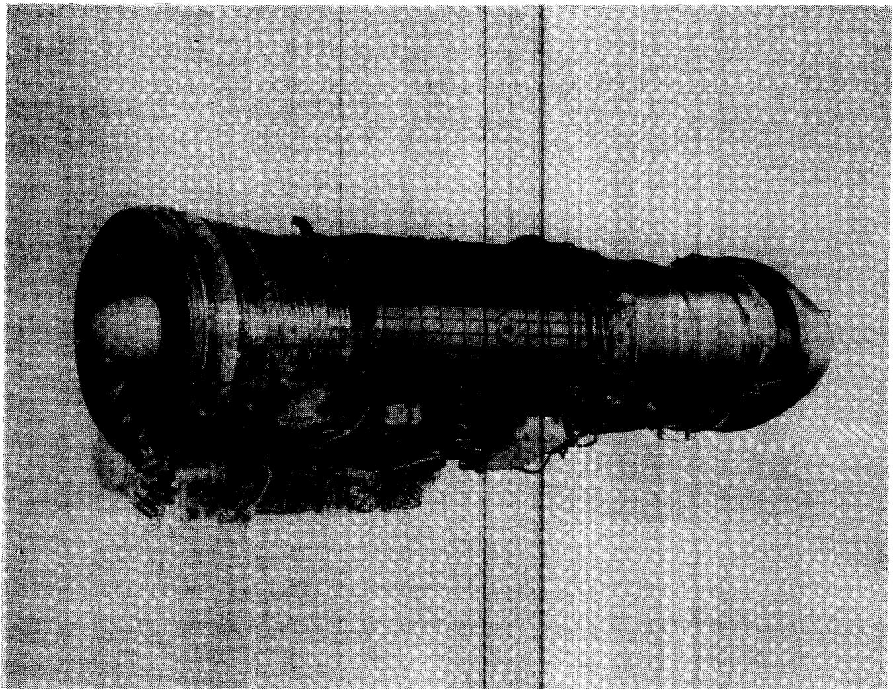

A black-and-white photograph shows a long, cylindrical object wrapped in dark, textured material, featuring a large circular end on the left and a smaller rounded tip on the right.

Photo: Cylindrical object wrapped in dark material with a circular end.

ECN 33131-001

*Figure 1. General Electric F404-GE-400 afterburning turbofan engine.*

{15}------------------------------------------------

ORIGINAL PAGE IS  
OF POOR QUALITY

![Schematic diagram of a jet engine showing the flow path and various measurement locations. The diagram is a cross-section of the engine, showing the compressor, combustor, turbine, and exhaust nozzle. Key locations are labeled with numbers (0 to 9, R) and names (e.g., Free stream, Compressor face, HPC inlet, HPC discharge, Combustor discharge, LPT rotor discharge, LPT discharge measuring plane, Afterburner inlet, Exhaust-nozzle inlet, Exhaust-nozzle throat, Exhaust-nozzle discharge, Survey rake location). Below the diagram, a table lists the parameters measured at each location.](images/exhaust-gas-pt-survey/5cab96b2d23174c25919840ecd50aa48_img.jpg)

|             |                 |           |               |                     |                     |                               |                   |                      |                       |                          |                      |
|-------------|-----------------|-----------|---------------|---------------------|---------------------|-------------------------------|-------------------|----------------------|-----------------------|--------------------------|----------------------|
| Free stream | Compressor face | HPC inlet | HPC discharge | Combustor discharge | LPT rotor discharge | LPT discharge measuring plane | Afterburner inlet | Exhaust-nozzle inlet | Exhaust-nozzle throat | Exhaust-nozzle discharge | Survey rake location |
| 0           | 1               | 25        | 3             | 4                   | 5                   | 5.58                          | 6                 | 7                    | 8                     | 9                        | R                    |
| PS0         | PT1             | N1        | HPVG          | PS3                 | WFE                 | TT5                           | WFAB              |                      | A8                    | PSNOZ                    |                      |
| TT0         | TT1             | FVG       |               |                     | PLA                 | PT5.58                        | WFP               |                      |                       |                          |                      |

Schematic diagram of a jet engine showing the flow path and various measurement locations. The diagram is a cross-section of the engine, showing the compressor, combustor, turbine, and exhaust nozzle. Key locations are labeled with numbers (0 to 9, R) and names (e.g., Free stream, Compressor face, HPC inlet, HPC discharge, Combustor discharge, LPT rotor discharge, LPT discharge measuring plane, Afterburner inlet, Exhaust-nozzle inlet, Exhaust-nozzle throat, Exhaust-nozzle discharge, Survey rake location). Below the diagram, a table lists the parameters measured at each location.

**Figure 2. Engine station and sensor locations.**

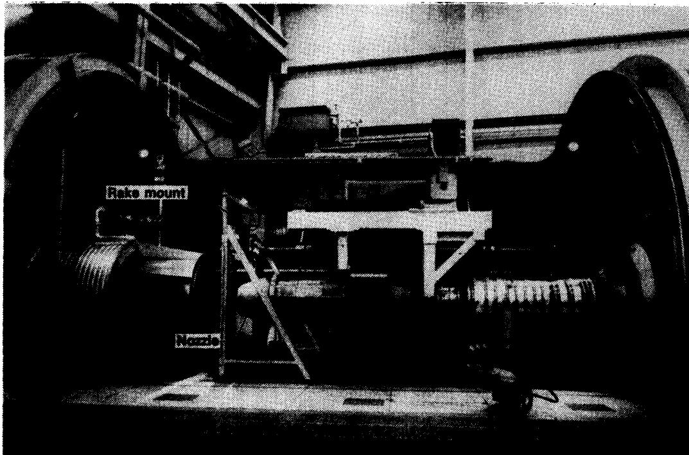

Rake mount  
Nippon

A black-and-white photograph shows an industrial machine setup featuring two large spools on either side of a central frame labeled 'Rake mount', with a small stepladder in front.

Photo: Industrial machinery with a rake mount and large spools.

C-86-0563

**Figure 3. Propulsion System Laboratory altitude test facility, test cell 4, at Lewis Research Center.**

{16}------------------------------------------------

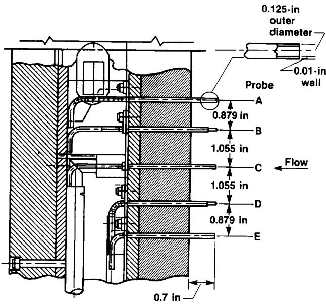

0.125-in  
outer  
diameter  
0.01-in  
wall  
Probe  
A  
0.879 in  
B  
1.055 in  
Flow  
C  
1.055 in  
D  
0.879 in  
E  
0.7 in

A technical cross-section diagram showing a probe assembly with five probes labeled A through E extending into a vessel, with vertical and horizontal dimensions and a detail of the probe's outer diameter and wall thickness.

Engineering drawing: Cross-sectional engineering drawing of a probe assembly with dimensional measurements.

(a) *Cutaway view of rake.*

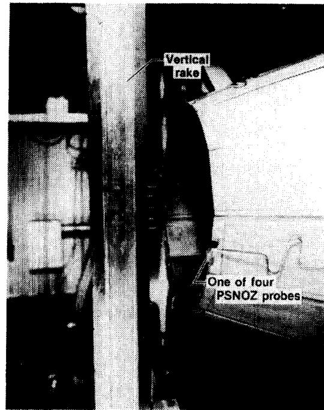

Vertical  
rake  
One of four  
PSNOZ probes

A black-and-white photograph shows a vertical rake and one of four PSNOZ probes mounted on a test apparatus, with callout labels pointing to each component.

Photo: Vertical rake and PSNOZ probes on a test structure.

(b) *Survey rake and F404-GE-400 nozzle.*

C-86-0561

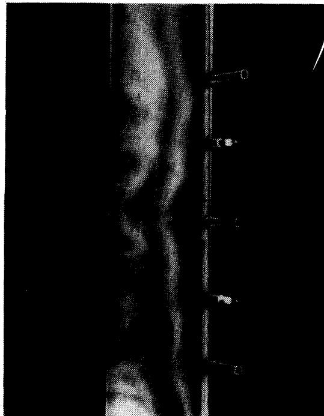

A black-and-white, vertically oriented photograph showing a curved, textured surface on the left and a vertical line with five small pin-like projections extending to the right against a dark background.

Photo: Vertical strip showing a textured surface with a row of small protrusions or pins.

C-86-1044

(c) *Closeup view of probes.*

*Figure 4. Exhaust survey rake.*

{17}------------------------------------------------

![Schematic diagram of a nozzle exit survey region. A large circle represents the nozzle edge. A horizontal line through the center is the XSRV (vertical) and XSRL (horizontal) centerline. Two shaded rectangular areas represent the survey regions: a 45° survey region at the top and a nozzle-exit horizontal centerline survey region at the bottom. Lines connect the survey region to labels: PIRA, TTRB, PIRC, TTRD, and PIRE. The 45° survey region is indicated by a double-headed arrow and the label '45° survey'. The nozzle-exit horizontal centerline survey region is indicated by a single-headed arrow and the label 'Nozzle-exit horizontal centerline survey'. The 'Nozzle edge' is labeled on the right side of the circle.](images/exhaust-gas-pt-survey/76b0cd79baaedd942af4dc42f2e764b8_img.jpg)

Survey region

PIRA  
TTRB  
PIRC  
TTRD  
PIRE

XSRV

0

XSRL

0

45° survey

Nozzle-exit horizontal centerline survey

Nozzle edge

Schematic diagram of a nozzle exit survey region. A large circle represents the nozzle edge. A horizontal line through the center is the XSRV (vertical) and XSRL (horizontal) centerline. Two shaded rectangular areas represent the survey regions: a 45° survey region at the top and a nozzle-exit horizontal centerline survey region at the bottom. Lines connect the survey region to labels: PIRA, TTRB, PIRC, TTRD, and PIRE. The 45° survey region is indicated by a double-headed arrow and the label '45° survey'. The nozzle-exit horizontal centerline survey region is indicated by a single-headed arrow and the label 'Nozzle-exit horizontal centerline survey'. The 'Nozzle edge' is labeled on the right side of the circle.

Figure 5. Survey configurations of exhaust exit plane.

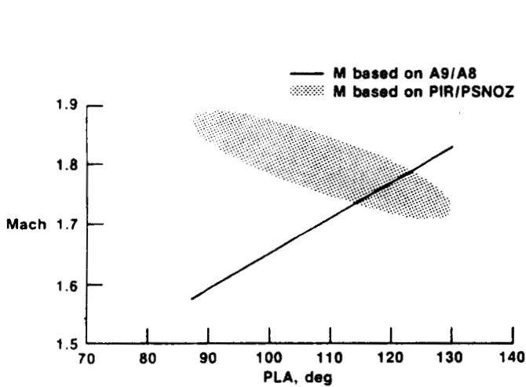

M based on A9/A8  
M based on PIR/PSNOZ

x: PLA, deg, 70 to 140; y: Mach, 1.5 to 1.9

| PLA, deg | M based on A9/A8 |
|----------|------------------|
| ~87      | ~1.58            |
| ~90      | ~1.60            |
| ~100     | ~1.65            |
| ~110     | ~1.70            |
| ~120     | ~1.75            |
| ~130     | ~1.82            |

A line plot of Mach number versus PLA in degrees, showing a linear increase, intersected by a shaded elliptical region representing M based on PIR/PSNOZ.

Line chart: Mach number versus PLA angle with confidence region.

(a)  $M = 0.30$ .

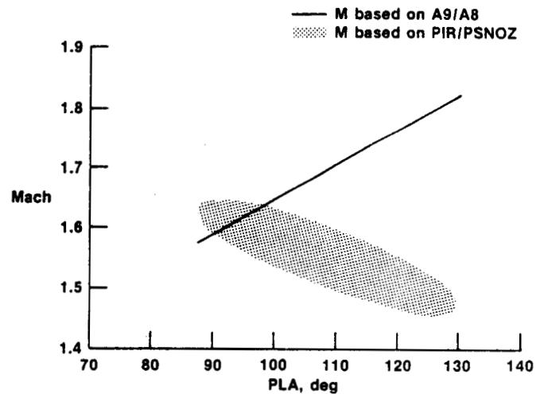

M based on A9/A8  
M based on PIR/PSNOZ

x: PLA, deg, 70 to 140; y: Mach, 1.4 to 1.9

| PLA, deg | M based on A9/A8 |
|----------|------------------|
| ~89      | ~1.57            |
| ~90      | ~1.58            |
| ~100     | ~1.63            |
| ~110     | ~1.68            |
| ~120     | ~1.73            |
| ~130     | ~1.82            |

A line plot of Mach number versus PLA in degrees, showing a solid line increasing linearly and a shaded elliptical region representing M based on PIR/PSNOZ.

Line chart: Mach number versus PLA angle with uncertainty region.

(b)  $M = 0.87$ .

Figure 6. Mach numbers at station 9 calculated from A9/A8 and PIR/PSNOZ data for various power lever angles.

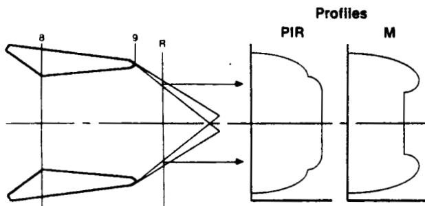

Profiles  
8  
9  
R  
PIR  
M

A technical diagram showing a cross-section of a component with points 8, 9, and R on the left, pointing via arrows to two profile views labeled PIR and M on the right.

Engineering drawing: Cross-sectional profiles of a mechanical component labeled PIR and M.

(a) Underexpanded case.

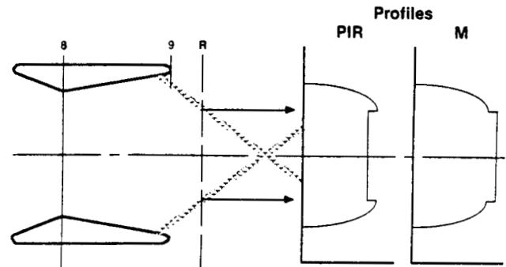

Profiles  
8  
9  
R  
PIR  
M

A schematic diagram showing light rays passing from two angled sources through a central aperture R into two profiles labeled PIR and M, with a horizontal dashed centerline.

Technical illustration: Optical ray tracing diagram showing profiles of PIR and M components.

(b) Overexpanded case.

Figure 7. Generalized flow profiles at survey rake station R.

{18}------------------------------------------------

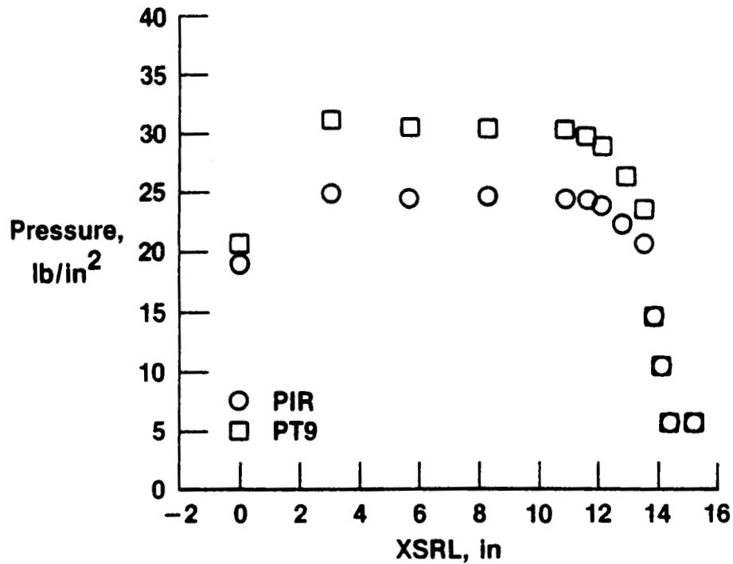

x: XSRL, in, -2 to 16; y: Pressure, lb/in^2, 0 to 40

| XSRL, in | PIR   | PT9   |
|----------|-------|-------|
| 0        | ~19   | ~21   |
| 3        | ~25   | ~31   |
| 6        | ~24.5 | ~30.5 |
| 8        | ~24.8 | ~30.5 |
| 11       | ~24.5 | ~30.5 |
| 12       | ~24   | ~29.5 |
| 13       | ~22.5 | ~26.5 |
| 14       | ~20.5 | ~23.5 |
| 14       | ~14.5 | ~10.5 |
| 15       | ~5.5  | ~5.5  |

A scatter plot showing pressure in lb/in^2 as a function of XSRL in inches for PIR (circles) and PT9 (squares), with values generally decreasing as XSRL increases beyond 12 inches.

Scatter plot: Pressure versus XSRL for PIR and PT9.

Figure 8. Normal shock correction for measured pitot pressure at maximum afterburning power (PLA = 130°),  $M = 0.87$ , and 24,000-ft altitude.

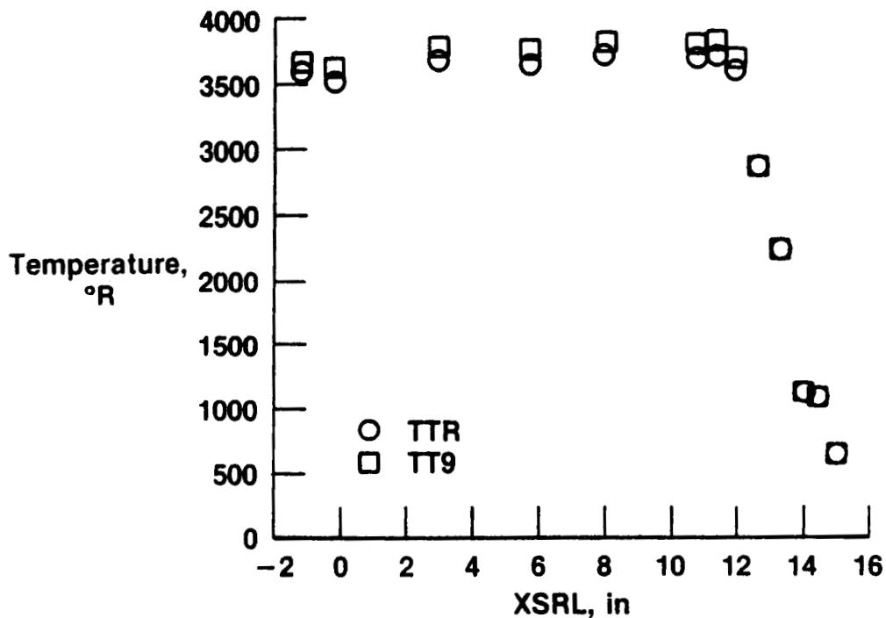

x: XSRL, in, -2 to 16; y: Temperature, °R, 0 to 4000

| XSRL, in | TTR   | TT9   |
|----------|-------|-------|
| ~-1.5    | ~3650 | ~3700 |
| ~-0.5    | ~3550 | ~3650 |
| ~3.0     | ~3700 | ~3800 |
| ~6.0     | ~3650 | ~3800 |
| ~8.0     | ~3750 | ~3850 |
| ~10.5    | ~3700 | ~3850 |
| ~11.0    | ~3700 | ~3850 |
| ~11.5    | ~3700 | ~3850 |
| ~12.0    | ~3600 | ~3700 |
| ~12.5    |       | ~2900 |
| ~13.0    |       | ~2250 |
| ~14.0    |       | ~1150 |
| ~14.5    |       | ~1100 |
| ~15.0    |       | ~650  |

A scatter plot showing temperature in degrees Rankine as a function of XSRL in inches for TTR and TT9, with values generally clustered between 3500 and 3850 °R and dropping sharply at higher XSRL.

Scatter plot: Temperature versus XSRL for TTR and TT9.

Figure 9. Radiation correction for total temperature probe at maximum afterburning power (PLA = 130°),  $M = 0.87$ , and 24,000-ft altitude.

{19}------------------------------------------------

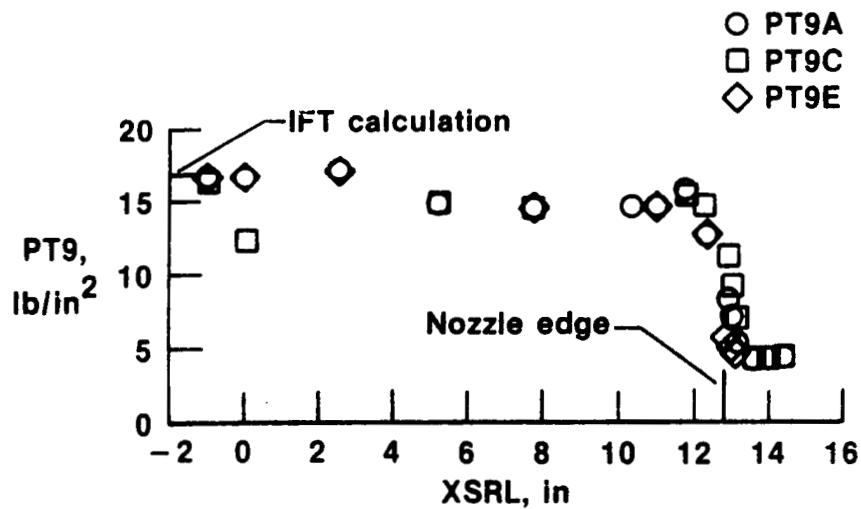

IFT calculation  
Nozzle edge

x: XSRL, in, -2 to 16; y: PT9, lb/in^2, 0 to 20

| XSRL, in | PT9A  | PT9C  | PT9E  |
|----------|-------|-------|-------|
| ~-1.2    | ~16.5 | ~16.5 | ~16.5 |
| ~-0.3    | ~12.5 | ~12.5 | ~16.5 |
| ~0.1     |       | ~12.5 | ~16.5 |
| ~2.5     |       |       | ~17.0 |
| ~5.1     |       | ~15.0 |       |
| ~7.6     | ~14.8 | ~14.8 | ~14.8 |
| ~10.2    | ~15.0 |       |       |
| ~11.0    |       | ~15.0 | ~14.8 |
| ~11.8    | ~16.0 | ~16.0 | ~16.0 |
| ~12.2    |       | ~15.0 | ~13.0 |
| ~12.5    |       | ~11.5 | ~10.0 |
| ~12.7    |       | ~9.5  | ~6.0  |
| ~12.9    |       | ~8.0  | ~5.0  |
| ~13.1    |       | ~7.0  | ~4.5  |
| ~13.3    |       | ~5.0  | ~4.5  |
| ~13.5    |       | ~4.5  | ~4.5  |
| ~13.7    |       | ~4.5  |       |

A scatter plot showing pressure values versus XSRL for three series (PT9A, PT9C, and PT9E), with a line indicating the IFT calculation and a nozzle edge marked around 12.8 in.

Scatter plot: Pressure distribution along XSRL for PT9A, PT9C, and PT9E.

(a) Total pressure.

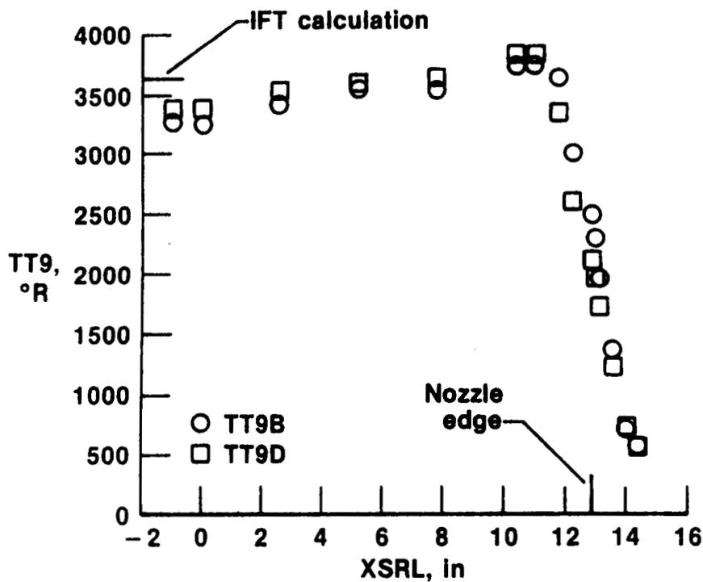

IFT calculation  
Nozzle  
edge

x: XSRL, in, -2 to 16; y: TT9, °R, 0 to 4000

| XSRL, in | TT9B  | TT9D  |
|----------|-------|-------|
| ~-1.2    | ~3350 | ~3400 |
| ~-0.2    | ~3250 | ~3400 |
| ~2.5     | ~3450 | ~3550 |
| ~5.2     | ~3550 | ~3600 |
| ~7.8     | ~3550 | ~3650 |
| ~10.2    | ~3800 | ~3850 |
| ~10.5    | ~3800 | ~3850 |
| ~11.2    | ~3650 | ~3350 |
| ~12.0    | ~3000 | ~2600 |
| ~12.5    | ~2500 | ~2100 |
| ~12.8    | ~2300 | ~2100 |
| ~13.0    | ~2000 | ~1700 |
| ~13.2    | ~1400 | ~1200 |
| ~13.8    | ~750  | ~700  |
| ~14.2    | ~600  | ~550  |

A scatter plot showing TT9B and TT9D values plotted against XSRL in inches, with a horizontal line indicating the IFT calculation and a vertical line marking the nozzle edge.

Scatter plot: Comparison of TT9B and TT9D measurements with IFT calculation and nozzle edge.

(b) Total temperature.

Figure 10. Exhaust-jet profiles for nozzle-exit horizontal centerline survey at maximum afterburning power (PLA = 130°), M = 0.30, and 30,000-ft altitude.

{20}------------------------------------------------

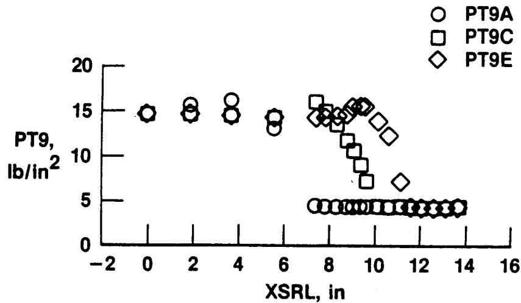

x: XSRL, in, -2 to 16; y: PT9, lb/in^2, 0 to 20

| XSRL, in | PT9A | PT9C | PT9E |
|----------|------|------|------|
| 0        | ~15  |      |      |
| 2        | ~15  |      |      |
| 4        | ~15  |      |      |
| 6        | ~14  |      |      |
| 7        | ~4.5 | ~16  | ~14  |
| 8        | ~4.5 | ~13  | ~14  |
| 9        | ~4.5 | ~11  | ~15  |
| 10       | ~4.5 | ~7   | ~12  |
| 11       | ~4.5 |      | ~7   |
| 12       | ~4.5 |      |      |
| 14       | ~4.5 |      |      |

A scatter plot showing PT9 values against XSRL for three series: PT9A, PT9C, and PT9E. PT9A remains constant around 4.5 lb/in^2 after XSRL of 7, while PT9C and PT9E decrease as XSRL increases.

Scatter plot: Scatter plot of PT9 versus XSRL for PT9A, PT9C, and PT9E.

(a) Total pressure.

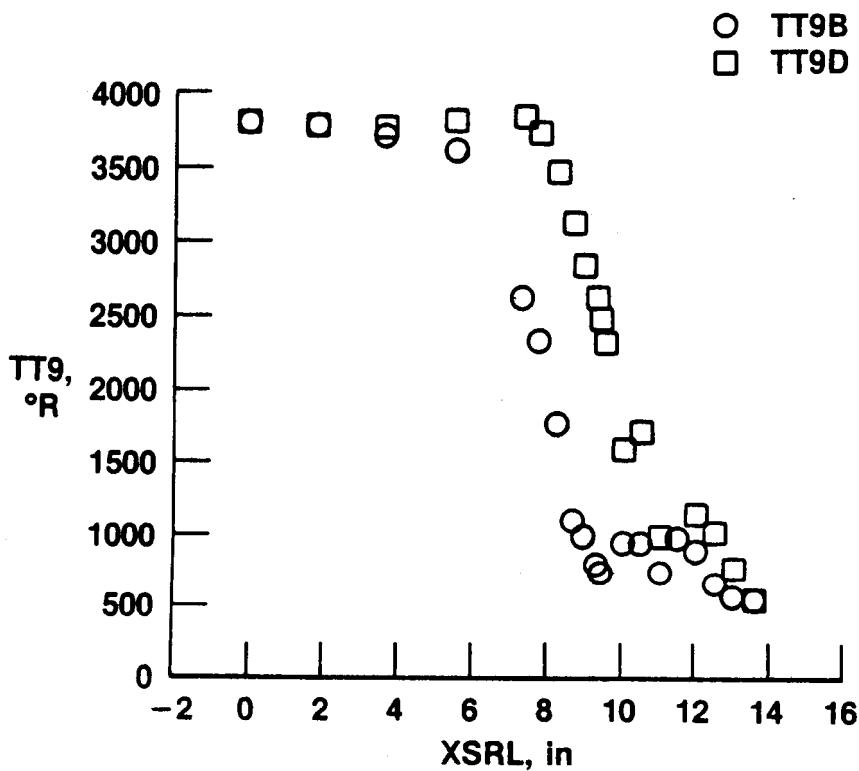

x: XSRL, in, -2 to 16; y: TT9, °R, 0 to 4000

| XSRL, in | TT9B                | TT9D                              |
|----------|---------------------|-----------------------------------|
| 0        |                     | ~3800                             |
| 2        |                     | ~3800                             |
| 4        | ~3700               | ~3750                             |
| 6        | ~3600               | ~3800                             |
| 8        | ~2600, ~2300, ~1750 | ~3850, ~3750, ~3450               |
| 10       | ~900, ~950, ~700    | ~1550, ~1650, ~2300, ~2500, ~2650 |
| 12       | ~850, ~850, ~900    | ~1150, ~1000, ~1000, ~1150        |
| 14       | ~500, ~550          | ~500, ~550, ~750                  |

A scatter plot showing TT9 in degrees Rankine as a function of XSRL in inches, comparing TT9B (circles) and TT9D (squares). Values generally decrease as XSRL increases.

Scatter plot: Scatter plot of TT9 versus XSRL for TT9B and TT9D.

(b) Total temperature.

Figure 11. Exhaust-jet profiles for 45° survey at maximum afterburning power (PLA = 130°),  $M = 0.30$ , and 30,000-ft altitude.

{21}------------------------------------------------

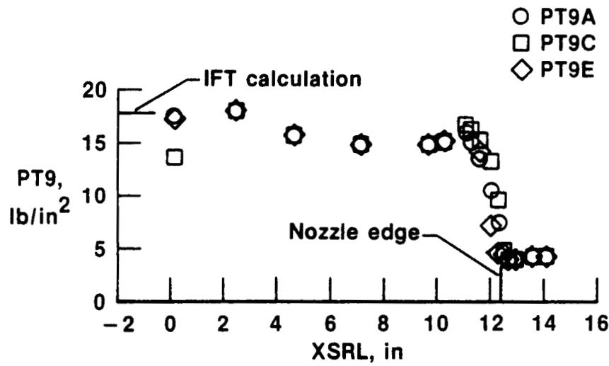

IFT calculation  
Nozzle edge

x: XSRL, in, -2 to 16; y: PT9, lb/in^2, 0 to 20

| XSRL, in | PT9A  | PT9C  | PT9E  | IFT calculation |
|----------|-------|-------|-------|-----------------|
| 0        | ~17.0 | ~13.5 | ~17.0 | ~17.5           |
| 2.5      |       |       | ~18.0 | ~17.5           |
| 4.5      | ~15.5 |       |       | ~17.5           |
| 7.0      | ~14.5 |       |       | ~17.5           |
| 9.5      | ~14.5 |       |       | ~17.5           |
| 10.0     | ~15.0 |       |       | ~17.5           |
| 10.5     | ~15.0 |       |       | ~17.5           |
| 11.0     | ~15.0 | ~16.5 |       | ~17.5           |
| 11.5     | ~13.0 | ~16.0 | ~14.5 | ~17.5           |
| 12.0     | ~10.5 | ~13.0 | ~7.5  | ~17.5           |
| 12.5     | ~4.5  | ~4.0  | ~4.0  | ~2.5            |
| 13.0     | ~4.0  |       | ~4.0  | ~2.5            |
| 13.5     | ~4.0  |       | ~4.0  | ~2.5            |

A scatter plot of PT9 against XSRL showing values around 17.5 lb/in^2 until XSRL reaches approximately 11.5 in, where they drop sharply to around 4.0 lb/in^2, marked by a nozzle edge line and an IFT calculation line.

Scatter plot: Pressure PT9 versus XSRL with IFT calculation and nozzle edge.

(a) Total pressure.

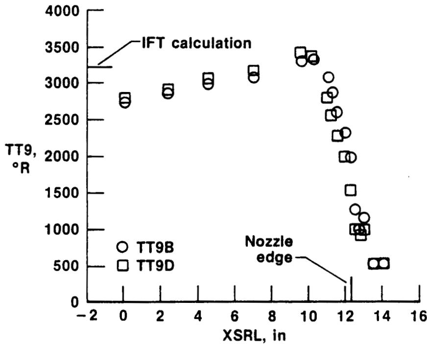

IFT calculation  
Nozzle  
edge

x: XSRL, in, -2 to 16; y: TT9, °R, 0 to 4000

| XSRL, in | TT9B  | TT9D  | IFT calculation |
|----------|-------|-------|-----------------|
| 0        | ~2750 | ~2750 | ~3200           |
| 2        | ~2850 | ~2900 |                 |
| 4        | ~3000 | ~3050 |                 |
| 6        | ~3100 | ~3150 |                 |
| 8        |       |       |                 |
| 10       | ~3300 | ~3450 |                 |
| 12       | ~2000 | ~1500 |                 |
| 14       | ~550  | ~550  |                 |

A scatter plot of TT9B and TT9D data points versus XSRL in inches, showing values peaking around 10 inches and dropping sharply near the nozzle edge, with an IFT calculation line at 0 inches.

Scatter plot: Comparison of TT9B and TT9D measurements with IFT calculation and nozzle edge.

(b) Total temperature.

Figure 12. Exhaust-jet profiles for nozzle-exit horizontal centerline survey at partial afterburning power (PLA = 120°),  $M = 0.30$ , and 30,000-ft altitude.

{22}------------------------------------------------

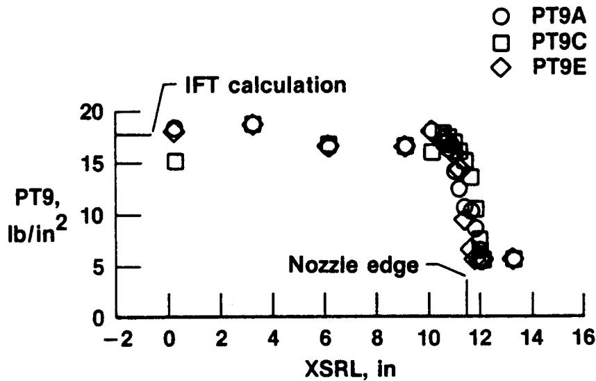

PT9A  
PT9C  
PT9E  
IFT calculation  
Nozzle edge

x: XSRL, in, -2 to 16; y: PT9, lb/in^2, 0 to 20

| XSRL, in | PT9A  | PT9C | PT9E  | IFT calculation |
|----------|-------|------|-------|-----------------|
| 0        | ~18   | ~15  | ~18   | ~18             |
| 3        | ~19   |      |       |                 |
| 6        | ~17   |      | ~16.5 |                 |
| 9        | ~16.5 |      |       |                 |
| 10       | ~18   | ~16  | ~18   |                 |
| 11       | ~13   | ~14  | ~13   |                 |
| 12       | ~5    | ~5   | ~5    |                 |
| 13       | ~5.5  |      |       |                 |

A scatter plot of PT9 pressure against XSRL showing experimental data points for PT9A, PT9C, and PT9E, compared to an IFT calculation line and a nozzle edge boundary.

Scatter plot: Comparison of PT9 pressure versus XSRL with IFT calculation and nozzle edge.

(a) Total pressure.

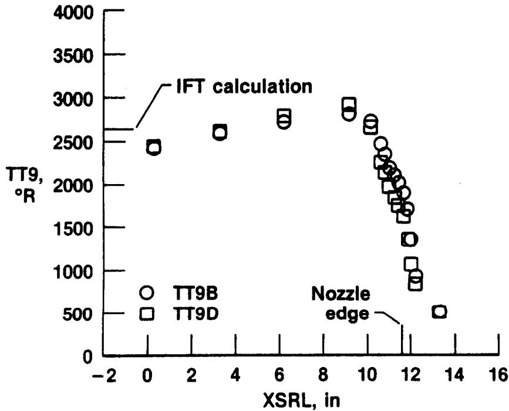

IFT calculation  
Nozzle  
edge

x: XSRL, in, -2 to 16; y: TT9, °R, 0 to 4000

| XSRL, in | TT9B  | TT9D  | IFT calculation |
|----------|-------|-------|-----------------|
| 0        | ~2450 | ~2450 | ~2650           |
| 3        | ~2650 | ~2650 |                 |
| 6        | ~2750 | ~2800 |                 |
| 9        | ~2900 | ~2950 |                 |
| 10       | ~2750 | ~2700 |                 |
| 11       | ~2200 | ~2200 |                 |
| 12       | ~1400 | ~1100 |                 |
| 13       | ~550  |       |                 |

A scatter plot showing temperature TT9 in degrees Rankine versus XSRL in inches, comparing experimental data points TT9B and TT9D with an IFT calculation curve that peaks around 9 inches and drops sharply past the nozzle edge.

Scatter plot: Comparison of TT9B and TT9D measurements with IFT calculation along XSRL.

(b) Total temperature.

Figure 13. Exhaust-jet profile for nozzle-exit horizontal centerline survey at partial afterburning power (PLA = 110°), M = 0.30, and 30,000-ft altitude.

{23}------------------------------------------------

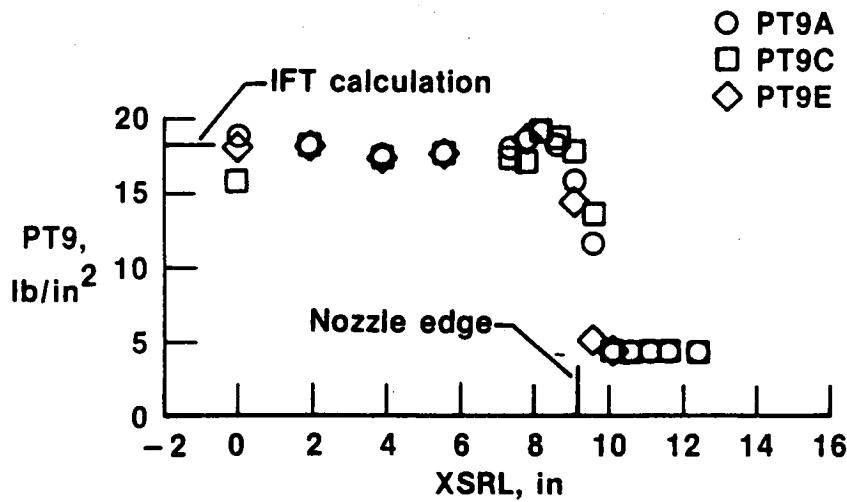

IFT calculation  
Nozzle edge

x: XSRL, in, -2 to 16; y: PT9, lb/in^2, 0 to 20

| XSRL, in | PT9A  | PT9C  | PT9E  |
|----------|-------|-------|-------|
| 0        | ~18.5 | ~15.5 | ~18.0 |
| 2        | ~18.0 |       |       |
| 4        | ~17.0 |       |       |
| 6        | ~17.5 |       |       |
| 7.5      | ~17.0 | ~17.0 | ~17.5 |
| 8        | ~19.0 | ~18.0 | ~19.0 |
| 9        | ~16.0 | ~18.0 | ~14.0 |
| 9.5      | ~11.5 | ~13.5 | ~5.5  |
| 10       | ~4.0  | ~4.5  |       |
| 12       | ~4.0  |       |       |

A scatter plot showing PT9 pressure versus XSRL distance, comparing experimental data points (PT9A, PT9C, PT9E) to an IFT calculation line and a nozzle edge reference.

Scatter plot: Comparison of PT9 pressure values along XSRL with IFT calculation and nozzle edge.

(a) Total pressure.

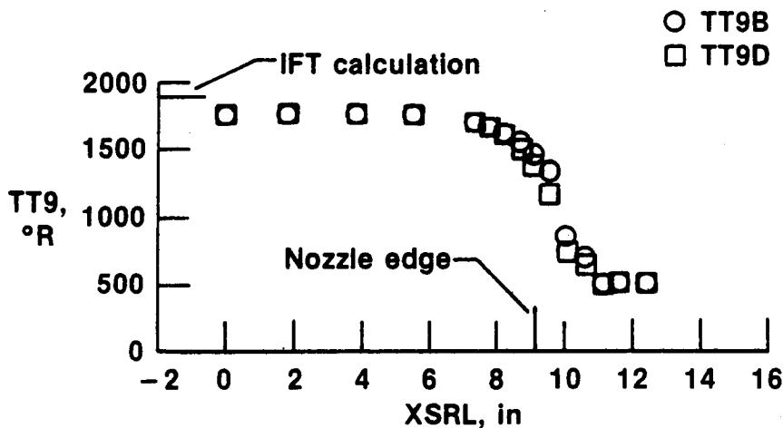

IFT calculation  
Nozzle edge

x: XSRL, in, -2 to 16; y: TT9, °R, 0 to 2000

| XSRL, in | TT9B  | TT9D  |
|----------|-------|-------|
| 0        | ~1750 | ~1750 |
| 2        | ~1750 | ~1750 |
| 4        | ~1750 | ~1750 |
| 6        | ~1750 | ~1750 |
| 8        | ~1650 | ~1650 |
| 10       | ~850  | ~700  |
| 12       | ~500  | ~500  |

A scatter plot showing TT9B and TT9D temperatures remaining constant around 1750 °R until approximately 7.5 in XSRL, then dropping sharply past the nozzle edge to around 500 °R.

Scatter plot: Comparison of TT9B and TT9D temperatures along XSRL with IFT calculation.

(b) Total temperature.

Figure 14. Exhaust-jet profile for nozzle-exit horizontal centerline survey at intermediate power (PLA = 87°), M = 0.30, and 30,000-ft altitude.

{24}------------------------------------------------

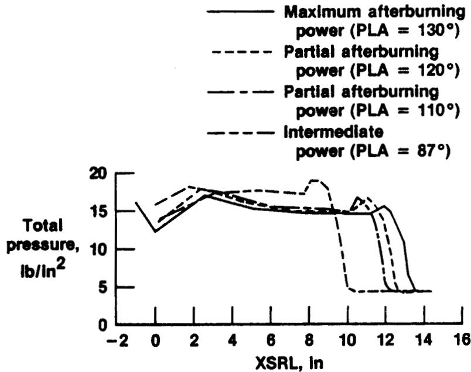

Maximum afterburning power (PLA = 130°)  
Partial afterburning power (PLA = 120°)  
Partial afterburning power (PLA = 110°)  
Intermediate power (PLA = 87°)

x: XSRL, in, -2 to 16; y: Total pressure, lb/in^2, 0 to 20

| XSRL, in | Maximum afterburning power (PLA = 130°) | Partial afterburning power (PLA = 120°) | Partial afterburning power (PLA = 110°) | Intermediate power (PLA = 87°) |
|----------|-----------------------------------------|-----------------------------------------|-----------------------------------------|--------------------------------|
| -1       | ~16                                     | ~16                                     | ~16                                     | ~16                            |
| 0        | ~12.5                                   | ~14                                     | ~14.5                                   | ~15.5                          |
| 2        | ~17                                     | ~17.5                                   | ~17.5                                   | ~18                            |
| 4        | ~16                                     | ~16.5                                   | ~17                                     | ~17.5                          |
| 6        | ~15                                     | ~15.5                                   | ~16                                     | ~17.5                          |
| 8        | ~15                                     | ~15                                     | ~15                                     | ~19                            |
| 10       | ~15                                     | ~15                                     | ~15                                     | ~4.5                           |
| 12       | ~15                                     | ~15                                     | ~10                                     | ~4.5                           |
| 14       | ~4.5                                    | ~4.5                                    | ~4.5                                    | ~4.5                           |

A line plot of total pressure against XSRL for four afterburning power settings, showing pressure rising initially, plateauing between 2 and 10 inches, and dropping sharply after 10 inches.

Line chart: Total pressure versus XSRL for different afterburning power levels.

(a) Total pressure.

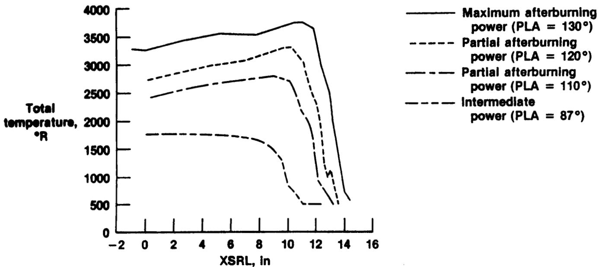

x: XSRL, in, -2 to 16; y: Total temperature, °R, 0 to 4000

| XSRL, in | Maximum afterburning power (PLA = 130°) | Partial afterburning power (PLA = 120°) | Partial afterburning power (PLA = 110°) | Intermediate power (PLA = 87°) |
|----------|-----------------------------------------|-----------------------------------------|-----------------------------------------|--------------------------------|
| 0        | ~3280                                   | ~2750                                   | ~2450                                   | ~1780                          |
| 2        | ~3400                                   | ~2850                                   | ~2550                                   | ~1780                          |
| 4        | ~3520                                   | ~3000                                   | ~2650                                   | ~1780                          |
| 6        | ~3580                                   | ~3100                                   | ~2700                                   | ~1750                          |
| 8        | ~3560                                   | ~3200                                   | ~2780                                   | ~1680                          |
| 10       | ~3750                                   | ~3350                                   | ~2750                                   | ~850                           |
| 12       | ~3700                                   | ~2250                                   | ~1400                                   | ~500                           |
| 14       | ~600                                    | ~500                                    | ~500                                    | ~500                           |

A line graph showing total temperature in degrees Rankine as a function of XSRL in inches for four different power settings, with temperatures peaking between 6 and 11 inches before dropping sharply.

Line chart: Total temperature versus XSRL for different afterburning power levels.

(b) Total temperature.

**Figure 15.** Exhaust-jet profile summaries for nozzle-exit horizontal centerline surveys at various power settings,  $M = 0.30$ , and 30,000-ft altitude.

{25}------------------------------------------------

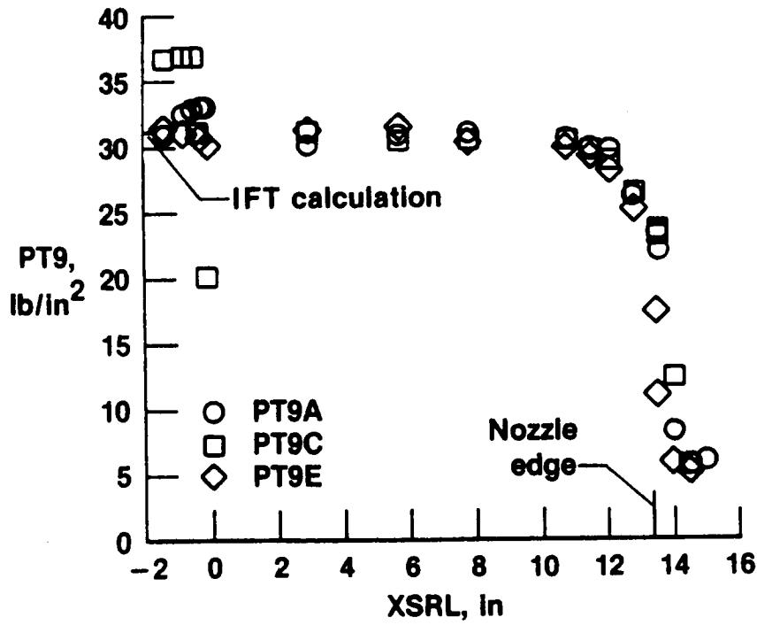

IFT calculation  
Nozzle  
edge  
PT9A  
PT9C  
PT9E

x: XSRL, in, -2 to 16; y: PT9, lb/in^2, 0 to 40

| XSRL, in | PT9A | PT9C | PT9E | IFT calculation |
|----------|------|------|------|-----------------|
| -2       | ~31  | ~37  | ~31  | ~31             |
| 0        | ~32  | ~20  | ~30  | ~32             |
| 2.5      | ~31  |      |      |                 |
| 5.5      | ~31  |      |      |                 |
| 7.5      | ~31  |      |      |                 |
| 10.5     | ~30  |      |      |                 |
| 11.5     | ~30  |      |      |                 |
| 12.5     | ~29  |      |      |                 |
| 13.5     | ~22  |      |      |                 |
| 14.5     | ~6   |      |      |                 |

A scatter plot of PT9 against XSRL showing data points for PT9A, PT9C, and PT9E, with an IFT calculation curve and a nozzle edge line.

Scatter plot: Pressure PT9 versus XSRL for PT9A, PT9C, and PT9E with IFT calculation.

(a) Total pressure.

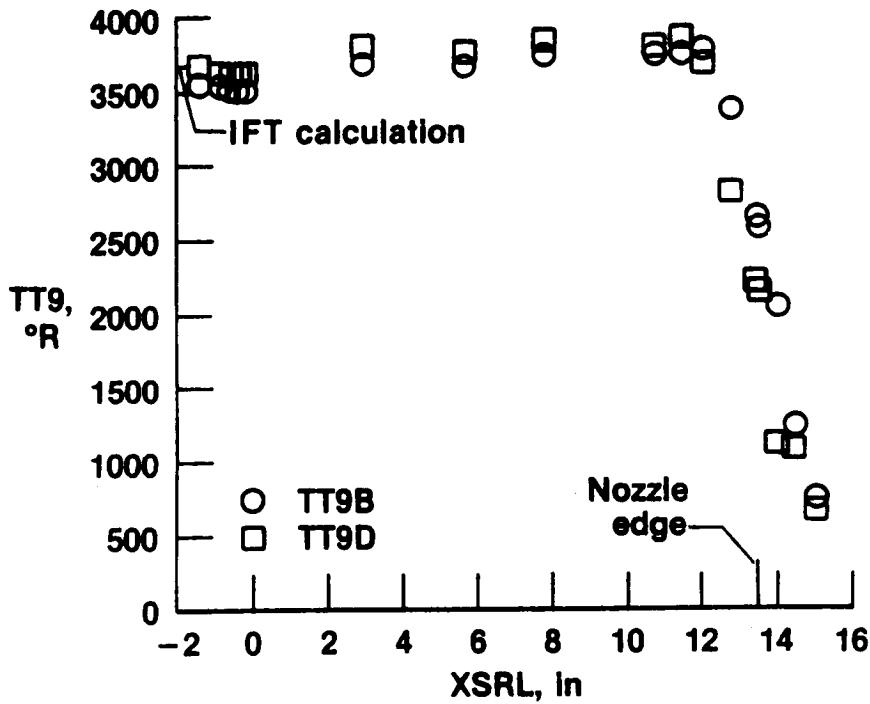

IFT calculation  
Nozzle  
edge

x: XSRL, in, -2 to 16; y: TT9, °R, 0 to 4000

| XSRL, in | TT9B  | TT9D  |
|----------|-------|-------|
| ~-1.5    | ~3600 | ~3700 |
| ~-1.0    | ~3550 | ~3600 |
| ~-0.5    | ~3550 | ~3600 |
| ~2.7     | ~3700 | ~3850 |
| ~5.7     | ~3700 | ~3800 |
| ~7.7     | ~3800 | ~3850 |
| ~10.7    | ~3800 | ~3850 |
| ~11.2    | ~3800 | ~3850 |
| ~11.7    | ~3800 | ~3900 |
| ~12.7    | ~3400 | ~2850 |
| ~13.2    | ~2650 | ~2250 |
| ~13.7    | ~2100 | ~2250 |
| ~14.2    | ~1350 | ~1150 |
| ~14.7    | ~1300 | ~1150 |
| ~15.2    | ~800  | ~700  |

A scatter plot showing TT9B and TT9D values plotted against XSRL in inches, with a callout indicating the IFT calculation region and a nozzle edge marker.

Scatter plot: Comparison of TT9B and TT9D measurements with IFT calculation along XSRL.

(b) Total temperature.

Figure 16. Exhaust-jet profiles for nozzle-exit horizontal centerline survey at maximum afterburning power (PLA = 130°), M = 0.87, and 24,000-ft altitude.

{26}------------------------------------------------

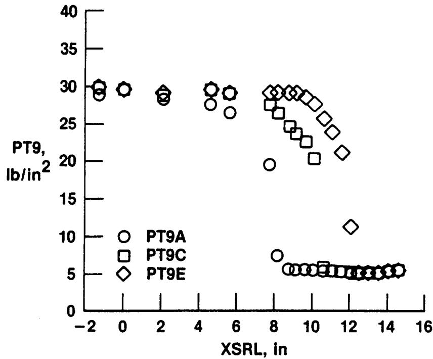

x: XSRL, in, -2 to 16; y: PT9, lb/in^2, 0 to 40

| XSRL, in | PT9A  | PT9C  | PT9E  |
|----------|-------|-------|-------|
| -1.5     | ~29   | ~29   | ~30   |
| 0        | ~29   | ~29   | ~29   |
| 2        | ~28   | ~28   | ~29   |
| 5        | ~27.5 | ~29.5 | ~29.5 |
| 6        | ~26.5 | ~29.5 | ~29.5 |
| 8        | ~19.5 | ~27   | ~29.5 |
| 9        | ~7.5  | ~26   | ~29   |
| 10       | ~5.5  | ~20.5 | ~28   |
| 12       | ~5.5  | ~5.5  | ~11.5 |
| 14       | ~5.5  | ~5.5  | ~5.5  |

A scatter plot showing PT9 values against XSRL for three series: PT9A, PT9C, and PT9E. The values remain relatively constant around 29 lb/in^2 until XSRL reaches 8 in, after which they drop sharply to around 5-6 lb/in^2.

Scatter plot: Scatter plot of PT9 versus XSRL for PT9A, PT9C, and PT9E.

(a) Total pressure.

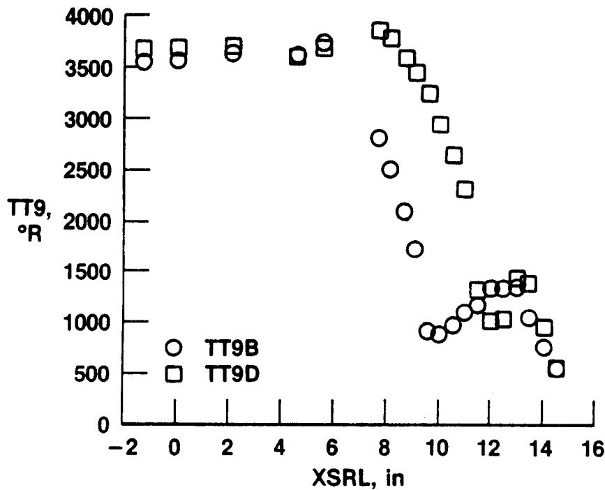

x: XSRL, in, -2 to 16; y: TT9, °R, 0 to 4000

| XSRL, in | TT9B, °R | TT9D, °R |
|----------|----------|----------|
| -1.5     | ~3550    | ~3700    |
| 0        | ~3580    | ~3700    |
| 2        | ~3650    | ~3700    |
| 5        | ~3620    | ~3620    |
| 6        | ~3720    | ~3750    |
| 8        | ~2820    | ~3880    |
| 9        | ~2520    | ~3620    |
| 10       | ~2080    | ~3250    |
| 11       | ~1700    | ~2280    |
| 12       | ~1180    | ~1350    |
| 13       | ~1050    | ~1480    |
| 14       | ~750     | ~950     |
| 14.5     |          | ~550     |

A scatter plot showing TT9 in degrees Rankine as a function of XSRL in inches for TT9B (circles) and TT9D (squares), both peaking around 5 to 6 inches and dropping at higher values.

Scatter plot: TT9 versus XSRL for TT9B and TT9D.

(b) Total temperature.

Figure 17. Exhaust-jet profiles for 45° survey at maximum afterburning power (PLA = 130°),  $M = 0.87$ , and 24,000-ft altitude.

{27}------------------------------------------------

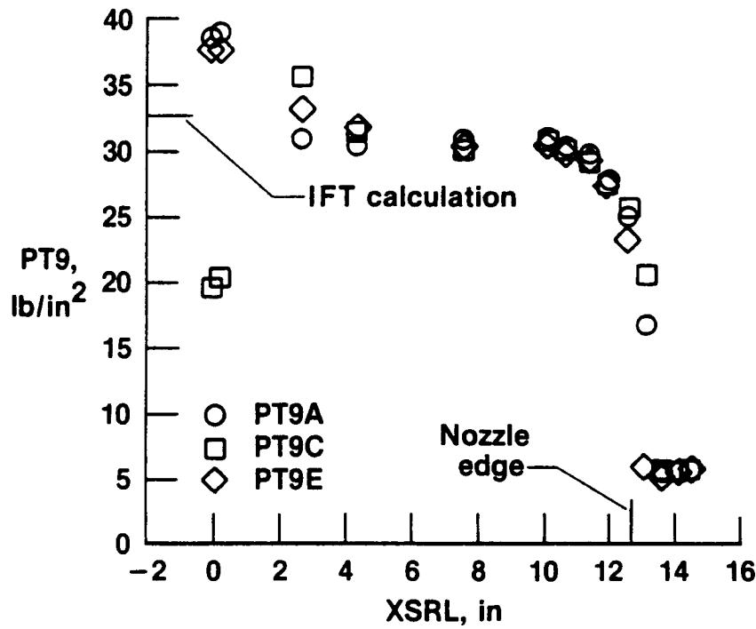

IFT calculation  
Nozzle  
edge  
PT9A  
PT9C  
PT9E

x: XSRL, in, -2 to 16; y: PT9, lb/in^2, 0 to 40

| XSRL, in | PT9A  | PT9C  | PT9E  | IFT calculation |
|----------|-------|-------|-------|-----------------|
| 0        | ~38.5 | ~19.5 | ~38.5 | ~32.5           |
| 2.5      | ~31   | ~36   | ~33.5 |                 |
| 4.5      | ~31.5 | ~32   | ~32   |                 |
| 7.5      | ~30.5 | ~30.5 | ~30.5 |                 |
| 10       | ~31   | ~31   | ~30.5 |                 |
| 11       | ~30   | ~30   | ~29.5 |                 |
| 12       | ~27.5 | ~27.5 | ~23   |                 |
| 12.5     | ~16.5 | ~20.5 | ~25.5 |                 |
| 13       | ~5.5  | ~5.5  | ~5.5  |                 |
| 14       | ~5.5  | ~5.5  | ~5.5  |                 |
| 15       | ~5.5  | ~5.5  | ~5.5  |                 |

A scatter plot showing PT9 values as a function of XSRL for probes PT9A, PT9C, and PT9E, compared with an IFT calculation line and a nozzle edge line.

Scatter plot: Pressure ratio PT9 versus XSRL for different probes and IFT calculation.

(a) Total pressure.

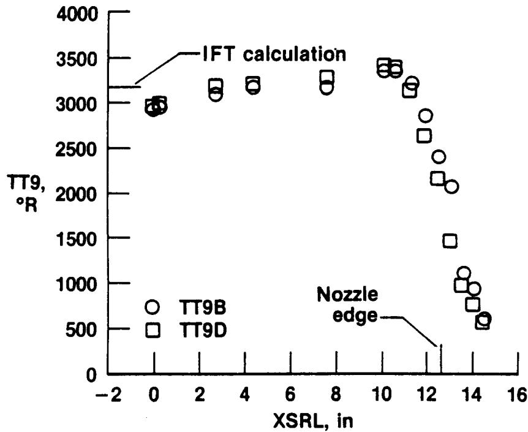

IFT calculation  
Nozzle  
edge

x: XSRL, in, -2 to 16; y: TT9, °R, 0 to 4000

| XSRL, in | TT9B  | TT9D  | IFT calculation |
|----------|-------|-------|-----------------|
| 0        | ~3000 | ~3000 | ~3200           |
| 2.5      | ~3150 | ~3250 |                 |
| 4.5      | ~3200 | ~3250 |                 |
| 7.5      | ~3250 | ~3350 |                 |
| 10       | ~3400 | ~3450 |                 |
| 10.5     | ~3400 | ~3450 |                 |
| 11       | ~3200 | ~3150 |                 |
| 11.5     | ~2900 | ~2650 |                 |
| 12       | ~2450 | ~2150 |                 |
| 12.5     | ~2450 | ~2150 |                 |
| 13       | ~2100 | ~1450 |                 |
| 13.5     | ~1150 | ~1000 |                 |
| 14       | ~950  | ~750  |                 |
| 14.5     | ~600  | ~550  |                 |

A scatter plot showing TT9B and TT9D data points plotted against XSRL in inches, with an IFT calculation line and a nozzle edge indicator.

Scatter plot: Comparison of TT9B and TT9D measurements with IFT calculation and nozzle edge.

(b) Total temperature.

Figure 18. Exhaust-jet profiles for nozzle-exit horizontal centerline survey at partial afterburning power (PLA = 120°), M = 0.87, and 24,000-ft altitude.

{28}------------------------------------------------

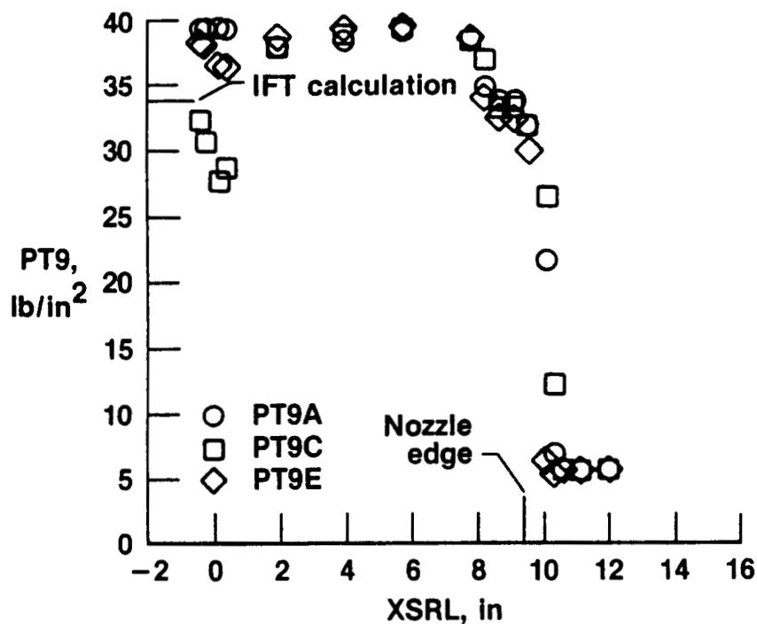

IFT calculation  
Nozzle  
edge

x: XSRL, in, -2 to 16; y: PT9, lb/in^2, 0 to 40

| XSRL, in | PT9A | PT9C | PT9E |
|----------|------|------|------|
| ~-0.5    | ~39  | ~33  | ~38  |
| ~0       | ~39  | ~31  | ~37  |
| ~0.5     | ~39  | ~29  | ~36  |
| ~1       | ~39  | ~28  | ~36  |
| ~2       | ~39  |      |      |
| ~4       | ~39  |      |      |
| ~6       | ~39  |      |      |
| ~8       | ~39  | ~38  | ~35  |
| ~9       | ~34  | ~33  | ~32  |
| ~10      | ~22  | ~27  |      |
| ~10.5    |      | ~12  |      |
| ~11      | ~6.5 | ~5   | ~5   |
| ~12      | ~6   |      |      |

A scatter plot of PT9 against XSRL showing values decreasing sharply as XSRL increases, with a horizontal line indicating the IFT calculation and a vertical line marking the nozzle edge.

Scatter plot: PT9 versus XSRL for PT9A, PT9C, and PT9E with IFT calculation and nozzle edge.

(a) Total pressure.

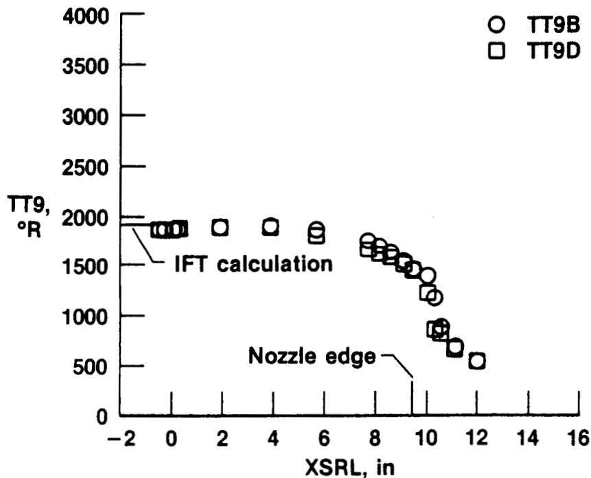

TT9B  
TT9D  
IFT calculation  
Nozzle edge

x: XSRL, in, -2 to 16; y: TT9, °R, 0 to 4000

| XSRL, in | TT9B  | TT9D  |
|----------|-------|-------|
| ~0       | ~1880 | ~1880 |
| ~2       | ~1900 | ~1900 |
| ~4       | ~1900 | ~1900 |
| ~6       | ~1850 | ~1800 |
| ~8       | ~1700 | ~1650 |
| ~10      | ~1250 | ~1250 |
| ~12      | ~550  | ~550  |

A scatter plot showing TT9 temperature in degrees Rankine as a function of XSRL in inches, comparing experimental data points for TT9B and TT9D with an IFT calculation line and a nozzle edge marker.

Scatter plot: TT9 temperature versus XSRL for TT9B and TT9D.

(b) Total temperature.

Figure 19. Exhaust-jet profiles for nozzle-exit horizontal centerline survey at intermediate power (PLA = 87°), M = 0.87, and 24,000-ft altitude.

{29}------------------------------------------------

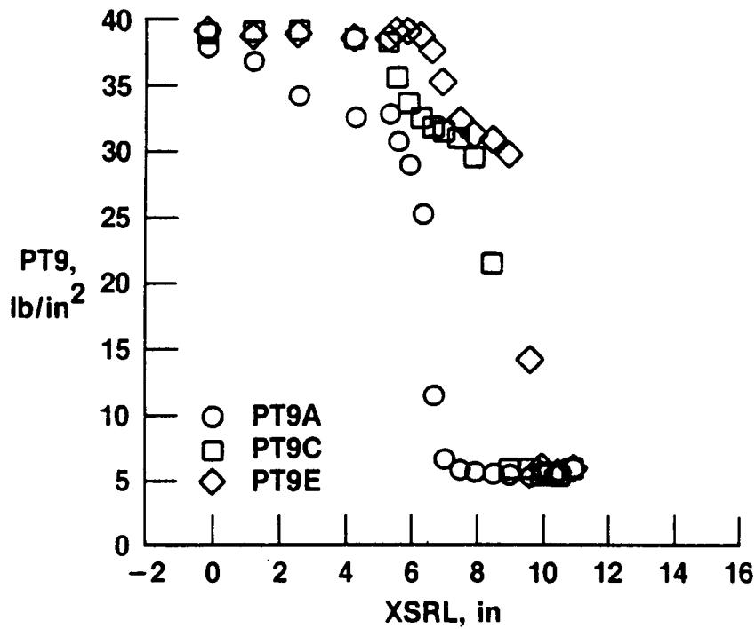

x: XSRL, in, -2 to 16; y: PT9, lb/in^2, 0 to 40

| XSRL, in | PT9A | PT9C | PT9E |
|----------|------|------|------|
| ~0       | ~38  | ~39  | ~39  |
| ~1       | ~37  | ~39  | ~39  |
| ~2.5     | ~34  | ~39  | ~39  |
| ~4.5     | ~33  | ~39  | ~39  |
| ~5.5     | ~33  | ~38  | ~39  |
| ~6.5     | ~25  | ~32  | ~38  |
| ~7.0     | ~11  | ~31  | ~35  |
| ~8.0     | ~5   | ~21  | ~31  |
| ~9.0     | ~5   | ~5   | ~14  |
| ~10.0    | ~5   | ~5   | ~5   |
| ~11.0    | ~5   | ~5   | ~5   |

A scatter plot showing PT9 decreasing as XSRL increases, with data points categorized into three series: PT9A (circles), PT9C (squares), and PT9E (diamonds).

Scatter plot: Scatter plot of PT9 versus XSRL for PT9A, PT9C, and PT9E.

(a) Total pressure.

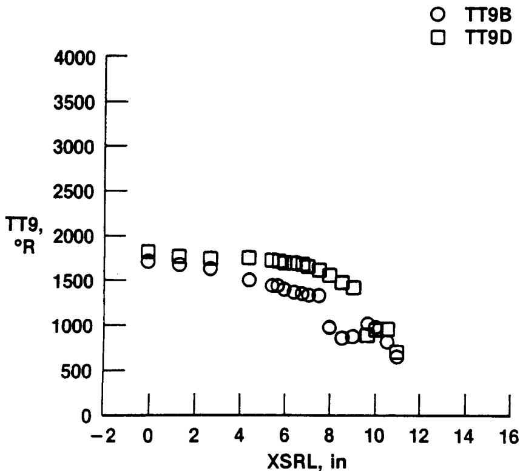

x: XSRL, in, -2 to 16; y: TT9, °R, 0 to 4000

| XSRL, in | TT9B  | TT9D  |
|----------|-------|-------|
| 0        | ~1750 | ~1850 |
| 1        | ~1700 | ~1750 |
| 2        | ~1650 | ~1750 |
| 3        | ~1650 | ~1750 |
| 4        | ~1500 | ~1750 |
| 5        | ~1450 | ~1750 |
| 6        | ~1450 | ~1750 |
| 7        | ~1350 | ~1700 |
| 8        | ~1000 | ~1600 |
| 9        | ~850  | ~1500 |
| 10       | ~1000 | ~950  |
| 11       | ~800  | ~950  |
| 12       | ~650  | ~700  |

A scatter plot showing TT9 in degrees Rankine decreasing as XSRL in inches increases, comparing TT9B (circles) and TT9D (squares).

Scatter plot: Scatter plot of TT9 versus XSRL for TT9B and TT9D.

(b) Total temperature.

Figure 20. Exhaust-jet profiles for 45° survey at intermediate power (PLA = 87°),  $M = 0.87$ , and 24,000-ft altitude.

{30}------------------------------------------------

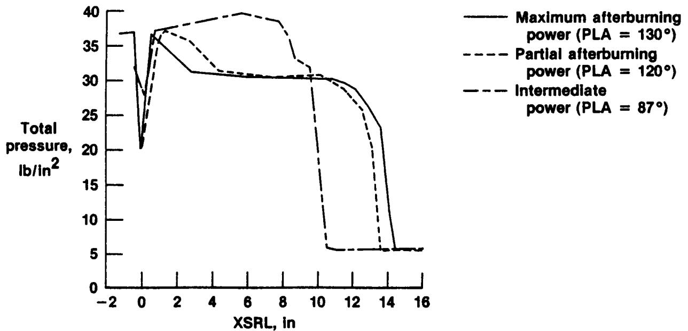

x: XSRL, in, -2 to 16; y: Total pressure, lb/in^2, 0 to 40

| XSRL, in | Maximum afterburning power (PLA = 130°) | Partial afterburning power (PLA = 120°) | Intermediate power (PLA = 87°) |
|----------|-----------------------------------------|-----------------------------------------|--------------------------------|
| -2       | ~37                                     | ~37                                     | ~37                            |
| 0        | ~20                                     | ~20                                     | ~20                            |
| 2        | ~31.5                                   | ~36.5                                   | ~37.5                          |
| 4        | ~31                                     | ~31                                     | ~39                            |
| 6        | ~30.5                                   | ~30.5                                   | ~39.5                          |
| 8        | ~30.5                                   | ~30.5                                   | ~38                            |
| 10       | ~30.5                                   | ~30.5                                   | ~6                             |
| 12       | ~29                                     | ~26                                     | ~6                             |
| 14       | ~6                                      | ~6                                      | ~6                             |
| 16       | ~6                                      | ~6                                      | ~6                             |

A line graph showing total pressure as a function of XSRL in inches for three afterburning power settings, with a sharp drop near 0 inches and a gradual decline to 6 lb/in^2 at higher XSRL.

Line chart: Total pressure versus XSRL for different afterburning power levels.

(a) Total pressure.

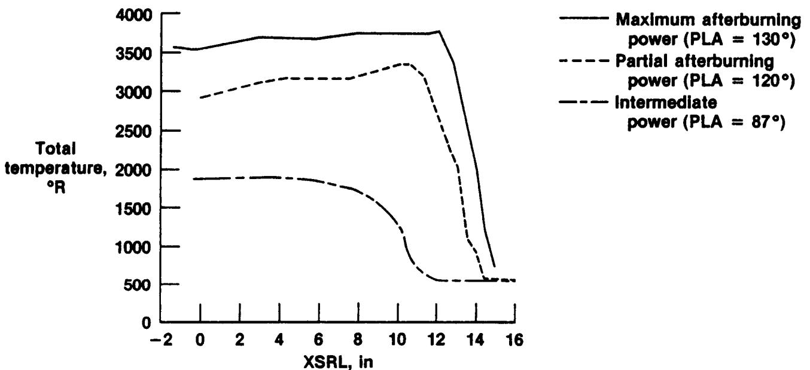

x: XSRL, in, -2 to 16; y: Total temperature, °R, 0 to 4000

| XSRL, in | Maximum afterburning power (PLA = 130°) | Partial afterburning power (PLA = 120°) | Intermediate power (PLA = 87°) |
|----------|-----------------------------------------|-----------------------------------------|--------------------------------|
| -2       | ~3580                                   | ~2950                                   | ~1880                          |
| 0        | ~3550                                   | ~2950                                   | ~1880                          |
| 2        | ~3680                                   | ~3080                                   | ~1890                          |
| 4        | ~3700                                   | ~3180                                   | ~1900                          |
| 6        | ~3700                                   | ~3180                                   | ~1850                          |
| 8        | ~3750                                   | ~3180                                   | ~1720                          |
| 10       | ~3750                                   | ~3350                                   | ~1250                          |
| 12       | ~3750                                   | ~2700                                   | ~580                           |
| 14       | ~1950                                   | ~1050                                   | ~580                           |
| 16       | ~0                                      | ~580                                    | ~580                           |

A line plot of total temperature against XSRL in inches for three afterburning power settings, showing high temperatures that drop sharply between 12 and 15 inches.

Line chart: Total temperature versus XSRL for different afterburning power levels.

(b) Total temperature.

Figure 21. Exhaust-jet profile summaries for nozzle-exit horizontal centerline surveys at various power settings,  $M = 0.87$ , and 24,000-ft altitude.

{31}------------------------------------------------

|                                                                                                                                                                                                                                                                                                                                                                                                                                                                                                                                                                                                                                                                                                                                                                                                                                               |                                                             |                                                                                                     |                                                                      |
|-----------------------------------------------------------------------------------------------------------------------------------------------------------------------------------------------------------------------------------------------------------------------------------------------------------------------------------------------------------------------------------------------------------------------------------------------------------------------------------------------------------------------------------------------------------------------------------------------------------------------------------------------------------------------------------------------------------------------------------------------------------------------------------------------------------------------------------------------|-------------------------------------------------------------|-----------------------------------------------------------------------------------------------------|----------------------------------------------------------------------|
| 1. Report No. <b>NASA TM-88273</b>                                                                                                                                                                                                                                                                                                                                                                                                                                                                                                                                                                                                                                                                                                                                                                                                         | 2. Government Accession No.                                 | 3. Recipient's Catalog No.                                                                          |                                                                      |
| 4. Title and Subtitle <b>Exhaust-Gas Pressure and Temperature Survey of F404-GE-400 Turbofan Engine</b>                                                                                                                                                                                                                                                                                                                                                                                                                                                                                                                                                                                                                                                                                                                                    |                                                             | 5. Report Date <b>December 1986</b>                                                              | 6. Performing Organization Code                                      |
|                                                                                                                                                                                                                                                                                                                                                                                                                                                                                                                                                                                                                                                                                                                                                                                                                                               |                                                             | 8. Performing Organization Report No. <b>H-1375</b>                                              | 10. Work Unit No. <b>RTOP 533-02-08</b>                           |
| 7. Author(s) <b>James T. Walton and Frank W. Burcham, Jr.</b>                                                                                                                                                                                                                                                                                                                                                                                                                                                                                                                                                                                                                                                                                                                                                                              |                                                             | 11. Contract or Grant No.                                                                           | 13. Type of Report and Period Covered <b>Technical Memorandum</b> |
| 9. Performing Organization Name and Address <b>NASA Ames Research Center Dryden Flight Research Facility P.O. Box 273 Edwards, CA 93523-5000</b>                                                                                                                                                                                                                                                                                                                                                                                                                                                                                                                                                                                                                                                                               |                                                             | 14. Sponsoring Agency Code                                                                          |                                                                      |
|                                                                                                                                                                                                                                                                                                                                                                                                                                                                                                                                                                                                                                                                                                                                                                                                                                               |                                                             |                                                                                                     |                                                                      |
| 12. Sponsoring Agency Name and Address <b>National Aeronautics and Space Administration Washington, DC 20546</b>                                                                                                                                                                                                                                                                                                                                                                                                                                                                                                                                                                                                                                                                                                                       |                                                             |                                                                                                     |                                                                      |
| 15. Supplementary Notes                                                                                                                                                                                                                                                                                                                                                                                                                                                                                                                                                                                                                                                                                                                                                                                                                       |                                                             |                                                                                                     |                                                                      |
| 16. Abstract  
An exhaust-gas pressure and temperature survey of the General Electric F404-GE-400 turbofan engine was conducted in the altitude test facility of the NASA Lewis Propulsion System Laboratory. Traversals by a survey rake were made across the exhaust-nozzle exit to measure the pitot pressure and total temperature. Tests were performed at Mach 0.87 and a 24,000-ft altitude and at Mach 0.30 and a 30,000-ft altitude with various power settings from intermediate to maximum afterburning. Data yielded smooth pressure and temperature profiles with maximum jet pressures approximately 1.4 in. inside the nozzle edge and maximum jet temperatures from 1 to 3 in. inside the edge. A low-pressure region located exactly at engine center was noted. The maximum temperature encountered was 3800°R.
 |                                                             |                                                                                                     |                                                                      |
| 17. Key Words (Suggested by Author(s))  <b>Engine thrust Exhaust-jet conditions F404-GE-400 engine Jet temperatures</b>                                                                                                                                                                                                                                                                                                                                                                                                                                                                                                                                                                                                                                                                                                     |                                                             | 18. Distribution Statement  <b>Unclassified — Unlimited</b>  <b>Subject category 07</b> |                                                                      |
| 19. Security Classif. (of this report) <b>Unclassified</b>                                                                                                                                                                                                                                                                                                                                                                                                                                                                                                                                                                                                                                                                                                                                                                                 | 20. Security Classif. (of this page) <b>Unclassified</b> | 21. No. of Pages <b>30</b>                                                                       | 22. Price* <b>A02</b>                                             |

*\*For sale by the National Technical Information Service, Springfield, Virginia 22161.*

---

## Related documents

- [[NASA TP 3001 - Evaluation of Various Thrust Calibration Techniques on an F404 Engine (April 1990)|NASA TP 3001]] - follow-on F404 thrust work at the same facility
- [[ADA164562 The General Electric F404 - Engine of the RAAF's New Fighter|ADA164562]] - RAAF F404 engine description
- [[Powel 1990 - On the Leading Edge, Combining Maturity and Advanced Technology on the F404 Turbofan Engine|Powel 1990]] - GE overview of F404 design and growth
- [[Yuhas 1992 - Effects of Bleed ir Extraction of Thrust Levels of the F404-GE-400 Turbofan Engine|Yuhas 1992]] - effects of bleed air extraction on F404 thrust
- [[NASA TM 4140 - Measurement Effects on the Calculation of In-Flight Thrust for an F404 turbofan engine|NASA TM 4140]] - in-flight thrust calculation for the F404
- [[NASA TM 4538 - Flight-Determine Engine Exhaust Characteristics of an F404 Engine in an F-18 Airplane|NASA TM 4538]] - flight-determined F404 exhaust characteristics
