{0}------------------------------------------------

# GT2010-23402

# LIMITED QUALIFICATION TESTS OF AN F404 ENGINE WITH BLENDED FISCHER TROPSCH SPK AND NATO F-34 FUEL

**Rastko Hadzic, Jeffrey Bird, Wajid A. Chishty\*,**

*National Research Council Canada, Ottawa, Ontario, K1A 0R6, Canada*

**Darrin Little**

*Department of National Defence Canada, Ottawa, Ontario, K1A 0K2, Canada*

**Pierre Poitras**

*Quality Engineering Test Establishment, Gatineau, Quebec, J8X 1C6, Canada*

## ABSTRACT

The purpose of this project was to compare the performance and operability of 50% Fischer-Tropsch Synthetic Paraffinic Kerosene (SPK) and 50% NATO F-34 (JP-8) blend and 100% Jet A-1 in a General Electric F404-400 augmented turbofan engine in the configuration currently in use with the Canadian Forces (CF). The paper describes the main test elements to simulate several aspects of CF use of the engine like acceptance testing, post-overhaul tests, performance (steady state and transient), operability, and durability. An abbreviated endurance test is described as is the special condition monitoring instrumentation. In addition, limited combustor and augmentor combustion stability tests were conducted and some results are described. Fuel properties are documented for reference. The linkage with and support of members of The Technical Cooperation Program (TTCP) is highlighted in terms of joint development of the test plans and sharing the results. Discussions of needs for future limited alternative fuel qualification tests are also presented.

## INTRODUCTION

To reduce the carbon footprint and in turn the impact on global climate change, aviation sectors around the world are trying to increase engine efficiency and support the use of alternative fuels. Not only are current fossil fuel reserves getting low, the marginal extraction costs are

significantly increasing. That creates a new global requirement for fuels from renewable sources. The challenge is to find a source that can be transformed into fuel similar to current jet fuels in order to be used in current engine configurations and to be supplied via the current fuel handling infrastructure.

One of the processes for producing alternative fuels having properties similar to current aviation fuel is the Fischer–Tropsch (F-T) Synthesis. The F-T process is a catalyzed chemical reaction where synthesis gas, a mixture of carbon monoxide and hydrogen, derived from coal, natural gas or biomass, is converted into liquid hydrocarbon fuel.

F-T processed fuels have low aromatic content and almost zero sulfur contents and as such have the potential to reduce emissions of Particulate Matter (PM) and Sulfur Oxides ( $\text{SO}_x$ ) in comparison to the conventional fuels [1]. In addition, the availability of a F-T processed jet fuel also reduces dependency on foreign crude oil supplies, because it may be produced wherever there is a supply of coal, natural gas or biomass. However, the state-of-art F-T production process does produce significant greenhouse gases.

Since the original F-T processed SASOL Iso-Paraffinic Kerosene (IPK), the new synthetic kerosene fuels have been known to contain a significant fraction of normal paraffins as well. In addition they may also contain small, but non-negligible, fractions of cyclo-paraffins. Hence, according to the current accepted terminology, the F-T processed fuels are called Synthetic Paraffinic Kerosene (SPK). Similarly, SPK blended in 50-50 ratio with conventional fuels like Jet A1 or JP-8 (NATO F-34) is now termed as Semi-Synthetic Jet Fuels (SSJF).

---

\* Corresponding Author: [Wajid.Chishty@nrc-cnrc.gc.ca](mailto:Wajid.Chishty@nrc-cnrc.gc.ca)

{1}------------------------------------------------

Semi-Synthetic Jet Fuel obtained using the F-T process has been identified as an alternative fuel for use in military aircraft engines [2]. Since mid-2006 the USAF has conducted a number of fleet-wide engine and flight tests using SSJF comprising various SPK fuels. Their certification process has found no significant differences in operation, performance and handling of SSJF compared to conventional fuel. However, General Electric (GE) F404-400 engines, installed on the F-18, were not certified because they are not used by the USAF. To ensure continued interoperability amongst TTCP nations that use the F404 engine, Department of National Defense (DND) Canada, US Navy and RAAF cooperated on a project to test an augmented F-404 engine in the configuration currently in use with the Canadian Forces (CF). The work was performed at the National Research Council (NRC) Canada.

This paper presents some major results of this project, which was conducted to measure engine performance and to identify any shortcomings of operating the F404 on a semi-synthetic jet fuel comprising a 50-50 blend of SPK and NATO F-34 fuels.

## TEST PLAN AND ELEMENTS

To demonstrate the operability and performance of the GE F404-400 engine when burning SSJF in comparison to conventional Jet-A1 fuel, a test procedure was established to obtain and analyze data. This procedure was developed taking into account the considerations and conditions derived from experience and the following documentation:

- a) Past SSJF fuel tests on the F-101 engine [3].
- b) NRC-DND correlation tests [4].
- c) NRC-DND repair qualification tests [5].
- d) General Electric FMECA [6].
- e) F-404 model specification [7].
- f) Canadian Forces Technical Orders [8].

Based on this information, the following sea level test elements were compiled to meet the expected range of technical requirements:

- a) Operability runs to demonstrate engine functionality on both fuels.
- b) Performance runs to document engine performance with each fuel before and after the endurance (durability) runs.
- c) Endurance runs – shortened accelerated mission simulation from reference 7 (6 cycles each).

Due to specific F404 related concerns, limited combustor and afterburner combustion stability tests were also conducted as were emission tests. However, since the emission test report was not prepared in time for this paper, results or conclusions pertaining to emissions are therefore not presented here. Acoustic testing was planned both for the afterburner and the main combustor sections. The purpose of the afterburner module measurements was to gather and compare rumble and screech noise signatures using both the conventional Jet A-1 and the alternative SSJF. On the other hand the combustor acoustic measurements were done to address a 500 Hz noise concern from DND and to investigate this noise under the alternative SSJF usage. The test matrix that was developed is given in Appendix ‘A’ as Table A-1.

Aviation fuel, Jet A-1 was used for the baseline measurements whereas for the SSJF testing, NATO F-34 (JP-8) fuel was blended with FT-processed SPK in a 50-50 ratio. The SPK used was in turn a blend of coal-to-liquid SASOL IPK (2/3 by volume) and gas-to-liquid from Shell (1/3 by volume). Table B-1 in Appendix ‘B’ lists properties for the baseline Jet A-1, neat SPK and SSJF used in the present campaign. These properties were measured at the DND Quality Engineering Test Establishment as part of fit-for-purpose evaluation process. Table B-2 in Appendix ‘B’ describes the specification requirements for neat Jet A-1 [9], NATO F-34 [10] and SPK [2], as well as fit-for-purpose properties determined under other studies [11]. It may be appreciated that although the properties of the two SPK fuels used in the current testing, individually have very different characteristic values (which may be attributed to notable differences in feedstock, and F-T and refinery processing), the impact is very low on the properties and characteristics of the SSJF.

{2}------------------------------------------------

## TEST FACILITY AND INSTRUMENTATION

The tests were conducted in Test Cell # 4 of the NRC-IAR-Gas Turbine Laboratory. This cell has a cross section of 7.7m x 7.7m by 23m long with a capacity for 800 lb/s of airflow and 50,000 lbf. thrust; it was equipped with: water injection exhaust cooling system for afterburner operation, an in-house VXI-based data acquisition system with over 1000 channels, and a 32 channel high speed (100 kHz) data system.

Conventional instrumentation was typical of development work for this engine and included pressure and temperature rakes at the fan exit, compressor exit and low pressure turbine exit. The latter rakes were compatible with a special development version of the afterburner (A/B) module made available for this test.

The following special hardware was used for this test:

- 17 type K thermocouples to measure temperature distribution on the A/B liner.
- 4 dynamic pressure transducers for the acoustic measurements in the main combustor module.
- 2 dynamic pressure transducers for the acoustic measurements in the A/B.
- Electrostatic debris measurement hoop to sense particles in the exhaust.
- Microphones at inlet and exit planes to measure near field acoustic spectra.
- Tailpipe exhaust plane static pressure tubes.
- Exhaust flow emissions probe.

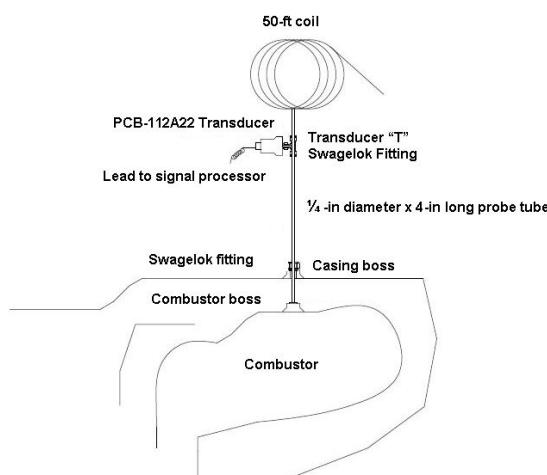

50-ft coil  
PCB-112A22 Transducer  
Transducer "T"  
Swagelok Fitting  
Lead to signal processor  
¼ -in diameter x 4-in long probe tube  
Swagelok fitting  
Casing boss  
Combustor boss  
Combustor

A technical diagram showing a 50-ft coil connected to a PCB-112A22 transducer, which is attached via a transducer 'T' and swagelok fitting to a ¼-in diameter probe tube inserted into a combustor through a casing boss.

Technical illustration: Schematic diagram of a transducer probe assembly in a combustor.

FIGURE 1: SCHEMATIC OF THE COMBUSTOR ACOUSTIC INSTRUMENTATION (NOT TO SCALE).

Pressure transducers from PCB model 112A22 were used for the acoustic measurements in the combustor and the augmentor tailpipe sections. Four transducers were used in the combustor, circumferentially separated by 90 degrees. Figure 1 shows the schematic of the combustor acoustic instrumentation. The transducers were installed on a wave-guide probe, 4-in outside the engine casing. The combustor was instrumented with an “infinite-line” arrangement, using a 50-ft tubing-coil, to avoid pickup of acoustic reflections. As shown in Figure 2, the combustor borescope ports were utilized for the transducer-probe access by replacing the borescope plugs with specially-fabricated plugs.

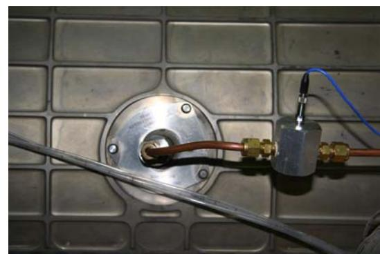

A photograph showing a circular metal flange on a ribbed metal surface, with a copper tube passing through it and connected via brass fittings to a cylindrical sensor unit with a blue wire.

Photo: Sensor and copper tubing assembly mounted on a metal tank wall.

FIGURE 2: COMBUSTOR BORESCOPE PORTS INSTRUMENTED WITH DYNAMIC PRESSURE TRANSDUCER.

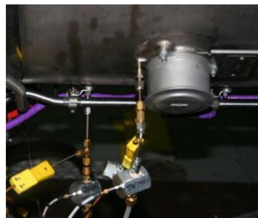

01461  
5042961

A photograph showing the underside of a vehicle chassis with a cylindrical component, metal pipes, and two sensor units labeled with numbers.

Photo: Undercarriage of a vehicle with attached sensors and fluid lines.

FIGURE 3: AFTERBURNER MODULE INSTRUMENTED WITH DYNAMIC PRESSURE TRANSDUCERS.

Two pressure transducers were used in the afterburner module, one at 7 o’clock (~200 deg) position and the other at 8 o’clock (~250 deg) position. As shown in Figure 3, the access for the 7 o'clock transducer-port was obtained by modifying a stud on an oil pipe bracket boss, while the 8 o'clock port access was achieved by modifying a stud hole on the afterburner flame detector boss.

{3}------------------------------------------------

The measurement uncertainty in the reported results was estimated as (percent of reading): corrected speeds- 0.4, pressure ratios- 0.2, temperature ratios- 0.9, corrected airflow- 0.7, corrected fuel flow- 0.8, corrected thrust-0.6 and specific fuel consumption- 0.9. These uncertainty estimates include contributions from instrument calibration hierarchy, signal processing and data reduction.

## TEST RESULTS – PERFORMANCE AND OPERABILITY

The examination of the SSJF effects on engine performance (steady state) and operability (starts and transients) is presented in this section, with reference to similar operations with Jet A-1. The test data were all corrected for ambient conditions and were run under similar ambient conditions, i.e. theta and delta of 0.99-1.01, except for the Post-Endurance SSJF test for which theta was 0.96. The test results to be shown cover two power hooks of double points for each of the four cases: pre- and post-endurance for each of the two fuels.

### Starts

Engine start characteristics were gathered through the program. Time to Light and Time to Idle results were 7.9 to 8.1 s and 20.0 to 21.3 s, respectively, both with standard deviations of approximately 0.3 s. The SSJF results were within the range of the Jet A-1 results confirming the overall similarity of starts for the two fuels.

However, temperature transients during start are of concern for engine durability reasons. Figure 4 shows the exhaust gas temperature transients for similar throttle inputs. The variation of maximum exhaust gas temperature (EGT) was less than 1 %. The one second slower transient for the pre-endurance Jet A-1 results was attributed to a slightly slower throttle movement, longer than the half second tolerance for maximum acceleration. This test result underlined the need for detailed test procedure instructions to ensure comparable datasets. No significant effects on start were observed resulting from the endurance tests series.

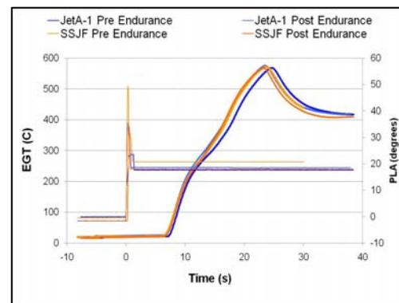

x: Time (s), -10 to 40; y: EGT (C), 0 to 600; y2: PLA (degrees), -10 to 60

| Time (s) | JetA-1 Pre Endurance (EGT) | SSJF Pre Endurance (EGT) | JetA-1 Post Endurance (EGT) | SSJF Post Endurance (EGT) | JetA-1 Pre Endurance (PLA) | SSJF Pre Endurance (PLA) | JetA-1 Post Endurance (PLA) | SSJF Post Endurance (PLA) |
|----------|----------------------------|--------------------------|-----------------------------|---------------------------|----------------------------|--------------------------|-----------------------------|---------------------------|
| -10      | ~20                        | ~20                      | ~20                         | ~20                       | ~0                         | ~0                       | ~0                          | ~0                        |
| 0        | ~20                        | ~20                      | ~20                         | ~20                       | ~20                        | ~20                      | ~20                         | ~20                       |
| 10       | ~200                       | ~200                     | ~200                        | ~200                      | ~20                        | ~20                      | ~20                         | ~20                       |
| 20       | ~450                       | ~450                     | ~450                        | ~450                      | ~20                        | ~20                      | ~20                         | ~20                       |
| 25       | ~560                       | ~570                     | ~560                        | ~570                      | ~20                        | ~20                      | ~20                         | ~20                       |
| 30       | ~450                       | ~430                     | ~450                        | ~430                      | ~20                        | ~20                      | ~20                         | ~20                       |
| 40       | ~410                       | ~410                     | ~410                        | ~410                      | ~20                        | ~20                      | ~20                         | ~20                       |

A dual-axis line chart showing EGT and PLA versus time for JetA-1 and SSJF pre and post endurance, with a sharp rise in EGT around 0 s and a peak around 25 s.

Line chart: EGT and PLA over time for JetA-1 and SSJF pre and post endurance.

FIGURE 4: COMPARISON OF ENGINE START TRANSIENTS.

### Steady State

**Control Repeatability:** The repeatability of the variable geometry functions of the engine is essential for the comparability of data sets. The measured values are shown in this section with the primary control parameter as the independent variable.

The repeatability of the fan variable geometry, scheduled with corrected fan rotor speed (N1 rotor speed and fan inlet temperature) is shown in Figure 5. No biases are noted within a  $\pm 2^\circ$  scatter which also depends on a variation in the corrected speed of  $\pm 0.5\%$ .

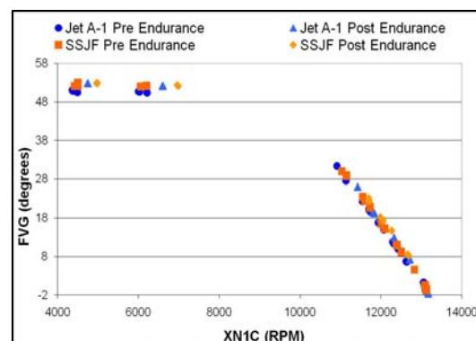

x: XN1C (RPM), 4000 to 14000; y: FVG (degrees), -2 to 58

| XN1C (RPM) | Jet A-1 Pre Endurance | SSJF Pre Endurance | Jet A-1 Post Endurance | SSJF Post Endurance |
|------------|-----------------------|--------------------|------------------------|---------------------|
| ~4400      | ~48                   | ~50                | ~50                    | ~50                 |
| ~4700      | ~48                   | ~50                | ~50                    | ~50                 |
| ~6200      | ~48                   | ~50                | ~49                    | ~50                 |
| ~6700      | ~48                   | ~50                | ~49                    | ~50                 |
| ~10900     | ~28                   | ~29                | ~28                    | ~29                 |
| ~11100     | ~26                   | ~27                | ~26                    | ~27                 |
| ~11300     | ~24                   | ~25                | ~24                    | ~25                 |
| ~11500     | ~22                   | ~23                | ~22                    | ~23                 |
| ~11700     | ~20                   | ~21                | ~20                    | ~21                 |
| ~11900     | ~18                   | ~19                | ~18                    | ~19                 |
| ~12100     | ~16                   | ~17                | ~16                    | ~17                 |
| ~12300     | ~14                   | ~15                | ~14                    | ~15                 |
| ~12500     | ~12                   | ~13                | ~12                    | ~13                 |
| ~12700     | ~10                   | ~11                | ~10                    | ~11                 |
| ~12900     | ~8                    | ~9                 | ~8                     | ~9                  |
| ~13100     | ~6                    | ~7                 | ~6                     | ~7                  |
| ~13300     | ~4                    | ~5                 | ~4                     | ~5                  |
| ~13500     | ~2                    | ~3                 | ~2                     | ~3                  |
| ~13700     | ~0                    | ~1                 | ~0                     | ~1                  |
| ~13900     | ~-2                   | ~-1                | ~-2                    | ~-1                 |

A scatter plot showing FVG in degrees decreasing linearly as XN1C RPM increases from approximately 10900 to 13900 RPM, with pre-endurance values clustered around 50 degrees and post-endurance values clustered around 50 degrees at lower RPM.

Scatter plot: FVG versus XN1C RPM for Jet A-1 and SSJF pre and post endurance.

FIGURE 5: FAN VARIABLE GEOMETRY REPEATABILITY.

The repeatability of the compressor variable geometry scheduled with corrected compressor rotor speed (N2 rotor speed and compressor inlet temperature) is shown in Figure 6. No biases were noted within a  $\pm 1^\circ$  scatter which also depends on a variation in the corrected speed of  $\pm 1.5\%$ .

{4}------------------------------------------------

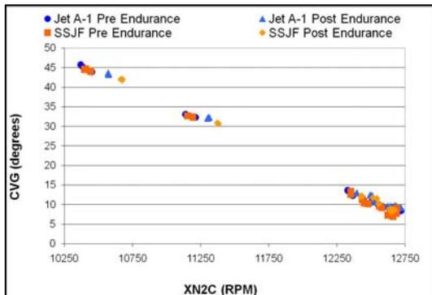

x: XN2C (RPM), 10250 to 12750; y: CVG (degrees), 0 to 50

| XN2C (RPM) | Jet A-1 Pre Endurance | Jet A-1 Post Endurance | SSJF Pre Endurance | SSJF Post Endurance |
|------------|-----------------------|------------------------|--------------------|---------------------|
| ~10400     | ~46                   |                        | ~44                |                     |
| ~10500     |                       |                        | ~43                |                     |
| ~10800     |                       | ~43                    |                    |                     |
| ~10900     |                       |                        |                    | ~42                 |
| ~11100     | ~33                   |                        | ~32                |                     |
| ~11200     |                       | ~32                    |                    |                     |
| ~11300     |                       |                        | ~31                |                     |
| ~11400     |                       | ~31                    |                    | ~30                 |
| ~12500     | ~14                   |                        | ~13                |                     |
| ~12600     |                       | ~12                    | ~11                |                     |
| ~12700     |                       | ~10                    | ~7                 |                     |

A scatter plot showing a decreasing trend of CVG (degrees) as XN2C (RPM) increases, comparing Jet A-1 and SSJF pre and post endurance conditions.

Scatter plot: CVG versus XN2C RPM for Jet A-1 and SSJF pre and post endurance.

FIGURE 6: COMPRESSOR VARIABLE GEOMETRY REPEATABILITY.

The repeatability of the variable nozzle area scheduled with power lever angle (PLA) and exhaust gas temperature trim signals is shown in Figure 7. No biases were noted within a  $\pm 0.5\%$  scatter in the PLA scheduled regime. In the temperature limiting regime the nozzle area is about  $\pm 1\%$  smaller for both fuels across the endurance period. The Pre-Endurance SSJF shows a more closed nozzle by 7%.

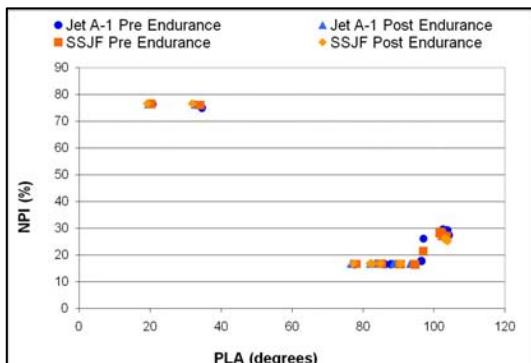

x: PLA (degrees), 0 to 120; y: NPI (%), 0 to 90

| PLA (degrees) | Jet A-1 Pre Endurance | SSJF Pre Endurance | Jet A-1 Post Endurance | SSJF Post Endurance |
|---------------|-----------------------|--------------------|------------------------|---------------------|
| ~20           | ~76                   | ~76                |                        |                     |
| ~32           | ~75                   | ~76                |                        |                     |
| ~76           |                       | ~16                |                        |                     |
| ~80           |                       | ~16                |                        |                     |
| ~84           |                       | ~16                |                        |                     |
| ~88           |                       | ~16                |                        |                     |
| ~92           |                       | ~16                |                        |                     |
| ~96           | ~25                   | ~18                |                        |                     |
| ~98           | ~27                   | ~20                |                        |                     |
| ~100          | ~28                   | ~27                |                        |                     |
| ~102          | ~29                   | ~27                |                        |                     |

A scatter plot showing NPI (%) against PLA (degrees) for Jet A-1 and SSJF before and after endurance, with points clustered around 75% and 16-29%.

Scatter plot: Scatter plot of NPI versus PLA for Jet A-1 and SSJF pre and post endurance.

FIGURE 7: NOZZLE POSITION INDICATION REPEATABILITY.

**Spool Split:** The ratio of the corrected spool speeds provides an indication of any rematching of the components because of changes in the engine condition. Figure 8 shows that for corrected fan speeds less than 7000 rpm the four data sets showed no differences. At the higher speeds, the scatter increased to  $\pm 0.4\%$ , within the estimated uncertainty.

**Fuel Flow:** Engine fuel flow in dry and augmented operation is shown in Figure 9. All cases but the Pre- Endurance SSJF cases showed similar values within  $\pm 0.8\%$ . For this case the

fuel flow was biased lower by some 3%. Other observations of airflow data showed consistent results ( $\pm 0.6\%$ ) for all cases and no shift in the SSJF data, within the expected uncertainty of 0.8%.

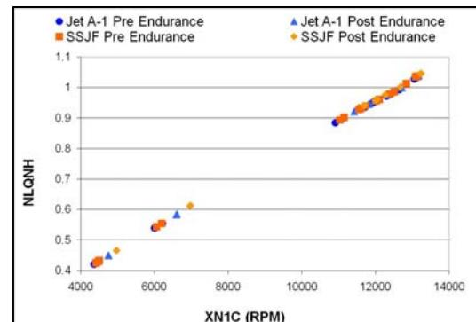

x: XN1C (RPM), 4000 to 14000; y: NLQNH, 0.4 to 1.1

| XN1C (RPM) | Jet A-1 Pre Endurance | SSJF Pre Endurance | Jet A-1 Post Endurance | SSJF Post Endurance |
|------------|-----------------------|--------------------|------------------------|---------------------|
| ~4200      | ~0.42                 | ~0.42              | ~0.42                  | ~0.42               |
| ~4400      | ~0.43                 | ~0.43              | ~0.43                  | ~0.43               |
| ~4600      | ~0.44                 | ~0.44              | ~0.44                  | ~0.44               |
| ~6200      | ~0.53                 | ~0.54              | ~0.54                  | ~0.54               |
| ~6800      | ~0.58                 | ~0.58              | ~0.58                  | ~0.58               |
| ~10800     | ~0.89                 | ~0.89              | ~0.89                  | ~0.89               |
| ~11200     | ~0.91                 | ~0.91              | ~0.91                  | ~0.91               |
| ~11600     | ~0.93                 | ~0.93              | ~0.93                  | ~0.93               |
| ~12000     | ~0.95                 | ~0.95              | ~0.95                  | ~0.95               |
| ~12400     | ~0.97                 | ~0.97              | ~0.97                  | ~0.97               |
| ~12800     | ~0.99                 | ~0.99              | ~0.99                  | ~0.99               |
| ~13200     | ~1.01                 | ~1.01              | ~1.01                  | ~1.01               |

A scatter plot showing a positive linear relationship between XN1C (RPM) and NLQNH, with data points for Jet A-1 and SSJF overlapping closely before and after endurance testing.

Scatter plot: NLQNH versus XN1C (RPM) for Jet A-1 and SSJF pre and post endurance.

FIGURE 8: SPOOL SPEED SPLIT REPEATABILITY.

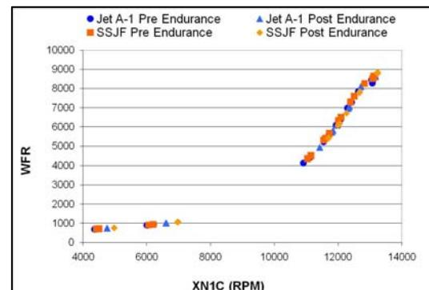

x: XN1C (RPM), 4000 to 14000; y: WFR, 0 to 10000

| XN1C (RPM) | Jet A-1 Pre Endurance | Jet A-1 Post Endurance | SSJF Pre Endurance | SSJF Post Endurance |
|------------|-----------------------|------------------------|--------------------|---------------------|
| ~4300      | ~600                  | ~600                   | ~600               | ~600                |
| ~6300      | ~800                  | ~800                   | ~800               | ~800                |
| ~10900     | ~4100                 |                        |                    |                     |
| ~11000     |                       | ~4100                  |                    |                     |
| ~11100     |                       |                        | ~4200              |                     |
| ~11200     |                       |                        |                    | ~4200               |
| ~11300     |                       |                        | ~4400              | ~4400               |
| ~11400     |                       |                        |                    | ~4500               |
| ~11500     |                       |                        | ~4600              | ~4600               |
| ~11600     |                       |                        |                    | ~4700               |
| ~11700     |                       |                        | ~4800              | ~4800               |
| ~11800     |                       |                        |                    | ~4900               |
| ~11900     |                       |                        | ~5000              | ~5000               |
| ~12000     |                       |                        |                    | ~5100               |
| ~12100     |                       |                        | ~5300              | ~5300               |
| ~12200     |                       |                        |                    | ~5400               |
| ~12300     |                       |                        | ~5600              | ~5600               |
| ~12400     |                       |                        |                    | ~5700               |
| ~12500     |                       |                        | ~5800              | ~5800               |
| ~12600     |                       |                        |                    | ~5900               |
| ~12700     |                       |                        | ~6100              | ~6100               |
| ~12800     |                       |                        |                    | ~6200               |
| ~12900     |                       |                        | ~6400              | ~6400               |
| ~13000     |                       |                        |                    | ~6500               |
| ~13100     |                       |                        | ~6700              | ~6700               |
| ~13200     |                       |                        |                    | ~6800               |
| ~13300     |                       |                        | ~7000              | ~7000               |
| ~13400     |                       |                        |                    | ~7100               |
| ~13500     |                       |                        | ~7300              | ~7300               |
| ~13600     |                       |                        |                    | ~7400               |
| ~13700     |                       |                        | ~7600              | ~7600               |
| ~13800     |                       |                        |                    | ~7700               |
| ~13900     |                       |                        | ~7900              | ~7900               |
| ~14000     |                       |                        |                    | ~8000               |
| ~14100     |                       |                        | ~8200              | ~8200               |
| ~14200     |                       |                        |                    | ~8300               |
| ~14300     |                       |                        | ~8500              | ~8500               |
| ~14400     |                       |                        |                    | ~8600               |
| ~14500     |                       |                        | ~8800              | ~8800               |
| ~14600     |                       |                        |                    | ~8900               |
| ~14700     | ~8300                 |                        |                    |                     |
| ~14800     | ~8500                 |                        |                    |                     |

A scatter plot showing WFR as a function of XN1C (RPM) for Jet A-1 and SSJF pre and post endurance, with values remaining low below 7000 RPM and increasing steeply above 11000 RPM.

Scatter plot: WFR versus XN1C RPM for Jet A-1 and SSJF pre and post endurance.

FIGURE 9: TOTAL FUEL FLOW REPEATABILITY.

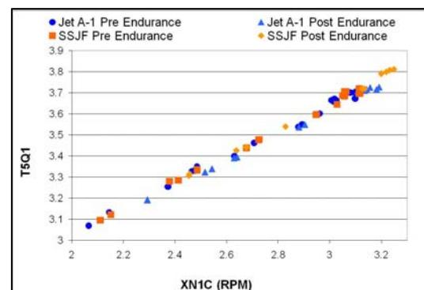

x: XN1C (RPM), 3 to 3.2; y: T5Q1, 3 to 3.9

| XN1C (RPM) | Jet A-1 Pre Endurance | SSJF Pre Endurance | Jet A-1 Post Endurance | SSJF Post Endurance |
|------------|-----------------------|--------------------|------------------------|---------------------|
| ~3.03      | ~3.08                 |                    |                        |                     |
| ~3.05      | ~3.11                 | ~3.12              |                        |                     |
| ~3.09      |                       |                    | ~3.19                  |                     |
| ~3.12      | ~3.25                 | ~3.28              |                        |                     |
| ~3.13      |                       |                    | ~3.31                  |                     |
| ~3.14      | ~3.32                 | ~3.33              |                        |                     |
| ~3.15      |                       |                    | ~3.34                  |                     |
| ~3.16      | ~3.35                 | ~3.36              |                        |                     |
| ~3.17      |                       |                    | ~3.39                  |                     |
| ~3.18      |                       | ~3.42              |                        |                     |
| ~3.19      |                       | ~3.44              |                        |                     |
| ~3.20      |                       | ~3.46              |                        |                     |
| ~3.21      |                       |                    | ~3.39                  |                     |
| ~3.22      |                       |                    | ~3.42                  |                     |
| ~3.23      |                       |                    | ~3.45                  |                     |
| ~3.24      |                       |                    | ~3.48                  |                     |
| ~3.25      |                       |                    | ~3.52                  |                     |
| ~3.26      |                       |                    | ~3.54                  |                     |
| ~3.27      |                       |                    | ~3.56                  |                     |
| ~3.28      |                       |                    | ~3.58                  |                     |
| ~3.29      |                       |                    | ~3.61                  |                     |
| ~3.30      |                       | ~3.64              |                        |                     |
| ~3.31      |                       | ~3.66              |                        |                     |
| ~3.32      |                       | ~3.68              |                        |                     |
| ~3.33      |                       | ~3.70              |                        |                     |
| ~3.34      |                       | ~3.71              |                        |                     |
| ~3.35      |                       |                    | ~3.72                  |                     |
| ~3.36      |                       |                    | ~3.73                  |                     |
| ~3.37      |                       |                    | ~3.74                  |                     |
| ~3.38      |                       |                    | ~3.75                  |                     |
| ~3.39      |                       |                    | ~3.76                  |                     |
| ~3.40      |                       |                    | ~3.77                  |                     |

A scatter plot showing a positive linear relationship between XN1C (RPM) and T5Q1 for Jet A-1 and SSJF both pre and post endurance.

Scatter plot: T5Q1 versus XN1C (RPM) for Jet A-1 and SSJF pre and post endurance.

FIGURE 10: ENGINE TEMPERATURE-PRESSURE RATIO REPEATABILITY.

**Engine Temperature-Pressure Ratio:** This relationship describes the overall engine performance. The cases showed no trends between fuels or across the endurance series (Figure 10). The total scatter was  $\pm 0.5\%$  within the expected uncertainty of  $0.9\%$ .

{5}------------------------------------------------

**Specific Fuel Consumption:** This performance measure is of prime importance to the operator and pilot as it indicates how much fuel is used for the desired thrust. Figure 11 shows that the corrected SFC Jet A-1 results were not affected by the endurance series, i.e. scatter is  $\pm 0.4\%$ . From this baseline, the Pre-Endurance SSJF was observed at  $+1.2\%$  (less efficient) relative to the Jet A-1. Post-Endurance SSJF data showed a  $-1.4\%$  bias from the Jet A-1 suggesting the engine was more efficient after the endurance tests. Comparatively, the Jet A-1 Pre- and Post-Endurance results showed no such improvement within the estimated measurement uncertainty. This difference is still being investigated.

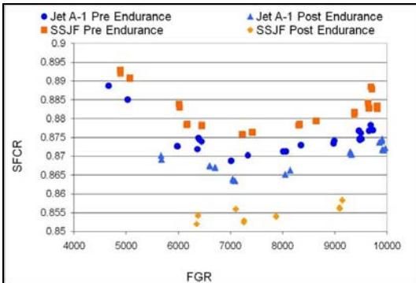

x: FGR, 4000 to 10000; y: SFCR, 0.85 to 0.9

| FGR   | Jet A-1 Pre Endurance | SSJF Pre Endurance | Jet A-1 Post Endurance | SSJF Post Endurance |
|-------|-----------------------|--------------------|------------------------|---------------------|
| ~4750 | ~0.889                | ~0.893             |                        |                     |
| ~5000 | ~0.884                | ~0.891             |                        |                     |
| ~5750 |                       |                    | ~0.868                 |                     |
| ~6000 | ~0.872                | ~0.883             |                        |                     |
| ~6250 | ~0.874                | ~0.878             |                        |                     |
| ~6350 | ~0.870                |                    |                        | ~0.853              |
| ~6400 | ~0.869                | ~0.878             |                        |                     |
| ~6500 |                       |                    | ~0.866                 |                     |
| ~6600 |                       |                    | ~0.867                 |                     |
| ~7000 | ~0.868                |                    | ~0.863                 |                     |
| ~7250 | ~0.870                | ~0.876             |                        | ~0.853              |
| ~7500 |                       | ~0.876             |                        |                     |
| ~8000 | ~0.871                |                    | ~0.865                 |                     |
| ~8100 |                       |                    | ~0.866                 |                     |
| ~8250 | ~0.872                | ~0.879             |                        |                     |
| ~8500 |                       | ~0.879             |                        |                     |
| ~9000 | ~0.873                |                    |                        | ~0.856              |
| ~9100 |                       | ~0.882             |                        |                     |
| ~9250 |                       | ~0.881             | ~0.870                 |                     |
| ~9350 | ~0.876                |                    |                        | ~0.858              |
| ~9400 | ~0.877                |                    |                        |                     |
| ~9500 | ~0.875                | ~0.888             |                        |                     |
| ~9600 | ~0.878                | ~0.883             |                        |                     |
| ~9750 |                       | ~0.883             |                        |                     |
| ~9850 |                       | ~0.884             |                        |                     |
| ~9900 |                       |                    | ~0.872                 |                     |
| ~9950 |                       |                    | ~0.874                 |                     |

A scatter plot showing SFCR plotted against FGR for Jet A-1 and SSJF, comparing pre-endurance and post-endurance conditions.

Scatter plot: Scatter plot of SFCR versus FGR for Jet A-1 and SSJF pre and post endurance.

FIGURE 11: CORRECTED SPECIFIC FUEL CONSUMPTION REPEATABILITY.

### Transient

Engine transient performance variations with the fuel and endurance effects are shown in this section. With the focus on thrust performance, a corrected thrust parameter is used: corrected thrust to corrected airflow ratio, with estimated uncertainty of  $1.1\%$ . Figure 12 shows the four cases for a slam to intermediate rated power (IRP) and a chop back to flight idle. For the slam portion, the peak values for the two Jet A-1 cases were within  $1\%$  and  $0.3$  s; for SSJF the peak values were within  $0.8\%$  and  $0.2$  s. All of the chop transients were similar, improved by the more repeatable throttle motion.

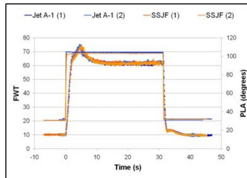

x: Time (s), -10 to 50; y: FWT, 0 to 80; y2: PLA (degrees), 0 to 120

| Time (s) | Jet A-1 (1) | Jet A-1 (2) | SSJF (1) | SSJF (2) |
|----------|-------------|-------------|----------|----------|
| -10      | ~10         | ~10         | ~20      | ~20      |
| 0        | ~10         | ~10         | ~20      | ~20      |
| ~3       | ~70         | ~70         | ~70      | ~70      |
| ~4       | ~70         | ~70         | ~65      | ~65      |
| 10       | ~70         | ~70         | ~62      | ~62      |
| 20       | ~70         | ~70         | ~61      | ~61      |
| 30       | ~70         | ~70         | ~61      | ~61      |
| ~32      | ~20         | ~20         | ~13      | ~13      |
| 40       | ~20         | ~20         | ~10      | ~10      |
| 50       | ~20         | ~20         | ~10      | ~10      |

A dual-axis line chart showing FWT and PLA as a function of time, where both FWT and PLA rise sharply around 3 seconds, remain constant until 32 seconds, and drop sharply to a lower steady state.

Line chart: FWT and PLA over time for Jet A-1 and SSJF.

FIGURE 12: THRUST FUNCTION TRANSIENTS BETWEEN FLIGHT IDLE TO IRP REPEATABILITY.

Figure 13 shows data for comparable slams and chops between IRP to maximum afterburner. For the slam portion, the peak values for the two Jet A-1 cases were within  $0.3\%$  and  $0.1$  s; for SSJF the peak values were within  $1\%$  and  $0.3$  s. Again, the chop transients were similar.

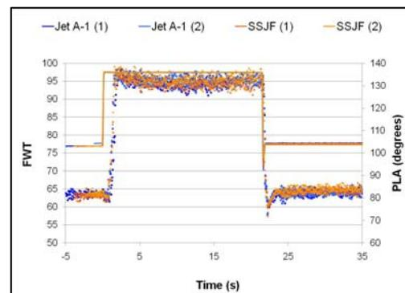

x: Time (s), -5 to 35; y: FWT, 50 to 100; y2: PLA (degrees), 60 to 140

| Time (s) | Jet A-1 (1) | Jet A-1 (2) | SSJF (1) | SSJF (2) |
|----------|-------------|-------------|----------|----------|
| -5       | ~64         | ~64         | ~77      | ~63      |
| 5        | ~95         | ~95         | ~95      | ~95      |
| 15       | ~95         | ~95         | ~95      | ~95      |
| 25       | ~63         | ~63         | ~77      | ~63      |
| 35       | ~63         | ~63         | ~77      | ~63      |

A dual-axis line plot showing FWT and PLA values over time for Jet A-1 and SSJF, where values step up around 2 s and step down around 22 s.

Line chart: FWT and PLA over time for Jet A-1 and SSJF.

FIGURE 13: THRUST FUNCTION TRANSIENTS BETWEEN IRP AND MAXIMUM.

### Afterburner

Hot end life is a concern for all operators. The results from the special instrumentation on the afterburner (A/B) module and nozzle components are reviewed in this section to ensure that the measured thermal environment is no worse with the SSJF.

Figure 14 illustrates the temperature transients for a location on the outer wall of the afterburner liner. Transients and peak temperatures about  $550$  K were similar for all of the cases.

{6}------------------------------------------------

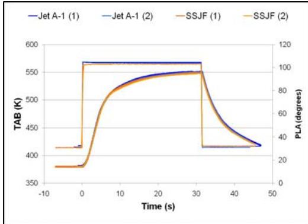

x: Time (s), -10 to 50; y: TAB (K), 350 to 600; y2: PLA (degrees), 0 to 120

| Time (s) | Jet A-1 (1) | Jet A-1 (2) | SSJF (1) | SSJF (2) |
|----------|-------------|-------------|----------|----------|
| -5       | ~380        | ~380        | ~415     | ~415     |
| 0        | ~380        | ~380        | ~415     | ~415     |
| 10       | ~565        | ~565        | ~520     | ~520     |
| 20       | ~565        | ~565        | ~545     | ~545     |
| 30       | ~565        | ~565        | ~550     | ~550     |
| 32       | ~415        | ~415        | ~415     | ~415     |
| 40       | ~415        | ~415        | ~435     | ~435     |
| 47       | ~415        | ~415        | ~415     | ~415     |

A dual-axis line chart showing temperature and pressure over time for Jet A-1 and SSJF, where both remain constant until a step increase at 0 s, peak around 30 s, and drop back down after 32 s.

Line chart: Comparison of TAB and PLA over time for Jet A-1 and SSJF.

FIGURE 14: AFTERBURNER LINER TEMPERATURE TRANSIENTS BETWEEN FLIGHT IDLE AND IRP.

Temperature transients (Flight idle to IRP) for the outer wall of the nozzle- convergent portion are shown in Figure 15. Transients were similar but peak values for the Post-Endurance SSJF were some 2% lower than the nominal 495K values for the other cases.

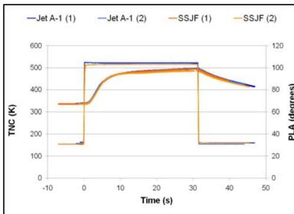

x: Time (s), -10 to 50; y: TNC (K), 0 to 600; y2: PLA (degrees), 0 to 120

| Time (s) | Jet A-1 (1) | Jet A-1 (2) | SSJF (1) | SSJF (2) |
|----------|-------------|-------------|----------|----------|
| -5       | ~150        | ~150        | ~330     | ~330     |
| 0        | ~150        | ~150        | ~330     | ~330     |
| 10       | ~520        | ~520        | ~470     | ~470     |
| 20       | ~520        | ~520        | ~490     | ~490     |
| 30       | ~520        | ~520        | ~490     | ~490     |
| 32       | ~150        | ~150        | ~150     | ~150     |
| 40       | ~450        | ~450        | ~450     | ~450     |
| 47       | ~410        | ~410        | ~410     | ~410     |

A dual-axis line chart showing TNC (K) and PLA (degrees) versus time (s) for Jet A-1 and SSJF, where both curves step up around 0 s, plateau, and drop sharply around 32 s.

Line chart: TNC and PLA over time for Jet A-1 and SSJF.

FIGURE 15: TEMPERATURE TRANSIENTS FOR NOZZLE CONVERGENT SECTION OUTER SURFACE.

Temperature transients (Flight idle to IRP) for the outer wall of the nozzle- divergent portion are shown in Figure 16. Transients were again similar but peak values for the Post-Endurance SSJF were up to 2.5% lower than the nominal 525K values for the other cases.

### Performance and Operability Discussion

Based on the variable geometry results, it is postulated that the engine did not change its basic characteristics or setup during the test program. Thus the observed changes or lack thereof are attributed to the fuel.

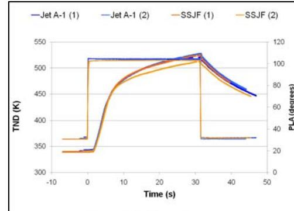

x: Time (s), -10 to 50; y: TND (K), 300 to 550; y2: PLA (degrees), 0 to 120

| Time (s) | Jet A-1 (1) | Jet A-1 (2) | SSJF (1) | SSJF (2) |
|----------|-------------|-------------|----------|----------|
| -5       | ~338        | ~338        | ~362     | ~362     |
| 0        | ~338        | ~338        | ~362     | ~362     |
| 10       | ~475        | ~475        | ~475     | ~475     |
| 20       | ~515        | ~515        | ~500     | ~500     |
| 30       | ~518        | ~518        | ~518     | ~518     |
| 32       | ~520        | ~520        | ~520     | ~520     |
| 40       | ~475        | ~475        | ~465     | ~465     |
| 47       | ~445        | ~445        | ~445     | ~445     |

A dual-axis line chart showing TND (K) and PLA (degrees) versus Time (s) for Jet A-1 and SSJF, where both curves rise sharply around 0 s, peak around 30-32 s, and decline after 32 s.

Line chart: TND and PLA over time for Jet A-1 and SSJF.

FIGURE 16: TEMPERATURE TRANSIENTS FOR THE NOZZLE DIVERGENT SECTION OUTER SURFACE.

The only significant ambiguity is the bias in the fuel flow (and thus SFC). From Table A1, the SSJF characteristics are +1.3% in net heat of combustion and -3.6% in density relative to the Jet A-1. Neither of these fuel characteristic differences was accommodated in the engine settings, the density setting remained throughout at 0.81. However, those changes were included in the calculation of fuel mass flow and thus SFC.

The results presented for a similar test [12] with a T63 detected the following changes with a similar fuel: reduced combustor pressure loss, and increased engine efficiency. A similar efficiency change was measured here but unfortunately no combustor pressure loss measurement was possible.

## TEST RESULTS – DYNAMIC STABILITY

### Combustion Oscillations

The data obtained from all the four dynamic pressure transducers on the combustor showed similar profiles. Acoustic signatures from the 3 o’clock pressure transducers are presented here. The vertical axis represents the amplitude of the pressure oscillations with respect to the absolute pressure at the measured location. Figure 17 shows a power spectrum captured during the pre-endurance baseline Jet A-1 test at N2 of 13900 rpm. Two tonal peaks corresponding to N1 and N2 rotor frequencies (one per revolution signal) were observed as was a broadband peak around 515Hz. The broadband noise was only observed between N2 of about 13,000 and 14,500 rpm.

{7}------------------------------------------------

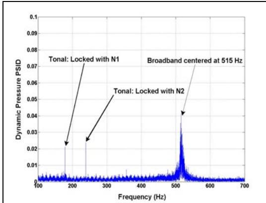

Tonal: Locked with N1  
Broadband centered at 515 Hz  
Tonal: Locked with N2

x: Frequency (Hz), 100 to 700; y: Dynamic Pressure PSD, 0 to 0.1

| Frequency (Hz) | Dynamic Pressure PSD |
|----------------|----------------------|
| 100            | ~0.003               |
| 200            | ~0.003               |
| 300            | ~0.003               |
| 400            | ~0.003               |
| 500            | ~0.005               |
| ~515           | ~0.042               |
| 600            | ~0.002               |
| 700            | ~0.002               |

A dynamic pressure power spectral density plot against frequency, featuring two low-amplitude tonal peaks around 170 Hz and 250 Hz, and a prominent broadband peak centered near 515 Hz.

Spectrum: Dynamic pressure PSD versus frequency showing tonal and broadband components.

FIGURE 17: POWER SPECTRUM OF ACOUSTIC PRESSURE SIGNAL AT 13900 RPM N2 WITH JET A-1 AS FUEL.

Figure 18 shows a comparison of the above mentioned 515 Hz broadband noise signature obtained from Jet A-1 and SSJF tests. A minor increase in magnitude (from 0.04 psid to 0.05 psid) and a slight shift in frequency (from 515 Hz to 520 Hz) were observed with SSJF. That shift in frequency was expected since it corresponds to 2.2 times N2 rotor speed frequency for all conditions.

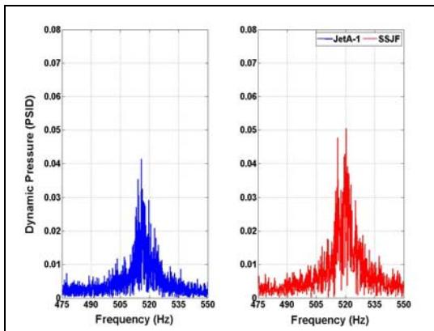

x: Frequency (Hz), 475 to 550; y: Dynamic Pressure (PSID), 0 to 0.08

| Frequency (Hz) | JetA-1 |
|----------------|--------|
| 475            | ~0.003 |
| 490            | ~0.004 |
| 505            | ~0.008 |
| ~515           | ~0.041 |
| 535            | ~0.005 |
| 550            | ~0.003 |

| Frequency (Hz) | JetA-1 | SSJF   |
|----------------|--------|--------|
| 475            | ~0.003 | ~0.003 |
| 490            | ~0.004 | ~0.004 |
| 505            | ~0.008 | ~0.008 |
| ~515           | ~0.041 | ~0.050 |
| 535            | ~0.005 | ~0.005 |
| 550            | ~0.003 | ~0.003 |

Two side-by-side line charts showing dynamic pressure power spectral density against frequency, with a prominent peak around 515 Hz. The right panel compares JetA-1 in blue and SSJF in red.

Multi-panel chart: Dynamic pressure PSD versus frequency for JetA-1 and SSJF.

FIGURE 18: COMPARISON OF BROADBAND NOISE SIGNATURES. LEFT: JET A-1. RIGHT: SSJF.

### Afterburner Rumble and Screech

The dynamic pressure data obtained from the two transducers installed in the tailpipe section showed similar profiles. Response from the 7 o'clock transducer is presented here as a sample. Figure 19 is a time plot showing the pressure response of the tailpipe under slow and rapid accelerations/decelerations using Jet A-1 and

SSJF. The corresponding power lever angle (PLA) transients are also shown for reference. Allowing for the differences in the PLA settings, no significant differences were observed as a result of change in fuel.

The power spectra from the 7 o'clock tailpipe pressure transducer are shown in Figure 20 at IRP and Max A/B run conditions using Jet A-1 fuel. Two dominant broadband noise peaks at 182 Hz and at 640 Hz were observed under Max A/B conditions. These two broadband peaks were also observed when running on SSJF.

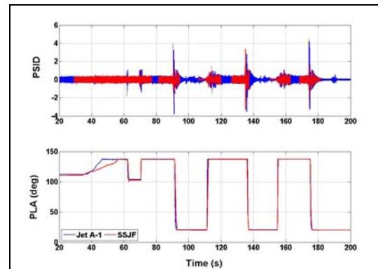

x: Time (s), 20 to 200; y: PSID, -4 to 6; y: PLA (deg), 0 to 150

| Time (s) | Jet A-1 | SSJF |
|----------|---------|------|
| 20       | ~0      | ~0   |
| 40       | ~0      | ~0   |
| 60       | ~0      | ~0   |
| 80       | ~0      | ~0   |
| 100      | ~0      | ~0   |
| 120      | ~0      | ~0   |
| 140      | ~0      | ~0   |
| 160      | ~0      | ~0   |
| 180      | ~0      | ~0   |
| 200      | ~0      | ~0   |

| Time (s) | Jet A-1 | SSJF |
|----------|---------|------|
| 20       | ~110    | ~110 |
| 40       | ~115    | ~115 |
| 60       | ~135    | ~135 |
| 80       | ~135    | ~135 |
| 100      | ~135    | ~135 |
| 120      | ~135    | ~135 |
| 140      | ~135    | ~135 |
| 160      | ~135    | ~135 |
| 180      | ~135    | ~135 |
| 200      | ~135    | ~135 |

Two stacked line charts show PSID and PLA over time. The top panel shows PSID oscillating around zero with peaks near 90, 135, and 175 seconds. The bottom panel shows PLA stepping up to 135 degrees and holding.

Multi-panel chart: Time history of PSID and PLA for Jet A-1 and SSJF.

FIGURE 19: AFTERBURNER TAILPIPE PRESSURE RESPONSE TO SLOW AND RAPID ACCELERATION AND DECELERATION. TOP: TRANSDUCER PRESSURE SIGNATURES. BOTTOM: POWER LEVER ANGEL DISPLACEMENT.

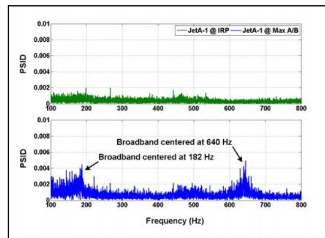

Broadband centered at 640 Hz  
Broadband centered at 182 Hz

x: Frequency (Hz), 100 to 800; y: PSID, 0 to 0.01

| Frequency (Hz) | JetA-1 @ IRP | JetA-1 @ Max A/B |
|----------------|--------------|------------------|
| 100            | ~0.001       | ~0.001           |
| 200            | ~0.001       | ~0.001           |
| 300            | ~0.001       | ~0.001           |
| 400            | ~0.001       | ~0.001           |
| 500            | ~0.001       | ~0.001           |
| 600            | ~0.001       | ~0.001           |
| 700            | ~0.001       | ~0.001           |
| 800            | ~0.001       | ~0.001           |

| Frequency (Hz) | JetA-1 @ Max A/B |
|----------------|------------------|
| 100            | ~0.001           |
| 182            | ~0.004           |
| 200            | ~0.001           |
| 300            | ~0.001           |
| 400            | ~0.001           |
| 500            | ~0.001           |
| 640            | ~0.004           |
| 700            | ~0.001           |
| 800            | ~0.001           |

Two stacked line charts showing PSID as a function of frequency from 100 to 800 Hz. The top panel compares JetA-1 at IRP and Max A/B, while the bottom panel highlights broadband peaks at 182 Hz and 640 Hz.

Multi-panel chart: Comparison of PSID versus frequency for JetA-1 at IRP and Max A/B.

FIGURE 20: POWER SPECTRA OF AFTERBURNER TAILPIPE ACOUSTIC PRESSURE SIGNAL WITH JET A-1 AS FUEL. TOP: AT IRP. BOTTOM: AT MAX A/B.

{8}------------------------------------------------

Figure 21 gives a comparison of the 640 Hz peak under Max A/B conditions and obtained from Jet A-1 and SSJF tests. No considerable differences were observed as a result of change in fuel.

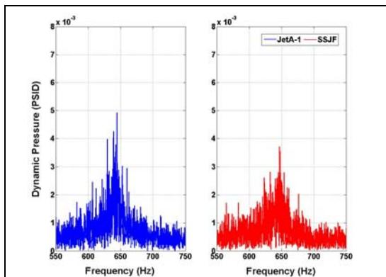

x 10^-3  
x 10^-3

x: Frequency (Hz), 550 to 750; y: Dynamic Pressure (PSID), 0 to 8 x 10^-3

| Frequency (Hz) | Dynamic Pressure (PSID) |
|----------------|-------------------------|
| 550            | ~0.5 x 10^-3            |
| 600            | ~1.0 x 10^-3            |
| 650            | ~4.9 x 10^-3            |
| 700            | ~0.8 x 10^-3            |
| 750            | ~0.5 x 10^-3            |

| Frequency (Hz) | JetA-1       | SSJF         |
|----------------|--------------|--------------|
| 550            | ~0.5 x 10^-3 | ~0.5 x 10^-3 |
| 600            | ~1.0 x 10^-3 | ~1.0 x 10^-3 |
| 650            | ~2.5 x 10^-3 | ~2.5 x 10^-3 |
| 700            | ~0.8 x 10^-3 | ~0.8 x 10^-3 |
| 750            | ~0.5 x 10^-3 | ~0.5 x 10^-3 |

Two side-by-side line charts showing dynamic pressure as a function of frequency, both peaking around 650 Hz, with the right panel comparing JetA-1 and SSJF.

Multi-panel chart: Dynamic pressure versus frequency for JetA-1 and SSJF.

**FIGURE 21: COMPARISON OF AFTERBURNER TAILPIPE BROADBAND NOISE SIGNATURES. LEFT: JET A-1, RIGHT: SSJF.**

## CONCLUSIONS

A comprehensive test program was developed and executed to cover a range of performance and operability demonstrations that would be of interest to a fleet operator when investigating possible effects of changes in fuel stocks.

Engine operation for the duration of the test program, even including a limited accelerated mission simulation was consistent and without significant degradation. Preliminary results of hot section temperature surveys showed similar operating conditions with both fuels. Measured fuel flows and efficiencies were measured consistent with fuel property differences between the fuels but further investigations are underway to quantify other possible effects. Borescope and detailed internal inspections are still to be completed to fully document any local damage or fuel nozzle fouling.

The comparative analysis discussed in the preceding sections indicates that this SSJF had little or no significant effect on the performance and operability of GE F404 engine used in the current test campaign.

### **Need for Future Alternative Fuels Qualification Tests**

The use of SSJF blended with SPK and conventional jet fuels in a 50-50 proportion has

been approved for both military and civil aviation. As new and sustainable alternative fuels, especially those derived from biomass, are developed, the need for qualification will continue in order to obtain a specification approval for their use. The purpose of this qualification process is to ensure that the candidate fuels and their blends will have no negative impact on engine safety, durability, or performance as well as to ensure their compatibility with existing fuel handling infrastructure.

Ideally, not all new fuels and their blends will require an engine test under the qualification process. However, the necessity for such testing will be dictated by the nature and chemistry of the fuels and will be at the discretion of the engine/aircraft manufacturers and the operators.

In addition to the performance qualification, emission measurements are also essential to assess the impact of alternative-fuel combustion on air quality. These include sea-level static as well as high-altitude tests, conducted either under simulated-altitude conditions in a test cell or actual airborne flights.

## ACKNOWLEDGEMENTS

The authors acknowledge the Department of National Defence, Captain Michael Clement and DGAEPM technical support for supplying the engine, Mr. Tim Hurley from GE for supplying engine testing documentation and expertise, the USAF and the US Navy for providing the SPK fuel and Environment Canada in supplying expertise, equipment and data for the emission measurements. Cooperation and data exchange under the TTCP project AER-TP3- CP 3B.1 also involving Australia are acknowledged. The authors also thank Mr. Marcel Fournier, Mr. David Manchip, Mr. Lennard Nelson and Ms. Natasha Jackson for their efforts in setting up the test facility and the instrumentation, conducting the tests and processing the data.

## REFERENCES

- [1] Hileman, J. I., Ortiz, D. S., Bartis, J. T., Wong, H. M., Donohoo, P. E., Weiss, M. A. and Waitz, I. A., 2009, “Near-Term Feasibility of Alternative Jet Fuels”, *Rand Corporation*, Pittsburg.
- [2] 2008, “Detail Specification Turbine Fuel, Aviation, Kerosene type, JP-8 (NATO F-

{9}------------------------------------------------

- 34), NATO F-35, and JP-8+100 (NATO F-37)”, *MIL-DTL-83133F*.
- [3] Mienko, A.P and Rolfes, J, 2008, “Alternate Fuels Test F101-102, ESN 470130/1”, *GE R2008AE544*.
- [4] Bird, J.W. and Mulligan, M. F., 1987, “CF18/F404 Engine Test Facility Correlation Test Plan: DND Test Cells Referenced to NRCC/Engine Lab Cell”, *NRC CTR-ENG-009*.
- [5] Mulligan, M.F., 1996, “CFB Bagotville CF18/F404 Engine Test Facility Correlation Test Results”, *NRC LTR ST-206*.
- [6] Zakak, V.H., 1979, “F404 Failure Modes, Effects and Criticality Analysis (FMECA)”, *GE R79AEG005*.
- [7] GE, 1975, “Model Specification for F404-GE-400 Turbofan Engine”, *No. CP45K0006*.
- [8] Canadian Forces, “Intermediate Maintenance Manual”, *C-14-404-000/MN024*.
- [9] Coordination Research Council Inc, 2004, “Handbook of Aviation Fuel Properties”, 3rd Edition, *CRC Report # 635*.
- [10] Canadian General Standards Board, 2008, “Aviation Turbine Fuel (Military Grades F-34 and F-44)”, *CGSB-3.24-2008*.
- [11] Coordination Research Council Inc. and United Technology Corporation, 2008, “Comparative Evaluation of Semi-Synthetic Jet Fuels – Final Report”, *CRC Project # AV-2-04a*.
- [12] Bester, N. and Yates, Andy, 2009, “Assessment of the Operational Performance of Fischer-Tropsch Synthetic Paraffinic Kerosene in a T63 Gas Turbine Engine Compared to Conventional Jet A-1 Fuel,” ASME Turbo Expo 2009, June 8-12, 2009 Orlando, ASME 2009-60333.

## Appendix ‘A’ – Test Matrix

**Table A-1: Test matrix developed for the limited qualification tests.**

| Test                | Part Power Dwell Time [min] | IRP Dwell Time [min] | A/B Dwell Time [min] | Comment                                                            |
|---------------------|-----------------------------|----------------------|----------------------|--------------------------------------------------------------------|
| <b>Operability</b>  |                             |                      |                      | <b>Both fuels</b>                                                  |
| Mechanical Checkout | 30 x 2                      | 8 x 2                | 5 x 2                | Only before durability                                             |
| Ground Start        | 15 x 2                      | 0                    | 0                    | Only before durability                                             |
| A/B Light-off       | 19 x 4                      | 2 x 4                | 4 x 4                | Performed before and after durability                              |
| Screech and Rumble  | 18 x 4                      | 2 x 4                | 5 x 4                | Performed before and after durability                              |
| Operational Issues  | 26 x 4                      | 6 x 4                | 0                    | Performed before and after durability                              |
| Emissions Test      | 50 x 4                      | 5 x 4                | 0                    | Performed before and after durability                              |
| <b>Performance</b>  |                             |                      |                      | <b>Both fuels</b>                                                  |
| Steady State        | 46 x 8                      | 10 x 8               | 8 x 8                | Two (back to back) runs with each fuel before and after durability |
| Transient State     | 12 x 8                      | 4 x 8                | 1 x 8                | Two (back to back) runs with each fuel before and after Durability |
| <b>Durability</b>   |                             |                      |                      | <b>SSJF Fuel blend only</b>                                        |
| 6 Endurance Cycles  | 281 x 6                     | 22 x 6               | 43 x 6               |                                                                    |
| Total               | 2692                        | 300                  | 376                  | 3368 min = 56 h 8 min                                              |

Part Power – power setting between idle and maximum

IRP – Intermediate Rated Power – maximum dry power setting

A/B – afterburner power setting

{10}------------------------------------------------

## Appendix 'B' – Fuel Specifications

**Table B-1: Specification of the fuels and fuel blends used for current tests.**

| Description                                          | CGSB Specification Limits [Ref. 10] | SSJF (Pre-Endurance) | NATO F-34 | SPK Blend | Shell GTL Kerosene | Sasol IPK | SSJF (Post-Endurance) |
|------------------------------------------------------|-------------------------------------|----------------------|-----------|-----------|--------------------|-----------|-----------------------|
| <b>Net Heat of Combustion</b> [MJ/kg] ASTM D4529     | <b>42.8 min</b>                     | 43.58                | 43.12     | 44.08     | 44.2               | 44.02     | 43.61                 |
| <b>Aniline Point</b> Report [°C] ASTM D611           |                                     | 66.9                 | 55.5      | 78.5      | 78.9               | 79.3      | 67.5                  |
| <b>Smoke Point</b> [mm] ASTM D1322                   | <b>18.0 min.</b>                    |                      |           |           |                    |           |                       |
| <b>Aromatics</b> [% by volume] ASTM D1319            | <b>25</b>                           | 12.2                 | 19.6      | 0         | 0                  | 0         | 12.4                  |
| <b>Water Separation Characteristic</b>               |                                     |                      |           |           |                    |           |                       |
| ASTM D3948                                           | <b>70/85</b>                        | 72                   | 51        | 90        | 86                 | 85        | 64                    |
| ASTM D7224                                           | <b>88</b>                           | 85                   | 76        | 93        | 99                 | 97        | 94                    |
| <b>FSII</b> [% by volume] ASTM D5006                 | <b>0.10 - 0.15</b>                  | 0.11                 | 0.12      | 0.1       | 0.03               | 0         | 0.12                  |
| <b>Flash Point</b> [°C] ASTM D5006                   | <b>38.0 min.</b>                    | 44.2                 | 49.2      | 41.2      | 40.7               | 41.2      | 44.2                  |
| <b>Existing Gum</b> [mg/100ml] ASTM D321             | <b>7 max.</b>                       | 1.82                 | 1.7       | 0.7       | 0.84               | 0         | 0.56                  |
| <b>Density</b> [kg/m3] ASTM D4052         | <b>report</b>                       | 784                  | 811.3     | 752       | 737.1              | 761.6     | 782.5                 |
| <b>Copper Corrosion</b> ASTM D130                    | <b>No.1 max.</b>                    | 1b                   | 1a        | 1b        | 1b                 | 1a        | 1a                    |
| <b>Kinematic Viscosity</b> ASTM D445                 |                                     |                      |           |           |                    |           |                       |
| <b>@ -20°C</b> [mm2/s]                    | <b>8.0 max.</b>                     | Not tested           | 4.2       | 3         | 2.52               | 3.59      | 3.53                  |
| <b>@ 0°C</b> [mm2/s]                      | <b>report</b>                       | 2.24                 | 2.54      | 1.93      | 1.65               | 2.21      | 2.26                  |
| <b>@ 20°C</b> [mm2/s]                     | <b>report</b>                       | 1.55                 | 1.72      | 1.39      | 1.22               | 1.55      | 1.55                  |
| <b>@ 40°C</b> [mm2/s]                     | <b>report</b>                       | 1.15                 | 1.27      | 1.04      | 0.92               | 1.15      | 0.99                  |
| Interface                                            | <b>1b max.</b>                      | 1                    | 1         | 1         | 1                  | 1         | 1                     |
| Separation                                           |                                     | 2                    | 2         | 2         | 2                  | 2         | 2                     |
| <b>JFTOT</b> ASTM D3241                              |                                     |                      |           |           |                    |           |                       |
| Tube Deposit                                         | <b>3 max.</b>                       | <1                   | 1a        | <1        | <1                 | 1         | 1                     |
| Filter Pressure Drop mm Hg                           | <b>25 max.</b>                      | 0                    | 0         | 0         | 0                  | 0         | 0                     |
| <b>Freezing Point</b> [°C] ASTM D5972             | <b>-47</b>                          | <-60.0               | -54.1     | <-60      | <-60               | <-60      | <-60                  |
| <b>Particulate Contamination</b> [mg/L] ASTM 2276 | <b>2.2 max.</b>                     | Not tested           | 1.22      | 0.95      | 0.32               | 0         | 0.46                  |
| <b>Electrical Conductivity</b> [pS/m] ASTM 2624   | <b>50 - 600</b>                     | 300                  | 218       | 185       | 173                | 155       | 109                   |
| <b>Distillation Temperature</b> [°C] ASTM 2887       |                                     |                      |           |           |                    |           |                       |
| IBP                                                  | <b>report</b>                       | 160.7                | 169       | 158.6     | 156.9              | 161.3     | 161.9                 |
| 50%                                                  | <b>report</b>                       | 185.3                | 200.9     | 173.9     | 167.7              | 179.3     | 185.3                 |
| 90%                                                  | <b>report</b>                       | 225.2                | 235.2     | 198.2     | 183.5              | 205.9     | 224.2                 |
| FBP                                                  | <b>300</b>                          | 246.9                | 254.2     | 220.5     | 199.6              | 226.8     | 247.6                 |
| Residue % by volume                                  | <b>1.5</b>                          | 1.2                  | 1.3       | 1.2       | 1.2                | 1.3       | 1.2                   |
| <b>BOCLE Test</b> [mm] ASTM 5001                     | <b>0.85 max.</b>                    | 0.53                 | 0.57      | 0.545     | 0.57               | 0.66      | 0.44                  |
| <b>Total Sulfur</b> [% by mass (ppm)] ASTM 5453      | <b>0.3(3000)</b>                    | 228ppm               | 531ppm    | 1ppm      | 1ppm               | 1ppm      | 247ppm                |

{11}------------------------------------------------

Synthetic Paraffinic Kerosene (SPK) Blend - Coal-to-Liquid SASOL IPK (2/3 by volume) and Gas-to-Liquid from Shell (1/3 by volume)  
Semi-Synthetic Jet Fuel (SSJF) - 50/50 SPK Blend & NATO F-34

{12}------------------------------------------------

**Table B-2: Comparison of specification requirements with properties determined under various studies**

| Property                           | Jet A-1 limits [Ref. 9] | NATO F-34 (JP-8) limits [Ref. 10] | 100 % SPK limits [Ref. 2] | SASOL IPK [Ref. 11] | Shell GTL [Ref.11] | 50/50 SPK & NATO F-34 (JP-8) limits [Ref. 2] | 50/50 Shell GTL & JP-8 [Ref. 11] |
|------------------------------------|----------------------------|-----------------------------------------|---------------------------------|---------------------------|-----------------------|-------------------------------------------------------|-------------------------------------------|
| Aromatics [v %]                    | 22                         | 25 (max)                                | 1 (max)                         | 0.5                       | 0.2                   | 8-25                                                  | 8.7                                       |
| Total sulphur [m %]                | 0.03 (max)                 | 0.3 (max)                               | 0.0015 (max)                 | <0.001                    | <0.01                 | 0.3 (max)                                             | 0.05                                      |
| Volatility [°C], 10% recovered     | 205 (max)                  | 205 (max)                               | 157-205                         | 181                       | 160.8                 | 157-205                                               | 171                                       |
| Final boiling point [°C]           | 300 (max)                  | 300 (max)                               | 300 (max)                       | 232                       | 195.2                 | 300 (max)                                             | 236                                       |
| Flash point [°C]                   | 38 (min)                   | 38 (min)                                | 38-68                           | 53                        | 43                    | 38-68                                                 | 50                                        |
| Density [kg/m3] @ 15 °C | 771-836                    | 775-840                                 | 751-840                         | 765                       | 736                   | 775-840                                               | 773                                       |
| Freezing point [°C]                | -47 (max)                  | -47 (max)                               | -47 (max)                       | <-65                      | -53.8                 | -47 (max)                                             | -61                                       |
| Viscosity [cSt] @ -20 °C           | 8 (max)                    | 8 (max)                                 | 8 (max)                         | 3.23                      | 2.49                  | 8 (max)                                               | 3.6                                       |
| Viscosity [cSt] @ 0 °C             |                            |                                         |                                 |                           |                       |                                                       |                                           |
| Net Heat of Combustion [MJ/kg]  | 42.8 (min)                 | 42.8 (min)                              | 42.8 (min)                      | 44                        | 44.2                  | 42.8 (min)                                            | 43.5                                      |
| Smoke point [mm]                   | 25 (min)                   | 25 (min)                                |                                 | 42                        | >50                   | 19 (min)                                              | 34                                        |
| Filter pressure drop [mm Hg]       | 25 (max)                   | 25 (max)                                | 25 (max)                        | 0                         | 0                     | 25 (max)                                              | 0                                         |
| Tube deposit rating @ 260 °C       | <3                         | <3                                      | <3                              | <1                        | 1                     | <3                                                    | 1                                         |

---

## Related documents

- [[Powel 1990 - On the Leading Edge, Combining Maturity and Advanced Technology on the F404 Turbofan Engine|Powel 1990]] - GE overview of F404 design and growth
- [[ADA164562 The General Electric F404 - Engine of the RAAF's New Fighter|ADA164562]] - RAAF F404 engine description
- [[NASA TP 3001 - Evaluation of Various Thrust Calibration Techniques on an F404 Engine (April 1990)|NASA TP 3001]] - NASA F404 thrust calculation methods
