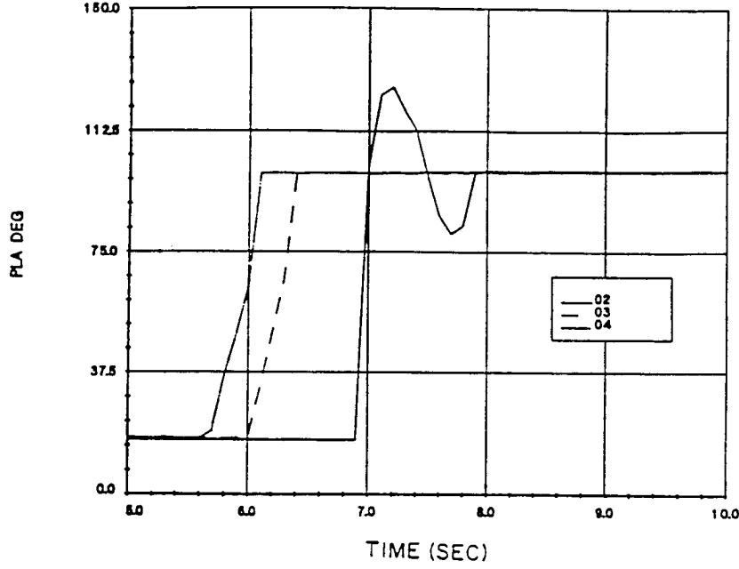
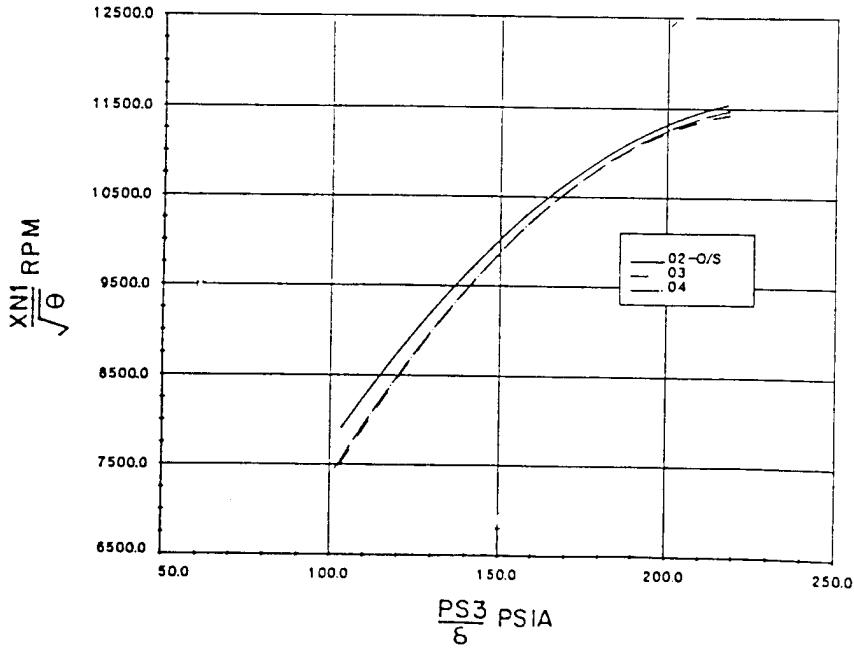
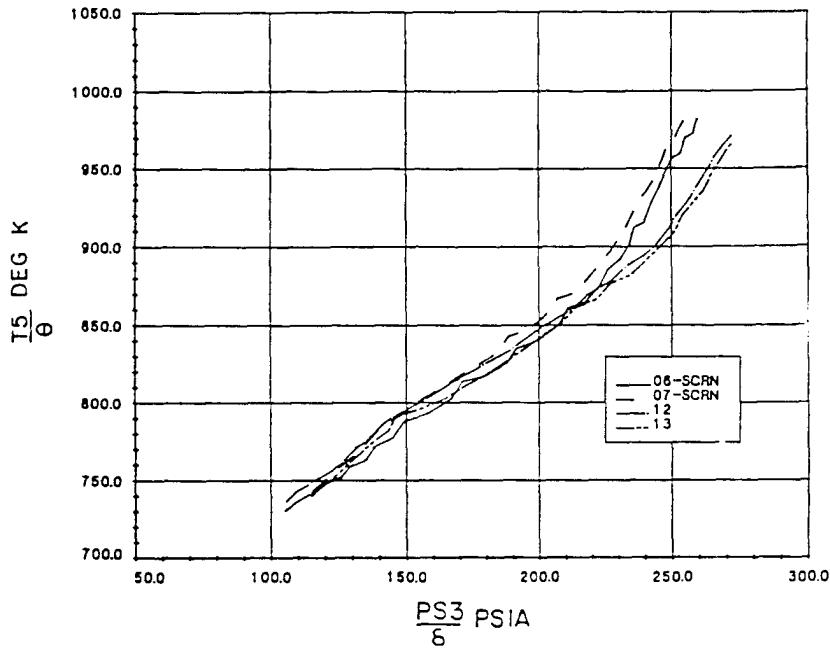
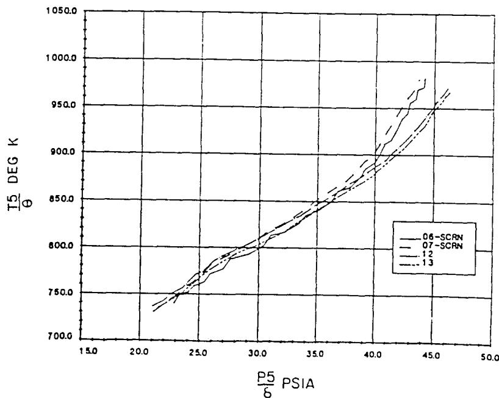
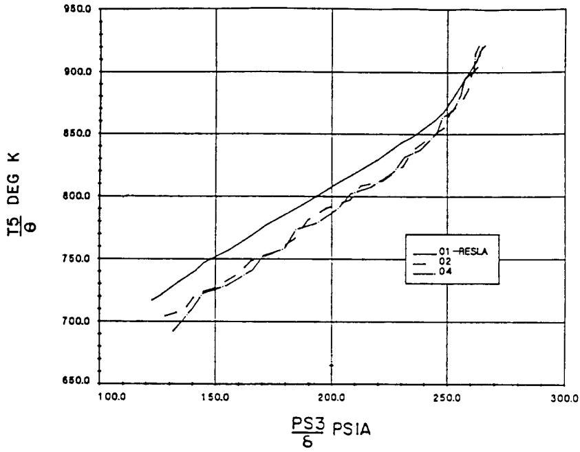
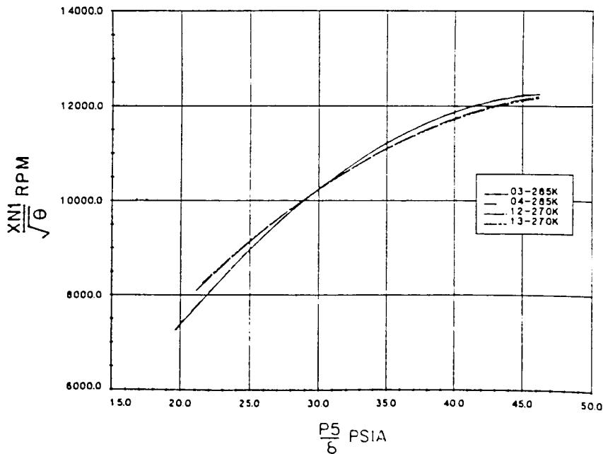
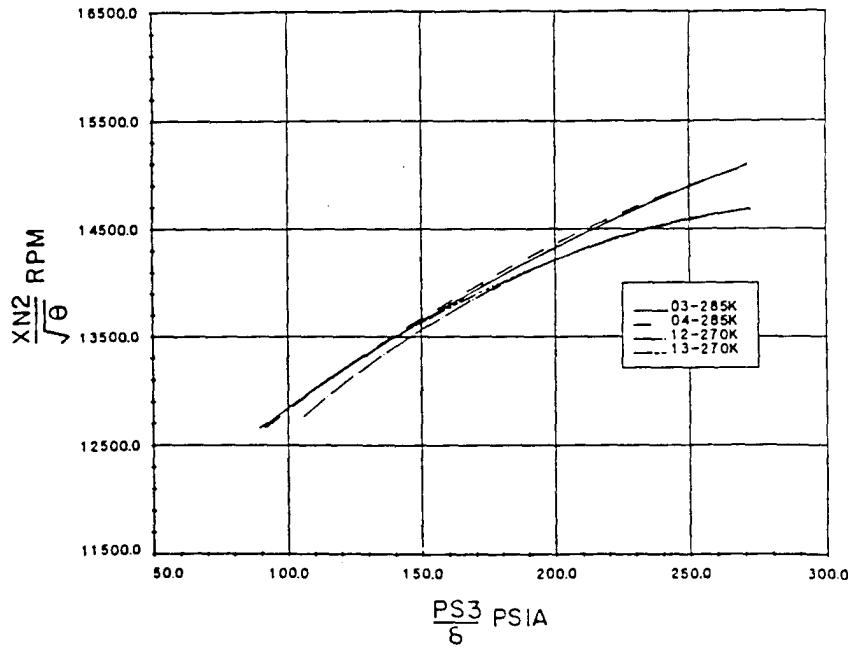
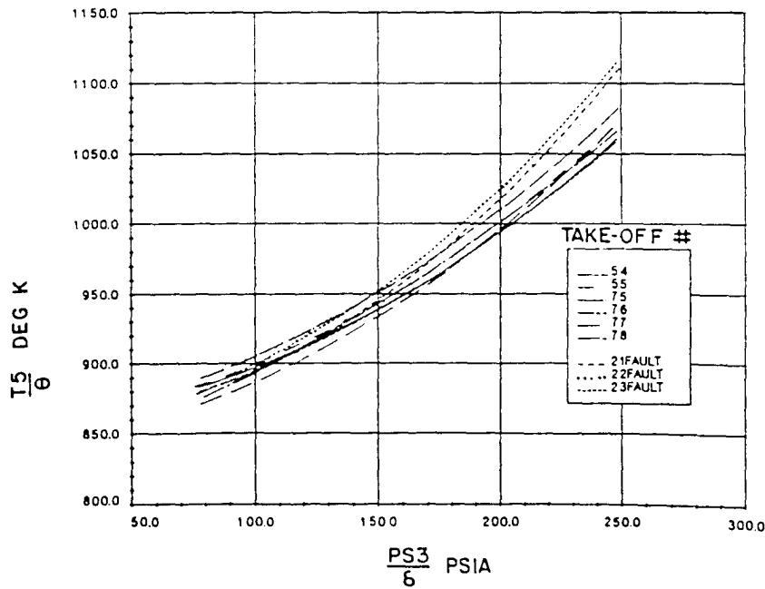
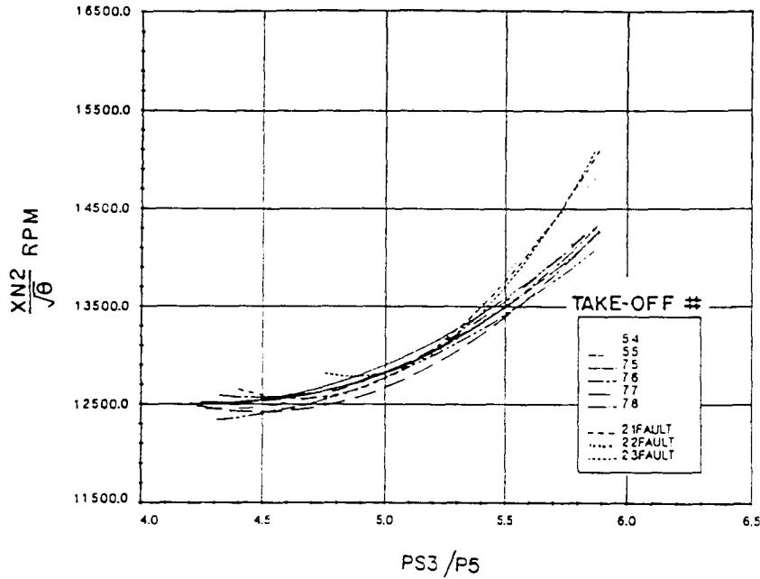
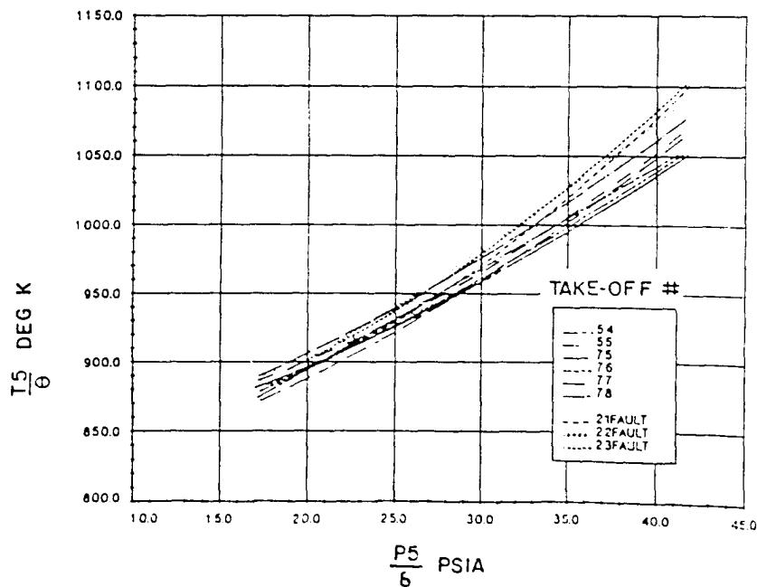

{0}------------------------------------------------

The Society shall not be responsible for statements or opinions advanced in papers or in discussion at meetings of the Society or of its Divisions or Sections, or printed in its publications. Discussion is printed only if the paper is published in an ASME Journal. Papers are available from ASME for fifteen months after the meeting.  
Printed in USA.

Copyright © 1988 by ASME

# Transient Performance Trending for a Turbofan Engine

**J. R. HENRY\***  
**W. C. MOFFATT\*\***

Royal Military College of Canada  
Kingston, Ontario, Canada  
K7K 5L0

## ABSTRACT

The "on condition" concept of aircraft engine maintenance has led to intensive analysis of the data recorded by engine health monitoring systems during steady-state operation of the engine. To date however the transient data acquired during takeoff or during in-flight transients have received far less attention. In this paper the results of an investigation of the feasibility of utilizing engine data acquired during takeoff to trend the performance of a modern turbofan engine (GE-F404) are presented. Factors influencing the repeatability of takeoff data such as throttle rate, variable geometry and instrumentation effects are discussed in detail. Using representative engine data from operational aircraft, various trending parameters are evaluated using a data capture window developed to minimize the scatter of nominal engine performance. A statistical tool employed to identify performance shifts is described, and when applied to a recently-repaired engine successfully detected a shift in its takeoff performance. It is concluded that trending of transient performance data is a viable means of detecting certain engine faults and recommendations are made concerning the implementation of such a program for the F404 engine.

## NOTATION

|          |                                                  |
|----------|--------------------------------------------------|
| PLA      | Power Level Angle                                |
| PS3      | Static Pressure at High Pressure Compressor Exit |
| T5       | Total Temperature at Low Pressure Turbine Inlet  |
| XN1      | Fan Speed                                        |
| XN2      | Core Spool Speed                                 |
| $\delta$ | P/PSTANDARD                                      |
| $\theta$ | T/TSTANDARD                                      |

\*Captain, Canadian Forces, currently with Aerospace Maintenance Development Unit, Trenton, Ont., Canada  
\*\*Dean of Engineering, Member ASME

## INTRODUCTION

The recent acquisition of the CF-18 aircraft by the Canadian Air Force has prompted a re-evaluation of maintenance policies and procedures. The unit cost of such weapon systems has increased dramatically, and with decreasing fleet size, ways of reducing operating expenditures while improving aircraft availability must be found. To help achieve this goal, the maintenance program for the F404 engine used in the CF-18 is based on an "on-condition" philosophy characterized by:

- (a) short, frequent inspections of the engines to assess their 'health' or suitability for further operations,
- (b) no scheduled overhauls,
- (c) a reliance on the engine design and demonstrated failure modes to ensure that non-critical component failures do not jeopardize flight safety or mission completion, and
- (d) the use of a system to assign and track 'lives' for critical engine components to minimize their probability of failure.

It is obvious that as the engines age, assessment of engine health will be a significant factor in determining their reliability and availability. If impending failures cannot be detected early, increased failure rates and unscheduled maintenance actions may be expected during installed operations. The early detection of faults may also reduce operating costs by allowing the user to replace damaged components before repairable limits are exceeded.

A concerted effort has been made to develop a wide range of Engine Health Monitoring (EHM) technologies suitable for application to the F404 engine. To date however, only borescope inspections of the F404 have produced tangible results; no other form of EHM has evolved sufficiently to permit reliable condition assessment. Since field units require a health monitoring system to supplement borescope inspections, the possible use of existing CF-18 engine data for EHM purposes merited investigation.

{1}------------------------------------------------

Each CF-18 is equipped with an Inflight Engine Condition Monitoring System (IECMS) designed to record engine and aircraft parameters on a magnetic tape at various times throughout a flight. Detailed engine data are recorded whenever

- (a) an engine parameter exceedance is sensed,
- (b) the pilot manually depresses a 'record' button located on the aircraft instrument panel, or
- (c) the aircraft takes off.

Unfortunately take-off data are necessarily time dependent, a complication which has heretofore made steady-state data recording a more attractive alternative. Nevertheless, data from take-offs is of particular value since information from the magnetic tape is archived, and therefore a record exists of virtually every CF-18 take-off ever made. Furthermore, as the recording of take-off data is software initiated, personnel are not involved in the data collection process. These two factors clearly make take-off records, although they are transient in nature, one of the most attractive sources of EHM data. This paper describes a recent study of the use of F404 transient performance data as a means of detecting engine faults.

## METHODOLOGY

### General

Because of the large number of variables involved, the transient performance of turbofan engines is likely to be non-repeatable. Variations in throttle handling will influence engine acceleration, as will variable geometry schedules and control system functions, such as temperature- or speed-limiting. Such factors are likely to mask changes in performance resulting from minor degradation in engine condition, and must therefore be identified and eliminated if a useful analysis of engine acceleration data is to result. An equally important consideration is the assessment of transient data repeatability. A simple means of quantifying transient performance data scatter is needed.

### Comparing Transient Data

When attempting to compare time-response traces for engine parameters collected during different accelerations, one is immediately confronted with the problem of synchronizing the data. Not only is it difficult to define the start of an acceleration, but preliminary results indicated that broad variations in the rate of throttle movement could be expected from run to run. Consequently, attempts to align response curves on the basis of throttle position proved fruitless. An effort was made to synchronize the response traces by defining an arbitrary transient starting speed as the beginning of the acceleration. Unfortunately the results from this approach were not acceptable, since temperature and pressure responses tended to display significant scatter. It became clear that to overcome this problem, elimination of time as a variable was required. The method adopted to accomplish this was to cross plot various engine parameters as functions of one another, rather than as functions of time.

### Repeatability Considerations

In addition to the difficulties encountered in comparing data, a number of factors will change the transient response characteristics of any given turbofan engine.

- (a) Ambient Conditions: Although standard temperature and pressure corrections were employed in this study, Zucrow (1958) points out that these terms do not account for all possible influences. Specifically, since variations in Reynolds and Prandtl numbers are disregarded, changes in the working fluid viscosity, specific heat ratio and thermal conductivity could contribute to data non-repeatability. Also, the correction of transient data can only modify parametric values; the time-dependance of the data is not changed.
- (b) Starting Speed: The importance of initial speed was emphasized by Gold and Rosenzweig (1952). Treating the engine as a linear first order system, they found that the time constant for spool speed response was dependent upon both the initial and final speeds of an acceleration. Clearly, CF-18 take-off data must be screened to ensure that the range of speed increase is consistent.
- (c) Variable Geometry (VG): The F404 engine incorporates variable geometry in the Fan, High Pressure Compressor (HPC) and Exhaust Nozzle. Fan VG activation occurs approximately half way through a slam acceleration (corrected XN1 = 9500). HPC VG activation occurs much earlier so that compressor geometry is continuously adjusted during a slam acceleration. Examination of test data revealed that during a slam acceleration, the F404 Variable Exhaust Nozzle (VEN) immediately travelled to and remained in the fully closed position for approximately 4 seconds. Thus, data collected over this period would essentially be from an engine with a fixed nozzle.
- (d) Rate of Throttle Movement: The rate of throttle movement influences the contour followed by the Main Fuel Control (MFC) acceleration fuel schedule. Thus there is a rate of throttle movement for which the maximum or limiting fuel schedule is followed and if the throttle is moved at this rate or faster, engine transient performance becomes independent of throttle rate. This throttle rate threshold is estimated to be about 50 degrees of power lever angle (PLA) per second. Unfortunately, as the IECMS does not start recording take off engine parameters until the throttle has been advanced to military power, it might appear that throttle rate can not be inferred from the data. However, analysis of preliminary results showed that the nozzle starts to close shortly after the throttle movement commences and that it takes about 1 second for the nozzle to fully close. Therefore, it was concluded that if the IECMS take-off record showed the nozzle fully closed then

{2}------------------------------------------------

the duration of throttle movement was less than the nozzle response time, and the limiting fuel schedule was followed.

- (e) Reslam Effects: A "reslam" occurs when two slam accelerations are carried out in quick succession. Engine components in the gas path are heated during the first slam, and without sufficient cooling time there will be less heat transferred to the engine during the second acceleration. Consequently, reslam effects will tend to decrease fan and compressor efficiencies by reducing the amount of air cooling occuring during compression. Conversely, turbine efficiencies will tend to increase since heat transfer to the gases in the hot end are reduced. The latter effect predominates and Saravanamuttoo and Fawke (1971) found, using a dynamic model of a twin spool engine, that speed response significantly improved during reslams. To eliminate reslam effects, care must be taken to ensure that sufficient cooling time is allowed between slams.
- (f) Installation: Whether an engine is installed in the left or right side of a CF-18 should make little difference to it's dynamic performance since left and right engines are interchangeable and identical in every respect. Also, the large inlet ducts are similar in every way. One possible difference between left and right engine positions is the amount of cooling air passing through the respective engine bays, but this effect is likely to be small. Each engine powers an Airframe Mounted Accessory Drive (AMAD) which uses generators and hydraulic pumps to support aircraft systems, but electrical and hydraulic loads are split equally between the two AMADs. Also, bleed air is extracted equally from the two engines. It is concluded therefore, that the side of the aircraft in which an engine is installed should not have significant influence on engine performance.
- (g) Instrumentation Errors: Instrumentation and data processing errors are major contributors to the non-repeatability of transient performance measurements. Fortunately, given sufficient empirical and manufacturers' information, the data repeatability can be quantified both analytically and experimentally. Techniques for accomplishing this are described in detail by Henry (1987) and by Henry and Moffatt (1987).
- (h) Other Effects: Several other phenomena that occur during accelerations such as varying tip and seal clearances, and combustion time lag, were considered. It was concluded however that these effects were generally repeatable from slam to slam. Also, ram temperature and pressure effects during take-off were evaluated, but it was found that aircraft forward speed during take-off would have a negligible impact on transient performance repeatability.

### Data Capture Window

In order to reduce the number of variables affecting the F404's measured transient performance, and the amount of associated data scatter, a data capture window was employed as follows:

- (a) transient data were taken only during the period of time for which the VEN was closed. This eliminated the influence of the variable nozzle;
- (b) take-off data were used only from those records which showed VEN closure. In this way, the effect of variations in throttle movement rate could be ignored.

By this means, repeatability-limiting factors (c) and (d) in the preceding section were eliminated.

### Detecting Faults

Successful and confident detection of engine faults requires transient data scatter to be minimized. If a nominal 'band of imprecision' for transient performance can be found, any data from a take-off falling outside this band can be assumed to have signalled a significant shift in performance. In order to identify those quantities most sensitive to component deterioration, this 'band of imprecision' was found for each of twenty-eight pairs of cross-plotted engine parameters. Data from numerous, controlled transients were curve-fitted, a statistical distribution was applied to each set of curves, and 95% confidence intervals were constructed about the mean curve fit for each cross-plotted pair (Henry, 1987). By employing elementary Kalman filtering Techniques (Leach, 1984), a 'moving baseline' was constructed for each cross-plotted set of parameters so that for each additional take-off, the baseline was updated and the confidence interval reduced in width. Take-off data falling outside this confidence interval were flagged and excluded from the updating process. This procedure is described at length by Henry (1987) and by Henry and Moffatt (1987).

## RESULTS

### Operator and Inlet Temperature Effects

During the analysis of aircraft back-to-back slam acceleration data, it became apparent that despite the use of a data capture window, as described above, several variables were still influencing transient data repeatability. Therefore a series of 'controlled' slam accelerations was conducted to quantify some of these factors. Each test consisted of three back-to-back slam accelerations with a five minute cool down period between each slam. Specific airframe/engine combinations were identified and the test sequence was repeated on days with differing ambient conditions. As these data were obtained using the pilot-initiated record feature of the IECMS, it was possible to study the transient in its entirety, not just the portion after the throttle reached military power. All the tests were performed on engines whose performance indicated there were no faults present.

The most important conclusions reached from examining the data from these controlled accelerations are as follows:

- (a) Throttle Overshoot: Figs. 1 and 2 clearly show that even a momentary throttle

{3}------------------------------------------------

overshoot into the afterburner range can cause a shift in a performance baseline. The solid line (Run 02) represents the overshoot case in both figures.

- (b) Inlet Screens: Two sets of slams were carried out on the same airframe/engine combination under virtually identical ambient conditions except that anti-personnel screens were left installed during one set. Figs. 3 and 4 show that the effect of the inlet screen on the transient data is significant.
- (c) Reslam Effects: Fig 5 shows that a significant baseline shift was observed for a reslam acceleration (Run 01) in which insufficient cooling time (80 seconds) was allowed before the slam. Runs 02 and 04 were each preceded by at least 3 minutes at ground idle.
- (d) Throttle Rate: At the end of each set of back-to-back slams, an acceleration was performed at a slower rate of throttle movement. Analysis of such data indicated that throttle rates greater than 45 deg/sec produced repeatable transient performance. Furthermore, it was demonstrated that take-off records showing nozzle closure were also take-offs with throttle rates greater than 45 deg/sec.
- (e) Inlet Temperature: It was found that changes of inlet temperature resulted in significant baseline shifts (Figs. 6 and 7). These results strongly suggest that the correction scheme employed was not adequate to remove all ambient effects. Since inlet temperature exerts a major influence on transient data repeatability, the development of better correction methods is required.
- (f) Starting Speeds: A survey of seven sets of back-to-back slams indicated that rotor speeds at the start of the accelerations were highly repeatable. The standard deviations of fan and core speeds were 4% and 2% respectively. This is remarkable considering that these speeds were established using only the throttle ground idle stop. The better repeatability of the high pressure spool starting speed is significant since engine transient behaviour is most sensitive to HP spool disturbances (MacCallum, 1981).

## ENGINE FAULT DETECTION

During a routine borescope inspection Engine Number 376020 was found to have extensive High Pressure Compressor (HPC) damage. During the repair process, it was determined that the damage was likely caused by the failure of a hook-bolt locking tab in the HPC. The tab passed through the compressor, damaging 117 blades in the process. Prior to the borescope inspection, this engine was installed in the right side of an aircraft and following repairs, it was installed in the left side of another aircraft. Several records were obtained for both pre-repair (and possibly faulted) and post-repair take-offs, and

the data curve-fitted and cross-plotted. Some of these results are shown in Figs. 8 through 10. It is clear that the pre-repair take-offs (numbers 21-23) display significant differences in the plotted parameters from those found after the repairs were made.

The significance of the observed shifts is more evident in Table 1. Note that for the five cross-plotted parameters shown, the observed shift in the curve fits exceeds the amount of nominal curve fit scatter. A statistical analysis of the data also confirmed that a detectable shift in transient performance had occurred.

While it has been shown that a performance shift occurred, there is no proof that this change was caused by flow path damage in the HPC. However, several factors indicate that this is the most likely probability.

- (a) The performance changes believed to be caused by damage to the HPC were compared with results from a F404 steady state computer model with and without an embedded compressor fault. None of the computer-predicted, steady state baseline shifts conflicted with the observed transient results.
- (b) MacCallum (1981) employed a transient model of a twin spool bypass engine to study the effects of component faults on engine performance. Among other things, MacCallum's analysis predicted a slower XN1 and PS3 response for a damaged engine, both of which were observed in the present data. MacCallum also predicted that the XN2 transient response would be significantly slower but this was not observed. With regard to observed shifts in the cross-plotted data, none were contradicted by MacCallum's results. Overall then, it is believed that the fault characteristics were mainly supported by the work of MacCallum.
- (c) A fault 'signature' was constructed by noting the observed direction of shift for each cross plotted pair of parameters. Similar signatures were obtained for the documented operator and ambient temperature effects. Comparing these sets of cross plot shifts, it was determined that the faulted engine exhibited an unique set of baseline shifts, and therefore operator and/or ambient effects could not satisfactorily explain the faulted engine data. Superposition of ambient temperature effects was also used and it was concluded that the observed changes could not be explained by operator effects such as throttle overshoot or throttle reslam.

Overall then, it was concluded that the detected change in performance was likely caused by a damaged HPC. Furthermore, it was demonstrated that the dynamic characteristics associated with such a fault could not be confused with other non-fault related performance changes.

{4}------------------------------------------------

x: TIME (SEC), 5.0 to 10.0; y: PLA DEG, 0.0 to 150.0

| TIME (SEC) | 02   | 03   | 04   |
|------------|------|------|------|
| 5.0        | ~15  | ~15  | ~15  |
| 6.0        | ~65  | ~15  | ~15  |
| 6.3        | ~100 | ~100 | ~15  |
| 6.5        | ~100 | ~100 | ~100 |
| 7.0        | ~100 | ~100 | ~100 |
| 7.2        | ~130 | ~130 | ~130 |
| 7.7        | ~80  | ~80  | ~80  |
| 8.0        | ~100 | ~100 | ~100 |
| 9.0        | ~100 | ~100 | ~100 |
| 10.0       | ~100 | ~100 | ~100 |

A line plot of PLA DEG against time in seconds, showing three curves (02, 03, and 04) that rise from around 15 to 100 degrees between 5.5 and 6.5 seconds, peak around 7.2 seconds, and settle at 100 degrees.

Line chart: PLA DEG versus TIME (SEC) for series 02, 03, and 04.

Fig. 1 Throttle overshoot (solid line) as shown by power lever angle vs time.

x: \frac{PS3}{\delta} PSIA, 50.0 to 250.0; y: \frac{XN1\ RPM}{\sqrt{\theta}}, 6500.0 to 12500.0

| \frac{PS3}{\delta} PSIA | 02-O/S   | 03       | 04       |
|-------------------------|----------|----------|----------|
| 100.0                   | ~7900.0  | ~7900.0  | ~7400.0  |
| 150.0                   | ~9700.0  | ~9700.0  | ~9600.0  |
| 200.0                   | ~11200.0 | ~11200.0 | ~11100.0 |
| 220.0                   | ~11450.0 | ~11450.0 | ~11400.0 |

A line chart showing three curves (02-O/S, 03, and 04) increasing monotonically with pressure, where 02-O/S and 03 closely overlap and 04 is slightly lower.

Line chart: Plot of XN1 RPM / sqrt(theta) versus PS3 / \delta PSIA for different O/S values.

Fig. 2 Effect of throttle overshoot (upper line) on corrected XN1 vs corrected PS3.

{5}------------------------------------------------

x: \frac{PS3}{\delta} PSIA, 50.0 to 300.0; y: \frac{T5}{\theta} DEG K, 700.0 to 1050.0

| \frac{PS3}{\delta} PSIA | 06-SCRN | 07-SCRN | 12     | 13     |
|-------------------------|---------|---------|--------|--------|
| ~110.0                  | ~730.0  | ~730.0  | ~730.0 | ~730.0 |
| ~150.0                  | ~790.0  | ~790.0  | ~790.0 | ~790.0 |
| ~200.0                  | ~840.0  | ~840.0  | ~840.0 | ~840.0 |
| ~250.0                  | ~960.0  | ~960.0  | ~910.0 | ~910.0 |
| ~270.0                  | ~970.0  | ~970.0  | ~965.0 | ~965.0 |

A line chart showing T5/Theta increasing with PS3/\delta across four series (06-SCRN, 07-SCRN, 12, and 13), with series 12 and 13 diverging upward at higher values.

Line chart: Plot of T5/Theta versus PS3/\delta for four test series.

Fig. 3 Corrected T5 vs corrected PS3 with (solid and dashed lines) and without inlet screens.

x: \frac{P5}{\delta} PSIA, 15.0 to 50.0; y: \frac{T5}{\theta} DEG K, 700.0 to 1050.0

| P5/\delta (PSIA) | 06-SCRN | 07-SCRN | 12   | 13   |
|------------------|---------|---------|------|------|
| 22.5             | ~730    | ~730    | ~730 | ~730 |
| 25.0             | ~760    | ~760    | ~760 | ~760 |
| 30.0             | ~800    | ~800    | ~800 | ~800 |
| 35.0             | ~835    | ~840    | ~835 | ~835 |
| 40.0             | ~875    | ~885    | ~875 | ~875 |
| 45.0             | ~940    | ~970    | ~940 | ~940 |

A line chart showing the relationship between T5/Theta and P5/\delta for four SCRNs, with values increasing monotonically from around 730 to over 900 as P5/\delta increases from 22.5 to 45.0.

Line chart: Plot of T5/Theta versus P5/\delta for SCRNs 06, 07, 12, and 13.

Fig. 4 Corrected T5 vs corrected P5 with (solid and dashed lines) and without inlet screens.

{6}------------------------------------------------

x: \frac{PS3}{\delta} PSIA, 100.0 to 300.0; y: \frac{T5}{\theta} DEG K, 650.0 to 950.0

| \frac{PS3}{\delta} PSIA | 01 -RESLA | 02     | 04     |
|-------------------------|-----------|--------|--------|
| ~125.0                  | ~718.0    |        |        |
| ~135.0                  |           | ~705.0 |        |
| 150.0                   | ~750.0    | ~725.0 | ~725.0 |
| 200.0                   | ~808.0    | ~788.0 | ~785.0 |
| 250.0                   | ~865.0    | ~860.0 | ~860.0 |
| ~260.0                  | ~915.0    | ~905.0 | ~905.0 |

A line chart showing three curves (01-RESLA, 02, and 04) that increase monotonically with the horizontal axis value, diverging slightly between 150.0 and 250.0 before converging above 250.0.

Line chart: Plot of T5/Theta versus PS3/\delta for RESLA, 02, and 04.

Fig. 5 Effect of insufficient cooling time between slam accelerations (solid line) on corrected T5 vs corrected PS3.

x: \frac{P5}{\delta} PSIA, 15.0 to 50.0; y: \frac{XN1}{\sqrt{\theta}} RPM, 6000.0 to 14000.0

| \frac{P5}{\delta} PSIA | 03-285K  | 04-285K  | 12-270K | 13-270K |
|------------------------|----------|----------|---------|---------|
| 20.0                   | ~7200.0  |          |         |         |
| 25.0                   | ~9000.0  | ~9100.0  |         |         |
| 30.0                   | ~10200.0 | ~10200.0 |         |         |
| 35.0                   | ~11100.0 | ~11200.0 |         |         |
| 40.0                   | ~11800.0 | ~11900.0 |         |         |
| 45.0                   | ~12100.0 | ~12200.0 |         |         |

A line chart showing the relationship between XN1/sqrt(\theta) in RPM and P5/\delta in PSIA across four conditions: 03-285K, 04-285K, 12-270K, and 13-270K, all increasing monotonically with pressure.

Line chart: Plot of XN1 / sqrt(\theta) versus P5/\delta PSIA for different temperatures.

Fig. 6 Effect of engine inlet temperature on corrected XN1 vs corrected P5.

{7}------------------------------------------------

x: \frac{PS3}{\delta} PSIA, 50.0 to 300.0; y: \frac{XN2}{\sqrt{\theta}} RPM, 11500.0 to 16500.0

| \frac{PS3}{\delta} PSIA | 03-285K  | 04-285K  | 12-270K  | 13-270K  |
|-------------------------|----------|----------|----------|----------|
| ~90.0                   | ~12580.0 | ~12580.0 |          |          |
| ~100.0                  | ~12680.0 | ~12680.0 |          |          |
| ~150.0                  | ~13550.0 | ~13550.0 | ~13550.0 | ~13550.0 |
| ~200.0                  | ~13900.0 | ~13900.0 | ~14000.0 | ~14000.0 |
| ~250.0                  | ~14200.0 | ~14200.0 | ~14700.0 | ~14700.0 |

A line chart showing four curves representing different conditions (03-285K, 04-285K, 12-270K, and 13-270K) where the value of XN2/sqrt(theta) increases monotonically with PS3/\delta.

Line chart: Plot of XN2 / sqrt(theta) RPM versus PS3 / \delta PSIA for different temperatures.

Fig. 7 Effect of engine inlet temperature on corrected XN2 vs corrected PS3.

TAKE-OFF #  
54  
55  
75  
76  
77  
78  
21FAULT  
22FAULT  
23FAULT

x: \frac{PS3}{\delta} PSIA, 50.0 to 300.0; y: \frac{T5}{\theta} DEG K, 800.0 to 1150.0

| PS3/\delta (PSIA) | 54    | 55    | 75    | 76    | 77    | 78    | 21FAULT | 22FAULT | 23FAULT |
|-------------------|-------|-------|-------|-------|-------|-------|---------|---------|---------|
| ~75               | ~880  | ~885  | ~885  | ~885  | ~885  | ~885  | ~885    | ~885    | ~885    |
| 100.0             | ~895  | ~898  | ~898  | ~898  | ~898  | ~898  | ~898    | ~898    | ~898    |
| 150.0             | ~940  | ~945  | ~945  | ~945  | ~945  | ~945  | ~945    | ~950    | ~950    |
| 200.0             | ~995  | ~1000 | ~1000 | ~1000 | ~1000 | ~1000 | ~1000   | ~1020   | ~1025   |
| 250.0             | ~1060 | ~1065 | ~1065 | ~1065 | ~1065 | ~1065 | ~1065   | ~1110   | ~1115   |

A line chart showing an approximately linear increase in T5/theta with PS3/\delta across multiple take-off numbers (54, 55, 75, 76, 77, 78) and fault conditions (21FAULT, 22FAULT, 23FAULT).

Line chart: Plot of T5/theta versus PS3/\delta for various take-off numbers and fault conditions.

Fig. 8 Effect of a major fault (take-offs 21-23) on corrected T5 vs corrected PS3.

{8}------------------------------------------------

TAKE-OFF #  
54  
55  
75  
76  
77  
78  
21FAULT  
22FAULT  
23FAULT

x: PS3 / P5, 4.0 to 6.5; y: XN2 / \sqrt{\theta} RPM, 11500.0 to 16500.0

| PS3 / P5 | 54       | 55       | 75       | 76       | 77       | 78       | 21FAULT  | 22FAULT  | 23FAULT  |
|----------|----------|----------|----------|----------|----------|----------|----------|----------|----------|
| 4.5      | ~12500.0 | ~12500.0 | ~12500.0 | ~12500.0 | ~12500.0 | ~12500.0 | ~12500.0 | ~12500.0 | ~12500.0 |
| 5.0      | ~12700.0 | ~12700.0 | ~12700.0 | ~12700.0 | ~12700.0 | ~12700.0 | ~12700.0 | ~12700.0 | ~12700.0 |
| 5.5      | ~13450.0 | ~13450.0 | ~13450.0 | ~13450.0 | ~13450.0 | ~13450.0 | ~13450.0 | ~13450.0 | ~13450.0 |
| 5.9      | ~14300.0 | ~14300.0 | ~14300.0 | ~14300.0 | ~14300.0 | ~14300.0 | ~14300.0 | ~14300.0 | ~14300.0 |

A line chart showing XN2 / \sqrt{\theta} RPM as a function of PS3 / P5, with curves diverging upward at higher values for different take-off numbers and fault conditions.

Line chart: Plot of XN2 / \sqrt{\theta} RPM versus PS3 / P5 for different take-off numbers and faults.

Fig. 9 Effect of a major fault (take-offs 21-23) on corrected XN2 vs PS3/P5.

TAKE-OFF #  
54  
55  
75  
76  
77  
78  
21FAULT  
22FAULT  
23FAULT

x: \frac{P5}{\delta} PSIA, 10.0 to 45.0; y: \frac{T5}{\theta} DEG K, 800.0 to 1150.0

| P5/\delta (PSIA) | 54    | 55    | 75    | 76    | 77    | 78    | 21FAULT | 22FAULT | 23FAULT |
|------------------|-------|-------|-------|-------|-------|-------|---------|---------|---------|
| ~17.5            | ~875  | ~880  | ~885  | ~880  | ~880  | ~875  | ~880    | ~880    | ~880    |
| ~20.0            | ~895  | ~900  | ~905  | ~895  | ~895  | ~890  | ~895    | ~895    | ~895    |
| ~25.0            | ~930  | ~935  | ~940  | ~930  | ~930  | ~925  | ~930    | ~930    | ~930    |
| ~30.0            | ~960  | ~965  | ~970  | ~960  | ~960  | ~955  | ~960    | ~960    | ~960    |
| ~35.0            | ~995  | ~1000 | ~1005 | ~995  | ~995  | ~990  | ~995    | ~995    | ~995    |
| ~40.0            | ~1030 | ~1035 | ~1040 | ~1030 | ~1030 | ~1025 | ~1030   | ~1030   | ~1030   |

A line chart showing a positive linear relationship between P5/\delta and T5/theta for take-off numbers 54, 55, 75, 76, 77, 78, and fault conditions 21FAULT, 22FAULT, and 23FAULT.

Line chart: Plot of T5/theta versus P5/\delta for various take-off numbers and faults.

Fig. 10 Effect of a major fault (take-offs 21-23) on corrected T5 vs corrected P5.

{9}------------------------------------------------

| <u>PLOT</u> <u>Y</u> vs <u>X</u>                | <u>TARGET 'X'</u> <u>VALUE</u> | <u>SHIFT IN</u> <u>'Y' VALUE</u> | <u>NOMINAL</u> <u>SCATTER</u> |
|----------------------------------------------------|-----------------------------------|-------------------------------------|----------------------------------|
| $\frac{P5}{\delta}$ vs $\frac{PS3}{\delta}$         | 125.0 psia                        | + 2 %                               | ± 1.0 %                          |
| $\frac{T5}{\theta}$ vs $\frac{PS3}{\delta}$        | 150.0 psia                        | + 3 %                               | ± 0.8 %                          |
| $\frac{XN2}{\sqrt{\theta}}$ vs $\frac{PS3}{P5}$    | 5.25                              | + 3 %                               | ± 3.0 %                          |
| $\frac{T5}{\theta}$ vs $\frac{PS3}{P5}$            | 5.5                               | + 5 %                               | ± 2.0 %                          |
| $\frac{T5}{\theta}$ vs $\frac{P5}{\delta}$         | 35.0 psia                         | + 2 %                               | ± 0.8 %                          |
| $\frac{T5}{\theta}$ vs $\frac{XN1}{\sqrt{\theta}}$ | 11000 rpm                         | + 2 %                               | ± 0.8 %                          |

NOTE: $\theta$ and $\delta$ correct data to standard day conditions.

Table 3 - Compressor Damage  
Curve Fit Shift Summary

## CONCLUSIONS

From this brief investigation of CF-18/F404 IECMS Data, it is concluded that:

- (a) transient F404 IECMS parameters are highly repeatable (within $\pm 1\%$) during rapid accelerations from ground idle to military power provided that:
  - i) the throttle rate is at least 45 deg/sec;
  - ii) the analysis is carried out while the nozzle is closed;
  - iii) the ambient temperature does not change significantly; and
  - iv) a cool down period is allowed prior to the accelerations.
- (b) overall, the existing IECM system has sufficient precision to permit the detection of changes in the F404's dynamic performance;
- (c) difficulties in synchronizing time-dependent data can be resolved by cross-plotting engine variables directly;
- (d) engine faults can be detected by analyzing CF-18/F404 take-off data records;
- (e) a statistical treatment of transient data can be a reliable means of detecting shifts in performance.

## RECOMMENDATIONS FOR IMPLEMENTATION

Although the monitoring of F404 transient performance appears to be a feasible means of passively detecting engine faults, work is needed before such a system could be implemented on a fleet-wide basis. These continuing efforts should include:

- (a) a cost-benefit analysis of transient performance trending to determine if it is the most effective means of detecting engine faults in relation to other methods now under development.
- (b) the development of better correction methods to remove ambient temperature influences on transient data.
- (c) a review of IECMS sensor and data processing characteristics with the aim of improving the repeatability of engine data.
- (d) a means of making aircraft data more available to research centers. For trending techniques and fault signature development to proceed at an acceptable pace, a steady input of engine data is required.
- (e) development of a dynamic F404 computer model capable of having faults embedded; and
- (f) expansion of the statistical methods developed to analyze transient data. New curve fitting algorithms and filtering techniques could be employed to increase the sensitivity of this method to performance changes.

## ACKNOWLEDGEMENTS

The authors wish to express their appreciation to the aircraft maintenance sections at Canadian Forces Bases, Cold Lake, Alberta and Bagotville, Quebec for their cooperation in providing engine test data for this study. The assistance provided by GAS-tops Ltd. in reduction of the data is also gratefully acknowledged. The staff of the Engine Laboratory, National Research Council of Canada, and in particular Mr. J.W. Bird, were very helpful in all aspects of the investigation. The work was supported under ARP Grant 3610-147 and DND Contract FE220786FRMC4.

## REFERENCES

- Gold, H. and Rosenzweig, S., 1952  
A Method for Estimating Speed Response of Gas Turbines, NACA RM E51K21, Lewis Flight Propulsion Laboratory, Cleveland, Ohio
- Henry, J.R., 1987  
CF-18 Transient Performance Trending, MEng Thesis, Royal Military College of Canada, Kingston, Canada
- Henry, J.R. and Moffatt, W.C., 1987  
Precision Error in a TurboFan Engine Monitoring System, 33rd ASME International Gas Turbine Congress, Amsterdam, 1988.
- Leach, B.W., 1984  
An Introduction to Kalman Filters, National Research Council Report, NAE MISC 57
- MacCallum, M.R.L., 1981  
Further Studies in the Influence of Thermal Effects on the Predicted Acceleration of Gas Turbines, Paper No. ASME 81-GT-21

{10}------------------------------------------------

Saravanamuttoo, H.I.H. and Fawke, A.J., 1971  
Digital Computer Methods for the Prediction of Gas  
Turbine Response, SAE 710550

Zucrow, M.J., 1958  
Aircraft and Missile Propulsion, Vol II, John  
Wiley and Sons, New York

---

## Related documents

- [[Hadzic 2010 - Limited Qualification Tests of an F404 Engine with Blended FT-SPK and NATO F-34 Fuel|Hadzic 2010]] - Canadian Forces F404 test cell and transient operability evaluation
- [[NASA TM 4140 - Measurement Effects on the Calculation of In-Flight Thrust for an F404 turbofan engine|NASA TM 4140]] - In-flight thrust instrumentation and sensitivity analysis
- [[Powel 1990 - On the Leading Edge, Combining Maturity and Advanced Technology on the F404 Turbofan Engine|Powel 1990]] - GE F404 architecture and baseline cycle parameters
- [[ADA164562 The General Electric F404 - Engine of the RAAF's New Fighter|ADA164562]] - Technical description and ratings of installed F404-GE-400
