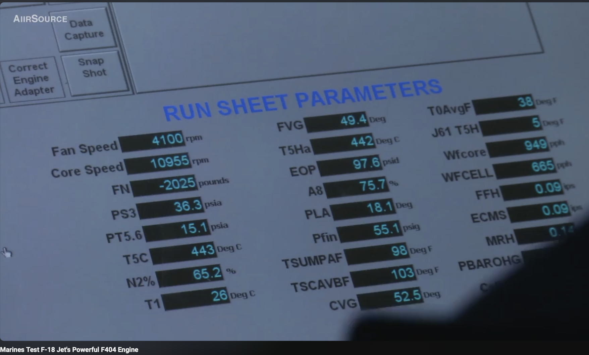
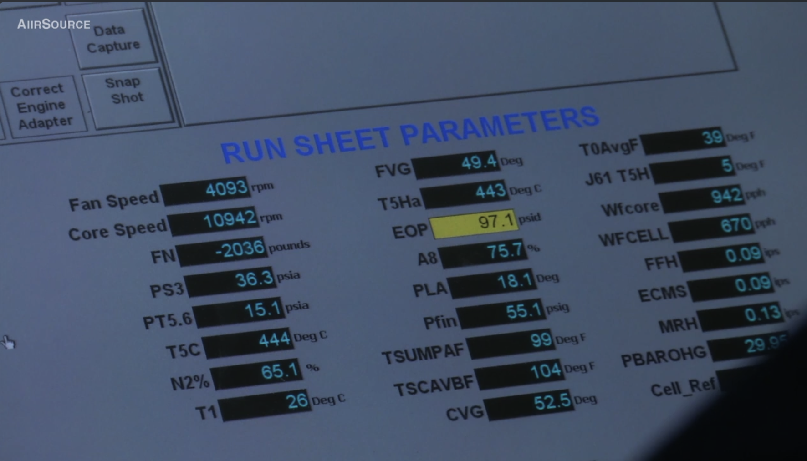
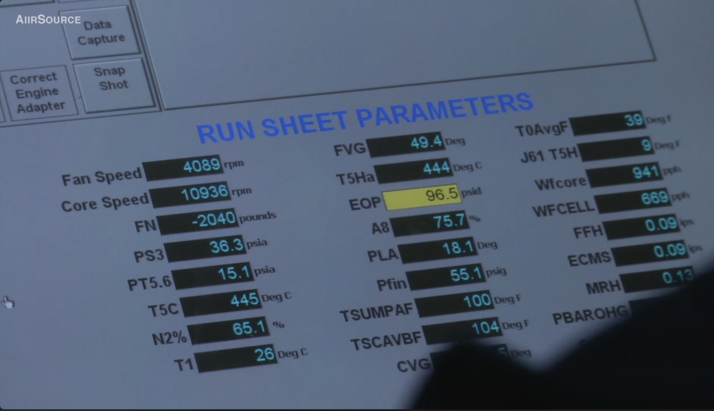
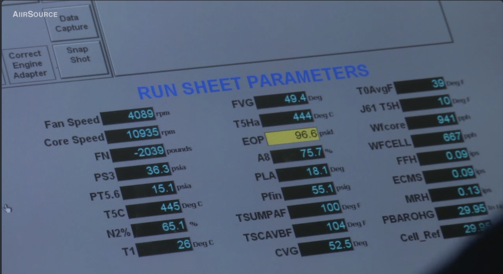
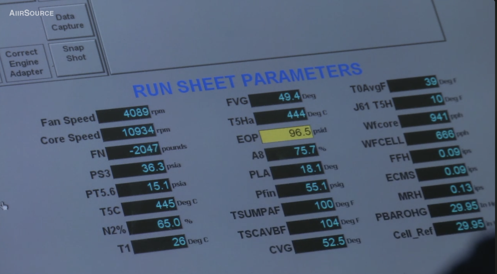
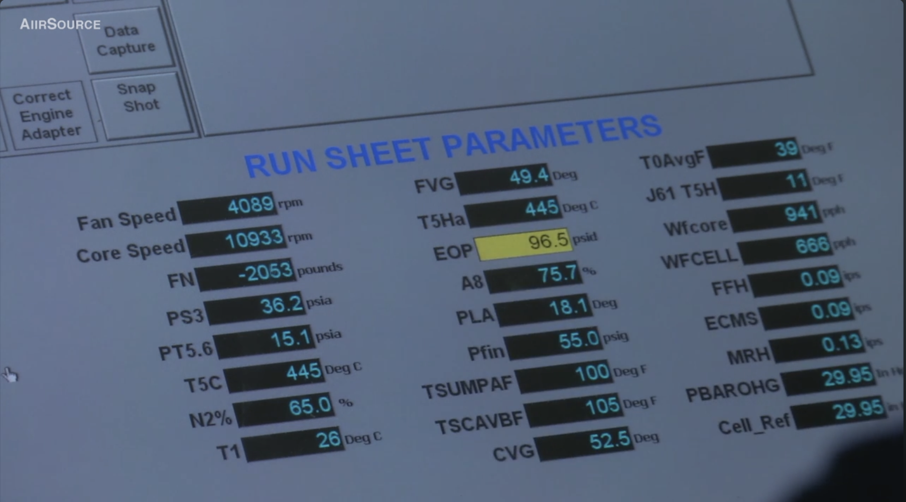
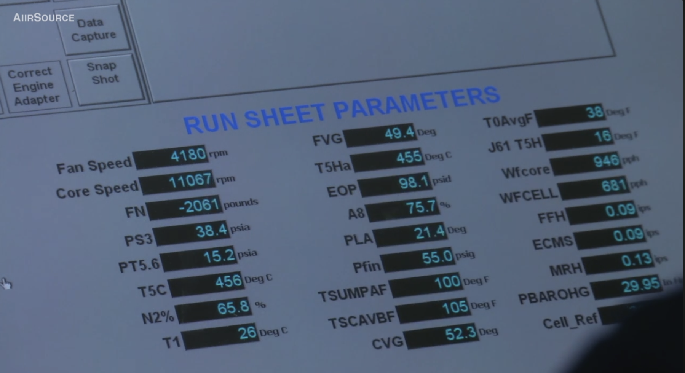

# MCAS Iwakuni (2017) — F404 Ground Run Test Cell Screen Data

**Source Video:** *Marines Test F-18 Jet's Powerful F404 Engine*  
**Channel:** AiirSource Military  
**Upload Date:** 16 June 2017  
**Direct URL:** [https://www.youtube.com/watch?v=gyaKh7BY-6c](https://www.youtube.com/watch?v=gyaKh7BY-6c)  
**Location:** Marine Corps Air Station (MCAS) Iwakuni, Japan  
**Test Facility:** Fixed Ground Engine Test Cell (indoor hush-house / test bed)  
**Engine:** General Electric F404-GE-400 / F404-GE-402 turbofan  

---

## 1. Context & Operational Background

During intermediate/depot-level maintenance and acceptance testing, USMC propulsion technicians operate the General Electric F404 on an indoor test cell thrust frame to verify mechanical integrity, variable geometry schedules, lubrication system parameters, vibration levels, and gas turbine thermodynamic performance prior to airframe installation in the F/A-18 Hornet.

A sequence in the source video presents the test conductor's supervisory control console displaying real-time telemetry on the **`RUN SHEET PARAMETERS`** screen. Seven high-resolution freeze frames capture two distinct low-power operating regimes:
1. **Frames 1–6:** Steady-state Ground Idle operation at $\text{PLA} = 18.1^\circ$.
2. **Frame 7:** Slightly advanced low-throttle operation at $\text{PLA} = 21.4^\circ$.

Because previously documented F404 unclassified cycle decks and flight-test literature (e.g. [[NASA TM-4240 - A simple Dynamic Engine Model for Use in a Real-time Aircraft Simulation with Thrust Vectoring|Johnson 1990]]) primarily document **Flight Idle** ($\text{PLA} \approx 25.5^\circ \text{ to } 30^\circ$), this dataset provides empirical measurements of the true **Ground Idle** ($\text{PLA} \approx 18.1^\circ$) operating point, including rotor speeds, station pressures, variable geometry positions, and nozzle throat schedule.

---

## 2. Test Cell Screen Captures

| Frame | Timestamp (Capture) | PLA | Key Features | Image Asset |
| :---: | :---: | :---: | :--- | :--- |
| **1** | 8:03:43 PM | $18.1^\circ$ | Ground idle baseline, $N_1 = 4100$, $N_2 = 10955$, EOP normal background |  |
| **2** | 8:04:51 PM | $18.1^\circ$ | Steady idle, EOP turns yellow caution ($97.1\text{ psid}$), baro visible |  |
| **3** | 8:05:19 PM | $18.1^\circ$ | Steady idle, $N_1 = 4089$, $N_2 = 10936$, EOP yellow ($96.5\text{ psid}$) |  |
| **4** | 8:07:19 PM | $18.1^\circ$ | Steady idle, unobstructed view of `PBAROHG` and `Cell_Ref` ($29.95\text{ inHg}$) |  |
| **5** | 8:10:59 PM | $18.1^\circ$ | Steady idle, thermal equilibrium, $N_2\% = 65.0\%$, $T_5 = 445^\circ\text{C}$ |  |
| **6** | 8:11:50 PM | $18.1^\circ$ | Steady idle final frame, $N_1 = 4089$, $N_2 = 10933$, $W_{f,\text{core}} = 941\text{ pph}$ |  |
| **7** | 8:17:47 PM | $21.4^\circ$ | Advanced throttle, $N_1 \to 4180$, $N_2 \to 11067$, $PS_3 \to 38.4\text{ psia}$, EOP normal |  |

---

## 3. Digitized Run Sheet Telemetry Table [M-DIR]

All numerical values transcribed directly from the operator screen displays across the seven capture frames:

| Parameter Label | Definition & Station Reference | Units | Frame 1 | Frame 2 | Frame 3 | Frame 4 | Frame 5 | Frame 6 | Frame 7 |
| :--- | :--- | :---: | :---: | :---: | :---: | :---: | :---: | :---: | :---: |
| **PLA** | Power Lever Angle | deg | 18.1 | 18.1 | 18.1 | 18.1 | 18.1 | 18.1 | **21.4** |
| **Fan Speed** | Physical LP Spool Rotor Speed ($N_1$) | rpm | 4100 | 4093 | 4089 | 4089 | 4089 | 4089 | **4180** |
| **Core Speed** | Physical HP Spool Rotor Speed ($N_2$) | rpm | 10955 | 10942 | 10936 | 10935 | 10934 | 10933 | **11067** |
| **N2%** | High Pressure Spool Speed Percentage | % | 65.2 | 65.1 | 65.1 | 65.1 | 65.0 | 65.0 | **65.8** |
| **FN** | Test Cradle Load Cell Net Thrust Reading | lbf | -2025 | -2036 | -2040 | -2039 | -2047 | -2053 | **-2061** |
| **PS3** | High Pressure Compressor Discharge Static Pressure ($PS_3$) | psia | 36.3 | 36.3 | 36.3 | 36.3 | 36.3 | 36.2 | **38.4** |
| **PT5.6** | Turbine Exhaust / Mixer Inlet Total Pressure ($Pt_{5.6}$) | psia | 15.1 | 15.1 | 15.1 | 15.1 | 15.1 | 15.1 | **15.2** |
| **T5C** | Turbine Exhaust Gas Temperature (Control / Calculated) | °C | 443 | 444 | 445 | 445 | 445 | 445 | **456** |
| **T5Ha** | T5 Thermocouple Harness 'A' Average Temperature | °C | 442 | 443 | 444 | 444 | 444 | 445 | **455** |
| **J61 T5H** | J61 T5 Thermocouple Harness Differential / Spread | °F | 5 | 5 | 9 | 10 | 10 | 11 | **16** |
| **T1** | Engine Inlet Total Temperature | °C | 26 | 26 | 26 | 26 | 26 | 26 | 26 |
| **T0AvgF** | Average Ambient / Test Cell Temperature | °F | 38 | 39 | 39 | 39 | 39 | 39 | **38** |
| **A8** | Variable Exhaust Nozzle Throat Area Indication | % | 75.7 | 75.7 | 75.7 | 75.7 | 75.7 | 75.7 | 75.7 |
| **FVG** | Fan Variable Guide Vane Angle | deg | 49.4 | 49.4 | 49.4 | 49.4 | 49.4 | 49.4 | 49.4 |
| **CVG** | Compressor Variable Geometry Vane Angle | deg | 52.5 | 52.5 | [52.5] | 52.5 | 52.5 | 52.5 | **52.3** |
| **Wfcore** | Core Fuel Mass Flow (Engine Internal Transmitter) | pph | 949 | 942 | 941 | 941 | 941 | 941 | **946** |
| **WFCELL** | Facility Fuel Flow (Test Cell External Flowmeter) | pph | 665 | 670 | 669 | 667 | 666 | 666 | **681** |
| **Pfin** | Fuel Boost Inlet Pressure at Engine Flange | psig | 55.1 | 55.1 | 55.1 | 55.1 | 55.1 | 55.0 | 55.0 |
| **EOP** | Engine Oil Differential Pressure | psid | 97.6 | 97.1 *(yel)* | 96.5 *(yel)* | 96.6 *(yel)* | 96.5 *(yel)* | 96.5 *(yel)* | **98.1** |
| **TSUMPAF** | Lube Oil Sump 'A' Temperature | °F | 98 | 99 | 100 | 100 | 100 | 100 | 100 |
| **TSCAVBF** | Lube Oil Scavenge 'B' Temperature | °F | 103 | 104 | 104 | 104 | 104 | 105 | 105 |
| **FFH** | Front Frame Horizontal Vibration Velocity | ips | 0.09 | 0.09 | 0.09 | 0.09 | 0.09 | 0.09 | 0.09 |
| **ECMS** | Engine Condition Monitoring System Vibration | ips | 0.09 | 0.09 | 0.09 | 0.09 | 0.09 | 0.09 | 0.09 |
| **MRH** | Mid-Ring / Main Bearing Horizontal Vibration | ips | 0.14 | 0.13 | 0.13 | 0.13 | 0.13 | 0.13 | 0.13 |
| **PBAROHG** | Ambient Barometric Pressure | inHg | [29.95] | 29.95 | [29.95] | 29.95 | 29.95 | 29.95 | 29.95 |
| **Cell_Ref** | Test Cell Reference Static Pressure | inHg | [29.95] | [29.95] | [29.95] | 29.95 | 29.95 | 29.95 | 29.95 |

*Note: Values in brackets `[...]` denote fields partially occluded by the operator's silhouette in that video frame, where the reading is verified identical by adjacent frames. `(yel)` denotes that the display field was highlighted in yellow caution color.*

---

## 4. Parameter Definitions & Engineering Interpretation

### Aerothermodynamic & Performance Parameters
- **`PLA` (Power Lever Angle, deg):** Commanded cockpit/throttle angle. The F404 mechanical power lever schedule spans from Ground Idle ($\approx 18^\circ$) to Flight Idle ($\approx 25.5^\circ - 30^\circ$), Intermediate / Military Rated Power ($\text{IRP/MIL} \approx 85^\circ$), and Maximum Afterburning ($\text{Max A/B} \approx 130^\circ$). The observed $18.1^\circ$ setting confirms a true Ground Idle condition.
- **`Fan Speed` / `N1` (rpm):** Physical rotational speed of the Low-Pressure (LP) spool (3-stage fan driven by the single-stage LPT). At Ground Idle ($4,089\text{ rpm}$), the LP spool runs at $30.8\%$ of its $100\%$ design mechanical rating ($13,270\text{ rpm}$).
- **`Core Speed` / `N2` (rpm) & `N2%` (%):** Physical rotational speed of the High-Pressure (HP) spool (7-stage HPC driven by single-stage HPT). At Ground Idle ($10,933\text{ rpm}$), the core spool operates at exactly $65.0\%$ of its $100\%$ mechanical rating ($16,810\text{ rpm}$), matching `N2% = 65.0%`.
- **`PS3` (Compressor Discharge Static Pressure, psia):** Static pressure measured at Station 3 (exit of the 7-stage HPC / diffuser inlet ahead of the combustor dome). With ambient barometric pressure $P_0 = 29.95\text{ inHg} = 14.71\text{ psia}$, the overall compression ratio at Ground Idle is:
  $$\text{OPR}_{\text{ground-idle}} = \frac{PS_3}{P_0} = \frac{36.3}{14.71} \approx 2.47$$
  When advanced to $\text{PLA} = 21.4^\circ$, $PS_3$ increases to $38.4\text{ psia}$ ($\text{OPR} \approx 2.61$).
- **`PT5.6` (Turbine Exit / Mixer Inlet Total Pressure, psia):** Total pressure at Station 5.6 (aft of the single-stage LPT exhaust frame and ahead of the confluent mixer). At Ground Idle, $PT_{5.6} = 15.1\text{ psia}$, which is approximately $0.39\text{ psi}$ above ambient barometric pressure ($14.71\text{ psia}$), confirming that exhaust flow through the mixer and augmentor duct is unchoked at idle.
- **`T5C` & `T5Ha` (Turbine Exit Gas Temperature, °C):** Measured gas temperature at Station 5 (LPT exit).
  - `T5Ha`: Direct thermocouple average from Harness 'A' of the dual-harness engine sensor installation.
  - `T5C`: Calculated / Control turbine exhaust gas temperature synthesized by the electronic engine control unit (ECU).
  - Both channels track within $1^\circ\text{C}$ ($442^\circ\text{C} - 445^\circ\text{C}$ at Ground Idle, $455^\circ\text{C} - 456^\circ\text{C}$ at $\text{PLA} = 21.4^\circ$).
- **`J61 T5H` (°F):** Connector J61 T5 thermocouple harness differential / channel spread. The reading ($5^\circ\text{F} - 16^\circ\text{F}$) monitors channel-to-channel or circumferential thermocouple divergence to verify sensor health.
- **`FN` (Net Thrust, lbf):** Raw test cradle load cell indication. On ground test stands, load cell instrumentation often incorporates a compression tare/pre-load offset on the restraining linkage, resulting in a signed negative raw channel display ($-2,025 \text{ to } -2,061\text{ lbf}$) prior to test cell tare subtraction.
- **`A8` (Exhaust Nozzle Throat Position, %):** Variable exhaust nozzle (VEN) throat area actuator position. Held steady at $75.7\%$ open across all frames. In the F404 nozzle schedule, $A_8$ opens wide at idle to relieve backpressure on the low-pressure turbine and reduce idle thrust on the ground.
- **`FVG` & `CVG` (Variable Vane Angles, deg):**
  - `FVG` ($49.4^\circ$): Fan Variable Guide Vane position.
  - `CVG` ($52.3^\circ - 52.5^\circ$): Compressor Variable Geometry stator vane angle.
  - Schedulers hold the variable vanes near their minimum-flow/closed stop to maintain compressor flutter and stall margin at low corrected speeds.

### Fuel & Lubrication Systems
- **`Wfcore` vs `WFCELL` (Fuel Flow Rates, pph):**
  - `Wfcore` ($941 - 949\text{ pph}$, $\approx 0.261 - 0.264\text{ lbm/s}$): Fuel mass flow metered to the engine main combustor nozzles, measured by the engine's internal fuel flow transmitter.
  - `WFCELL` ($665 - 681\text{ pph}$, $\approx 0.185 - 0.189\text{ lbm/s}$): Fuel mass flow measured by the facility's external test cell flowmeter (e.g. Coriolis or calibrated turbine meter).
  - The offset between engine-mounted transmitter output and test cell calibration meters is standard in depot testing due to transmitter density/viscosity calibration curves, bypass/spillback recirculation flows from the hydromechanical fuel control (which uses fuel as actuation hydraulic fluid for VEN and VG actuators), or facility meter calibration factors.
- **`Pfin` (Fuel Inlet Pressure, psig):** Fuel boost delivery pressure ($55.0 - 55.1\text{ psig}$) from the test facility fuel conditioning skid to the engine high-pressure pump inlet.
- **`EOP` (Engine Oil Pressure, psid):** Differential lubrication oil pressure across the engine bearing oil supply gallery. Normal operating range is approximately $80 - 100\text{ psid}$. The yellow caution highlight on frames 2–6 ($96.5 - 97.1\text{ psid}$) occurs because the engine oil is still warming up from cold ambient conditions ($T_{\text{sump}} \approx 98^\circ\text{F} - 100^\circ\text{F}$, compared to standard operational oil temperatures of $160^\circ\text{F} - 250^\circ\text{F}$), causing higher oil viscosity and activating the upper advisory band on the test cell DAQ.
- **`TSUMPAF` & `TSCAVBF` (Oil Temperatures, °F):**
  - `TSUMPAF` ($98^\circ\text{F} - 100^\circ\text{F}$): Lube oil Sump 'A' temperature.
  - `TSCAVBF` ($103^\circ\text{F} - 105^\circ\text{F}$): Lube oil Scavenge 'B' temperature.

### Mechanical Vibration Pickups
- **`FFH`, `ECMS`, `MRH` (Vibration Velocity, ips):**
  - `FFH` ($0.09\text{ ips}$): Front Frame Horizontal velocity pickup.
  - `ECMS` ($0.09\text{ ips}$): Engine Condition Monitoring System vibration sensor.
  - `MRH` ($0.13 - 0.14\text{ ips}$): Mid-Ring / Main-Frame Horizontal velocity pickup.
  - All channels read well below the standard engine maintenance reject limit of $0.5 - 1.0\text{ ips}$, reflecting smooth mechanical balance.

### Ambient Test Cell Environment
- **`PBAROHG` & `Cell_Ref` ($29.95\text{ inHg}$):** Atmospheric pressure in inches of mercury ($29.95\text{ inHg} = 101.42\text{ kPa} = 14.71\text{ psia}$). MCAS Iwakuni sits at sea level (elevation $\approx 10\text{ ft}$), placing ambient conditions within $0.02\text{ inHg}$ of standard sea level pressure ($29.92\text{ inHg}$).
- **`T0AvgF` ($38^\circ\text{F} - 39^\circ\text{F}$):** Average ambient air temperature inside the intake duct / test cell bellmouth ($3.3^\circ\text{C} - 3.9^\circ\text{C}$, $497.7\text{ R}$).
- **`T1` ($26^\circ\text{C} = 78.8^\circ\text{F}$):** Engine inlet total temperature sensor channel. Note that $T_1$ reflects test cell internal thermal dissipation or sensor bias relative to the cold intake bellmouth average ($T_0 \approx 39^\circ\text{F}$).

---

## 5. Aerothermodynamic Cycle Comparison

Comparison of the MCAS Iwakuni Ground Idle test cell data against public F404 literature and the cycle deck:

| Cycle Parameter | Ground Idle (MCAS Iwakuni, 2017) | Flight Idle (NASA TM-4240 / Johnson 1990) | Design Point (SLS Dry Mil) |
| :--- | :---: | :---: | :---: |
| **PLA** | $18.1^\circ$ [M-DIR] | $25.5^\circ - 30.0^\circ$ [M-MOD] | $85.0^\circ$ [M-SPEC] |
| **$N_1$ Physical Speed** | $4,089\text{ rpm}$ ($30.8\%$) [M-DIR] | $\approx 5,000 - 6,000\text{ rpm}$ [M-MOD] | $13,270\text{ rpm}$ ($100\%$) |
| **$N_2$ Physical Speed** | $10,933\text{ rpm}$ ($65.0\%$) [M-DIR] | $\approx 10,800 - 11,500\text{ rpm}$ [M-MOD] | $16,810\text{ rpm}$ ($100\%$) |
| **Overall Pressure Ratio ($PS_3 / P_0$)** | $2.47:1$ [M-DIR] | $\approx 2.8 - 3.2:1$ [M-MOD] | $25.0:1$ |
| **Compressor Exit Static ($PS_3$)** | $36.3\text{ psia}$ [M-DIR] | $\approx 42 - 48\text{ psia}$ [M-MOD] | $\approx 367\text{ psia}$ |
| **Turbine Exit Total Pressure ($PT_{5.6}$)** | $15.1\text{ psia}$ [M-DIR] | $\approx 15.5 - 16.0\text{ psia}$ [M-MOD] | $\approx 42\text{ psia}$ |
| **Turbine Exit Temperature ($T_5$)** | $444^\circ\text{C}$ ($1291\text{ R}$) [M-DIR] | $\approx 480 - 520^\circ\text{C}$ [M-MOD] | $1,675\text{ R}$ ($658^\circ\text{C}$) |
| **Core Fuel Flow ($W_f$)** | $941\text{ pph}$ ($0.261\text{ lbm/s}$) [M-DIR] | $\approx 950 - 1,100\text{ pph}$ [M-MOD] | $\approx 8,500\text{ pph}$ |
| **Nozzle Position ($A_8$)** | $75.7\%$ open [M-DIR] | $\approx 400\text{ in}^2$ ($\approx 75 - 80\%$) [M-MOD] | $\approx 232 - 249\text{ in}^2$ ($0\% - 20\%$) |

### Modeling Significance
1. **Low-Power Off-Design Sizing Anchor:** Provides direct empirical validation points for pyCycle off-design part-power operating lines at ground idle ($PLA = 18.1^\circ$) where public data has historically been sparse.
2. **Variable Exhaust Nozzle Schedule Validation:** Confirms the F404 VEN schedule holds $A_8$ at $\approx 75.7\%$ open at idle to prevent turbine backpressure and eliminate residual ground idle thrust.
3. **Spool Speed Matching:** Verifies that at ground idle, the core spool governs at $\approx 65\%$ mechanical speed while the LP fan spool windmilling/driving speed drops to $\approx 31\%$.
