{0}------------------------------------------------

(NASA-TM-4140) MEASUREMENT EFFECTS ON THE  
CALCULATION OF IN-FLIGHT THRUST FOR AN F404  
TURBOFAN ENGINE (NACA) 24 3 69 CL 21F

N90-11741

Unclas

71/07 6732467

{1}------------------------------------------------

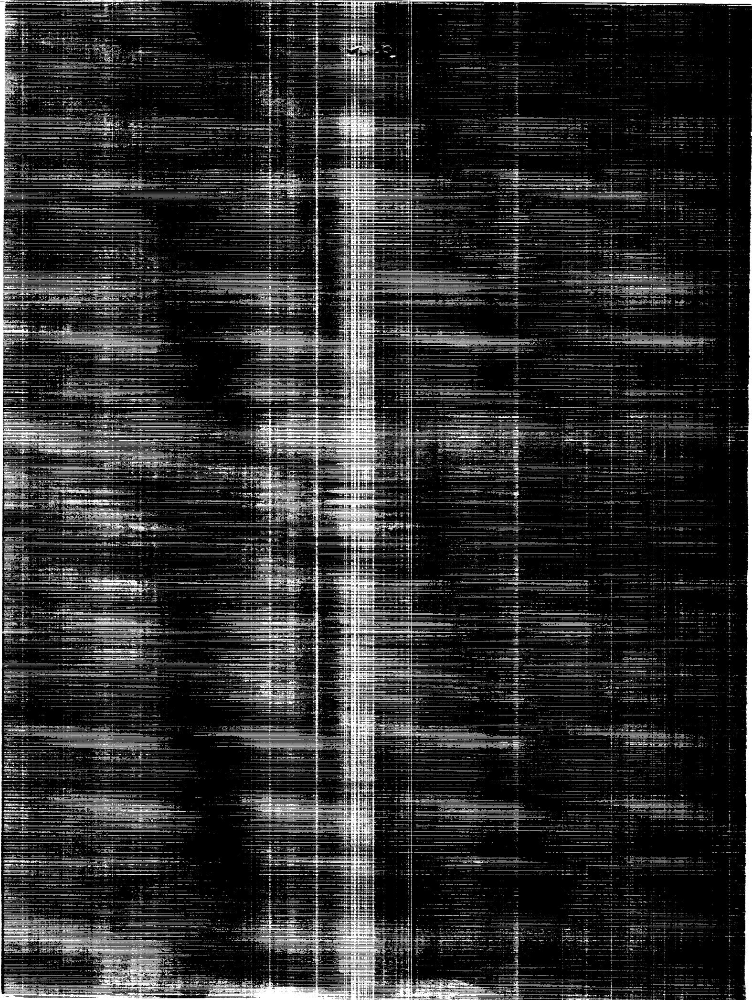

A heavily distorted, black and white scan of a page, likely a photograph or a document, with severe horizontal and vertical scan lines and artifacts. The content is almost entirely obscured by the noise.

{2}------------------------------------------------

# Measurement Effects on the Calculation of In-Flight Thrust for an F404 Turbofan Engine

Timothy R. Conners  
*Ames Research Center  
Dryden Flight Research Facility  
Edwards, California*


National Aeronautics and  
Space Administration  
Office of Management  
Scientific and Technical  
Information Division

{3}------------------------------------------------


{4}------------------------------------------------

# MEASUREMENT EFFECTS ON THE CALCULATION OF IN-FLIGHT THRUST FOR AN F404 TURBOFAN ENGINE

Timothy R. Conners\*  
NASA Ames Research Center  
Dryden Flight Research Facility  
Edwards, California

## Abstract

A study has been performed that investigates parameter measurement effects on calculated in-flight thrust for the General Electric F404-GE-400 afterburning turbofan engine which powered the X-29A forward-swept wing research aircraft. Net-thrust uncertainty and influence coefficients were calculated and are presented. Six flight conditions were analyzed at five engine power settings each. Results were obtained using the mass flow-temperature and area-pressure thrust calculation methods, both based on the commonly used gas generator technique. Thrust uncertainty was determined using a common procedure based on the use of measurement uncertainty and influence coefficients. The effects of data nonlinearity on the uncertainty calculation procedure were studied and results are presented. The advantages and disadvantages of using this particular uncertainty procedure are discussed. A brief description of the thrust-calculation technique along with the uncertainty calculation procedure is included.

## Nomenclature

|                      |                                                           |
|----------------------|-----------------------------------------------------------|
| <i>A</i>             | cross-sectional area, in.<sup>2</sup>                     |
| <i>AE</i>            | effective cross-sectional area, in.<sup>2</sup>           |
| <i>ALT</i>           | altitude, ft                                              |
| <i>AP</i>            | area pressure                                             |
| <i>CFG</i>           | gross thrust coefficient                                  |
| <i>C<sub>i</sub></i> | influence coefficient                                     |
| <i>E</i>             | error in thrust due to parameter-measurement uncertainty  |
| ECU                  | electronic control unit                                   |
| <i>FG</i>            | gross thrust, lbf                                         |
| <i>FGI</i>           | ideal gross thrust, lbf                                   |
| <i>FHV</i>           | fuel heating value, Btu/lbm                               |
| <i>FN</i>            | net thrust, lbf                                           |
| <i>FNAP</i>          | net thrust, area-pressure calculation method, lbf         |
| <i>FNWT</i>          | net thrust, mass flow-temperature calculation method, lbf |
| <i>FR</i>            | ram drag, lbf                                             |
| <i>FVG</i>           | fan variable guide vane angle, deg                        |
| <i>g</i>             | gravity constant, 32.17 ft-lbm/lbf-s<sup>2</sup>          |
| <i>H</i>             | total enthalpy, Btu                                       |
| HPC                  | high pressure compressor                                  |
| IFT                  | in-flight thrust                                          |
| LPT                  | low pressure turbine                                      |
| LVDT                 | linear-variable differential transformer                  |
| <i>M</i>             | Mach number                                               |
| <i>N1</i>            | fan rotor speed, rpm                                      |
| <i>N2</i>            | high pressure compressor rotor speed, rpm                 |
| <i>PLA</i>           | power lever angle, deg                                    |
| <i>PT</i>            | total pressure, lbf/in.<sup>2</sup>                       |
| <i>p</i>             | static pressure, lbf/in.<sup>2</sup>                      |
| <i>R</i>             | gas constant, lbf-ft/lbm-°R                               |
| RSS                  | root-sum-square                                           |
| <i>T</i>             | static temperature, °R                                    |
| <i>TT</i>            | total temperature, °R                                     |
| <i>U</i>             | measurement uncertainty                                   |
| <i>UF</i>            | root-sum-square thrust uncertainty                        |
| <i>UFNAP</i>         | uncertainty in net thrust, area-pressure method           |
| <i>UFNWT</i>         | uncertainty in net thrust, mass flow-temperature method   |
| $V$                  | velocity, ft/s                                            |
| $VI$                 | ideal velocity, ft/s                                      |
| $W$                  | mass flow, lbm/s                                          |
| $WFAB$               | afterburner fuel flow, lbm/s                              |
| $WFE$                | engine core fuel flow, lbm/s                              |
| $WT$                 | mass flow temperature                                     |
| $\gamma$             | specific heat ratio, air                                  |

\*Aerospace engineer. Member AIAA.

Copyright © 1989 by the American Institute of Aeronautics and Astronautics, Inc. No copyright is asserted in the United States under Title 17, U.S. Code. The U.S. Government has a royalty-free license to exercise all rights under the copyright claimed herein for Governmental purposes. All other rights are reserved by the copyright owner.

{5}------------------------------------------------

### **F404 engine station identification numbers:**

|     |                                                |
|-----|------------------------------------------------|
| 0   | freestream                                     |
| 1   | engine inlet                                   |
| 2   | fan inlet                                      |
| 25  | high pressure compressor inlet                 |
| 3   | high pressure compressor discharge             |
| 4   | combustor discharge                            |
| 5   | low pressure turbine discharge                 |
| 558 | low pressure turbine discharge measuring plane |
| 6   | afterburner inlet                              |
| 7   | exhaust nozzle inlet                           |
| 8   | exhaust nozzle throat                          |
| 9   | exhaust nozzle discharge                       |

## **Introduction**

Knowledge of the uncertainty of calculated in-flight thrust is important in understanding the accuracy of aircraft performance values, including vehicle drag.<sup>1</sup> Errors in engine and aircraft parameter measurements required for the calculation of thrust directly affect thrust uncertainty. The degree of influence that these errors have depends on the characteristics of the specific engine model and thrust calculation method utilized. Other sources of uncertainty, including engine model error, affect thrust uncertainty, but these effects were not considered in this investigation.

Several studies have been undertaken in the past two decades at NASA Ames-Dryden Flight Research Facility investigating thrust calculation methods and their corresponding sensitivity to measurement errors. These studies were performed for various engines installed in several types of aircraft, including the XB-70<sup>2</sup> and the F-111.<sup>3</sup>

The primary purpose of this investigation is to document the net-thrust uncertainty and influence of measurement error for the F404-GE-400 afterburning turbofan engine. Problems in the analysis procedure, including influence data nonlinearity, were also investigated to better understand the uncertainty methodology used.

The engine analyzed was installed in the X-29A forward-swept wing research aircraft (ship 1) which was flight tested at NASA Ames-Dryden. The results of this study are applicable to other aircraft powered by the F404 engine which

utilize an instrumentation system similar to that used for this analysis. Previous work involving the F404 engine installed in the X-29A includes a limited study of thrust sensitivity to measurement changes. A limited thrust uncertainty investigation was also performed, but a less accurate instrumentation system was used.<sup>4</sup>

An in-flight thrust (IFT) computer program was used to calculate thrust for the F404 engine using measured parameter values as input. This program was supplied by the engine manufacturer.<sup>5</sup> The program uses two variations of the classical gas generator thrust-calculation technique: the mass flow-temperature (WT) method and the area-pressure (AP) method. The error effects of ten important measured input parameters on thrust were determined for both methods. Inlet ram recovery, bleed air, and horsepower extraction were estimated and used in the thrust calculation. Their effects on thrust uncertainty were not included in this analysis since the errors in estimating these aircraft installation factors were unknown. For a similar reason, engine model error inherent to the IFT program was not considered.

Actual measured test data was not available for input into the IFT program at the time the analysis was performed. Therefore, this data was estimated using an F404 engine specification computer simulation program.<sup>6</sup> Actual X-29A aircraft and engine instrumentation accuracy data, required in the thrust-uncertainty analysis, was used in the study.

This report presents parameter measurement effects on calculated net thrust for the F404 engine which was installed in the X-29A. Six simulated flight conditions, ranging from 10,000 ft to 40,000 ft in altitude and from 0.4 to 1.6 Mach number ( $M$ ), were studied at throttle power lever angle ( $PLA$ ) settings from part-power ( $70^\circ PLA$ ) to maximum afterburner power ( $130^\circ PLA$ ). Thrust uncertainty was determined using a common procedure based on the use of measurement uncertainty and influence coefficients. These influence coefficient values were also calculated and are presented. The effects of data nonlinearity on the uncertainty calculation were also studied. Results are presented and the advantages and disadvantages of using this particular uncertainty procedure are discussed. In addition, a brief description of the thrust calculation technique and uncertainty calculation procedure is included.

## **Engine Description**

The F404-GE-400 engine is a 16,000-lbf thrust class, low bypass, twin spool turbofan with afterburner. The engine incorporates a three-stage fan and a seven-stage high pressure compressor, each driven by a single-stage turbine. The fan and high pressure compressor guide vanes utilize variable geometry. Bleed air extraction is provided at the seventh stage of the high pressure compressor. The combustor is a through-flow annular type utilizing atomizing fuel nozzles. The afterburner can be fully modulated from minimum to maximum augmentation and uses fan discharge air and an afterburner liner to maintain a low engine skin temperature. The hinged-flap, cam-linked exhaust nozzle is hydraulically actuated. An engine accessory gearbox is driven by the compressor rotor. This gearbox drives the lubrication oil pump, the variable-exhaust nozzle power unit, the generator, and both the main and afterburner fuel pumps. A schematic view of the F404-GE-400 engine with station designations is shown in Fig. 1.

{6}------------------------------------------------

The engine-control system consists of the throttle, main fuel control, electronic control unit (ECU) and afterburner fuel control. Throttle (power lever) movement is mechanically transmitted to a power amplifier which positions the main fuel control. During flight,  $PLA$  ranges from  $31^\circ$  (flight idle) to  $130^\circ$  (full power with afterburner). Intermediate power (full nonafterburning) occurs at  $87^\circ PLA$ .

At power settings below intermediate, engine inlet total temperature ( $TT1$ ) and throttle movement control the high pressure compressor rotor speed ( $N2$ ) through the main fuel control. At intermediate power and above, fan rotor speed ( $N1$ ) is controlled by the ECU as a function of  $TT1$ , while  $N2$  remains essentially constant. The ECU senses engine and aircraft parameters, computes schedules, and maintains engine limits. The afterburner fuel control schedules fuel flow to the pilot and main spraybars.

A single F404 engine is mounted in the fuselage of the X-29A and utilizes two side-mounted, fixed geometry inlets optimized for transonic performance.

### Instrumentation

The engine location of measurements used in the thrust calculation are shown in Fig. 1.

A resistance temperature device is used to determine  $TT1$  while  $N1$  is measured using an eddy-current instrument utilizing magnetic pickup from the fan. Fan variable guide vane angle ( $FVG$ ) is measured using a linear-variable differential transformer (LVDT).

The low pressure turbine discharge total pressure measurement,  $PT558$ , a critical parameter in thrust calculation, is obtained using four five-element total pressure rakes. The 20  $PT558$  pressures are measured by a multi-port differential transducer referenced to a highly accurate absolute transducer. The differential transducer is thermally controlled by a heater-insulation blanket to maintain a constant temperature at which the unit was calibrated. The final  $PT558$  value is an average of the 20  $PT558$  measurements. Values outside a specified tolerance are omitted from the average. The uncertainty in the  $PT558$  measurement is a root-sum-square (RSS) of the differential  $PT558$  uncertainty and the reference-pressure uncertainty.

The nozzle throat area,  $A8$ , is also measured using an LVDT. Volumetric flow meters are used to measure engine core and afterburner fuel flows ( $WFE$  and  $WFAB$  respectively). Fuel temperatures are measured in both the gas generator and afterburner fuel lines to permit conversion of volumetric values to mass flow. Fuel heating value ( $FHV$ ) is a laboratory determined quantity.

The thrust calculation also requires the measurement of freestream altitude ( $ALT$ ) and Mach number ( $M$ ). These measurements are obtained through the aircraft air-data system.

Table 1 presents the range and absolute uncertainty for each measured parameter used in the thrust calculation. The measurement-uncertainty values were either supplied by the engine and instrumentation manufacturers or determined through in-house calibration. This instrumentation was installed in the X-29A during the aircraft's performance flight-testing phase.

## Calculation Procedures

### In-Flight Thrust Calculation

**Thrust Calculation Methods.** Thrust was calculated according to two variations of the commonly used gas generator technique: the mass flow-temperature (WT) method and the area-pressure (AP) method. The gas generator methodology is based on classical momentum, energy, and continuity laws. The primary difference between the WT and AP methods is due to the manner in which nozzle mass flow is calculated.

The simplest form of the equation for ideal gross thrust ( $FGI$ ) is based on the time rate-of-change of mass momentum at the nozzle of the engine. This equation assumes complete exhaust expansion to ambient pressure and therefore neglects the thrust pressure term at the nozzle exit. Using F404 station identification, the equation takes the form

$$FGI = \frac{W8}{g} VI9$$

where  $W8$  is the nozzle throat mass flow rate and  $VI9$  is the ideal nozzle exit velocity.

$VI9$  is expanded further in the above equation to obtain the mass flow-temperature equation in ideal gross thrust form. A gross thrust coefficient ( $CFG$ ) is used to obtain actual gross thrust; and ram drag (engine inlet airflow,  $W1$ , multiplied by freestream velocity,  $V0$ ) is subtracted to give net thrust. The result is the net thrust mass flow-temperature equation

$$\begin{aligned} FNWT = & \left\{ \frac{W8}{g} (TT8)^{1/2} \left( \frac{2\gamma g R}{\gamma - 1} \right)^{1/2} \right. \\ & \times \left. \left[ 1 - \left( \frac{PT8}{p0} \right)^{-(\frac{\gamma-1}{\gamma})} \right]^{1/2} \right\} \\ & \times CFG - \frac{W1}{g} V0 \end{aligned} \quad (1)$$

{7}------------------------------------------------

The nozzle mass flow term ( $W8$ ) is further expanded in the above equation to give the net thrust area-pressure equation

$$\begin{aligned} FNAP = & \left\{ AE8 \ PT8 \ \gamma \left[ \left( \frac{2}{\gamma - 1} \right) \left( \frac{2}{\gamma + 1} \right)^{\left( \frac{\gamma - 1}{\gamma + 1} \right)} \right]^{1/2} \right. \\ & \times \left. \left[ 1 - \left( \frac{PT8}{p0} \right)^{-\left( \frac{\gamma - 1}{\gamma} \right)} \right]^{1/2} \right\} \\ & \times CFG - \frac{W1}{g} V0 \end{aligned} \quad (2)$$

The  $CFG$  modifies the ideal gross thrust term of the equations to account for incomplete expansion, two-dimensional expansion effects, nozzle friction, and other sources of thrust loss. The values for this coefficient are determined empirically through engine altitude facility and ground-testing.

Equations (1) and (2) illustrate the effects that nozzle and freestream parameters have on the thrust calculation. The quantities in the equations are obtained through several measurements which are discussed in the following section. Complete derivation of both equations is presented in Refs. 3 and 7.

**The In-Flight Thrust Program.** The thrust values used to obtain the results of this report were acquired using an in-flight thrust (IFT) calculation program.<sup>5</sup> This computer program was developed by General Electric for the Navy's F404-F-18 Propulsion System Integration Program.

The IFT program determines mass flow, pressure, and temperature at the exhaust nozzle inlet by modelling the engine as a gas generator. The gas generator procedure uses a combination of engine performance models, engine component ground-test data, and actual measured engine and aircraft flight data. The IFT program uses these models and data to generate the values necessary for thrust calculation. The use of actual flight data allows the program to adjust for engine-to-engine performance variations.

A schematic representation of the actual IFT calculation procedure and data flow is shown in Fig. 2. The 10 parameter measurements listed in Table 1 are used as input into the IFT program and are labeled in *italics* in the figure.

Flight-condition measurements  $ALT$  and  $M$ , along with the measured engine parameters  $N1$ ,  $TT1$ , and  $FVG$ , are used in the inlet model and airflow calculation. Utilizing these parameters,  $W1$  is calculated. Altitude ( $ALT$ ) is used to calculate freestream pressure ( $p0$ ) based on standard day correlations. This value, along with  $W1$  and  $M$ , allows the program to estimate inlet ram recovery using empirically derived data. Engine inlet total pressure ( $PT1$ ) is then calcu-

lated. Freestream pressure ( $p0$ ) is also used directly in both equations (1) and (2).

Next, using an energy balance between the turbine and compressor, along with  $N1$ ,  $W1$ , and  $PT1$ , the total temperature, enthalpy, and pressure of the flow leaving the compressor ( $TT3$ ,  $H3$ , and  $PT3$  respectively) are calculated. Compressor discharge airflow ( $W3$ ) is determined by subtracting estimated nominal bleed airflow from  $W1$ . Horsepower extraction, also estimated by the program, is used in the energy balance also.

The measurements  $WFE$ ,  $FHV$ , and the compressor model output are then used to calculate the energy rise across the combustor and turbine. Total temperature and enthalpy at the afterburner inlet,  $TT6$  and  $H6$ , are then determined. Total pressure at this station,  $PT6$ , is equal to the  $PT558$  measurement. Afterburner inlet mass flow ( $W6$ ) is calculated by adding  $WFE$  to  $W1$  and subtracting bleed airflow.

If the afterburner is not operating,  $TT7$ ,  $H7$ , and  $W7$  remain unchanged from station 6. Nozzle inlet total pressure ( $PT7$ ) is obtained by subtracting afterburner frictional loss, based on ground-test data, from  $PT6$ . If the afterburner is in operation  $TT7$ ,  $H7$ , and  $W7$  are then determined using  $FHV$  and  $WFAB$  measured values and station 6 conditions. Pressure losses because of heating and friction are included to obtain  $PT7$ .

Since the flow is isentropically compressed from the nozzle inlet to the throat,  $PT8$  and  $TT8$  equal  $PT7$  and  $TT7$  respectively. Nozzle throat total pressure ( $PT8$ ) is required in both equations (1) and (2) while  $TT8$  is used in equation (1). Nozzle inlet mass flow ( $W7$ ) is adjusted for nozzle leakage giving mass flow at the throat,  $W8$ , which is required in equation (1), the mass flow-temperature thrust equation. The measured nozzle throat area,  $A8$ , is adjusted using a flow coefficient to give effective throat area,  $AE8$ . This value is required as input for equation (2), the area-pressure equation. Freestream pressure ( $p0$ ), from  $ALT$ , is used to determine nozzle leakage and flow coefficients.

Ideal gross thrust ( $FGI$ ) is then calculated according to both the WT and AP thrust-calculation methods. The results are adjusted using the  $CFG$ , which is determined from empirical data and is based on nozzle operating conditions. Actual gross thrust ( $FG$ ) is then calculated. Freestream velocity ( $V0$ ), calculated using  $M$  and  $ALT$ , is multiplied with  $W1$  giving  $FR$ . By subtracting this term from  $FG$ , net thrust ( $FN$ ) is obtained for both thrust-calculation methods.

Certain aircraft installation effects, including inlet spillage and nozzle drag, were not included in the calculation because they are independent of the net-thrust calculation procedure.

### Thrust-Uncertainty Calculation

The common procedure by which thrust uncertainty ( $UF$ ) is calculated, is to perform a root-sum-square on the individual thrust errors ( $E$ ) each due to the measurement uncertainty of one parameter.<sup>8</sup> The thrust-uncertainty calculation equation therefore takes the form

{8}------------------------------------------------

$$UF = (E_1^2 + E_2^2 + \dots + E_{10}^2)^{1/2} \quad (3)$$

Equation (3) contains ten squared terms, one for each of the input parameters analyzed.

The individual thrust-error values are determined analytically by adding the associated measurement uncertainty (from Table 1) to the measurement-parameter value and inputting the result into the IFT program along with the other required, but unmodified, parameter measurements. The calculated-thrust value is then compared to the value that results using all unmodified input, and  $E$ , due to the single-measurement uncertainty, is determined. This procedure is repeated for each parameter. The  $E$  values must be recalculated for a change in flight or engine condition or for a change in thrust-calculation method.

Although precise, this thrust-uncertainty calculation procedure can be time-consuming and cumbersome to use if multiple instrumentation systems, and therefore different measurement uncertainties, are analyzed. This is because of the need to rerun the IFT program for each change in a measurement uncertainty. Also, this procedure does not clearly differentiate between the influence that a parameter has on thrust and the resulting effect on thrust uncertainty.

Because of these reasons, an alternate thrust-uncertainty calculation procedure is commonly used, based on the linear variation of sensitivity of thrust to changes, or uncertainty, in an input parameter measurement. The error in thrust ( $E$ ) is estimated by multiplying the parameter influence coefficient ( $C_i$ ) by the measurement uncertainty ( $U$ ) of that parameter. The resulting equation takes the form

$$UF = [(C_{i1} \times U_1)^2 + (C_{i2} \times U_2)^2 + \dots + (C_{i10} \times U_{10})^2]^{1/2} \quad (4)$$

By definition,  $C_i$  is the slope of the data representing the change, or error, in thrust because of a change, or uncertainty, in a thrust-calculation parameter measurement. A large  $C_i$  value indicates a large parameter influence on thrust calculation.

Taking advantage of the linear nature of the sensitivity data, each parameter  $C_i$  value was calculated by determining the percent change in thrust due to a 1-percent change in that parameter. This  $C_i$  calculation was accomplished by running the IFT program for each flight-engine condition and varying the input of the parameter in question by this percentage. The resulting thrust value was compared to the baseline thrust value calculated using unmodified input, and a percent change in thrust was obtained. Because it is defined as a slope, the  $C_i$ , in percent form, was numerically equal to the percent change in thrust since a 1-percent measurement parameter change was used. By changing the flight condition, engine power setting, or thrust calculation

method, a parameter's  $C_i$  value also changed and had to be re-calculated.

Since the  $C_i$  values were calculated in percent form,  $U$  values also had to be nondimensionalized for each flight and engine condition. This nondimensionalization was performed by dividing the absolute uncertainty value (from Table 1) by the actual measured value of that parameter. The calculated  $UF$  was then also in percent form. The percent  $UF$  value is relative to the baseline-thrust value.

An advantage of using the thrust-uncertainty calculation procedure, based on equation (4), is that once the  $C_i$  database is obtained, the IFT program is no longer needed. This is because changes in instrumentation only affect the parameter's  $U$  value, not the  $C_i$ , which is inherent to the thrust-calculation method utilized. Also, availability of the  $C_i$  data allows thrust-uncertainty calculation to be performed despite unavailability of the IFT program. This thrust-uncertainty calculation procedure is commonly used and is the procedure on which the results in this report are based.

## Results and Discussions

Thrust-uncertainty and influence-coefficient values were calculated for both the WT and AP method net-thrust results. Six simulated flight conditions were analyzed: 10,000 ft,  $M = 0.4$  and 0.8; 30,000 ft,  $M = 0.9$  and 1.2; and 40,000 ft,  $M = 0.8$  and 1.6. Each flight condition was analyzed at five engine *PLA* settings each: 70° (part-power), 87° (intermediate), 92.5° (minimum afterburner), 109° (mid-afterburner), and 130° (maximum afterburner).

Flight data was not available for input into the IFT program at the time this analysis was performed. Because of the unavailability of flight data, an F404 engine specification program was used to estimate the required IFT program input measurement data.<sup>6</sup> Unlike the IFT program, the specification program is a complete simulator requiring only flight condition and engine power setting as input. It estimates operating parameter values throughout the entire engine. Like the IFT program, the specification program is based on extensive engine ground and altitude cell testing.

### Calculated Thrust Uncertainty

Figure 3 displays net-thrust uncertainty against *PLA* for all six flight conditions analyzed. These values were calculated using the thrust-uncertainty procedure based on equation (4). Figure 3(a) presents results using the WT thrust-calculation method  $C_i$  values and Fig. 3(b) displays results using AP method  $C_i$  values.

Figure 3(a) shows that WT net-thrust uncertainty (*UFNWT*) values generally decrease (i.e., improve) as *PLA* increases to intermediate power then increase to a peak at mid-afterburner and decrease again as maximum power is approached. Figure 3(b) shows that the AP net-thrust uncertainty (*UFNAP*) values generally improve steadily as *PLA* is increased. The lowest uncertainty values normally occur at maximum power since many of the parameter values are at their lowest measurement uncertainty (in percent) at full-power.

{9}------------------------------------------------

All thrust-uncertainty values calculated are between 1 percent and 11 percent of the baseline-thrust values. The average *UFNWT* value is 3.19 percent while the average *UFNAP* value, 6.11 percent, is nearly twice as large. The lowest *UFNWT* value calculated, 1.16 percent, occurs at 10,000 ft,  $M = 0.4$ , and  $130^\circ PLA$ ; the highest, 7.99 percent, occurs at 40,000 ft,  $M = 0.8$ , and  $109^\circ PLA$ . The lowest *UFNAP* value, 3.00 percent, was also calculated at 10,000 ft,  $M = 0.4$ , and  $130^\circ PLA$ ; the highest, 10.41 percent, at 40,000 ft,  $M = 1.6$ , and  $70^\circ PLA$ .

At the 10,000 ft conditions, the uncertainty values change more gradually with *PLA* change for both thrust calculation methods than at the higher altitudes and are generally smaller in magnitude.

The data show that, at the same altitude, the higher Mach number *UFNWT* values are generally less than the values at the lower *M* condition. This trend is reversed for the *UFNAP* data.

Except for the 40,000 ft,  $M = 0.8$ ,  $109^\circ PLA$  condition, *UFNAP* values are greater than the *UFNWT* values at the same engine operating condition. These results indicate that the mass flow-temperature method is more accurate than the area-pressure method in calculating thrust for the in-flight instrumentation system analyzed.

### Calculated Influence Coefficients

Figures 4(a) through 4(l) present influence coefficient data for each flight condition and thrust-calculation method. To compare the parameter  $C_i$  values relative to each other, the  $C_i$  data are presented against *PLA* in the form of area graphs, with each  $C_i$  value displayed relative to the shaded region below it, not relative to the *PLA* axis. Tables 2(a) through 2(f) present the  $C_i$  data in numerical form. Each table contains  $C_i$  data for a single-flight condition as well as the absolute net-thrust values calculated by the IFT program using both the WT and AP methods.

The majority of the calculated  $C_i$  values are less than 1.0 percent, except for changes in *PT558* and *A8* in the AP method, which generally produce higher values in the 1-percent to 3-percent range. In general, the  $C_i$  values calculated for the same parameter differ only slightly between thrust calculation methods at the same flight condition-*PLA* setting. However, *PT558* and *A8*  $C_i$  values, using the AP method, are generally much greater than the WT method *PT558* and *A8*  $C_i$  results (on the order of 1 percent to 2 percent larger).  $C_i$  trends according to *PLA* setting vary considerably between different parameters.

All data considered, *FHV* and *PT558* have the largest average  $C_i$  values for the WT method. For the AP method, *PT558* and *A8*  $C_i$  values are largest on average. *FHV* directly affects combustion temperature, and therefore *TT8*, and so it has a large influence on the WT method (eq. 1).

Area-pressure (AP) *PT558* and *A8*  $C_i$  values are large because of the predominance of *PT8* and *AE8* in the *FNAP* algorithm (eq. 2). Fan rotor speed (*N1*) is quite influential in the AP method but has minimal effect in the WT method due to sensitivity cancellation occurring because of the presence of mass flow terms in both the *FG* and *FR* terms. Fan variable guide vane angle (*FVG*) has the smallest  $C_i$  values on average.

The large influence of both *PT558* and *A8* on the AP method indicates that these two parameters must be measured with high precision to keep AP method-thrust uncertainty at a low value.

**Nonlinearity Analysis.** The thrust-uncertainty calculation method using  $C_i$  values will lose accuracy if nonlinearity exists in the thrust change data, implying a varying  $C_i$  value. This is important to equation (4) since it assumes that the  $C_i$  does not vary with changing *U* values. However, most of the data exhibited at least slight nonlinearity.

Some parameters, depending on the thrust-calculation method and flight and engine condition, display severe nonlinearity. In certain instances, this has a noticeable effect on the thrust-uncertainty calculation when combined with a large percent measurement uncertainty according to equation (4).

Figures 5(a) and 5(b) present thrust change against parameter change for two of the more severe cases of nonlinearity observed. Figure 5(a) shows data for *N1* at 10,000 ft,  $M = 0.8$ , and  $130^\circ PLA$ . The curves show that both thrust calculation methods, WT in particular, become increasingly sensitive to negatively increasing changes in *N1* at this condition. Figure 5(b) displays data for *FHV* at 30,000 ft,  $M = 1.2$ , and  $130^\circ PLA$ . In this case, the AP method data display more linearity than the WT method data. In both of these cases, varying slope, and therefore nonconstant  $C_i$ , is obvious.

In general, nonlinearity affects the WT method data to a greater extent than AP method data, with *N1* and *FHV* generally displaying the most nonlinearity. Mach number (*M*) exhibits more linearity than the other parameters, especially at larger parameter changes. This is not surprising since the ram drag term is a linear function of *M*. Consistent data linearity is exhibited by *PT558* as is shown in Fig. 5(c) for the 30,000 ft,  $M = 0.9$ , and  $87^\circ PLA$  condition. Data for the  $-5$  percent parameter change condition are not shown since the IFT program had difficulty running this point.

To make sure that the constant  $C_i$  assumption gave acceptable thrust-uncertainty results, thrust-uncertainty values calculated using equation (4) were compared to values calculated using equation (3) (the more precise, but time-consuming, procedure). The results are presented in Fig. 6. For each flight-engine condition, the differences between the two thrust uncertainty values are plotted against values calculated using equation (4). As can be seen, the data show little difference between the procedures. For the WT method, the absolute average discrepancy between the different thrust uncertainty calculation procedure values is 0.11 percent; for the AP method, the average difference, 0.04 percent, is even smaller. One point on the figure displays a difference of approximately  $-0.9$  percent between the two procedures and occurs at 40,000 ft,  $M = 0.8$ , and  $92.5^\circ PLA$  for the WT method. The difference is mostly because of measurement effects of  $WFAB$ . The percent measurement uncertainty for this parameter (64.4 percent) is very large because of the low afterburner fuel flow rate at this condition. Because of this, even the slight nonlinearity that exists for  $WFAB$  causes the difference seen.

{10}------------------------------------------------

The overall effects of nonlinearity are small. The results validate the commonly used uncertainty calculation procedure based on equation (4) as a means for easily and accurately analyzing frequent changes to an instrumentation system.

### Measurement Uncertainty Contributions to Thrust Uncertainty

As described in the Calculation Procedures section, the thrust uncertainty equation is the root-sum-square of several thrust errors, each due to the measurement uncertainty of a specific parameter. Each thrust error contributes to the thrust uncertainty value, with the contribution equaling the  $C_i$  value multiplied by the percent parameter uncertainty. Results show that a large portion of each root-sum-squared thrust uncertainty value can generally be attributed to just one or two of these individual parameter contributions. This is normally because of an exceptionally large  $C_i$  for that parameter, or the parameter uncertainty is much larger than the others, or both.

All of the thrust uncertainty contribution data was analyzed, but because of the large quantity of data, only a representative example is presented. Parameter values, measurement uncertainty in percent,  $C_i$  values, and individual parameter thrust uncertainty contributions in percent are presented in Tables 3(a) and 3(b) for the 30,000 ft,  $M = 0.9$ ,  $87^\circ PLA$  and 30,000 ft,  $M = 1.2$ ,  $130^\circ PLA$  conditions respectively. Also shown are the root-sum-square thrust-uncertainty values. The WT method absolute net-thrust values for these conditions, calculated by the IFT program, are shown in the table subheadings.

In the intermediate power case, Table 3(a),  $WFE$  has the largest affect on thrust uncertainty for the WT method due to its rather large measurement uncertainty, 5.23 percent, coupled with its fairly large  $C_i$  value, 0.46 percent. Nozzle throat area ( $A8$ ) is the primary error source for the AP thrust-uncertainty value. Its measurement uncertainty, 4.66 percent, is also large as is the  $C_i$  value for this condition, 1.61 percent. Even though the parameter uncertainty value for  $FVG$  is large, it has virtually no influence on thrust because the  $C_i$  value is very small (less than  $1 \times 10^{-4}$  percent) for this condition. In the maximum power case, Table 3(b),  $WFE$  is no longer the primary source for the WT thrust uncertainty value;  $WFAB$  and  $TT1$  are responsible

for a large portion of the thrust uncertainty with the introduction of afterburner fuel flow and a higher  $C_i$  value for  $TT1$  (0.44 percent compared to 0.27 percent in the intermediate case). For the AP thrust uncertainty,  $A8$  is still the primary uncertainty source, but has less effect than in the intermediate power case because of a lower nozzle area uncertainty, 2.57 percent, coupled with a slightly lower  $C_i$  value, 1.38 percent.

Considering all of the data,  $A8$  and  $PT558$  produce the largest contributions to AP method thrust-uncertainty values on average. For WT method thrust-uncertainty values, the fuel flows,  $WFAB$  and  $WFE$ , produce the largest contributions. Engine inlet total temperature ( $TT1$ ) contributions are substantial for both methods also. Fan rotor speed ( $N1$ ) contributions are significant for the AP but not the WT thrust-uncertainty values. Despite the fact that their  $C_i$  values are significant,  $FHV$  and  $ALT$  contributions are small for both methods. This is because of their small measurement uncertainty (high measurement accuracy). The smallest contributions on average are produced by  $M$ ,  $FVG$ ,  $FHV$ , and  $ALT$ .

Engine core fuel flow ( $WFE$ ) and  $WFAB$  both have average WT method  $C_i$  values relative to other parameter results. However, the percent measurement uncertainty is quite large for both, especially at lower  $PLA$  settings (and hence lower fuel flow rates), and so their uncertainty contributions are substantial for the WT method values.

## Concluding Remarks

The measurement effects on the calculation of in-flight thrust for an F404-GE-400 afterburning turbofan engine were documented in this study. The mass flow-temperature (WT) and area-pressure (AP) thrust-calculation methods were used to calculate the thrust values used in the analysis. Six flight conditions throughout the flight envelope of the engine were analyzed at five engine power settings each.

One of the primary purposes of this investigation was to document net-thrust uncertainty using an instrumentation system flown on board the X-29A research aircraft. The analysis revealed that the average thrust uncertainty due to measurement uncertainty using the WT thrust calculation method was 3.19 percent while the average using the AP method, 6.11 percent, was nearly twice as large. All of the thrust-uncertainty values fell between 1 percent and 11 percent. For the WT method, the measurement effects of engine core fuel flow,  $WFE$ , and afterburner fuel flow,  $WFAB$ , made the largest contributions to thrust uncertainty. Nozzle throat area,  $A8$ , and turbine discharge total pressure,  $PT558$ , contributed most to the AP method thrust uncertainty results. The lowest uncertainty values occurred at maximum power for both methods. Low altitude thrust-uncertainty values were generally less than higher altitude values.

To determine the influence of measurement error on the calculation of thrust,  $C_i$  values were calculated for all measurement parameters and for both thrust-calculation methods. For the AP method, *PT558* and *A8*  $C_i$  values averaged between 1 percent and 3 percent. All other parameters generally had much lower values that averaged less than 1 percent for both methods. Fuel heating value (*FHV*) and *PT558* had the largest  $C_i$  values, and therefore the most influence on net thrust, for the WT and AP methods respectively.

{11}------------------------------------------------

The effects of nonlinearity on influence coefficient and thrust-uncertainty calculation were investigated and found to be minimal except in a few isolated cases.

## References

<sup>1</sup>Powers, S.G., *Predicted X-29A Lift and Drag Coefficient Uncertainties Caused by Errors in Selected Parameters*, NASA TM-86747, 1985.

<sup>2</sup>Arnaiz, H.H. and Schweikhard, W.G., *Validation of the Gas Generator Method of Calculating Jet-Engine Thrust and Evaluation of XB-70-I Airplane Engine Performance at Ground Static Conditions*, NASA TN D-7028, 1970.

<sup>3</sup>Burcham, F.W., Jr., *An Investigation of Two Variations of the Gas Generator Method to Calculate the Thrust of the Afterburning Turbofan Engines Installed in an F-111A Airplane*, NASA TN D-6297, 1971.

<sup>4</sup>Hughes, D.L., Ray, R.J., and Walton, J.T., "Net Thrust Calculation Sensitivity of an Afterburning Turbofan Engine to Variations in Input Parameters," AIAA Paper 85-4041, Oct. 1985.

<sup>5</sup>*F404 In-Flight Thrust Calculation Deck*, Program No. 83112, General Electric Co., Aug. 1983.

<sup>6</sup>*F404 Engine Specification Deck*, Program No. 80031A(U), General Electric Co., Aug. 1981.

<sup>7</sup>Carpenter, T.W., Levin, R., and Ray, R., "Feasibility of Thrust Measurement During Flight of an Aircraft," California Polytechnic State University, San Luis Obispo, CA, July 1981.

<sup>8</sup>Abernethy, Dr. R.B. and Thompson, J.W., Jr., "Handbook, Uncertainty in Gas Turbine Measurements," Air Force Systems Command, Arnold Engineering Development Center, TR-73-5, Feb. 1973.

Table 1. Measurement ranges and uncertainty of thrust calculation parameters.

| Parameter    | Range                       | Absolute measurement uncertainty, $\pm$ |
|--------------|-----------------------------|-----------------------------------------|
| <i>M</i>     | 0 to 2.0                    | 0.005                                   |
| <i>ALT</i>   | 0 to 60,000 ft              | 60.0 ft                                 |
| <i>TT1</i>   | 400° to 860 °R              | 8.6 °R                                  |
| <i>N1</i>    | 0 to 13,270 rpm             | 132.7 rpm                               |
| <i>FVG</i>   | 0° to 55°                   | 1.1°                                    |
| <i>PT558</i> | 0 to 60 lbf/in.<sup>2</sup> | 0.16 lbf/in.<sup>2</sup>                |
| <i>A8</i>    | 220 to 540 in.<sup>2</sup>  | 10.8 in.<sup>2</sup>                    |
| <i>WFE</i>   | 0 to 12,000 lbm/hr          | 240.0 lbm/hr                            |
| <i>WFAB</i>  | 0 to 30,000 lbm/hr          | 600.0 lbm/hr                            |
| <i>FHV</i>   | 18,200 to 18,600 Btu/lbm    | 93.0 Btu/lbm                            |

{12}------------------------------------------------

Table 2. Influence coefficient and absolute thrust values.

(a) 10,000 ft,  $M = 0.4$ 

| Parameter        | Influence coefficient, percent |       |       |       |       |                 |       |       |       |       |
|------------------|--------------------------------|-------|-------|-------|-------|-----------------|-------|-------|-------|-------|
|                  | WT method                      |       |       |       |       | AP method       |       |       |       |       |
|                  | <i>PLA</i>, deg                |       |       |       |       | <i>PLA</i>, deg |       |       |       |       |
|                  | 70                             | 87    | 92.5  | 109   | 130   | 70              | 87    | 92.5  | 109   | 130   |
| <i>M</i>         | 0.248                          | 0.193 | 0.178 | 0.151 | 0.121 | 0.248           | 0.193 | 0.184 | 0.151 | 0.120 |
| <i>ALT</i>       | 0.201                          | 0.156 | 0.152 | 0.153 | 0.158 | 0.207           | 0.169 | 0.165 | 0.160 | 0.154 |
| <i>TT1</i>       | 0.680                          | 0.304 | 0.315 | 0.257 | 0.440 | 0.273           | 0.129 | 0.128 | 0.123 | 0.162 |
| <i>N1</i>        | 0.877                          | 0.189 | 0.189 | 0.144 | 0.198 | 0.525           | 0.226 | 0.223 | 0.210 | 0.223 |
| <i>FVG</i>       | 0.048                          | 0.000 | 0.000 | 0.000 | 0.000 | 0.020           | 0.000 | 0.000 | 0.000 | 0.000 |
| <i>PT558</i>     | 0.437                          | 0.354 | 0.339 | 0.361 | 0.436 | 1.813           | 1.704 | 1.690 | 1.662 | 1.681 |
| <i>A8</i>        | 0.159                          | 0.130 | 0.125 | 0.111 | 0.088 | 1.155           | 1.082 | 1.082 | 1.066 | 1.022 |
| <i>WFE</i>       | 0.433                          | 0.429 | 0.373 | 0.278 | 0.099 | 0.006           | 0.005 | 0.007 | 0.015 | 0.022 |
| <i>WFAB</i>      | 0.000                          | 0.000 | 0.064 | 0.271 | 0.173 | 0.000           | 0.000 | 0.000 | 0.009 | 0.014 |
| <i>FHV</i>       | 0.426                          | 0.421 | 0.434 | 0.583 | 0.329 | 0.007           | 0.003 | 0.005 | 0.026 | 0.051 |
| Net thrust, lbf: | 4904                           | 7318  | 7956  | 9392  | 11664 | 4909            | 7337  | 7680  | 9398  | 11813 |

(b) 10,000 ft,  $M = 0.8$ 

|                  |       |       |       |       |       |       |       |       |       |       |
|------------------|-------|-------|-------|-------|-------|-------|-------|-------|-------|-------|
| <i>M</i>         | 0.550 | 0.428 | 0.388 | 0.321 | 0.244 | 0.546 | 0.427 | 0.407 | 0.324 | 0.238 |
| <i>ALT</i>       | 0.238 | 0.171 | 0.164 | 0.163 | 0.160 | 0.250 | 0.188 | 0.182 | 0.168 | 0.160 |
| <i>TT1</i>       | 0.602 | 0.426 | 0.435 | 0.347 | 0.549 | 0.445 | 0.380 | 0.378 | 0.344 | 0.441 |
| <i>N1</i>        | 0.680 | 0.451 | 0.451 | 0.336 | 0.519 | 0.937 | 0.845 | 0.830 | 0.732 | 0.816 |
| <i>FVG</i>       | 0.078 | 0.003 | 0.003 | 0.002 | 0.004 | 0.086 | 0.004 | 0.004 | 0.003 | 0.004 |
| <i>PT558</i>     | 0.509 | 0.425 | 0.408 | 0.410 | 0.501 | 2.238 | 2.161 | 2.141 | 2.035 | 2.123 |
| <i>A8</i>        | 0.238 | 0.097 | 0.096 | 0.106 | 0.071 | 1.452 | 1.421 | 1.392 | 1.252 | 1.215 |
| <i>WFE</i>       | 0.537 | 0.496 | 0.422 | 0.309 | 0.103 | 0.015 | 0.043 | 0.045 | 0.046 | 0.069 |
| <i>WFAB</i>      | 0.000 | 0.000 | 0.071 | 0.296 | 0.210 | 0.000 | 0.000 | 0.004 | 0.023 | 0.039 |
| <i>FHV</i>       | 0.528 | 0.487 | 0.490 | 0.636 | 0.365 | 0.016 | 0.041 | 0.047 | 0.073 | 0.137 |
| Net thrust, lbf: | 4724  | 7928  | 8750  | 10564 | 13892 | 4760  | 7957  | 8334  | 10467 | 14299 |

(c) 30,000 ft,  $M = 0.9$ 

|                  |       |       |       |       |       |       |       |       |       |       |
|------------------|-------|-------|-------|-------|-------|-------|-------|-------|-------|-------|
| <i>M</i>         | 0.474 | 0.387 | 0.348 | 0.281 | 0.219 | 0.474 | 0.387 | 0.356 | 0.277 | 0.216 |
| <i>ALT</i>       | 0.567 | 0.362 | 0.362 | 0.392 | 0.415 | 0.595 | 0.362 | 0.365 | 0.378 | 0.398 |
| <i>TT1</i>       | 0.735 | 0.271 | 0.278 | 0.212 | 0.400 | 0.806 | 0.190 | 0.184 | 0.161 | 0.193 |
| <i>N1</i>        | 0.884 | 0.086 | 0.091 | 0.061 | 0.115 | 1.495 | 0.347 | 0.333 | 0.287 | 0.276 |
| <i>FVG</i>       | 0.020 | 0.000 | 0.000 | 0.000 | 0.000 | 0.028 | 0.000 | 0.000 | 0.000 | 0.000 |
| <i>PT558</i>     | 0.439 | 0.411 | 0.432 | 0.408 | 0.404 | 2.163 | 1.960 | 1.914 | 1.829 | 1.813 |
| <i>A8</i>        | 0.044 | 0.163 | 0.125 | 0.032 | 0.026 | 1.552 | 1.611 | 1.526 | 1.335 | 1.234 |
| <i>WFE</i>       | 0.511 | 0.461 | 0.393 | 0.295 | 0.114 | 0.033 | 0.068 | 0.059 | 0.046 | 0.033 |
| <i>WFAB</i>      | 0.000 | 0.000 | 0.072 | 0.296 | 0.198 | 0.000 | 0.000 | 0.009 | 0.035 | 0.025 |
| <i>FHV</i>       | 0.502 | 0.452 | 0.462 | 0.628 | 0.363 | 0.031 | 0.065 | 0.066 | 0.086 | 0.076 |
| Net thrust, lbf: | 3395  | 4547  | 5061  | 6261  | 8022  | 3399  | 4553  | 4944  | 6359  | 8145  |

{13}------------------------------------------------

Table 2. Concluded.  
(d) 30,000 ft,  $M = 1.2$

| Parameter                | Influence coefficient, percent |       |       |       |       |                 |       |       |       |       |
|--------------------------|--------------------------------|-------|-------|-------|-------|-----------------|-------|-------|-------|-------|
|                          | WT method                      |       |       |       |       | AP method       |       |       |       |       |
|                          | <i>PLA</i>, deg                |       |       |       |       | <i>PLA</i>, deg |       |       |       |       |
|                          | 70                             | 87    | 92.5  | 109   | 130   | 70              | 87    | 92.5  | 109   | 130   |
| <i>M</i>                 | 0.526                          | 0.526 | 0.466 | 0.371 | 0.275 | 0.544           | 0.541 | 0.489 | 0.372 | 0.268 |
| <i>ALT</i>               | 0.329                          | 0.330 | 0.325 | 0.340 | 0.359 | 0.351           | 0.351 | 0.341 | 0.359 | 0.399 |
| <i>TT1</i>               | 0.320                          | 0.320 | 0.328 | 0.250 | 0.439 | 0.402           | 0.401 | 0.381 | 0.336 | 0.404 |
| <i>N1</i>                | 0.134                          | 0.138 | 0.156 | 0.102 | 0.237 | 0.829           | 0.837 | 0.785 | 0.679 | 0.644 |
| <i>FVG</i>               | 0.000                          | 0.000 | 0.000 | 0.000 | 0.001 | 0.001           | 0.001 | 0.001 | 0.001 | 0.001 |
| <i>PT558</i>             | 0.404                          | 0.404 | 0.389 | 0.382 | 0.432 | 2.363           | 2.357 | 2.256 | 2.108 | 2.118 |
| <i>A8</i>                | 0.212                          | 0.210 | 0.178 | 0.090 | 0.020 | 1.933           | 1.926 | 1.816 | 1.550 | 1.382 |
| <i>WFE</i>               | 0.503                          | 0.504 | 0.423 | 0.305 | 0.108 | 0.110           | 0.110 | 0.098 | 0.082 | 0.093 |
| <i>WFAB</i>              | 0.000                          | 0.000 | 0.074 | 0.298 | 0.213 | 0.000           | 0.000 | 0.012 | 0.051 | 0.046 |
| <i>FHV</i>               | 0.494                          | 0.494 | 0.494 | 0.636 | 0.371 | 0.106           | 0.106 | 0.109 | 0.140 | 0.169 |
| Net thrust, lbf:         | 5475                           | 5478  | 6174  | 7766  | 10477 | 5298            | 5327  | 5884  | 7741  | 10740 |
| (e) 40,000 ft, $M = 0.8$ |                                |       |       |       |       |                 |       |       |       |       |
| <i>M</i>                 | 0.389                          | 0.344 | 0.312 | 0.253 | 0.198 | 0.391           | 0.347 | 0.318 | 0.250 | 0.200 |
| <i>ALT</i>               | 0.727                          | 0.539 | 0.549 | 0.599 | 0.618 | 0.767           | 0.546 | 0.558 | 0.601 | 0.606 |
| <i>TT1</i>               | 0.292                          | 0.258 | 0.250 | 0.161 | 0.352 | 0.265           | 0.179 | 0.173 | 0.154 | 0.182 |
| <i>N1</i>                | 0.107                          | 0.054 | 0.053 | 0.023 | 0.051 | 0.477           | 0.290 | 0.280 | 0.250 | 0.240 |
| <i>FVG</i>               | 0.000                          | 0.000 | 0.000 | 0.000 | 0.000 | 0.000           | 0.000 | 0.000 | 0.000 | 0.000 |
| <i>PT558</i>             | 0.441                          | 0.415 | 0.431 | 0.434 | 0.429 | 2.131           | 1.991 | 1.945 | 1.871 | 1.836 |
| <i>A8</i>                | 0.024                          | 0.127 | 0.084 | 0.012 | 0.047 | 1.457           | 1.519 | 1.433 | 1.253 | 1.189 |
| <i>WFE</i>               | 0.484                          | 0.455 | 0.400 | 0.308 | 0.124 | 0.066           | 0.067 | 0.058 | 0.045 | 0.038 |
| <i>WFAB</i>              | 0.000                          | 0.000 | 0.079 | 0.332 | 0.232 | 0.000           | 0.000 | 0.008 | 0.031 | 0.027 |
| <i>FHV</i>               | 0.476                          | 0.446 | 0.472 | 0.690 | 0.399 | 0.063           | 0.064 | 0.064 | 0.082 | 0.082 |
| Net thrust, lbf:         | 2348                           | 2675  | 2954  | 3639  | 4654  | 2336            | 2657  | 2895  | 3691  | 4598  |
| (f) 40,000 ft, $M = 1.6$ |                                |       |       |       |       |                 |       |       |       |       |
| <i>M</i>                 | 0.679                          | 0.679 | 0.593 | 0.459 | 0.320 | 0.687           | 0.685 | 0.619 | 0.453 | 0.298 |
| <i>ALT</i>               | 0.521                          | 0.521 | 0.493 | 0.476 | 0.431 | 0.335           | 0.336 | 0.360 | 0.510 | 0.518 |
| <i>TT1</i>               | 0.473                          | 0.473 | 0.477 | 0.313 | 0.792 | 1.774           | 1.771 | 1.670 | 1.375 | 1.379 |
| <i>N1</i>                | 0.281                          | 0.281 | 0.308 | 0.148 | 0.759 | 3.145           | 3.140 | 2.936 | 2.375 | 2.256 |
| <i>FVG</i>               | 0.007                          | 0.007 | 0.007 | 0.004 | 0.017 | 0.052           | 0.052 | 0.051 | 0.038 | 0.037 |
| <i>PT558</i>             | 0.553                          | 0.553 | 0.580 | 0.532 | 0.481 | 2.779           | 2.776 | 2.685 | 2.475 | 2.432 |
| <i>A8</i>                | 0.297                          | 0.297 | 0.233 | 0.163 | 0.080 | 2.407           | 2.403 | 2.223 | 1.891 | 1.626 |
| <i>WFE</i>               | 0.565                          | 0.565 | 0.459 | 0.324 | 0.102 | 0.161           | 0.160 | 0.158 | 0.106 | 0.081 |
| <i>WFAB</i>              | 0.000                          | 0.000 | 0.085 | 0.326 | 0.216 | 0.000           | 0.000 | 0.018 | 0.082 | 0.081 |
| <i>FHV</i>               | 0.554                          | 0.554 | 0.541 | 0.677 | 0.368 | 0.156           | 0.156 | 0.174 | 0.199 | 0.213 |
| Net thrust, lbf:         | 4251                           | 4252  | 4872  | 6273  | 9012  | 4205            | 4214  | 4669  | 6367  | 9683  |

{14}------------------------------------------------

Table 3. Parameter measurement values, measurement uncertainty,  $C_i$  values and thrust uncertainty contribution examples.

(a) 30,000 ft,  $M = 0.9$ ,  $87^\circ PLA$ ; baseline  $FNWT = 4547$  lbf

| Parameter                                                        | Baseline parameter value  | Parameter uncertainty ($U$),<br>$\pm$ percent | Influence Coefficient ($C_i$),<br>percent |           | Thrust uncertainty contribution ($C_i \times U$),<br>$\pm$ percent |           |
|------------------------------------------------------------------|---------------------------|-----------------------------------------------|-------------------------------------------|-----------|--------------------------------------------------------------------|-----------|
|                                                                  |                           |                                               | WT method                                 | AP method | WT method                                                          | AP method |
| $M$                                                              | 0.9                       | 0.56                                          | 0.387                                     | 0.387     | 0.215                                                              | 0.215     |
| $ALT$                                                            | 30,000 ft                 | 0.20                                          | 0.362                                     | 0.362     | 0.072                                                              | 0.072     |
| $TT1$                                                            | 478.7 $^\circ R$          | 1.80                                          | 0.271                                     | 0.190     | 0.486                                                              | 0.341     |
| $N1$                                                             | 13,187.2 rpm              | 1.01                                          | 0.086                                     | 0.347     | 0.087                                                              | 0.349     |
| $FVG$                                                            | 0.00$^\circ$              | ---*                                          | 0.000                                     | 0.000     | 0.000                                                              | 0.000     |
| $PT558$                                                          | 27.95 lbf/in.<sup>2</sup> | 0.58                                          | 0.411                                     | 1.960     | 0.238                                                              | 1.136     |
| $A8$                                                             | 231.9 in.<sup>2</sup>     | 4.66                                          | 0.163                                     | 1.611     | 0.757                                                              | 7.502     |
| $WFE$                                                            | 4590.1 lbm/hr             | 5.23                                          | 0.461                                     | 0.068     | 2.408                                                              | 0.357     |
| $WFAB$                                                           | 0.00 lbm/hr               | 0.00**                                        | 0.000                                     | 0.000     | 0.000                                                              | 0.000     |
| $FHV$                                                            | 18,400 Btu/lbm            | 0.51                                          | 0.452                                     | 0.065     | 0.229                                                              | 0.033     |
| Total RSS thrust uncertainty ($UFNWT$ and $UFNAP$ respectively): |                           |                                               |                                           |           | 2.603                                                              | 7.615     |

(b) 30,000 ft,  $M = 1.2$ ,  $130^\circ PLA$ ; baseline  $FNWT = 10477$  lbf

|                                                                  |                           |           |       |       |       |       |
|------------------------------------------------------------------|---------------------------|-----------|-------|-------|-------|-------|
| $M$                                                              | 1.2                       | 0.42      | 0.275 | 0.268 | 0.115 | 0.112 |
| $ALT$                                                            | 30,000 ft                 | 0.20      | 0.359 | 0.399 | 0.072 | 0.080 |
| $TT1$                                                            | 530.7 $^\circ R$          | 1.62      | 0.439 | 0.404 | 0.710 | 0.655 |
| $N1$                                                             | 13,536.9 rpm              | 0.98      | 0.237 | 0.644 | 0.233 | 0.631 |
| $FVG$                                                            | 0.24$^\circ$              | 458.33*** | 0.001 | 0.001 | 0.273 | 0.370 |
| $PT558$                                                          | 34.27 lbf/in.<sup>2</sup> | 0.47      | 0.432 | 2.118 | 0.204 | 1.001 |
| $A8$                                                             | 420.2 in.<sup>2</sup>     | 2.57      | 0.020 | 1.382 | 0.053 | 3.552 |
| $WFE$                                                            | 5652.2 lbm/hr             | 4.25      | 0.108 | 0.093 | 0.457 | 0.394 |
| $WFAB$                                                           | 14107.1 lbm/hr            | 4.25      | 0.213 | 0.046 | 0.904 | 0.198 |
| $FHV$                                                            | 18,400 Btu/lbm            | 0.51      | 0.371 | 0.169 | 0.188 | 0.086 |
| Total RSS thrust uncertainty ($UFNWT$ and $UFNAP$ respectively): |                           |           |       |       | 1.325 | 3.848 |

\*The zero parameter value causes an infinite percent uncertainty value due to division by zero. The zero influence coefficient at this condition, however, causes zero thrust uncertainty contribution.

\*\*In this case, the percent uncertainty is zero since, with the valve shut off, it is known with certainty that there is no fuel flow.

\*\*\*The high percent uncertainty for this parameter is due to the low measurement value. The very small influence coefficient at this condition for this parameter, however, causes a fairly small thrust uncertainty contribution.

{15}------------------------------------------------

![Schematic diagram of a jet engine showing various measurement and sampling locations. The diagram is a cross-section of the engine, with labels for inlets, discharges, and measurement planes. Below the engine, a series of boxes represent data acquisition and analysis systems: ALT, M, TT1, FVG, N1, WFE, PT558, WFAB, A8, and FHV. A horizontal line at the top indicates the 'LPT discharge measuring plane' with positions 0 through 9. Labels for inlets and discharges are placed above the engine: Freestream, Fan inlet, HPC discharge, LPT discharge, Afterburner inlet, and Exhaust nozzle throat. Specific inlets and discharges are labeled: Engine inlet, HPC Inlet, Combustor discharge, Exhaust nozzle inlet, and Exhaust nozzle discharge. The data acquisition boxes are connected to these locations by lines.](images/nasa-tm-4140/fa859e4e468bfb2710a94527f2c504af_img.jpg)

LPT discharge measuring plane

Freestream 0

Fan inlet 1

Engine inlet 1

HPC discharge 2

HPC Inlet 2.5

Combustor discharge 3

LPT discharge 4

Afterburner inlet 5

558 6

Exhaust nozzle throat 7

Exhaust nozzle inlet 7

Exhaust nozzle discharge 8

9

ALT

M

TT1

FVG

N1

WFE

PT558

WFAB

A8

Laboratory analysis → FHV

9254

Schematic diagram of a jet engine showing various measurement and sampling locations. The diagram is a cross-section of the engine, with labels for inlets, discharges, and measurement planes. Below the engine, a series of boxes represent data acquisition and analysis systems: ALT, M, TT1, FVG, N1, WFE, PT558, WFAB, A8, and FHV. A horizontal line at the top indicates the 'LPT discharge measuring plane' with positions 0 through 9. Labels for inlets and discharges are placed above the engine: Freestream, Fan inlet, HPC discharge, LPT discharge, Afterburner inlet, and Exhaust nozzle throat. Specific inlets and discharges are labeled: Engine inlet, HPC Inlet, Combustor discharge, Exhaust nozzle inlet, and Exhaust nozzle discharge. The data acquisition boxes are connected to these locations by lines.

Fig. 1 F404 engine station and measurement locations.

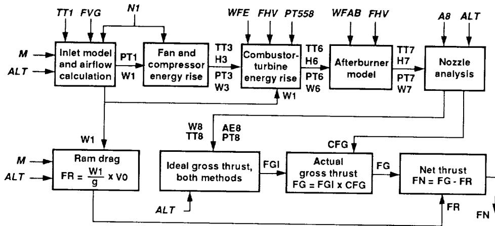

TT1 FVG N1 WFE FHV PT558 WFAB FHV A8 ALT  
M Inlet model and airflow calculation PT1 Fan and compressor energy rise TT3 H3 Combustor-turbine energy rise TT6 H6 Afterburner model TT7 H7 Nozzle analysis  
ALT W1 PT3 H3 PT6 H6 PT7 H7  
W3 W6 W7  
W1  
W8 TT8 AE8 PT8 CFG  
W1  
M Ram drag FR = W1 / g x V0  
Ideal gross thrust, both methods FGI Actual gross thrust FG = FGI x CFG FG Net thrust FN = FG - FR  
ALT ALT FR FN

```
graph LR
  subgraph Top
    Inlet["Inlet model and airflow calculation"] -->|PT1| Fan["Fan and compressor energy rise"]
    Fan -->|TT3 H3| Combustor["Combustor-turbine energy rise"]
    Combustor -->|TT6 H6| Afterburner["Afterburner model"]
    Afterburner -->|TT7 H7| Nozzle["Nozzle analysis"]
  end
  Inlet -->|W1| Ram["Ram drag<br>FR = W1 / g x V0"]
  Nozzle -->|W8 TT8 AE8 PT8| Ideal["Ideal gross thrust, both methods"]
  Nozzle -->|CFG| Actual["Actual gross thrust<br>FG = FGI x CFG"]
  Ideal -->|FGI| Actual
  Actual -->|FG| Net["Net thrust<br>FN = FG - FR"]
  Ram -->|FR| Net
  Net -->|FN| Inlet
```

A block diagram of a gas turbine engine analysis system showing data flow from inlet and airflow calculations through fan, combustor, afterburner, and nozzle to net thrust calculation.

Flowchart: Block diagram of a jet engine performance and thrust calculation model.

Fig. 2 F404 in-flight thrust calculation flow chart.

{16}------------------------------------------------

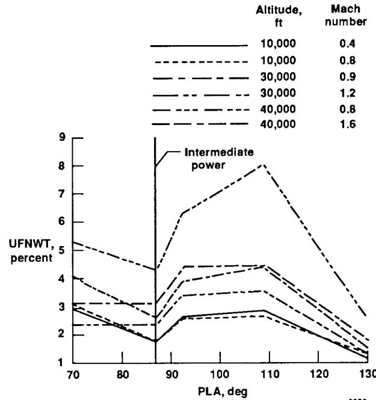

Intermediate  
power

x: PLA, deg, 70 to 130; y: UFNWT, percent, 1 to 9

| PLA, deg | 10,000 ft, 0.4 | 10,000 ft, 0.8 | 30,000 ft, 0.9 | 30,000 ft, 1.2 | 40,000 ft, 0.8 | 40,000 ft, 1.6 |
|----------|----------------|----------------|----------------|----------------|----------------|----------------|
| 70       | ~3.0           | ~3.0           | ~4.0           | ~5.2           | ~2.3           | ~2.3           |
| 80       | ~2.3           | ~2.3           | ~3.1           | ~4.5           | ~2.3           | ~2.3           |
| 87       | ~1.7           | ~2.6           | ~2.6           | ~4.3           | ~2.3           | ~2.3           |
| 90       | ~2.0           | ~3.0           | ~3.9           | ~5.2           | ~2.6           | ~2.6           |
| 93       | ~2.6           | ~3.4           | ~4.5           | ~6.2           | ~2.6           | ~2.6           |
| 100      | ~2.7           | ~3.5           | ~4.5           | ~7.0           | ~2.6           | ~2.6           |
| 109      | ~2.8           | ~3.5           | ~4.4           | ~8.1           | ~2.6           | ~2.6           |
| 120      | ~2.0           | ~2.6           | ~3.2           | ~5.0           | ~2.0           | ~2.0           |
| 130      | ~1.2           | ~1.8           | ~2.6           | ~2.7           | ~1.2           | ~1.2           |

A line chart showing UFNWT percent as a function of PLA in degrees, with a vertical line marking intermediate power at approximately 87 degrees.

Line chart: UFNWT percent versus PLA degree for various altitudes and Mach numbers.

(a) WT method.

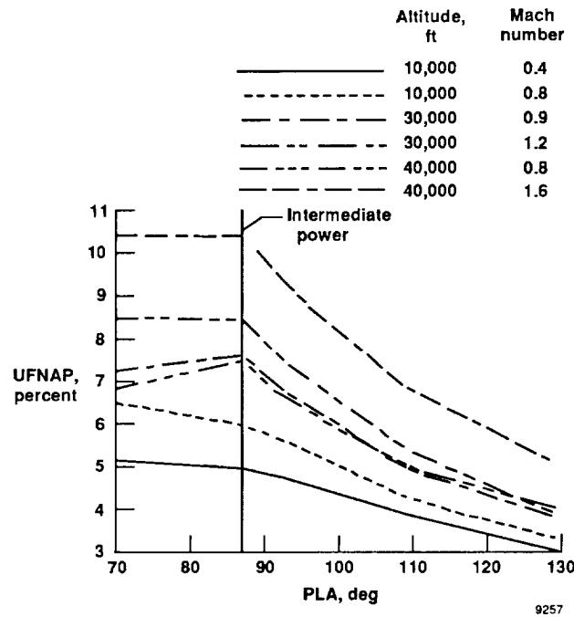

Intermediate  
power  
Altitude,  
ft  
Mach  
number  
10,000  
0.4  
10,000  
0.8  
30,000  
0.9  
30,000  
1.2  
40,000  
0.8  
40,000  
1.6

x: PLA, deg, 70 to 130; y: UFNAP, percent, 3 to 11

| PLA, deg | Intermediate power (10,000 ft, 0.4 Mach) | 10,000 ft, 0.8 Mach | 30,000 ft, 0.9 Mach | 30,000 ft, 1.2 Mach | 40,000 ft, 0.8 Mach | 40,000 ft, 1.6 Mach |
|----------|------------------------------------------|---------------------|---------------------|---------------------|---------------------|---------------------|
| 70       | ~5.1                                     | ~6.4                | ~7.2                | ~7.4                | ~6.4                | ~8.4                |
| 80       | ~5.0                                     | ~6.3                | ~7.2                | ~7.4                | ~6.3                | ~8.4                |
| 90       | ~4.9                                     | ~5.9                | ~7.4                | ~7.2                | ~5.9                | ~8.3                |
| 100      | ~4.4                                     | ~5.1                | ~6.4                | ~6.2                | ~5.1                | ~8.1                |
| 110      | ~3.8                                     | ~4.2                | ~5.0                | ~5.0                | ~4.2                | ~6.8                |
| 120      | ~3.4                                     | ~3.6                | ~4.2                | ~4.2                | ~3.6                | ~5.9                |
| 130      | ~3.0                                     | ~3.2                | ~3.9                | ~4.0                | ~3.2                | ~5.1                |

A line chart showing UFNAP percent decreasing as PLA increases from 70 to 130 degrees, with a vertical line marking intermediate power around 88 degrees.

Line chart: UFNAP percent versus PLA angle at various altitudes and Mach numbers.

(b) AP method.

Fig. 3 Net-thrust uncertainty as a function of *PLA*.

{17}------------------------------------------------

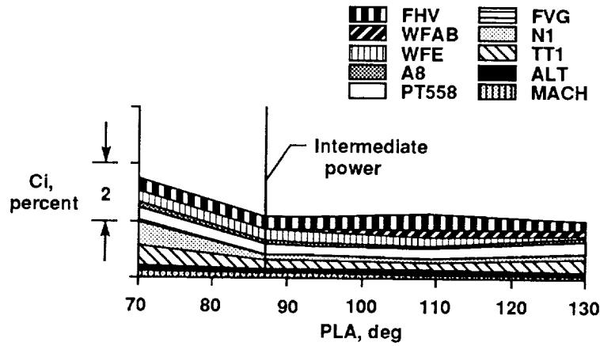

FHV  
WFAB  
WFE  
A8  
PT558  
FVG  
N1  
TT1  
ALT  
MACH  
Intermediate  
power

x: PLA, deg, 70 to 130; y: Ci, percent, 0 to 2

| PLA, deg | FHV  | WFAB | WFE  | A8   | PT558 | FVG  | N1    | TT1   | ALT   | MACH  |
|----------|------|------|------|------|-------|------|-------|-------|-------|-------|
| 70       | ~2.1 | ~1.8 | ~1.5 | ~1.2 | ~0.9  | ~0.6 | ~0.4  | ~0.2  | ~0.1  | ~0.05 |
| 80       | ~1.7 | ~1.4 | ~1.1 | ~0.8 | ~0.6  | ~0.4 | ~0.25 | ~0.15 | ~0.05 | ~0.02 |
| 90       | ~1.4 | ~1.1 | ~0.8 | ~0.6 | ~0.4  | ~0.3 | ~0.2  | ~0.1  | ~0.05 | ~0.02 |
| 100      | ~1.4 | ~1.1 | ~0.8 | ~0.6 | ~0.4  | ~0.3 | ~0.2  | ~0.1  | ~0.05 | ~0.02 |
| 110      | ~1.4 | ~1.1 | ~0.8 | ~0.6 | ~0.4  | ~0.3 | ~0.2  | ~0.1  | ~0.05 | ~0.02 |
| 120      | ~1.3 | ~1.0 | ~0.7 | ~0.5 | ~0.4  | ~0.3 | ~0.2  | ~0.1  | ~0.05 | ~0.02 |
| 130      | ~1.2 | ~0.9 | ~0.6 | ~0.5 | ~0.4  | ~0.3 | ~0.2  | ~0.1  | ~0.05 | ~0.02 |

A stacked area chart showing Ci percent decreasing as PLA increases from 70 to 130 degrees, with a vertical line marking the transition to intermediate power around 88 degrees.

Line chart: Plot of Ci percent versus PLA degree for various aircraft types.

(a) WT method; 10,000 ft,  $M = 0.4$ .

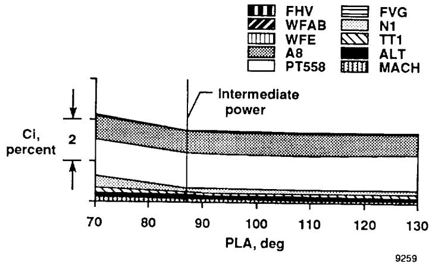

FHV  
FVG  
WFAB  
N1  
WFE  
TT1  
A8  
ALT  
PT558  
MACH  
Intermediate  
power  
Ci,  
percent  
2  
9259

x: PLA, deg, 70 to 130; y: Ci, percent, 0 to 2

| PLA, deg | FHV  | WFAB | WFE  | A8   | PT558 | FVG  | N1   | TT1  | ALT  | MACH |
|----------|------|------|------|------|-------|------|------|------|------|------|
| 70       | ~0.1 | ~0.1 | ~0.1 | ~0.1 | ~1.8  | ~0.1 | ~0.1 | ~0.1 | ~0.1 | ~0.1 |
| 80       | ~0.1 | ~0.1 | ~0.1 | ~0.1 | ~1.6  | ~0.1 | ~0.1 | ~0.1 | ~0.1 | ~0.1 |
| 90       | ~0.1 | ~0.1 | ~0.1 | ~0.1 | ~1.5  | ~0.1 | ~0.1 | ~0.1 | ~0.1 | ~0.1 |
| 100      | ~0.1 | ~0.1 | ~0.1 | ~0.1 | ~1.4  | ~0.1 | ~0.1 | ~0.1 | ~0.1 | ~0.1 |
| 110      | ~0.1 | ~0.1 | ~0.1 | ~0.1 | ~1.3  | ~0.1 | ~0.1 | ~0.1 | ~0.1 | ~0.1 |
| 120      | ~0.1 | ~0.1 | ~0.1 | ~0.1 | ~1.3  | ~0.1 | ~0.1 | ~0.1 | ~0.1 | ~0.1 |
| 130      | ~0.1 | ~0.1 | ~0.1 | ~0.1 | ~1.3  | ~0.1 | ~0.1 | ~0.1 | ~0.1 | ~0.1 |

A stacked area chart showing Ci percent as a function of PLA in degrees from 70 to 130, with a vertical line marking intermediate power around 88 degrees.

Line chart: Plot of Ci percent versus PLA degree for various aircraft models.

(b) AP method; 10,000 ft,  $M = 0.4$ .

Fig. 4 Relative parameter  $C_i$  values.

{18}------------------------------------------------

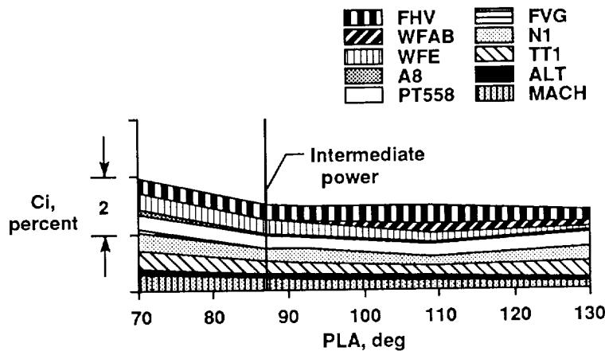

FHV  
WFAB  
WFE  
A8  
PT558  
FVG  
N1  
TT1  
ALT  
MACH  
Intermediate  
power

x: PLA, deg, 70 to 130; y: Ci, percent, 0 to 2

| PLA, deg | Top boundary (FHV) | Bottom boundary (MACH) |
|----------|--------------------|------------------------|
| 70       | ~2.3               | ~0.0                   |
| 80       | ~2.0               | ~0.0                   |
| 90       | ~1.8               | ~0.0                   |
| 100      | ~1.8               | ~0.0                   |
| 110      | ~1.8               | ~0.0                   |
| 120      | ~1.8               | ~0.0                   |
| 130      | ~1.8               | ~0.0                   |

A stacked area or layered line chart showing Ci percent as a function of PLA in degrees, with a vertical line marking intermediate power around 88 degrees.

Line chart: Plot of Ci percent versus PLA deg with intermediate power marker and patterned legend.

(c) WT method; 10,000 ft,  $M = 0.8$ .

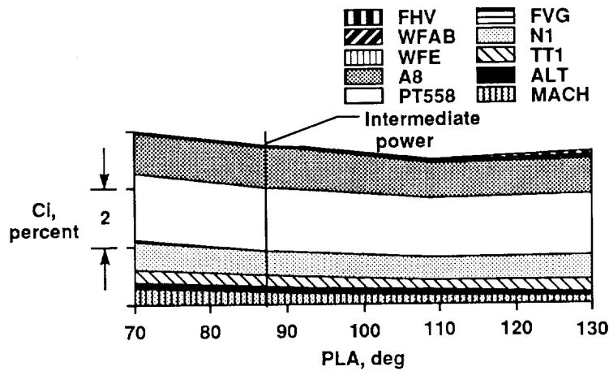

FHV  
WFAB  
WFE  
A8  
PT558  
FVG  
N1  
TT1  
ALT  
MACH  
Intermediate  
power  
CI,  
percent  
2

x: PLA, deg, 70 to 130; y: CI, percent, 0 to 2

| PLA, deg | Total CI, percent |
|----------|-------------------|
| 70       | ~2.3              |
| 80       | ~2.2              |
| 90       | ~2.1              |
| 100      | ~2.0              |
| 110      | ~1.9              |
| 120      | ~2.0              |
| 130      | ~2.1              |

A stacked area chart showing the percentage of CI across PLA from 70 to 130 degrees, with a vertical line marking intermediate power around 87 degrees.

Area chart: Stacked area chart of CI percent versus PLA degree for various aircraft types.

(d) AP method; 10,000 ft,  $M = 0.8$ .

Fig. 4 Continued.

{19}------------------------------------------------

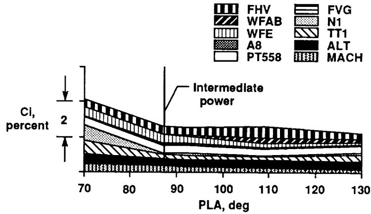

FHV  
WFAB  
WFE  
A8  
PT558  
FVG  
N1  
TT1  
ALT  
MACH  
Intermediate  
power

x: PLA, deg, 70 to 130; y: CI, percent, 0 to 2

| PLA, deg | FHV  | WFAB | WFE  | A8   | PT558 | FVG  | N1   | TT1  | ALT  | MACH |
|----------|------|------|------|------|-------|------|------|------|------|------|
| 70       | ~2.0 | ~1.5 | ~1.0 | ~0.5 | ~0.0  | ~1.0 | ~0.5 | ~0.2 | ~0.0 | ~0.0 |
| 80       | ~1.5 | ~1.0 | ~0.5 | ~0.2 | ~0.0  | ~0.8 | ~0.4 | ~0.1 | ~0.0 | ~0.0 |
| 90       | ~1.2 | ~0.8 | ~0.4 | ~0.1 | ~0.0  | ~0.7 | ~0.3 | ~0.1 | ~0.0 | ~0.0 |
| 100      | ~1.1 | ~0.7 | ~0.3 | ~0.1 | ~0.0  | ~0.6 | ~0.2 | ~0.1 | ~0.0 | ~0.0 |
| 110      | ~1.0 | ~0.6 | ~0.3 | ~0.1 | ~0.0  | ~0.6 | ~0.2 | ~0.1 | ~0.0 | ~0.0 |
| 120      | ~0.9 | ~0.5 | ~0.2 | ~0.1 | ~0.0  | ~0.5 | ~0.2 | ~0.1 | ~0.0 | ~0.0 |
| 130      | ~0.8 | ~0.4 | ~0.2 | ~0.1 | ~0.0  | ~0.5 | ~0.2 | ~0.1 | ~0.0 | ~0.0 |

A stacked area chart showing the percentage of confidence interval (CI) across PLA angles from 70 to 130 degrees, with a vertical line marking the intermediate power setting around 87 degrees.

Line chart: Confidence interval percent versus PLA angle for various aircraft models.

(e) WT method; 30,000 ft,  $M = 0.9$ .

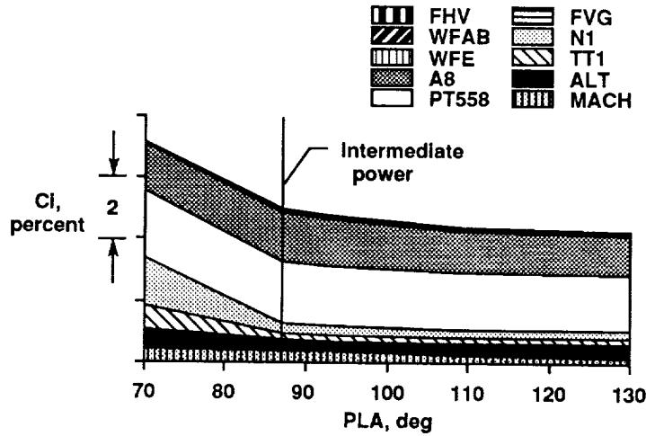

FHV  
WFAB  
WFE  
A8  
PT558  
FVG  
N1  
TT1  
ALT  
MACH  
Intermediate  
power  
CI,  
percent  
2

x: PLA, deg, 70 to 130; y: CI, percent, 0 to 2

| PLA, deg | FHV  | WFAB | WFE  | A8   | PT558 | FVG  | N1   | TT1  | ALT  | MACH |
|----------|------|------|------|------|-------|------|------|------|------|------|
| 70       | ~0.1 | ~0.1 | ~0.1 | ~0.1 | ~0.1  | ~0.1 | ~0.1 | ~0.1 | ~0.1 | ~0.1 |
| 80       | ~0.1 | ~0.1 | ~0.1 | ~0.1 | ~0.1  | ~0.1 | ~0.1 | ~0.1 | ~0.1 | ~0.1 |
| 90       | ~0.1 | ~0.1 | ~0.1 | ~0.1 | ~0.1  | ~0.1 | ~0.1 | ~0.1 | ~0.1 | ~0.1 |
| 100      | ~0.1 | ~0.1 | ~0.1 | ~0.1 | ~0.1  | ~0.1 | ~0.1 | ~0.1 | ~0.1 | ~0.1 |
| 110      | ~0.1 | ~0.1 | ~0.1 | ~0.1 | ~0.1  | ~0.1 | ~0.1 | ~0.1 | ~0.1 | ~0.1 |
| 120      | ~0.1 | ~0.1 | ~0.1 | ~0.1 | ~0.1  | ~0.1 | ~0.1 | ~0.1 | ~0.1 | ~0.1 |
| 130      | ~0.1 | ~0.1 | ~0.1 | ~0.1 | ~0.1  | ~0.1 | ~0.1 | ~0.1 | ~0.1 | ~0.1 |

A stacked area chart showing the percentage of CI across PLA from 70 to 130 degrees, with a vertical line marking intermediate power around 88 degrees.

Area chart: Percentage of CI versus PLA for various aircraft types.

(f) AP method; 30,000 ft,  $M = 0.9$ .

Fig. 4 Continued.

{20}------------------------------------------------

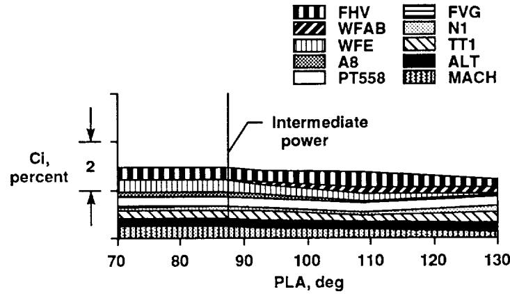

FHV  
WFAB  
WFE  
A8  
PT558  
FVG  
N1  
TT1  
ALT  
MACH  
Intermediate  
power

x: PLA, deg, 70 to 130; y: Ci, percent, 0 to 2

| PLA, deg | FHV  | WFAB | WFE  | A8   | PT558 | FVG  | N1   | TT1  | ALT  | MACH |
|----------|------|------|------|------|-------|------|------|------|------|------|
| 70       | ~1.9 | ~1.6 | ~1.3 | ~1.0 | ~0.7  | ~0.5 | ~0.3 | ~0.1 | ~0.0 | ~0.0 |
| 80       | ~1.9 | ~1.6 | ~1.3 | ~1.0 | ~0.7  | ~0.5 | ~0.3 | ~0.1 | ~0.0 | ~0.0 |
| 90       | ~1.8 | ~1.5 | ~1.2 | ~0.9 | ~0.6  | ~0.4 | ~0.2 | ~0.1 | ~0.0 | ~0.0 |
| 100      | ~1.7 | ~1.4 | ~1.1 | ~0.8 | ~0.6  | ~0.4 | ~0.2 | ~0.1 | ~0.0 | ~0.0 |
| 110      | ~1.6 | ~1.3 | ~1.0 | ~0.7 | ~0.5  | ~0.3 | ~0.1 | ~0.0 | ~0.0 | ~0.0 |
| 120      | ~1.5 | ~1.2 | ~0.9 | ~0.6 | ~0.5  | ~0.3 | ~0.1 | ~0.0 | ~0.0 | ~0.0 |
| 130      | ~1.4 | ~1.1 | ~0.8 | ~0.5 | ~0.4  | ~0.2 | ~0.1 | ~0.0 | ~0.0 | ~0.0 |

A stacked line chart showing Ci percent as a function of PLA in degrees from 70 to 130, with a vertical line marking intermediate power around 88 degrees.

Line chart: Plot of Ci percent versus PLA degree for various aircraft models.

9264

(g) WT method; 30,000 ft,  $M = 1.2$ .

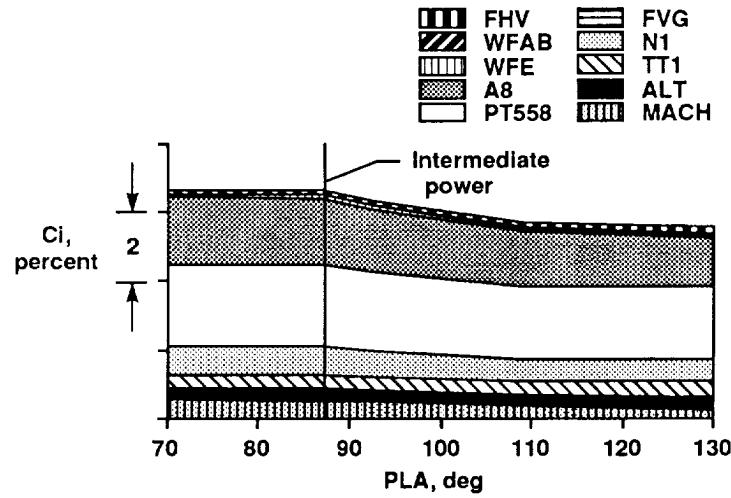

FHV  
WFAB  
WFE  
A8  
PT558  
FVG  
N1  
TT1  
ALT  
MACH  
Intermediate  
power  
Ci,  
percent  
2

x: PLA, deg, 70 to 130; y: Ci, percent, 0 to 2

| PLA, deg | Total Ci, percent |
|----------|-------------------|
| 70       | ~2.1              |
| 80       | ~2.1              |
| 90       | ~2.0              |
| 100      | ~1.8              |
| 110      | ~1.7              |
| 120      | ~1.7              |
| 130      | ~1.7              |

A stacked area chart showing the distribution of Ci percent across PLA from 70 to 130 degrees, with a vertical line marking intermediate power at approximately 88 degrees.

Area chart: Stacked area chart of Ci percent versus PLA with intermediate power.

9265

(h) AP method; 30,000 ft,  $M = 1.2$ .

Fig. 4 Continued.

{21}------------------------------------------------

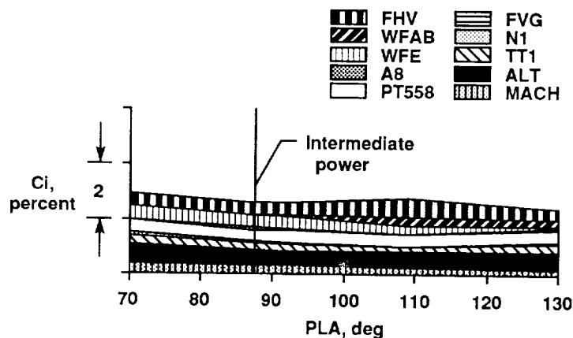

FHV  
WFAB  
WFE  
A8  
PT558  
FVG  
N1  
TT1  
ALT  
MACH  
Intermediate  
power

x: PLA, deg, 70 to 130; y: Ci, percent, 0 to 2

| PLA, deg | FHV  | WFAB | WFE  | A8   | PT558 | FVG  | N1   | TT1  | ALT  | MACH |
|----------|------|------|------|------|-------|------|------|------|------|------|
| 70       | ~1.8 | ~1.5 | ~1.3 | ~1.1 | ~0.9  | ~0.7 | ~0.5 | ~0.3 | ~0.1 | ~0.0 |
| 80       | ~1.6 | ~1.3 | ~1.1 | ~0.9 | ~0.7  | ~0.5 | ~0.3 | ~0.1 | ~0.0 | ~0.0 |
| 90       | ~1.5 | ~1.2 | ~1.0 | ~0.8 | ~0.6  | ~0.4 | ~0.2 | ~0.1 | ~0.0 | ~0.0 |
| 100      | ~1.4 | ~1.1 | ~0.9 | ~0.7 | ~0.5  | ~0.3 | ~0.1 | ~0.0 | ~0.0 | ~0.0 |
| 110      | ~1.4 | ~1.1 | ~0.9 | ~0.7 | ~0.5  | ~0.3 | ~0.1 | ~0.0 | ~0.0 | ~0.0 |
| 120      | ~1.3 | ~1.0 | ~0.8 | ~0.6 | ~0.4  | ~0.2 | ~0.1 | ~0.0 | ~0.0 | ~0.0 |
| 130      | ~1.2 | ~0.9 | ~0.7 | ~0.5 | ~0.3  | ~0.1 | ~0.0 | ~0.0 | ~0.0 | ~0.0 |

A stacked line chart showing Ci percent decreasing as PLA increases from 70 to 130 degrees, with a vertical line marking intermediate power at 90 degrees.

Line chart: Plot of Ci percent versus PLA degree for various aircraft types.

(i) WT method; 40,000 ft,  $M = 0.8$ .

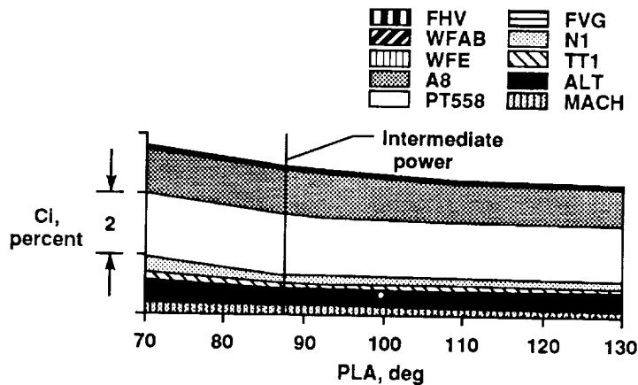

FHV  
WFAB  
WFE  
A8  
PT558  
FVG  
N1  
TT1  
ALT  
MACH  
Intermediate  
power  
2

x: PLA, deg, 70 to 130; y: CI, percent, 0 to 2

| PLA, deg | FHV  | WFAB | WFE  | A8   | PT558 | FVG  | N1   | TT1  | ALT  | MACH |
|----------|------|------|------|------|-------|------|------|------|------|------|
| 70       | ~0.1 | ~0.1 | ~0.1 | ~0.1 | ~0.1  | ~0.1 | ~0.1 | ~0.1 | ~0.1 | ~0.1 |
| 80       | ~0.1 | ~0.1 | ~0.1 | ~0.1 | ~0.1  | ~0.1 | ~0.1 | ~0.1 | ~0.1 | ~0.1 |
| 90       | ~0.1 | ~0.1 | ~0.1 | ~0.1 | ~0.1  | ~0.1 | ~0.1 | ~0.1 | ~0.1 | ~0.1 |
| 100      | ~0.1 | ~0.1 | ~0.1 | ~0.1 | ~0.1  | ~0.1 | ~0.1 | ~0.1 | ~0.1 | ~0.1 |
| 110      | ~0.1 | ~0.1 | ~0.1 | ~0.1 | ~0.1  | ~0.1 | ~0.1 | ~0.1 | ~0.1 | ~0.1 |
| 120      | ~0.1 | ~0.1 | ~0.1 | ~0.1 | ~0.1  | ~0.1 | ~0.1 | ~0.1 | ~0.1 | ~0.1 |
| 130      | ~0.1 | ~0.1 | ~0.1 | ~0.1 | ~0.1  | ~0.1 | ~0.1 | ~0.1 | ~0.1 | ~0.1 |

A stacked area chart showing confidence interval percentage as a function of PLA in degrees from 70 to 130, with a vertical line marking intermediate power around 88 degrees.

Area chart: Confidence interval percentage versus pitch angle of launch for various flight vehicles.

(j) AP method; 40,000 ft,  $M = 0.8$ .

Fig. 4 Continued.

{22}------------------------------------------------

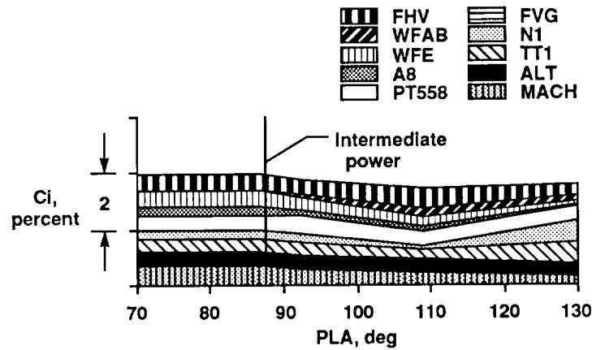

FHV  
WFAB  
WFE  
A8  
PT558  
FVG  
N1  
TT1  
ALT  
MACH  
Intermediate  
power  
Ci,  
percent  
2

x: PLA, deg, 70 to 130; y: Ci, percent, 0 to 2

| PLA, deg | Total Ci, percent |
|----------|-------------------|
| 70       | ~2.0              |
| 80       | ~2.0              |
| 90       | ~1.9              |
| 100      | ~1.8              |
| 110      | ~1.7              |
| 120      | ~1.8              |
| 130      | ~2.0              |

A stacked area chart showing the distribution of Ci percent across different aircraft models (FHV, WFAB, WFE, A8, PT558, FVG, N1, TT1, ALT, MACH) as a function of PLA from 70 to 130 degrees, with a vertical line marking intermediate power.

Area chart: Stacked area chart of Ci percent versus PLA deg for various aircraft types.

9268

(k) WT method; 40,000 ft,  $M = 1.6$ .

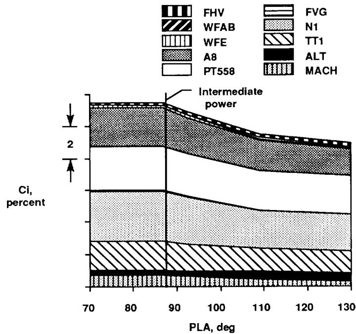

Intermediate  
power  
2  
Ci,  
percent  
PLA, deg

x: PLA, deg, 70 to 130; y: Ci, percent, 0 to 2

| PLA, deg | MACH | ALT  | TT1  | N1   | FVG  | PT558 | A8   | WFE  | WFAB | FHV  |
|----------|------|------|------|------|------|-------|------|------|------|------|
| 70       | ~0.1 | ~0.1 | ~0.2 | ~0.5 | ~0.5 | ~0.5  | ~0.5 | ~0.5 | ~0.5 | ~0.5 |
| 80       | ~0.1 | ~0.1 | ~0.2 | ~0.5 | ~0.5 | ~0.5  | ~0.5 | ~0.5 | ~0.5 | ~0.5 |
| 90       | ~0.1 | ~0.1 | ~0.2 | ~0.5 | ~0.5 | ~0.5  | ~0.5 | ~0.5 | ~0.5 | ~0.5 |
| 100      | ~0.1 | ~0.1 | ~0.2 | ~0.5 | ~0.5 | ~0.5  | ~0.5 | ~0.5 | ~0.5 | ~0.5 |
| 110      | ~0.1 | ~0.1 | ~0.2 | ~0.5 | ~0.5 | ~0.5  | ~0.5 | ~0.5 | ~0.5 | ~0.5 |
| 120      | ~0.1 | ~0.1 | ~0.2 | ~0.5 | ~0.5 | ~0.5  | ~0.5 | ~0.5 | ~0.5 | ~0.5 |
| 130      | ~0.1 | ~0.1 | ~0.2 | ~0.5 | ~0.5 | ~0.5  | ~0.5 | ~0.5 | ~0.5 | ~0.5 |

A stacked area chart showing Ci, percent as a function of PLA, deg from 70 to 130 at intermediate power, with a legend identifying ten aircraft types.

Area chart: Indicated airspeed (Ci) percentage versus pitch angle (PLA) for various aircraft.

9269

(l) AP method; 40,000 ft,  $M = 1.6$ .

Fig. 4 Concluded.

{23}------------------------------------------------

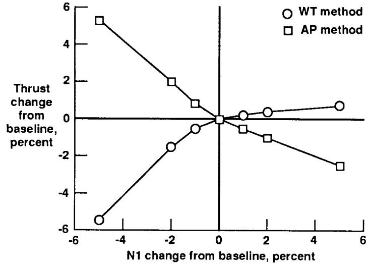

x: N1 change from baseline, percent, -6 to 6; y: Thrust change from baseline, percent, -6 to 6

| N1 change from baseline, percent | WT method | AP method |
|----------------------------------|-----------|-----------|
| -5                               | ~-5.5     | ~5.2      |
| -2                               | ~-1.5     | ~1.9      |
| -1                               | ~-0.6     | ~0.7      |
| 0                                | ~0        | ~0        |
| 1                                | ~0.2      | ~-0.6     |
| 2                                | ~0.4      | ~-1.1     |
| 5                                | ~0.6      | ~-2.6     |

A line plot showing thrust change from baseline against N1 change from baseline for WT and AP methods, both intersecting at the origin (0, 0).

Line chart: Thrust change from baseline versus N1 change from baseline for WT and AP methods.

(a)  $N1$ ; 10,000 ft,  $M = 0.8$ ,  $130^\circ PLA$ .

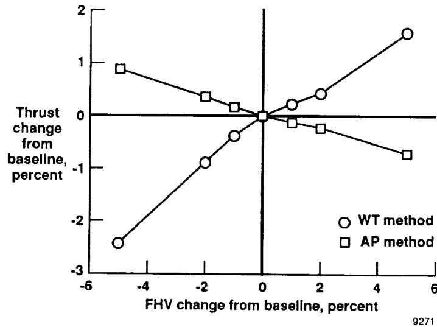

x: FHV change from baseline, percent, -6 to 6; y: Thrust change from baseline, percent, -3 to 2

| FHV change from baseline, percent | WT method | AP method |
|-----------------------------------|-----------|-----------|
| -5                                | ~-2.5     | ~0.85     |
| -2                                | ~-0.9     | ~0.35     |
| -1                                | ~-0.4     | ~0.15     |
| 0                                 | ~0        | ~0        |
| 1                                 | ~0.2      | ~-0.15    |
| 2                                 | ~0.4      | ~-0.25    |
| 5                                 | ~1.5      | ~-0.75    |

A line plot showing thrust change from baseline against FHV change from baseline for the WT method and the AP method, both intersecting at (0, 0).

Line chart: Thrust change from baseline versus FHV change from baseline for WT and AP methods.

(b)  $FHV$ ; 30,000 ft,  $M = 1.2$ ,  $130^\circ PLA$ .

Fig. 5 Nonlinear data analysis examples.

{24}------------------------------------------------

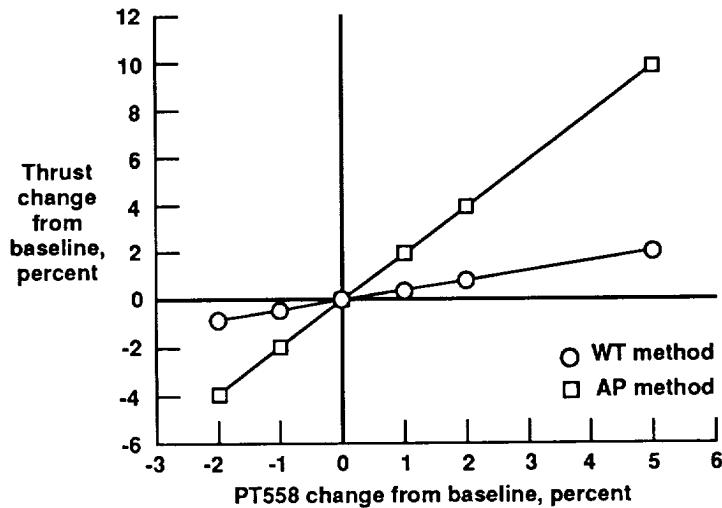

x: PT558 change from baseline, percent, -3 to 6; y: Thrust change from baseline, percent, -6 to 12

| PT558 change from baseline, percent | WT method | AP method |
|-------------------------------------|-----------|-----------|
| -2                                  | ~-1       | ~-4       |
| -1                                  | ~-0.5     | ~-2       |
| 0                                   | ~0        | ~0        |
| 1                                   | ~0.5      | ~2        |
| 2                                   | ~1        | ~4        |
| 5                                   | ~2.2      | ~10       |

A line plot showing thrust change from baseline as a function of PT558 change from baseline, comparing the WT method and the AP method, both showing a positive linear relationship.

Line chart: Thrust change from baseline versus PT558 change from baseline for WT and AP methods.

(c) *PT558*; 30,000 ft,  $M = 0.9$ , 87° *PLA*.

Fig. 5 Concluded.

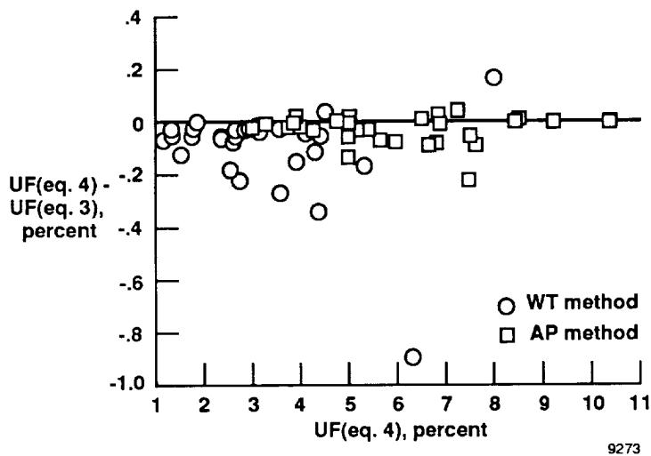

x: UF(eq. 4), percent, 1 to 11; y: UF(eq. 4) - UF(eq. 3), percent, -1.0 to .4

| UF(eq. 4), percent | WT method | AP method |
|--------------------|-----------|-----------|
| ~1.3               | ~-0.07    | ~-0.05    |
| ~1.5               | ~-0.10    | ~-0.05    |
| ~1.7               | ~0.00     | ~-0.05    |
| ~2.0               | ~-0.13    | ~-0.05    |
| ~2.2               | ~-0.20    | ~-0.05    |
| ~2.5               | ~-0.21    | ~-0.05    |
| ~2.7               | ~-0.07    | ~-0.05    |
| ~3.0               | ~-0.07    | ~-0.03    |
| ~3.5               | ~-0.26    | ~-0.02    |
| ~3.7               | ~-0.07    | ~-0.02    |
| ~4.0               | ~-0.15    | ~0.01     |
| ~4.3               | ~-0.33    | ~0.01     |
| ~4.5               | ~0.04     | ~0.01     |
| ~4.7               | ~-0.10    | ~0.01     |
| ~5.0               | ~-0.15    | ~-0.13    |
| ~5.2               | ~-0.16    | ~0.01     |
| ~5.5               | ~-0.05    | ~-0.07    |
| ~5.7               | ~-0.07    | ~-0.07    |
| ~6.3               | ~-0.89    | ~0.01     |
| ~6.5               | ~0.01     | ~-0.08    |
| ~6.7               | ~0.01     | ~0.04     |
| ~7.0               | ~0.01     | ~-0.07    |
| ~7.2               | ~0.04     | ~0.05     |
| ~7.5               | ~-0.07    | ~-0.21    |
| ~7.9               | ~0.18     | ~0.01     |
| ~8.3               | ~0.01     | ~0.01     |
| ~9.0               | ~0.01     | ~0.01     |
| ~10.5              | ~0.01     | ~0.01     |

A scatter plot showing the difference between UF(eq. 4) and UF(eq. 3) in percent versus UF(eq. 4) in percent for WT and AP methods, with a horizontal reference line at 0.

Scatter plot: Comparison of UF(eq. 4) and UF(eq. 3) between WT and AP methods.

Fig. 6 Nonlinearity effects on equation (4) thrust uncertainty results.

{25}------------------------------------------------

|                                                                                                                                                                                                                                                                                                                                                                                                                                                                                                                                                                                                                                                                                                                                                                                                                                                                                                                                                                                                                                                                          |                                                          |                                                                                       |                      |
|--------------------------------------------------------------------------------------------------------------------------------------------------------------------------------------------------------------------------------------------------------------------------------------------------------------------------------------------------------------------------------------------------------------------------------------------------------------------------------------------------------------------------------------------------------------------------------------------------------------------------------------------------------------------------------------------------------------------------------------------------------------------------------------------------------------------------------------------------------------------------------------------------------------------------------------------------------------------------------------------------------------------------------------------------------------------------|----------------------------------------------------------|---------------------------------------------------------------------------------------|----------------------|
|                                                                                                                                                                                                                                                                                                                                                                                                                                                                                                                                                                                                                                                                                                                                                                                                                                                                                                                                                                                         |                                                          | <b>Report Documentation Page</b>                                                      |                      |
| 1. Report No.<br><br>NASA TM-4140                                                                                                                                                                                                                                                                                                                                                                                                                                                                                                                                                                                                                                                                                                                                                                                                                                                                                                                                                                                                                                        | 2. Government Accession No.                              | 3. Recipient's Catalog No.                                                            |                      |
| 4. Title and Subtitle<br><br>Measurement Effects on the Calculation of In-Flight Thrust for an F404 Turbofan Engine                                                                                                                                                                                                                                                                                                                                                                                                                                                                                                                                                                                                                                                                                                                                                                                                                                                                                                                                                      |                                                          | 5. Report Date<br><br>September 1989                                                  |                      |
|                                                                                                                                                                                                                                                                                                                                                                                                                                                                                                                                                                                                                                                                                                                                                                                                                                                                                                                                                                                                                                                                          |                                                          | 6. Performing Organization Code                                                       |                      |
| 7. Author(s)<br><br>Timothy R. Conners                                                                                                                                                                                                                                                                                                                                                                                                                                                                                                                                                                                                                                                                                                                                                                                                                                                                                                                                                                                                                                   |                                                          | 8. Performing Organization Report No.<br><br>H-1556                                   |                      |
|                                                                                                                                                                                                                                                                                                                                                                                                                                                                                                                                                                                                                                                                                                                                                                                                                                                                                                                                                                                                                                                                          |                                                          | 10. Work Unit No.<br><br>RTOP 533-02-51                                               |                      |
| 9. Performing Organization Name and Address<br><br>NASA Ames Research Center<br>Dryden Flight Research Facility<br>P.O. Box 273, Edwards, CA 93523-5000                                                                                                                                                                                                                                                                                                                                                                                                                                                                                                                                                                                                                                                                                                                                                                                                                                                                                                                  |                                                          | 11. Contract or Grant No.                                                             |                      |
|                                                                                                                                                                                                                                                                                                                                                                                                                                                                                                                                                                                                                                                                                                                                                                                                                                                                                                                                                                                                                                                                          |                                                          | 13. Type of Report and Period Covered<br><br>Technical Memorandum                     |                      |
| 12. Sponsoring Agency Name and Address<br><br>National Aeronautics and Space Administration<br>Washington, DC 20546                                                                                                                                                                                                                                                                                                                                                                                                                                                                                                                                                                                                                                                                                                                                                                                                                                                                                                                                                      |                                                          | 14. Sponsoring Agency Code                                                            |                      |
|                                                                                                                                                                                                                                                                                                                                                                                                                                                                                                                                                                                                                                                                                                                                                                                                                                                                                                                                                                                                                                                                          |                                                          |                                                                                       |                      |
| 15. Supplementary Notes<br><br>Prepared as AIAA Paper 89-2364 for presentation at the AIAA Joint Propulsion Conference, Monterey, California, July 10-14, 1989.                                                                                                                                                                                                                                                                                                                                                                                                                                                                                                                                                                                                                                                                                                                                                                                                                                                                                                          |                                                          |                                                                                       |                      |
| 16. Abstract<br><br><p>A study has been performed that investigates parameter measurement effects on calculated in-flight thrust for the General Electric F404-GE-400 afterburning turbofan engine which powered the X-29A forward-swept wing research aircraft. Net-thrust uncertainty and influence coefficients were calculated and are presented. Six flight conditions were analyzed at five engine power settings each. Results were obtained using the mass flow-temperature and area-pressure thrust calculation methods, both based on the commonly used gas generator technique. Thrust uncertainty was determined using a common procedure based on the use of measurement uncertainty and influence coefficients. The effects of data nonlinearity on the uncertainty calculation procedure were studied and results are presented. The advantages and disadvantages of using this particular uncertainty procedure are discussed. A brief description of the thrust-calculation technique along with the uncertainty calculation procedure is included.</p> |                                                          |                                                                                       |                      |
| 17. Key Words (Suggested by Author(s))<br><br>F404 turbofan engine; Influence coefficient; Measurement uncertainty; Performance; Thrust calculation; Thrust uncertainty                                                                                                                                                                                                                                                                                                                                                                                                                                                                                                                                                                                                                                                                                                                                                                                                                                                                                                  |                                                          | 18. Distribution Statement<br><br>Unclassified — Unlimited<br><br>Subject category 07 |                      |
| 19. Security Classif. (of this report)<br><br>Unclassified                                                                                                                                                                                                                                                                                                                                                                                                                                                                                                                                                                                                                                                                                                                                                                                                                                                                                                                                                                                                               | 20. Security Classif. (of this page)<br><br>Unclassified | 21. No. of pages<br><br>24                                                            | 22. Price<br><br>A02 |

{26}------------------------------------------------


A high-contrast, black and white, vertically oriented photograph of a person's face, possibly a woman, with a strong vertical light source creating a bright highlight down the center of the face. The image is heavily grainy and has a dark, textured background.

{27}------------------------------------------------

---

## Related documents

- [[NASA TP 3001 - Evaluation of Various Thrust Calibration Techniques on an F404 Engine (April 1990)|NASA TP 3001]] - F404 thrust calibration/calculation techniques
- [[Yuhas 1992 - Effects of Bleed ir Extraction of Thrust Levels of the F404-GE-400 Turbofan Engine|Yuhas 1992]] - effects of bleed air extraction on F404 thrust
- [[Exhaust-Gas P & T Survey of F404-GE-400 engine|Exhaust-Gas]] - NASA F404-GE-400 exhaust survey
- [[Powel 1990 - On the Leading Edge, Combining Maturity and Advanced Technology on the F404 Turbofan Engine|Powel 1990]] - GE overview of F404 design and growth
