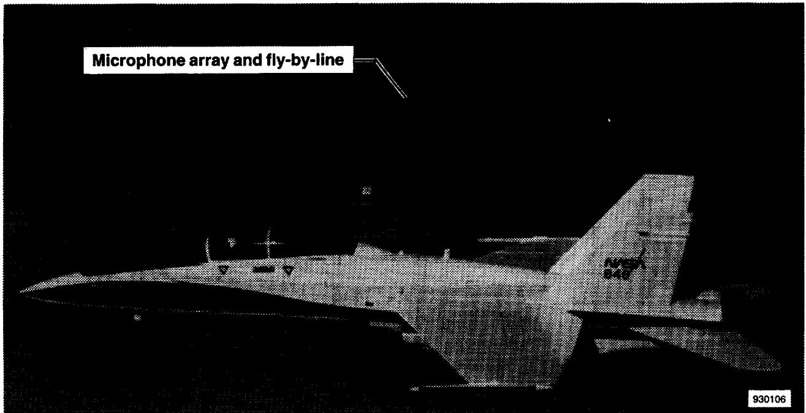
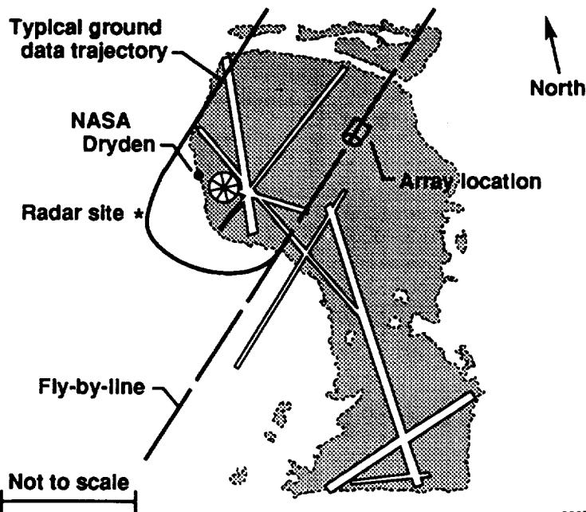
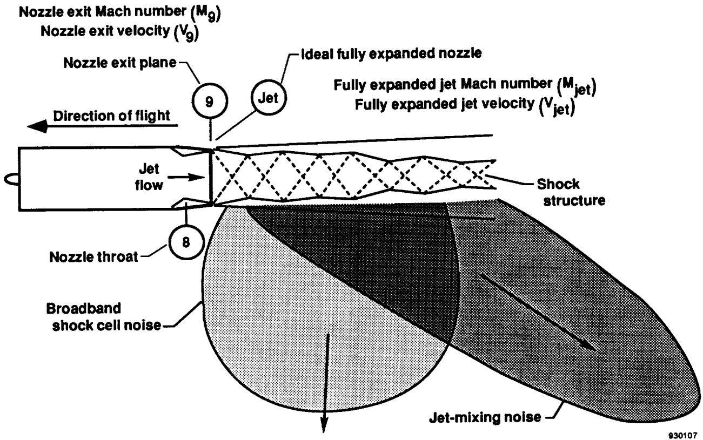
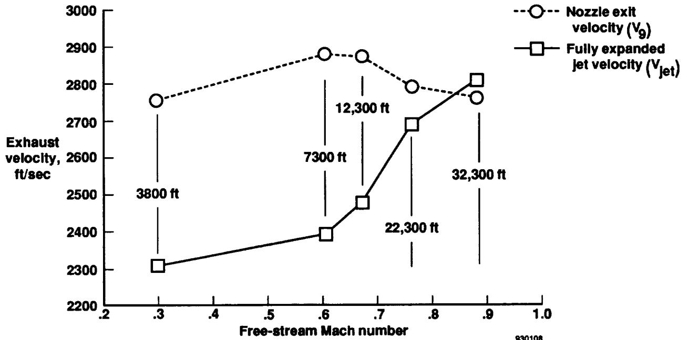
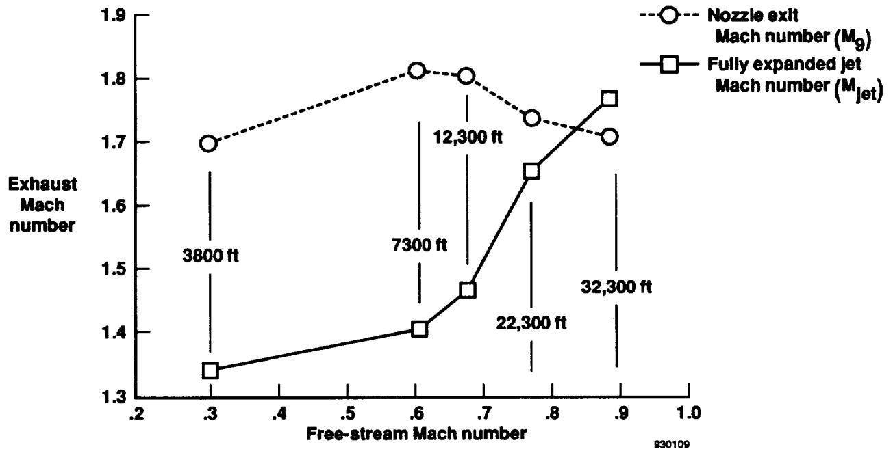
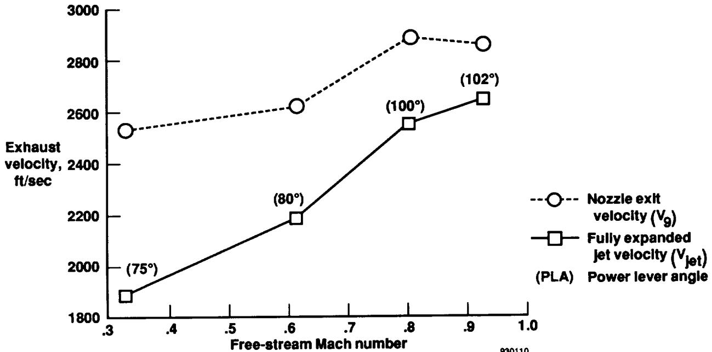
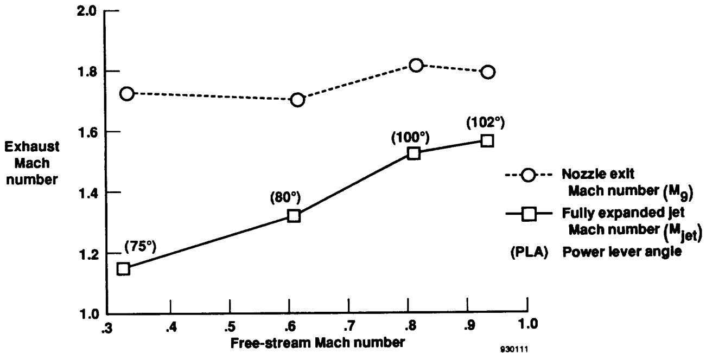
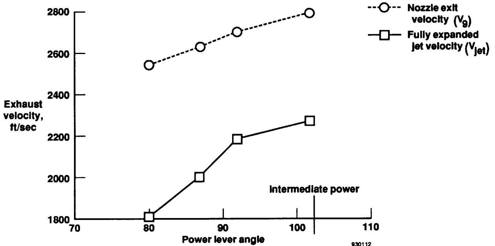
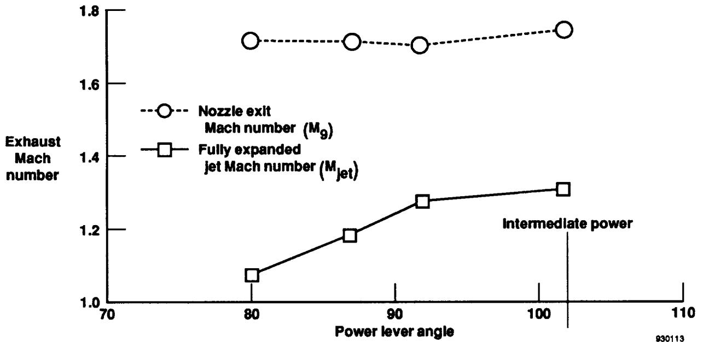

{0}------------------------------------------------

# Flight-Determined Engine Exhaust Characteristics of an F404 Engine in an F-18 Airplane

Kimberly A. Ennix, Frank W. Burcham, Jr., and Lannie D. Webb

October 1993

(NASA-TM-4538) FLIGHT-DETERMINED  
ENGINE EXHAUST CHARACTERISTICS OF  
AN F404 ENGINE IN AN F-18 AIRPLANE  
(NASA) 15 p

N94-15141

Unclas

H1/07 0189624

NASA

A black circular insignia featuring the word NASA in white, overlaid with a white orbital path and a stylized wing or chevron shape.

Logo: NASA insignia logo.

{1}------------------------------------------------

{2}------------------------------------------------

# Flight-Determined Engine Exhaust Characteristics of an F404 Engine in an F-18 Airplane

Kimberly A. Ennix, Frank W. Burcham, Jr., and Lannie D. Webb  
*Dryden Flight Research Facility  
Edwards, California*

NASA

A black circular insignia featuring the word NASA in bold white letters, overlaid with a white orbital ring and a stylized chevron or wing shape, set against a starry space background.

Logo: NASA insignia logo with a starry background and orbital path.

National Aeronautics and  
Space Administration  
Office of Management  
Scientific and Technical  
Information Program  
**1993**

{3}------------------------------------------------

{4}------------------------------------------------

# FLIGHT-DETERMINED ENGINE EXHAUST CHARACTERISTICS OF AN F404 ENGINE IN AN F-18 AIRPLANE

Kimberly A. Ennix\*  
Frank W. Burcham, Jr.\*\*  
Lannie D. Webb\*\*\*  
NASA Dryden Flight Research Facility  
Edwards, California

## Abstract

Personnel at the NASA Langley Research Center (NASA-Langley) and the NASA Dryden Flight Research Facility (NASA-Dryden) have recently completed a joint acoustic flight test program. Several types of aircraft with high nozzle pressure ratio engines were flown to satisfy a twofold objective. First, assessments were made of subsonic climb-to-cruise noise from flights conducted at varying altitudes in a Mach 0.30 to 0.90 range. Second, using data from flights conducted at constant altitude in a Mach 0.30 to 0.95 range, engineers obtained a high-quality noise database. This database was desired to validate the Aircraft Noise Prediction Program and other system noise prediction codes. NASA-Dryden personnel analyzed the engine data from several aircraft that were flown in the test program to determine the exhaust characteristics. The analysis of the exhaust characteristics from the F-18 aircraft will be reported in this paper. This paper presents an overview of the flight test planning, instrumentation, test procedures, data analysis, engine modeling codes, and results.

## Nomenclature

|       |                                                                 |
|-------|-----------------------------------------------------------------|
| A8    | exhaust nozzle physical area at the throat, in2      |
| AE8   | exhaust nozzle effective throat area, in2            |
| AE9   | exhaust nozzle effective area at the exit plane, in2 |
| ANOPP | Aircraft Noise Prediction Program                               |

|            |                                                     |
|------------|-----------------------------------------------------|
| <i>FG</i>  | gross thrust, lb                                    |
| HSCT       | high-speed civil transport                          |
| $M_9$      | nozzle exit Mach number                             |
| $M_{jet}$  | fully expanded jet Mach number                      |
| $M_\infty$ | free-stream Mach number                             |
| NPR        | nozzle pressure ratio, $P8/P_{amb}$                 |
| <i>P8</i>  | total pressure at the exhaust nozzle throat, psia   |
| PLA        | power lever angle, deg                              |
| $P_{amb}$  | ambient pressure, psia                              |
| $P_{s9}$   | static pressure at the exit plane, psia             |
| <i>T8</i>  | total temperature at the exhaust nozzle throat, °R  |
| $V_9$      | nozzle exit velocity, ft/sec                        |
| $V_{jet}$  | fully expanded jet velocity, ft/sec                 |
| $V_\infty$ | free-stream velocity, ft/sec                        |
| W8         | mass flow rate at the exhaust nozzle throat, lb/sec |

## Introduction

Environmental issues are a significant concern confronting the designers of future high-speed civil transport (HSCT) airplanes. It has been determined that a substantial market will exist for HSCT aircraft if designers meet key environmental issues, one of which is noise. The HSCT aircraft must keep takeoff, climb-to-cruise, and landing noise levels within the Federal Aviation Regulation, part 36, Stage III community noise standards.1

The HSCT design concept will likely have supersonic cruise speeds between Mach 2.00 and 2.50. Engines capable of efficient flights at speeds above Mach 2.00 will likely have the thermodynamic cycle of a turbojet or a very-low-bypass turbofan.2 These engines have high nozzle pressure ratios (NPRs) and jet velocities, which raises concern not only for takeoff and landing noise, but also for climb-to-cruise noise, extending from the airport for a distance of up to 50 miles.

\*Aerospace Engineer.

\*\*Chief, Propulsion and Performance Branch. AIAA Associate Fellow.

\*\*\*Aerospace Engineer. Member AIAA.

Copyright © 1993 by the American Institute of Aeronautics and Astronautics, Inc. No copyright is asserted in the United States under Title 17, U.S. Code. The U.S. Government has a royalty-free license to exercise all rights under the copyright claimed herein for Governmental purposes. All other rights are reserved by the copyright owner.

{5}------------------------------------------------

To determine the predicted noise of HSCT aircraft, acoustic codes such as ANOPP (Aircraft Noise Prediction Program)3 are used. These codes were developed using data acquired from engines with NPRs and flight speeds lower than those planned for HSCT aircraft.

To better understand the acoustic characteristics of engines representative of HSCT designs and to enhance current noise prediction codes, personnel at NASA Langley Research Center (NASA-Langley) and NASA Dryden Flight Research Facility (NASA-Dryden) have conducted joint flyover acoustic testing to acquire data.4 The test objective was first, to assess subsonic climb-to-cruise noise using aircraft with high NPR engines and second, to obtain an improved noise database to validate ANOPP and other system noise prediction codes. The NASA-Dryden personnel conducted the flyover tests and determined the engine exhaust characteristics. The NASA-Langley personnel made the acoustic measurements, performed the correlations between the engine exhaust characteristics and acoustic data, and updated the ANOPP code.

The flight study consisted of a series of flights over microphone arrays using several types of aircraft. In the subsonic climb portion of the study, the flight matrix consisted of flyovers at intermediate power at altitudes from 3800 to 32,000 ft and Mach numbers from 0.30 to 0.95. For the ANOPP evaluation flyovers, the test points were conducted at a constant altitude and Mach number. A ground static acoustic test was also conducted to establish acoustic levels with no forward velocity.

For all of the tests, the measured engine data were collected and later analyzed by an F404-GE-400 in-flight thrust code. The code predicted the engine exhaust characteristics of exhaust velocity and Mach number, which cannot be directly obtained from the measured engine data.

This paper describes the F-18 airplane, the F404 engine, the flight test program, and the methods used to calculate the engine exhaust properties. In addition, the paper presents the exhaust velocity and Mach number data for the climb-to-cruise, ANOPP validation, and ground tests.

## **Aircraft Description**

### **F-18 Aircraft**

Figure 1 shows an F-18 aircraft (McDonnell Douglas Corp., St. Louis, Missouri and Northop Corp., Newbury

Park, California) during one of the test runs. This supersonic, high-performance fighter has excellent transonic maneuverability and is powered by two F404-GE-400 (General Electric Co., Lynn, Massachusetts) afterburning, turbofan engines.5 Both engines are mounted close together in the aft fuselage. The standard F-18 maintenance data recorder was used onboard the aircraft to record a limited number of airplane and engine parameters.

## **Engine Description**

The F404-GE-400 is a two-spool, low-bypass, axial-flow turbofan with afterburner. The engine consists of a three-stage fan driven by a single-stage, low-pressure turbine and a seven-stage, high-pressure compressor driven by a single-stage, high-pressure turbine. Variable geometry is incorporated into the fan and high-pressure compressor and the nozzle is a convergent-divergent nozzle.6 It is equipped with an engine control unit (ECU) where idle power is 35° power lever angle (PLA) and intermediate (maximum nonafterburning) power is 102° PLA. It produces NPRs similar to those expected of an HSCT engine application.

## **Test Procedures**

### **Ground Track**

The flight tests were flown over the Rogers Dry Lake which is adjacent to NASA-Dryden. Located at an elevation of 2300 ft, this dry lakebed provides a flat, interference-free area for acoustic testing. Figure 2 shows the approximate location of the microphone array placed along the “fly-by” line on the northeast side of the lakebed. This area was ideal for tracking because of its close proximity to the NASA-Dryden radar site. Using the ground track and distance displayed in the control room, the pilots were guided down the ground track and over the acoustic array. Flight conditions such as altitude or Mach number needed to be kept as constant as possible to get good quantitative runs. There were 95 recorded F-18 flyovers.

## **Flight Procedures**

The flight tests were conducted in two segments: subsonic climb to cruise and ANOPP validation. A single-exhaust jet was desired so the acoustics tests would have one distinct noise source. For the twin-engine F-18 aircraft both engines were used to set up the initial conditions before the beginning of a maneuver. On call from the control room, the pilot stabilized the speed and altitude of the aircraft. The left engine was throttled back to idle while the right test engine was operated at intermediate power. This procedure simulated the effect of a single engine. For the ANOPP validation segment the test engine was operated at the power required to maintain level flight. The F-18 maintenance recorder was activated by the pilot and operated for 35 sec to record aircraft and engine data during the run. Table 1 shows the flight matrix for the climb-to-cruise and ANOPP validation segments of the flight test.

{6}------------------------------------------------

### Climb-to-Cruise Test Matrix

The flight matrix for the climb-to-cruise segment consisted of level flight accelerations at various Mach numbers and altitude to simulate points along a expected HSCT climb profile. Altitudes varied from 3800 to 32,500 ft and speeds ranged from Mach 0.30 to 0.90. The aircraft flew with the right test engine at the intermediate power setting to maximize NPR.

#### ANOPP Validation Test Matrix

The ANOPP evaluation segment was flown at a constant altitude of 3800 ft (1500 ft above the ground) with speeds ranging from Mach 0.30 to 0.95. Power settings on the test engine varied depending on what was required to maintain constant flight speed or Mach number and altitude.

### Ground Test

In addition to the flight testing, static ground tests were conducted with the aircraft tied down on the thrust stand pad at the US Air Force Flight Test Center at Edwards, California. The test matrix consisted of PLAs from idle to intermediate power at 0.1 increments in engine pressure ratio. The F-18 onboard recorder maintenance tape was run for 35 sec at each power setting to record the engine data. Temperature, wind speed, and wind direction were also recorded. The tests were conducted with the wind speeds below 5 kts.

### Engine Exhaust Characteristics

Jet-mixing and shock cell noise are the two primary sources of noise for takeoffs and subsonic climbs.7 These noise sources are primarily affected by the aircraft velocity, the exhaust exit Mach number and velocity, and the NPR. For acoustic analysis, engine exhaust characteristics are often defined at the nozzle exit and an assumed fully expanded jet. Jet-mixing noise is a function of the difference between the fully expanded jet velocity ( $V_{jet}$ ) and the free-stream velocity ( $V_{\infty}$ ). Shock cell noise is a function of the difference between the fully expanded jet Mach number ( $M_{jet}$ ) and the nozzle exit Mach number ( $M_9$ ). As you approach the point where  $M_9 = M_{jet}$  and  $V_{\infty} = V_{jet}$ , the shock cell noise and jet-mixing noise are diminished. Nozzle exit velocity ( $V_9$ ) and  $M_9$  are based on the

aerothermodynamic characteristics of the flow at the nozzle exit plane (Fig. 3).

### F404 In-Flight Thrust Code

Data obtained from the engine during the flight and ground tests included compressor speed, compressor discharge pressure, fan speed, fuel flow, inlet temperature, turbine discharge temperatures, turbine discharge pressure, and nozzle area ratio. Measured engine data obtained from the flight tests do not directly give the values of  $M_9$ ,  $V_9$ ,  $M_{jet}$ , and  $V_{jet}$  needed for acoustic analysis with the ANOPP prediction code. As a result, the measured engine data must be input into the engine performance codes to obtain the desired engine exhaust characteristics.

The F404-GE-400 in-flight-thrust performance code8 was developed by the General Electric Co. for the US Navy. This code models the engine as a gas generator and uses the measured engine parameters as input. The performance code calculates the following parameters throughout the flight envelope: gross thrust ( $FG$ ),  $V_9$ ,  $V_{jet}$ ,  $M_9$ ,  $M_{jet}$ , NPR, exhaust nozzle effective exit area to effective throat area ratio ( $AE9/AE8$ ), exhaust nozzle static exit pressure to ambient pressure ratio ( $P_{s9}/P_{amb}$ ), exhaust nozzle throat total temperature ( $T8$ ), and exhaust nozzle throat mass flow rate ( $W8$ ). The exhaust nozzle exit mass flow rate ( $W9$ ) and total temperature ( $T9$ ) are assumed to be equal to  $W8$  and  $T8$ , respectively.

The following assumptions are used in the in-flight thrust code. Steady one-dimensional isentropic flow is assumed between the throat and the nozzle exit. Based on the resulting nozzle static exit pressure ( $P_{s9}$ ), the flow will be overexpanded ( $P_{s9} < P_{amb}$ ), fully expanded ( $P_{s9} = P_{amb}$ ), or underexpanded ( $P_{s9} > P_{amb}$ ).  $M_{jet}$  is based on the point where the flow is fully expanded ( $P_{s9} = P_{amb}$ ) and it is a function of NPR.  $M_9$  is a function of nozzle area ratio. Once  $M_9$  and  $M_{jet}$  are determined,  $V_9$  and  $V_{jet}$  are then calculated.  $V_9$  represents the actual exhaust exit velocity while  $V_{jet}$  represents the ideal fully expanded jet exhaust velocity. If the actual exhaust velocity were fully expanded,  $V_9$  would match  $V_{jet}$ .

## Results and Discussion

### Climb-to-Cruise Test Results

Figure 4 shows the effect of Mach number on F404 engine exhaust characteristics for climb-to-cruise tests at intermediate power. Figure 4(a) shows the relationship between  $V_{jet}$  and  $V_9$  and the free-stream Mach number ( $M_{\infty}$ ). Each point on the curve represents a different altitude in the climb-to-cruise matrix. At the beginning of the climb profile when the altitude is approximately 3800 ft and  $M_{\infty} \approx 0.30$ , the nozzle is overexpanded ( $V_9 > V_{jet}$ ). The point where the data crosses,  $M_{\infty} \approx 0.85$  and  $V_{jet} = V_9$ , indicates that the nozzle is fully expanded. When the climb profile reaches an altitude of approximately 32,300 ft and  $M_\infty \approx 0.90$ , the nozzle is underexpanded ( $V_9 < V_{jet}$ ). Overall,  $V_9$  varies from  $V_9 \approx 2750$  ft/sec up to a maximum of  $V_9 \approx 2800$  ft/sec, and then drops to a value of  $V_9 \approx 2750$  ft/sec, while  $V_{jet}$  varies from 2300 to 2900 ft/sec.

{7}------------------------------------------------

Figure 4(b) shows  $M_{jet}$  and  $M_9$  as a function of  $M_\infty$ .  $M_{jet}$  and  $M_9$  follow the same trends with Mach number and altitudes as  $V_{jet}$  and  $V_9$ . The values of  $M_9$  vary between 1.69 up to a maximum of  $M_9 \approx 1.80$ , and then drop to  $M_9 \approx 1.70$ . The values of  $M_{jet}$  vary between  $M_{jet} \approx 1.35$  up to a maximum of  $M_{jet} \approx 1.76$ . Above  $M_\infty \approx 0.85$ , the difference between the two values is significantly reduced. Table 2 lists other parameters of interest for the climb-to-cruise test. The maximum nozzle pressure ratio was 5.24.

### ANOPP Validation Test Results

Figure 5 shows the effect of Mach number on F404 engine exhaust characteristics for ANOPP validation tests at a level altitude of 3800 ft. Figure 5(a) shows the exhaust velocities  $V_9$  and  $V_{jet}$  with respect to  $M_\infty$ . The power setting (PLA) of the test engine was set at the level (shown in parentheses) necessary to maintain constant Mach number in level flight while the other engine remained at idle. The power settings varied from partial power (75°) at the lower speeds, to intermediate power (102°) at the higher speeds. As in Fig. 4, both  $V_9$  and  $V_{jet}$  were plotted as a function of  $M_\infty$ ; however, no crossover occurred because at this low altitude the nozzle is overexpanded for this  $M_\infty$  range. The values of  $V_9$  varied from  $V_9 \approx 2550$  ft/sec up to a maximum of  $V_9 \approx 2900$  ft/sec, while  $V_{jet}$  varied between  $V_{jet} \approx 1900$  to 2650 ft/sec.

Figure 5(b) shows a plot of exhaust Mach numbers  $M_9$  and  $M_{jet}$  with respect to  $M_\infty$ . This set of data also shows a steady trend of increased  $M_9$  and  $M_{jet}$  without any crossover of the data. The two curves do converge toward each other indicating that a fully expanded nozzle condition may occur at a higher  $M_\infty$ . The values of  $M_9$  were  $M_9 \approx 1.70$  to 1.80 while  $M_{jet}$  varied from  $M_{jet} \approx 1.15$  to 1.60. Table 3 shows additional parameters of interest for the ANOPP validation test.

### Ground Test Results

For the ground static tests the effect of PLA on F404 engine exhaust characteristics is shown in Fig. 6. Figure 6(a) shows  $V_9$  and  $V_{jet}$  plotted against PLA for the ground tests. The values of  $V_9$  varied from  $V_9 \approx 2500$  to 2800 ft/sec with increasing PLA.  $V_{jet}$  varied from  $V_{jet} \approx 1800$  to 2200 ft/sec. Figure 6(b) shows the relationship of

PLA to exhaust Mach numbers  $M_9$  and  $M_{jet}$ . The values of  $M_9$  varied between  $M_9 \approx 1.71$  to 1.74 and  $M_{jet}$  varied between  $M_{jet} \approx 1.08$  to 1.30. The data for the exhaust Mach numbers show a trend similar to the exhaust velocities in Fig. 6(a). Additional data for the ground tests are listed in Table 4.

The data in the tables and figures are typical points taken from the many runs conducted in the study. They matched the desired altitudes and Mach numbers shown in the flight matrix in Table 1. The data were selected from test points with stable engine conditions. These points were not averaged. The overall results show that the engine exhaust characteristics of interest for the acoustic test vary with  $M_\infty$  altitude, and PLA. Tables 2, 3, and 4 show that from the climb-to-cruise, ANOPP validation, and ground tests the peak  $V_9$  values were approximately 2800 to 2900 ft/sec.

## Concluding Remarks

A series of acoustic tests were conducted, first, to determine climb-to-cruise noise of aircraft with high nozzle pressure ratios and second, to validate the Aircraft Noise Prediction Program (ANOPP). An F-18 airplane, with the F404-GE-400 engine installed, was flown over a range of flight speeds and altitudes. From these tests, the engine data were analyzed to determine their exhaust characteristics. The flight tests produced a large engine exhaust characteristics database that was correlated with acoustic data and used to upgrade the ANOPP code. This new database will aid in the design of future high-speed civil transport (HSCT) aircraft.

In summary, the climb-to-cruise test conditions at intermediate power produced engine exhaust conditions that varied from overexpanded to underexpanded. The nozzle exit velocities ranged from approximately 2750 ft/sec up to a maximum of approximately 2800 ft/sec, and then dropped to a value of approximately 2750 ft/sec. The nozzle exit Mach numbers ranged between Mach 1.69 up to a maximum of Mach 1.81 and then dropped to a value of Mach 1.70. The maximum nozzle pressure ratio was 5.24. For the ANOPP validation test points, the exhaust conditions were overexpanded and nozzle exit velocity ranged from approximately 2550 to 2900 ft/sec. Nozzle exit Mach numbers ranged from approximately Mach 1.70 to Mach 1.81. For the ground test conditions, nozzle exit velocity varied from 2500 to 2800 ft/sec. Nozzle exit Mach number remained fairly constant at Mach 1.70 over the range of power levels tested. For the three tests: climb-to-cruise, ANOPP, and the ground run, at intermediate power, maximum nozzle exit velocities were approximately 2800 to 2900 ft/sec and nozzle exit Mach number was approximately Mach 1.70.

{8}------------------------------------------------

## References

1United States, Federal Aviation Administration, *Code of Federal Regulations—Aeronautics and Space*, vol. 14, pts. 1 to 59, Washington, DC, rev. Jan. 1, 1992.

2Vachal, John D., "High-Speed Civil Transport Research and Technology Needs," SAE 901925, SAE Aerospace Technology Conference and Exposition, Oct. 1990, pp. 1824–1831.

3Whitehead, Allen H., Jr., "Overview of Airframe Technology in the NASA High-Speed Research Program," AIAA-91-3100, Sept. 1991.

4Kelly, J.J. and M.R. Wilson, "Signal Processing of Jet Noise From Flyover Test Data," AIAA-93-0736, Jan. 1993.

5Powel, S.F., IV, "On the Leading Edge: Combining Maturity and Advanced Technology on the F404 Turbofan Engine," *ASME, Transactions, J. of Engineering for Gas Turbines and Power*, vol. 113, Jan. 1991, pp. 1–10.

6Walton, James T. and Frank W. Burcham, Jr., *Exhaust-Gas Pressure and Temperature Survey of F404-GE-400 Turbofan Engine*, NASA TM-88273, 1986.

7Preisser, J.S., R.A. Golub, J.M. Seiner, and C.A. Powell, "Supersonic Jet Noise: Its Generation, Prediction, and Effects on People and Structures," *SAE 1990 Transactions, J. of Aerospace*, sec. 1, vol. 99, pt. 2, 1990, pp. 1833–1847. (Also available as SAE 901927, 1990.)

8*F404 In-Flight Thrust Calculation Deck*, Program no. 83112, General Electric Co., Aug. 1983.

{9}------------------------------------------------

Table 1. Flight matrix for climb-to-cruise points and ANOPP validation.

| Test matrix                          |                                |                                      |                               |
|--------------------------------------|--------------------------------|--------------------------------------|-------------------------------|
| Climb to cruise                      |                                | ANOPP                                |                               |
| <u>Altitude, ft (mean sea level)</u> | <u>Free-stream Mach number</u> | <u>Altitude, ft (mean sea level)</u> | <u>Free-steam Mach number</u> |
| 3,800                                | 0.30                           | 3800                                 | 0.30                          |
| 7,300                                | 0.60                           | 3800                                 | 0.40                          |
| 12,300                               | 0.65                           | 3800                                 | 0.65                          |
| 22,300                               | 0.75                           | 3800                                 | 0.75                          |
| 32,300                               | 0.90                           | 3800                                 | 0.95                          |

9

Table 2. Primary data associated with climb-to-cruise test points.

| Climb-to-cruise points |              |                 |       |                      |                 |                         |           |                     |             |       |                  |           |                      |
|------------------------|--------------|-----------------|-------|----------------------|-----------------|-------------------------|-----------|---------------------|-------------|-------|------------------|-----------|----------------------|
| Throttle, deg       | $M_{\infty}$ | Altitude, ft | NPR   | $T8, ^\circ\text{R}$ | $W8,$ lb/sec | $A8,$ in2 | $AE9/AE8$ | $Ps9/$ $P_{amb}$ | $FG,$ lb | $M_9$ | $V_9,$ ft/sec | $M_{jet}$ | $V_{jet'}$ ft/sec |
| 102                    | 0.32         | 3,850           | 2.930 | 1687.0               | 127.6           | 274.6                   | 1.430     | 0.539               | 9125.0      | 1.69  | 2744.00          | 1.340     | 2305.0               |
| 102                    | 0.61         | 7,292           | 3.090 | 1683.6               | 132.7           | 298.3                   | 1.490     | 0.531               | 9703.2      | 1.81  | 2871.51          | 1.396     | 2388.3               |
| 102                    | 0.68         | 12,324          | 3.375 | 1689.6               | 116.6           | 293.4                   | 1.470     | 0.588               | 8810.1      | 1.80  | 2861.18          | 1.459     | 2465.6               |
| 102                    | 0.77         | 22,331          | 4.420 | 1687.2               | 89.2            | 261.5                   | 1.390     | 0.868               | 7380.7      | 1.73  | 2779.82          | 1.644     | 2679.2               |
| 102                    | 0.89         | 32,307          | 5.240 | 1682.9               | 66.4            | 251.2                   | 1.360     | 1.071               | 5726.0      | 1.70  | 2749.14          | 1.759     | 2796.0               |

{10}------------------------------------------------

Table 3. Primary data associated with ANOPP validation test points.

| ANOPP points     |              |                 |       |                          |                 |                         |           |               |             |       |                  |           |                       |
|------------------|--------------|-----------------|-------|--------------------------|-----------------|-------------------------|-----------|---------------|-------------|-------|------------------|-----------|-----------------------|
| Throttle, deg | $M_{\infty}$ | Altitude, ft | NPR   | $T8$, $^{\circ}\text{R}$ | $W8$, lb/sec | $A8$, in2 | $AE9/AE8$ | $Ps9/P_{amb}$ | $FG$, lb | $M_9$ | $V_9$, ft/sec | $M_{jet}$ | $V_{jet'}$, ft/sec |
| 75               | 0.34         | 3745            | 2.244 | 1423.5                   | 92.82           | 249.2                   | 1.380     | 0.440         | 5304.8      | 1.722 | 2543.98          | 1.151     | 1887.81               |
| 80               | 0.61         | 3800            | 2.782 | 1542.9                   | 107.05          | 245.3                   | 1.350     | 0.778         | 7119.2      | 1.692 | 2621.38          | 1.317     | 2183.69               |
| 100              | 0.80         | 3795            | 3.658 | 1718.7                   | 163.51          | 303.3                   | 1.488     | 0.628         | 12672.6     | 1.811 | 2896.83          | 1.515     | 2555.67               |
| 102              | 0.92         | 3845            | 4.136 | 1713.0                   | 177.54          | 297.2                   | 1.459     | 0.737         | 14289.3     | 1.787 | 2867.34          | 1.559     | 2649.41               |

Table 4. Primary data associated with ground-test points.

| Ground-test points |              |                 |       |                          |                 |                         |           |               |             |       |                  |           |                       |
|--------------------|--------------|-----------------|-------|--------------------------|-----------------|-------------------------|-----------|---------------|-------------|-------|------------------|-----------|-----------------------|
| Throttle, deg   | $M_{\infty}$ | Altitude, ft | NPR   | $T8$, $^{\circ}\text{R}$ | $W8$, lb/sec | $A8$, in2 | $AE9/AE8$ | $Ps9/P_{amb}$ | $FG$, lb | $M_9$ | $V_9$, ft/sec | $M_{jet}$ | $V_{jet'}$, ft/sec |
| 80                 | ---          | 2350            | 2.055 | 1437.3                   | 91.3            | 249                     | 1.24      | 0.413         | 4978.5      | 1.71  | 2542.60          | 1.08      | 1800.7                |
| 87                 | ---          | 2350            | 2.330 | 1527.8                   | 100.7           | 249                     | 1.28      | 0.465         | 6121.9      | 1.71  | 2629.35          | 1.18      | 1998.0                |
| 92                 | ---          | 2350            | 2.610 | 1622.1                   | 110.1           | 249                     | 1.28      | 0.520         | 7326.3      | 1.70  | 2701.63          | 1.27      | 2176.3                |
| 102                | ---          | 2350            | 2.720 | 1671.9                   | 120.6           | 264                     | 1.32      | 0.520         | 8717.7      | 1.74  | 2784.81          | 1.30      | 2252.6                |

{11}------------------------------------------------

A black and white photograph of a military jet, likely an F-15, parked on a tarmac. A label in the upper left corner points to the top of the aircraft's fuselage with a line, reading 'Microphone array and fly-by-line'.

Fig. 1 F-18 aircraft powered by two F404-GE-400 engines.

Typical ground  
data trajectory  
North  
NASA  
Dryden  
Array location  
Radar site \*  
Fly-by-line  
Not to scale

A map of NASA Dryden indicating the array location, a radar site, a typical ground data trajectory, and a fly-by-line, with a north arrow and a not-to-scale bar.

Map: Map of NASA Dryden showing array location, radar site, and fly-by-line trajectory.

Fig. 2 Ground-tracking and array layout at Rogers Dry Lake, Edwards, California.

{12}------------------------------------------------

Nozzle exit Mach number ( $M_g$ )  
Nozzle exit velocity ( $V_g$ )  
Nozzle exit plane  
Ideal fully expanded nozzle  
Jet  
Fully expanded jet Mach number ( $M_{jet}$ )  
Fully expanded jet velocity ( $V_{jet}$ )  
Direction of flight  
Jet flow  
Shock structure  
Nozzle throat  
Broadband shock cell noise  
Jet-mixing noise

A technical diagram of a jet engine nozzle showing the internal flow from the nozzle throat (8) to the exit plane (9). The diagram illustrates the ideal fully expanded nozzle, the resulting shock structure, and the resulting noise fields: broadband shock cell noise and jet-mixing noise. The direction of flight is indicated by an arrow pointing to the left.

Technical illustration of a jet engine nozzle and its acoustic effects.

Fig. 3 Noise sources for an engine operating at high NPRs.

{13}------------------------------------------------

12,300 ft  
7300 ft  
32,300 ft  
3800 ft  
22,300 ft

x: Free-stream Mach number, .2 to 1.0; y: Exhaust velocity, ft/sec, 2200 to 3000

| Free-stream Mach number | Nozzle exit velocity (Vg) | Fully expanded jet velocity (Vjet) |
|-------------------------|---------------------------|------------------------------------|
| .3                      | ~2760                     | ~2310                              |
| .6                      | ~2880                     | ~2400                              |
| .67                     | ~2870                     | ~2480                              |
| .76                     | ~2800                     | ~2690                              |
| .88                     | ~2760                     | ~2810                              |

A line plot of exhaust velocity against free-stream Mach number, showing nozzle exit velocity peaking around Mach 0.6 and fully expanded jet velocity increasing monotonically.

Line chart: Exhaust velocity versus free-stream Mach number for nozzle exit and fully expanded jet.

(a) Nozzle exit and fully expanded jet velocity.

3800 ft  
7300 ft  
12,300 ft  
22,300 ft  
32,300 ft

x: Free-stream Mach number, .2 to 1.0; y: Exhaust Mach number, 1.3 to 1.9

| Free-stream Mach number | Nozzle exit Mach number (M9) | Fully expanded jet Mach number (MJet) |
|-------------------------|------------------------------|---------------------------------------|
| ~0.29                   | ~1.70                        | ~1.34                                 |
| ~0.60                   | ~1.81                        | ~1.40                                 |
| ~0.67                   | ~1.80                        | ~1.47                                 |
| ~0.77                   | ~1.74                        | ~1.65                                 |
| ~0.89                   | ~1.71                        | ~1.77                                 |

A line plot showing exhaust Mach number as a function of free-stream Mach number, comparing nozzle exit Mach number (M9) and fully expanded jet Mach number (MJet) across altitudes from 3800 ft to 32,300 ft.

Line chart: Exhaust Mach number versus free-stream Mach number for nozzle exit and fully expanded jet.

(b) Nozzle exit and fully expanded jet Mach number.

Fig. 4 Effect of Mach number and altitude on exhaust characteristics for climb-to-cruise test points, PLA setting at intermediate.

{14}------------------------------------------------

(75°)  
(80°)  
(100°)  
(102°)  
Nozzle exit velocity (Vg)  
Fully expanded jet velocity (Vjet)  
(PLA) Power lever angle

x: Free-stream Mach number, .3 to 1.0; y: Exhaust velocity, ft/sec, 1800 to 3000

| Free-stream Mach number | Nozzle exit velocity (Vg) | Fully expanded jet velocity (Vjet) |
|-------------------------|---------------------------|------------------------------------|
| ~0.32                   | ~2530                     | ~1880                              |
| ~0.61                   | ~2630                     | ~2190                              |
| ~0.80                   | ~2890                     | ~2560                              |
| ~0.92                   | ~2870                     | ~2660                              |

A line plot showing exhaust velocity increasing with free-stream Mach number for both nozzle exit velocity and fully expanded jet velocity across power lever angles from 75° to 102°.

Line chart: Exhaust velocity versus free-stream Mach number at various power lever angles.

(a) Nozzle exit and fully expanded jet velocity.

(75°)  
(80°)  
(100°)  
(102°)  
Nozzle exit Mach number (M\_g)  
Fully expanded jet Mach number (M\_jet)  
(PLA) Power lever angle

x: Free-stream Mach number, .3 to 1.0; y: Exhaust Mach number, 1.0 to 2.0

| Free-stream Mach number | Nozzle exit Mach number (M_g) | Fully expanded jet Mach number (M_jet) |
|-------------------------|-------------------------------|----------------------------------------|
| ~0.33                   | ~1.73                         | ~1.15                                  |
| ~0.60                   | ~1.71                         | ~1.33                                  |
| ~0.80                   | ~1.82                         | ~1.53                                  |
| ~0.92                   | ~1.80                         | ~1.57                                  |

A line plot showing exhaust Mach number as a function of free-stream Mach number for nozzle exit and fully expanded jet conditions across power lever angles from 75° to 102°.

Line chart: Exhaust Mach number versus free-stream Mach number for different power lever angles.

(b) Nozzle exit and fully expanded jet Mach number.

Fig. 5 Effect of Mach number on F404 engine exhaust characteristics for ANOPP test points, PLA setting at power for level flight (as noted).

{15}------------------------------------------------

Intermediate power  
930112

x: Power lever angle, 70 to 110; y: Exhaust velocity, ft/sec, 1800 to 2800

| Power lever angle | Nozzle exit velocity (Vg) | Fully expanded jet velocity (Vjet) |
|-------------------|---------------------------|------------------------------------|
| 80                | ~2550                     | ~1820                              |
| ~87               | ~2630                     | ~2010                              |
| ~92               | ~2710                     | ~2190                              |
| 100               | ~2790                     | ~2270                              |

A line chart showing both nozzle exit velocity and fully expanded jet velocity increasing as the power lever angle increases from 80 to 100.

Line chart: Exhaust velocity versus power lever angle.

(a) Nozzle exit and fully expanded jet velocity.

Nozzle exit  
Mach number (M9)  
Fully expanded  
jet Mach number (Mjet)  
Intermediate power

x: Power lever angle, 70 to 110; y: Exhaust Mach number, 1.0 to 1.8

| Power lever angle | Nozzle exit Mach number (M9) | Fully expanded jet Mach number (Mjet) |
|-------------------|------------------------------|---------------------------------------|
| 80                | ~1.72                        | ~1.08                                 |
| 87                | ~1.72                        | ~1.19                                 |
| 92                | ~1.71                        | ~1.28                                 |
| 102               | ~1.75                        | ~1.31                                 |

A line plot of exhaust Mach number against power lever angle, showing a nearly constant nozzle exit Mach number around 1.72 and a fully expanded jet Mach number increasing from 80 to 102 degrees.

Line chart: Exhaust Mach number versus power lever angle.

(b) Nozzle exit and fully expanded jet Mach number.

Fig. 6 Effect of PLA on F404 engine exhaust characteristics for ground static test points, 2300-ft altitude.

{16}------------------------------------------------

{17}------------------------------------------------

|                                                                                                                                                                                                                                                                                                                                                                                                                                                                                                                                                                                                                                                                                                                                                                                                                                                                                                                                                                                                                                                                                                                                                                        |                                                          |                                                          |                                                                    |
|------------------------------------------------------------------------------------------------------------------------------------------------------------------------------------------------------------------------------------------------------------------------------------------------------------------------------------------------------------------------------------------------------------------------------------------------------------------------------------------------------------------------------------------------------------------------------------------------------------------------------------------------------------------------------------------------------------------------------------------------------------------------------------------------------------------------------------------------------------------------------------------------------------------------------------------------------------------------------------------------------------------------------------------------------------------------------------------------------------------------------------------------------------------------|----------------------------------------------------------|----------------------------------------------------------|--------------------------------------------------------------------|
| <b>REPORT DOCUMENTATION PAGE</b>                                                                                                                                                                                                                                                                                                                                                                                                                                                                                                                                                                                                                                                                                                                                                                                                                                                                                                                                                                                                                                                                                                                                       |                                                          |                                                          | Form Approved OMB No. 0704-0188                                 |
| Public reporting burden for this collection of information is estimated to average 1 hour per response, including the time for reviewing instructions, searching existing data sources, gathering and maintaining the data needed, and completing and reviewing the collection of information. Send comments regarding this burden estimate or any other aspect of this collection of information, including suggestions for reducing this burden, to Washington Headquarters Services, Directorate for Information Operations and Reports, 1215 Jefferson Davis Highway, Suite 1204, Arlington, VA 22202-4302, and to the Office of Management and Budget, Paperwork Reduction Project (0704-0188), Washington, DC 20503.                                                                                                                                                                                                                                                                                                                                                                                                                                             |                                                          |                                                          |                                                                    |
| 1. AGENCY USE ONLY (Leave blank)                                                                                                                                                                                                                                                                                                                                                                                                                                                                                                                                                                                                                                                                                                                                                                                                                                                                                                                                                                                                                                                                                                                                       | 2. REPORT DATE October 1993                           | 3. REPORT TYPE AND DATES COVERED Technical Memorandum |                                                                    |
| 4. TITLE AND SUBTITLE Flight-Determined Engine Exhaust Characteristics of an F404 Engine in an F-18 Airplane                                                                                                                                                                                                                                                                                                                                                                                                                                                                                                                                                                                                                                                                                                                                                                                                                                                                                                                                                                                                                                                        |                                                          |                                                          | 5. FUNDING NUMBERS  WU 537-03-20                             |
| 6. AUTHOR(S)  Kimberly A. Ennix, Frank W. Burcham, Jr., and Lannie D. Webb                                                                                                                                                                                                                                                                                                                                                                                                                                                                                                                                                                                                                                                                                                                                                                                                                                                                                                                                                                                                                                                                                       |                                                          |                                                          |                                                                    |
| 7. PERFORMING ORGANIZATION NAME(S) AND ADDRESS(ES)  NASA Dryden Flight Research Facility P.O. Box 273 Edwards, California 93523-0273                                                                                                                                                                                                                                                                                                                                                                                                                                                                                                                                                                                                                                                                                                                                                                                                                                                                                                                                                                                                                       |                                                          |                                                          | 8. PERFORMING ORGANIZATION REPORT NUMBER  H-1910             |
| 9. SPONSORING/MONITORING AGENCY NAME(S) AND ADDRESS(ES)  National Aeronautics and Space Administration Washington, DC 20546-0001                                                                                                                                                                                                                                                                                                                                                                                                                                                                                                                                                                                                                                                                                                                                                                                                                                                                                                                                                                                                                              |                                                          |                                                          | 10. SPONSORING/MONITORING AGENCY REPORT NUMBER  NASA TM-4538 |
| 11. SUPPLEMENTARY NOTES  Prepared as AIAA-93-2543 for presentation at the AIAA/SAE/ASME/ASEE 29th Joint Propulsion Conference and Exhibit, Monterey, California, June 28–30, 1993.                                                                                                                                                                                                                                                                                                                                                                                                                                                                                                                                                                                                                                                                                                                                                                                                                                                                                                                                                                               |                                                          |                                                          |                                                                    |
| 12a. DISTRIBUTION/AVAILABILITY STATEMENT  Unclassified—Unlimited Subject Category 07                                                                                                                                                                                                                                                                                                                                                                                                                                                                                                                                                                                                                                                                                                                                                                                                                                                                                                                                                                                                                                                                          |                                                          |                                                          | 12b. DISTRIBUTION CODE                                             |
| 13. ABSTRACT (Maximum 200 words)  
Personnel at the NASA Langley Research Center (NASA-Langley) and the NASA Dryden Flight Research Facility (NASA-Dryden) have recently completed a joint acoustic flight test program. Several types of aircraft with high nozzle pressure ratio engines were flown to satisfy a twofold objective. First, assessments were made of subsonic climb-to-cruise noise from flights conducted at varying altitudes in a Mach 0.30 to 0.90 range. Second, using data from flights conducted at constant altitude in a Mach 0.30 to 0.95 range, engineers obtained a high-quality noise database. This database was desired to validate the Aircraft Noise Prediction Program and other system noise prediction codes. NASA-Dryden personnel analyzed the engine data from several aircraft that were flown in the test program to determine the exhaust characteristics. The analysis of the exhaust characteristics from the F-18 aircraft will be reported in this paper. This paper presents an overview of the flight test planning, instrumentation, test procedures, data analysis, engine modeling codes, and results.
 |                                                          |                                                          |                                                                    |
| 14. SUBJECT TERMS  Acoustics, Climb to cruise, Engine exhaust characteristics, Environmental impact                                                                                                                                                                                                                                                                                                                                                                                                                                                                                                                                                                                                                                                                                                                                                                                                                                                                                                                                                                                                                                                              |                                                          |                                                          | 15. NUMBER OF PAGES 15                                          |
|                                                                                                                                                                                                                                                                                                                                                                                                                                                                                                                                                                                                                                                                                                                                                                                                                                                                                                                                                                                                                                                                                                                                                                        |                                                          |                                                          | 16. PRICE CODE AO3                                              |
| 17. SECURITY CLASSIFICATION OF REPORT Unclassified                                                                                                                                                                                                                                                                                                                                                                                                                                                                                                                                                                                                                                                                                                                                                                                                                                                                                                                                                                                                                                                                                                                  | 18. SECURITY CLASSIFICATION OF THIS PAGE Unclassified | 19. SECURITY CLASSIFICATION OF ABSTRACT Unclassified  | 20. LIMITATION OF ABSTRACT  Unlimited                        |

{18}------------------------------------------------

National Aeronautics and  
Space Administration  
Code JTT  
Washington, D.C.  
20546-0001  
Official Business  
Penalty for Private Use, \$300

|                                                                              |
|------------------------------------------------------------------------------|
| SPECIAL FOURTH-CLASS RATE POSTAGE AND FEES PAID NASA PERMIT No. G27 |
|------------------------------------------------------------------------------|

Logo of the National Aeronautics and Space Administration (NASA) featuring a stylized 'N' and 'A' with a star and a swoosh.

POSTMASTER: If Undeliverable (Section 158  
Postal Manual) Do Not Return

---

{19}------------------------------------------------

---

## Related documents

- [[Exhaust-Gas P & T Survey of F404-GE-400 engine|Exhaust-Gas]] - ground exhaust survey of the F404-GE-400 (shared author F. W. Burcham)
- [[NASA TM 4140 - Measurement Effects on the Calculation of In-Flight Thrust for an F404 turbofan engine|NASA TM 4140]] - in-flight thrust calculation for the F404
- [[NASA TP 3001 - Evaluation of Various Thrust Calibration Techniques on an F404 Engine (April 1990)|NASA TP 3001]] - NASA F404 thrust calculation methods
- [[Yuhas 1992 - Effects of Bleed ir Extraction of Thrust Levels of the F404-GE-400 Turbofan Engine|Yuhas 1992]] - effects of bleed air extraction on F404 thrust
