{0}------------------------------------------------

# A Simple Dynamic Engine Model for Use in a Real-Time Aircraft Simulation With Thrust Vectoring

Steven A. Johnson

OCTOBER 1990

(NASA-TM-4240) A SIMPLE DYNAMIC ENGINE  
MODEL FOR USE IN A REAL-TIME AIRCRAFT  
SIMULATION WITH THRUST VECTORING (NASA)  
21 p

CSCL 01C

HI/05

N91-19079

Unclas  
0001652

{1}------------------------------------------------


{2}------------------------------------------------

# A Simple Dynamic Engine Model for Use in a Real-Time Aircraft Simulation With Thrust Vectoring

Steven A. Johnson  
*Ames Research Center*  
*Dryden Flight Research Facility*  
*Edwards, California*


National Aeronautics and  
Space Administration  
Office of Management  
Scientific and Technical  
Information Division

{3}------------------------------------------------


{4}------------------------------------------------

# A SIMPLE DYNAMIC ENGINE MODEL FOR USE IN A REAL-TIME AIRCRAFT SIMULATION WITH THRUST VECTORING

Steven A. Johnson\*  
NASA Ames Research Center  
Dryden Flight Research Facility  
Edwards, California

## Abstract

A simple dynamic engine model was developed at the NASA Ames Research Center, Dryden Flight Research Facility, for use in thrust vectoring control law development and real-time aircraft simulation. The simple dynamic engine model of the F404-GE-400 engine (General Electric, Lynn, Massachusetts) operates within the aircraft simulator. It was developed using tabular data generated from a complete nonlinear dynamic engine model supplied by the manufacturer. Engine dynamics were simulated using a throttle rate limiter and low-pass filter. This paper includes a description of a method to account for axial thrust loss resulting from thrust vectoring. In addition, this paper presents the development of the simple dynamic engine model and its incorporation into the F-18 high alpha research vehicle (HARV) thrust vectoring simulation. The simple dynamic engine model was evaluated at Mach 0.2, 35,000-ft altitude and at Mach 0.7, 35,000-ft altitude. The simple dynamic engine model is within 3 percent of the steady state response, and within 25 percent of the transient response of the complete nonlinear dynamic engine model.

## Nomenclature

|           |                                                  |
|-----------|--------------------------------------------------|
| $A8$      | nozzle throat area, in<sup>2</sup>               |
| $CFGX$    | axial thrust ratio,<br>$\frac{FG_{(axial)}}{FG}$ |
| $D_{ind}$ | inlet spillage drag, lbf                         |

|                |                                                |
|----------------|------------------------------------------------|
| $D_{noz}$      | nozzle aft-end drag increment, lbf             |
| $FG$           | gross thrust, lbf                              |
| $FG_{(axial)}$ | axial gross thrust after thrust vectoring, lbf |
| $FNP$          | net propulsive force, lbf                      |
| $F_{ram}$      | ram drag, lbf                                  |
| $GE$           | General Electric                               |
| $H$            | altitude, ft                                   |
| $HARV$         | high alpha research vehicle                    |
| $Max\ AB$      | maximum afterburner                            |
| $Min\ AB$      | minimum afterburner                            |
| $Mil\ power$   | intermediate-rated power                       |
| $NPR$          | nozzle pressure ratio                          |
| $PLA$          | power lever angle, deg                         |
| $PLA'$         | shaped power lever angle, deg                  |
| $TVCS$         | thrust vectoring control system                |
| $\alpha$       | angle of attack                                |
| $\tau$         | time constant, sec                             |

## Introduction

The National Aeronautics and Space Administration (NASA) has undertaken a program to investigate the high-angle-of-attack flight regime with a modified F-18 aircraft called the high alpha research vehicle (HARV).<sup>1</sup> Some of the modifications to the F-18 HARV include adding a simple thrust vectoring system that employs turning vanes located aft of the engine primary nozzles. These vanes will be used to fly and sustain the F-18 HARV to angles of attack in excess of 70°. To use the thrust vectoring turning vanes to control the aircraft, modifications to the aircraft control laws were necessary.

\*Aerospace Engineer. Member AIAA.

Copyright ©1990 by the American Institute of Aeronautics and Astronautics, Inc. No copyright is asserted in the United States under Title 17, U.S. Code. The U.S. Government has a royalty-free license to exercise all rights under the copyright claimed herein for Governmental purposes. All other rights are reserved by the copyright owner.

{5}------------------------------------------------

In support of these control law modifications, there was a need for a real-time dynamic model of the F-18 engine, the F404-GE-400 (General Electric, Lynn, Massachusetts). The model would operate in the NASA Ames Research Center, Dryden Flight Research Facility's F-18 HARV simulator. An attempt was made to incorporate the engine manufacturer's nonlinear component level dynamic engine model (General Electric Report R88AEB427, *Software User's Manual for the HARV F404-GE-400 Dynamic Real Time Model*) into the simulation, but execution time constraints of the F-18 HARV simulation prohibited its use. As a result, development began on a simple dynamic engine model that would execute within the control law execution rate; perform within 5 percent of the steady state response, and perform within 25 percent of the transient response of the complete nonlinear component level dynamic engine model. In addition, the thrust vectoring effect on the axial thrust of the aircraft needed to be accounted for in the engine model.

A simple dynamic engine model was developed that fulfilled the timing and accuracy requirements for control law development and evaluation. The simple dynamic engine model includes tables of internal engine parameters that were generated using the engine manufacturer's nonlinear component level dynamic engine model. Tables of engine–aircraft installation effects parameters were generated using a simple model from the airframe manufacturer. Engine dynamics were simulated using a throttle rate limiter and low-pass filter.

This paper provides an overview of the development of the simple dynamic engine model. It presents a comparison of the model results to the engine manufacturer's complete nonlinear component level dynamic engine model at two typical thrust vectoring flight conditions. In addition, there is a description of the engine model's incorporation into the F-18 HARV thrust vectoring simulation.

## Vehicle and Model Description

### Vehicle Description

The F-18 HARV (Fig. 1) is a single-place aircraft built by the McDonnell Douglas (St. Louis, Missouri) and Northrop (Newbury Park, California) Corporations. The aircraft features a midwing with leading-

and trailing-edge flaps. Leading-edge extensions are mounted on each side of the fuselage from the wing roots to just forward of the windscreen. The aircraft has twin vertical stabilizers canted out from vertical 20° and differential all-moving horizontal tails.

The F-18 HARV is powered by two F404-GE-400 engines. The F404-GE-400 engine is a 16,000-lb thrust class, low bypass, twin spool turbofan with afterburner. It incorporates a three-stage fan and a seven-stage high-pressure compressor, each driven by a single-stage turbine.<sup>2</sup> During flight, power lever angle (PLA) ranges from 31° (flight idle) to 130° (full power with afterburner). Intermediate power (full non-afterburning) occurs at 87° PLA.

The F-18 HARV is being modified to incorporate a simple multiaxis thrust vectoring control system (TVCS) as shown in Fig. 2. Figure 2(a) shows the installation details of the six thrust vectoring vanes to be installed on the aft fuselage. With installation of the TVCS, the divergent portion of the nozzle and the external nozzle flaps will be removed from the engines. The circumferential and radial locations of the vanes relative to the nozzle exit are shown in Fig. 2(b). The vanes are double curvature in shape and are limited to a deflection range of  $-10^\circ$  out of the jet exhaust to  $+25^\circ$  into the jet exhaust (Fig. 2(c)).

### Model Description

Real-time simulation of the F-18 HARV aircraft required a simple dynamic engine model that fulfilled the timing and accuracy requirements for control law development and evaluation. A simple dynamic engine model was developed using data from a nonlinear component level dynamic engine model, an engine–aircraft installation effects model, and a model of the thrust vectoring performance of the F-18 HARV vane configuration. Figure 3 is a schematic of the models used to develop the various parts of the simple dynamic engine model. A description of these models and the resulting simple dynamic engine model follows.

**Nonlinear Component Level Dynamic Engine Model.** Complex nonlinear dynamic engine models developed by the engine manufacturer provide accurate engine values for the F404-GE-400 engine. An example is the GE Dynamic Real Time Model—a low-frequency, transient aerothermodynamic turbofan simulation (General Electric Report R88AEB427, *Software User's Manual for the HARV F404-GE-400 Dynamic Real Time Model*). Each engine component (fan, core compressor, combustor, turbines, afterburner, nozzle) is mathematically modeled within the body of the overall model. The GE model includes the F-18 HARV nozzle modifications which affect the gross thrust value.

{6}------------------------------------------------

The GE model is coupled with the airframe manufacturer's engine–airframe installation effects model which estimates inlet drag as a function of Mach number and spillage airflow. The data for this model were derived from force and moment testing of a 6-percent scale model of a production F-18 aircraft. In addition, the model estimates nozzle aft-end drag increment as a function of Mach number, altitude, and PLA. This increment is added to the baseline nozzle aft-end drag of a production F-18 aircraft. The nozzle modification makes this increment unique to the F-18 HARV aircraft.

The GE engine modeling process uses a set of simultaneous nonlinear equations that cannot be solved closed form. As a result, iteration techniques are used to converge on a solution. The GE Dynamic Real Time Model coupled with the engine–airframe installation effects model contains approximately 6,250 lines of FORTRAN code. For a 20-msec time frame, the GE model requires approximately 4 msec to execute on a Gould Sel 97 (Gould Incorporated, Computer Systems Division, Fort Lauderdale, Florida) simulation computer. In addition, the GE model is designed to execute additional time steps to remain in phase with the external simulation time step. These additional time steps further increase the model execution time. For a 40-msec time frame, the model requires approximately 12 msec to execute. The F-18 aircraft simulation at NASA Ames-Dryden had execution time constraints that prohibited the use of the GE Dynamic Real Time Model.

**Simple Dynamic Engine Model.** Because of the execution time constraints, a simple dynamic engine model was developed that used a different modeling approach. Instead of using equations to model each individual engine component, tabular data of steady state values of gross thrust ( $FG$ ), ram drag ( $F_{ram}$ ), nozzle pressure ratio ( $NPR$ ), and nozzle throat area ( $A8$ ) data were used. The tables were generated using the GE Dynamic Real Time Model for standard day conditions. All tabular data are the same size and are a function of Mach number, altitude, and PLA. The breakpoints of Mach number and altitude are shown in Fig. 4.

Breakpoints of PLA are flight idle, intermediate-rated power (Mil power), minimum afterburner (Min AB), and maximum afterburner (Max AB). An example plot of the gross thrust tabular data values appears in Fig. 4. The plot symbols represent the table values of Max AB gross thrust at different Mach number and altitude conditions for the F404-GE-400 engine with the modified F-18 HARV nozzle.

The simple dynamic engine model also includes tabular data of steady state values of inlet spillage drag ( $D_{inl}$ ) and nozzle aft-end drag increment ( $D_{noz}$ ). These tables were generated using the airframe manufacturer's engine–airframe installation effects model and are a function of the same parameters as the engine tabular data generated from the GE Dynamic Real Time Model.

### Engine Dynamics Model Description

A thrust vectoring aircraft simulation with a variable throttle requires an accurate model of the engine parameter dynamics. A study examining the response of the GE Dynamic Real Time Model to throttle steps showed that the engine parameters required for this simulation exhibited approximately a first-order response. The study showed that the transient response of the engine parameters from a Min AB to Max AB throttle step was faster than the transient response from a flight idle to Mil power throttle step. In addition, a faster response was noted when stepping the throttle from high to low power rather than from low to high power. Lastly, the transient response of these engine parameters changed only slightly with typical thrust vectoring flight conditions. The results implied that it was feasible to develop a simple model to introduce engine parameter dynamics.

A simple model was developed that introduced dynamics to the engine model by routing the PLA cockpit command through a low-pass filter and a rate limiter. Using this method, the dynamics introduced to the PLA modifies the response of all tabular engine parameters. A block diagram of the PLA shaping model appears in Fig. 5. Both the low-pass filter time constant and rate limiter are a function of power zone. These values were determined by averaging the best-fitting rate limiters and time constants to gross thrust at the four corners of the F-18 HARV flight envelope. When stepping the throttle from high to low power, it was noted that the pure first-order decay sufficiently modeled engine parameter dynamics. As a result, there is no rate limiting on decreasing PLA.

{7}------------------------------------------------

## Thrust Loss Resulting From Vectoring

The F-18 HARV TVCS aircraft simulation contains a thrust vectoring performance model that uses internal engine parameters in the calculation of thrust vectoring performance. The simple dynamic engine model supplies these parameters. The thrust vectoring performance model was developed from results of a 14.25-percent scale static nozzle test performed in the static test facility of the NASA Langley Research Center 16-Foot Transonic Tunnel.

During the NASA Langley static nozzle test, one of the parameters investigated was the amount of axial thrust lost as a result of vane deflection. This parameter,  $CFGX$ , is defined as the ratio of the thrust along the body axis to the undeflected gross thrust. As the turning vanes are deflected into the jet exhaust, axial thrust is lost as a result of both the turning of the gross thrust vector and the friction and pressure drags associated with the thrust vectoring hardware.<sup>3</sup> As shown in Fig. 6, the static nozzle test results indicate that axial thrust loss, caused by vane deflection, has a significant effect on the axial thrust of the aircraft ( $FNP$ ). The example presented uses results from the thrust vectoring performance model and thrust values from the simple dynamic engine model. This illustrates the effect of axial thrust loss as a result of thrust vectoring on  $FNP$  for each engine. This effect is evaluated at a typical F-18 HARV flight condition (Mach 0.2 and 35,000-ft altitude). As the inboard and outboard vanes are deflected  $25^\circ$  into the flow and the top vane is fixed at  $-10^\circ$ , for each engine as much as 1,000 lb of axial thrust are lost because of the turning of the gross thrust vector and the vane friction and pressure losses.

## Model Incorporation Description

Figure 7 represents the overall schematic of the simple dynamic engine model. As illustrated, input parameters to the simple dynamic engine model are determined from the aircraft simulation flight condition and cockpit PLA position. As described previously, simple dynamics are introduced to engine parameters by shaping the cockpit PLA command. The values of  $FG$ ,  $F_{ram}$ ,  $D_{inl}$ ,  $D_{noz}$ ,  $NPR$ , and  $A8$  are determined by linearly interpolating the tabular data with respect to altitude, Mach number, and shaped power lever angle ( $PLA'$ ).

Figure 7 also illustrates how the simple dynamic engine model interfaces with the thrust vectoring performance model and control laws. In addition, it shows how  $FNP$  is determined using the tabular en-

gine parameters, engine-airframe installation effects parameters, and  $CFGX$ . Net propulsive force is used as the axial thrust component in the aircraft simulation equations of motion.

## Results

## Comparison With the General Electric Dynamic Real Time Model

The accuracy of the simple dynamic engine model was evaluated by comparing it to the GE Dynamic Real Time Model. Data presented are for one engine only. Identical input conditions were used by both models to examine and compare the output of the models. A standard PLA input time history was used, which consisted of the PLA set to flight idle at 0 sec. At 7 sec, the PLA was stepped to Mil power. At 14 sec, the PLA was stepped to Max AB. At 21 sec, the PLA was stepped to Min AB. At 28 sec, the PLA was stepped to flight idle, and at 35 sec the input time history was terminated.

An input technique of this manner was chosen because it exercised all the different time constants and rate limiter values of the simple dynamic engine model. In addition, it showed both the steady state and dynamic responses of the models. This PLA input time history was evaluated for two flight cases at the two upper corners of the F-18 HARV design envelope. These two conditions were chosen because they represent typical flight conditions for an aircraft with thrust vectoring. The first case was at Mach 0.2 and 35,000-ft altitude; the second case was at Mach 0.7 and 35,000-ft altitude.

Figure 8 shows a comparison of the standard PLA input to the  $PLA'$ . As with the case of increasing PLA, the PLA rate limiter is in effect in the simple dynamic model. This results in a PLA rate of increase that is less than the first-order response rate of increase. In areas of decreasing PLA, no PLA rate limiter is in effect, and the first-order decay of the PLA response is evident.

**Comparisons at First Flight Case.** Figure 9 shows comparisons of the simple dynamic engine model with the GE Dynamic Real Time Model at Mach 0.2 and 35,000-ft altitude. Figure 9(a) shows the PLA input time history used for both models while Figs. 9(b)–9(e) show the output time history comparisons.

Figure 9(b) shows the gross thrust time history comparison of the models. Only slight differences are discernible in steady state  $FG$  responses of both models. In examining the dynamic responses of the models—for the case of increasing gross thrust—the PLA rate limiter is in effect in the simple dynamic model. By limiting the PLA rate of increase, the  $FG$  rate of increase is nearly the same as the GE model  $FG$ . The largest difference in the rate of change between models is seen at 8 sec. At this transient condition, the simple dynamic model  $FG$  is approximately 20 percent less than the GE model  $FG$ . In areas of decreasing thrust, no PLA rate limiter is in effect, and the first-order decay of the simple dynamic model closely matches the gross thrust response of the GE model.

{8}------------------------------------------------

Figure 9(c) shows the net propulsive force time history comparison of the models with no thrust vectoring. Net propulsive force is calculated by subtracting ram drag, inlet spillage drag, and nozzle aft-end drag increment from gross thrust. Note that the steady state and dynamic differences between the models are similar to those seen in Fig. 9(b). At this low Mach number, the magnitude of  $F_{ram}$ ,  $D_{inl}$ , and  $D_{noz}$  is small. As a result, the steady state magnitude of  $FNP$  with no vectoring is within 250 lb of the  $FG$  values presented in Fig. 9(b). As shown in Fig. 5, thrust vectoring would result in axial thrust loss, a decrease in  $FNP$ , and an increase in the steady state differences between  $FG$  and  $FNP$ .

Figures 9(d)–9(e) show the nozzle pressure ratio and nozzle throat area time history comparison of the models. The GE Dynamic Real Time Model schedules  $A8$  as a function of: PLA, ambient pressure, fan rotor speed, exhaust gas temperature, and inlet total temperature.<sup>2</sup> At a flight idle PLA,  $A8$  is scheduled to a throat area of 400 in<sup>2</sup>. As the PLA is advanced to Mil power, the nozzle closes and  $A8$  is reduced. This results in an increase in NPR. As PLA advances from Mil power to afterburner operation,  $A8$  opens to maintain the exhaust gas temperature within limits, resulting in little change in the NPR response. In examining the dynamic response of NPR, the greatest difference in the rate of change between models is seen at 8 sec. At this transient condition, the simple dynamic engine model NPR is 18 percent less than the GE model NPR. In areas of decreasing NPR, the pure first-order decay of the simple dynamic engine model closely matches the NPR response of the GE Dynamic Real Time Model.

Figure 9(e) shows the nozzle throat area time history comparison of the models. Because five different parameters influence the GE model  $A8$ , it is the

most difficult parameter to model with the technique used in the simple dynamic engine model. As seen in Fig. 9(e), the steady state responses of both models are nearly identical. In examining the dynamic responses of the models, the change between PLA settings has the GE Dynamic Real Time Model  $A8$  closing and opening faster than the simple dynamic engine model  $A8$ . This is because the time constants and PLA rate limiters of the simple dynamic engine model are designed for the gross thrust rate of change but not the  $A8$  rate of change. A very accurate model of the nozzle throat area was beyond the scope of this study, but adding tables at more PLA settings and developing  $A8$  specific rate limiters and time constants would increase the accuracy of  $A8$ . The largest difference in the rate of change between models is seen at 8 sec. At this transient condition, the simple dynamic engine model  $A8$  is 25 percent greater than the GE model  $A8$ . However, at 8 sec gross thrust is only 2,000 lb, so there is little thrust to vector. As a result, the difference between models is not considered to have a significant impact on aircraft simulation performance with thrust vectoring.

**Comparisons at Second Flight Case.** Figure 10 illustrates comparisons of the simple dynamic engine model with the GE Dynamic Real Time Model at Mach 0.7 and 35,000-ft altitude. Figure 10(a) shows the PLA input conditions used for the models. The output time history comparisons are presented in Figs. 10(b)–10(e). Figure 10(b) shows the gross thrust time history comparison of the models. The steady state responses of both models compare favorably. For instance, the simple dynamic engine model  $FG$  is within 3 percent of the GE model  $FG$  at 25 sec. In examining the dynamic response of the models, the  $FG$  response of the simple dynamic engine model once again is in close agreement with the  $FG$  response of the GE Dynamic Real Time Model.

Figure 10(c) shows the net propulsive force time history comparison of the models. At this flight condition, the magnitude of  $F_{ram}$ ,  $D_{inl}$ , and  $D_{noz}$  is appreciable. At the Max AB condition, the steady state magnitude of net propulsive force is 1,223 lb or 18.5 percent less than the gross thrust values presented in Fig. 10(b).

Figures 10(d)–10(e) show the NPR and  $A8$  time history comparison of the models. The NPR and  $A8$  responses at this flight condition show all of the Mach 0.2, 35,000-ft altitude response characteristics. Steady state differences between the models are almost negligible. In examining the dynamic response of the models, the nozzle pressure ratio response of the simple dynamic engine model once again is in close agreement with the nozzle pressure ratio response of the GE Dynamic Real Time Model. As at Mach 0.2, 35,000-ft altitude, the GE Dynamic Real Time Model nozzle throat area closes and opens faster than the simple dynamic engine model nozzle throat area.

{9}------------------------------------------------

Using tabular data of  $FG$ ,  $F_{ram}$ ,  $D_{inl}$ ,  $D_{noz}$ , NPR,  $A8$ , a low-pass filter, and PLA rate limiter, these results demonstrate that the simple dynamic engine model closely matches the response of the GE Dynamic Real Time Model for the input conditions studied. As seen in the time history comparisons between models, the steady state differences of  $FG$ ,  $FNP$ , NPR, and  $A8$  are less than 3 percent; this is within the original goal of 5 percent. The differences between models in the transient responses of  $FG$ ,  $FNP$ , and NPR are less than or equal to 20 percent. In  $A8$  the difference was as much as 25 percent during the step from flight idle to Mil power.

### Execution Time

As previously described, the modeling process of the simple dynamic engine model uses sets of tables that are linearly interpolated with aircraft flight condition and a PLA shaping model to add engine dynamics. Compared to the GE Dynamic Real Time Model which uses iteration to solve nonlinear equations, the simple dynamic engine model would be expected to have shorter execution times. For a 20-msec time frame, the simple dynamic engine model requires approximately 0.3 msec to execute on a Gould Sel 97 simulation computer. A larger simulation time step has no effect on the model execution time. The simple dynamic engine model contains approximately 25 percent of the lines of FORTRAN code and requires only 25 percent of the storage memory requirements of the GE Dynamic Real Time Model. The faster execution time and reduced storage requirements of the simple dynamic engine model allowed it to meet the interface and timing requirements of the F-18 HARV aircraft simulation at NASA Ames-Dryden.

## Concluding Remarks

A simple real-time engine simulation was developed at NASA Ames Research Center, Dryden Flight Research Facility for use in thrust vectoring control law development and real-time aircraft simulation. The engine model contains tables of internal engine parameters that were generated using the engine manu-

facturer's nonlinear component level dynamic engine model. In addition, it includes tables of engine-aircraft installation effects parameters that were generated using a simple model from the airframe manufacturer. Engine dynamics were simulated using a throttle rate limiter and low-pass filter.

The accuracy of the response characteristics of the simple dynamic engine model was examined using the General Electric (GE) Dynamic Real Time Model at two typical thrust vectoring aircraft flight conditions. The simple dynamic engine model steady state response matched the GE Dynamic Real Time Model response within 3 percent at the conditions studied. In examining the overall dynamic responses of the models, the simple dynamic engine model transient response matched the GE Dynamic Real Time Model response within 25 percent at the conditions studied. For gross thrust ( $FG$ ), net propulsive force ( $FNP$ ), and nozzle pressure ratio (NPR) the model transient responses were within 20 percent of each other. These results were within the original accuracy goal for the simple dynamic engine model.

The execution times of the models were determined. Both engine models were executed on a Gould Sel 97 (Gould Incorporated, Computer Systems Division, Fort Lauderdale, Florida) simulation computer. For a 20-msec time frame, the simple dynamic engine model took approximately 0.3 msec to execute, compared to 4 msec for the GE Dynamic Real Time Model. These results verify that fast execution and engine parameters with the required accuracy are being achieved with the F-18 high alpha research vehicle, thrust vectoring control system (HARV TVCS) simple dynamic engine model.

## References

- <sup>1</sup>Gilbert, William P., Luat T. Nguyen, and Joseph Gera, *Control Research in the NASA High-Alpha Technology Program*, AGARD Fluid Dynamics Panel Symposium on Aerodynamics of Combat Aircraft Control and of Ground Effects, Oct. 1989.
- <sup>2</sup>*F404-400 Training Guide*, SEI-477, GE Aircraft Engines, 1989.
- <sup>3</sup>Berrier, Bobby L., and Mary L. Mason, *Static Performance of an Axisymmetric Nozzle With Post-Exit Vanes for Multiaxis Thrust Vectoring*, NASA TP-2800, 1988.

{10}------------------------------------------------

## ORIGINAL PAGE BLACK AND WHITE PHOTOGRAPH

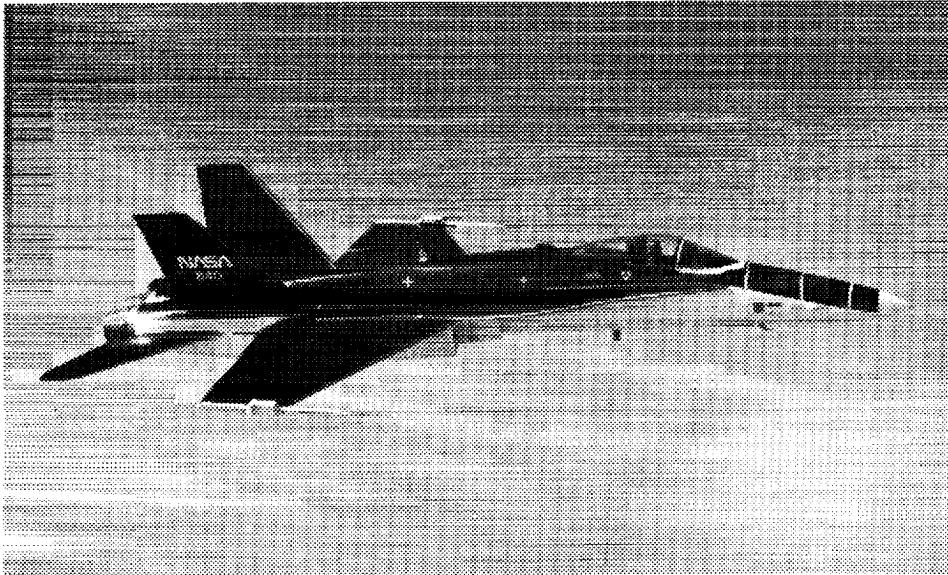

NASA  
840

A black-and-white photograph shows a NASA F-15 fighter jet flying in profile view against a light background.

Photo: NASA F-15 aircraft in flight.

EC 89-0062-001

Fig. 1 F-18 HARV.

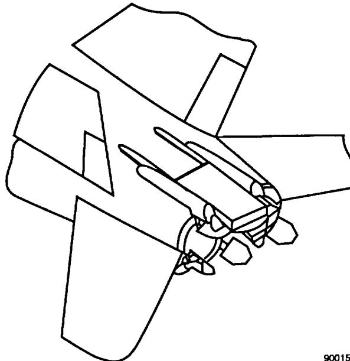

Line drawing of a biplane's front section, showing the propeller, engine, and wings.

900159

(a) Installation details of the six turning vanes.

Fig. 2 F-18 HARV vane configuration.

{11}------------------------------------------------

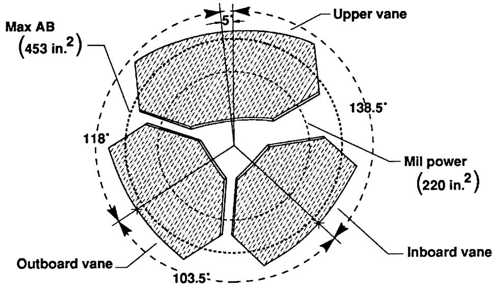

5  
Upper vane  
Max AB  
(453 in.<sup>2</sup>)  
138.5°  
118°  
Mil power  
(220 in.<sup>2</sup>)  
Inboard vane  
Outboard vane  
103.5°

A schematic cross-section of a three-vane rotor showing the upper, inboard, and outboard vanes with angular spacing of 5°, 118°, 103.5°, and 138.5°, along with surface area values.

Technical illustration: Cross-sectional diagram of a three-vane rotor with angular measurements and surface areas.

900160

(b) Vane positions shown fully deflected.


|                                |                                    |
|--------------------------------|------------------------------------|
| <b>Outboard, inboard vanes</b> | <b>Width:</b> 15 in.               |
|                                | <b>Length:</b> 20 in.              |
|                                | <b>Area:</b> 262.8 in.<sup>2</sup> |

|                         |                                    |
|-------------------------|------------------------------------|
| <b>Large upper vane</b> | <b>Width:</b> 20 in.               |
|                         | <b>Length:</b> 20 in.              |
|                         | <b>Area:</b> 359.7 in.<sup>2</sup> |

10°

25°

900161

Technical illustration of a boat's outboard and inboard vanes. The diagram shows the vanes in a deployed position, with dashed lines indicating the retracted position. The outboard vane is at the top and the inboard vane is at the bottom. A 10-degree angle is shown between the outboard vane and a horizontal dashed line. A 25-degree angle is shown between the inboard vane and the same horizontal dashed line. The vanes are labeled 'Large upper vane' and 'Outboard, inboard vanes'.

900161

(c) Vane geometry and deflection range.

Fig. 2 Concluded.

{12}------------------------------------------------

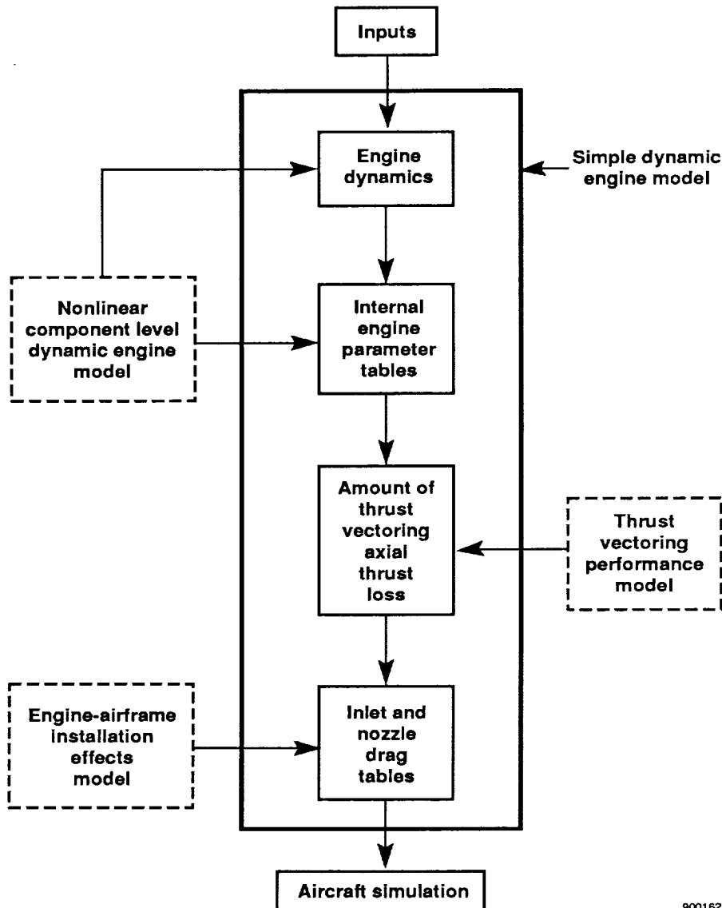

Inputs  
Engine dynamics  
Simple dynamic engine model  
Nonlinear component level dynamic engine model  
Internal engine parameter tables  
Amount of thrust vectoring axial thrust loss  
Thrust vectoring performance model  
Engine-airframe installation effects model  
Inlet and nozzle drag tables  
Aircraft simulation  
900162

```
graph TD
    Inputs --> Engine_dynamics["Engine dynamics"]
    Simple_dynamic_engine_model["Simple dynamic engine model"] --> Engine_dynamics
    Nonlinear_component_level_dynamic_engine_model["Nonlinear component level dynamic engine model"] --> Engine_dynamics
    Engine_dynamics --> Internal_engine_parameter_tables["Internal engine parameter tables"]
    Nonlinear_component_level_dynamic_engine_model --> Internal_engine_parameter_tables
    Internal_engine_parameter_tables --> Amount_of_thrust_vectoring_axial_thrust_loss["Amount of thrust vectoring axial thrust loss"]
    Thrust_vectoring_performance_model["Thrust vectoring performance model"] --> Amount_of_thrust_vectoring_axial_thrust_loss
    Amount_of_thrust_vectoring_axial_thrust_loss --> Inlet_and_nozzle_drag_tables["Inlet and nozzle drag tables"]
    Engine_airframe_installation_effects_model["Engine-airframe installation effects model"] --> Inlet_and_nozzle_drag_tables
    Inlet_and_nozzle_drag_tables --> Aircraft_simulation["Aircraft simulation"]
```

A block diagram showing a flowchart from Inputs through Engine dynamics, internal engine parameter tables, thrust vectoring loss, and drag tables to Aircraft simulation, with external models feeding into each stage.

Flowchart: Block diagram of an engine dynamics and aircraft simulation model.

Fig. 3 Schematic of the models used in the development of the simple dynamic engine model.

{13}------------------------------------------------

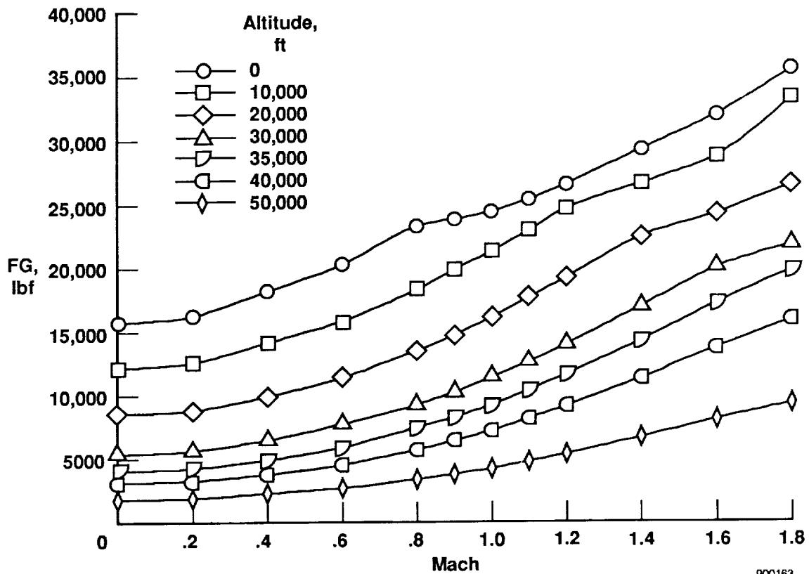

Altitude,  
ft  
0  
10,000  
20,000  
30,000  
35,000  
40,000  
50,000  
FG,  
lbf  
Mach  
900163

x: Mach, 0 to 1.8; y: FG, lbf, 0 to 40,000

| Mach | 0 ft   | 10,000 ft | 20,000 ft | 30,000 ft | 35,000 ft | 40,000 ft | 50,000 ft |
|------|--------|-----------|-----------|-----------|-----------|-----------|-----------|
| 0    | ~16000 | ~12300    | ~8900     | ~5800     | ~4600     | ~3500     | ~2200     |
| .2   | ~16500 | ~12800    | ~9100     | ~6000     | ~4700     | ~3600     | ~2300     |
| .4   | ~18500 | ~14500    | ~10200    | ~6900     | ~5300     | ~4100     | ~2800     |
| .6   | ~20600 | ~16000    | ~11800    | ~8100     | ~6200     | ~4700     | ~3200     |
| .8   | ~23800 | ~18600    | ~13900    | ~9800     | ~7800     | ~5900     | ~3700     |
| 1.0  | ~25000 | ~21800    | ~16400    | ~11900    | ~9400     | ~7400     | ~4500     |
| 1.2  | ~27200 | ~25200    | ~19700    | ~14700    | ~11800    | ~9500     | ~5600     |
| 1.4  | ~29800 | ~27300    | ~23000    | ~17500    | ~14700    | ~11800    | ~7100     |
| 1.6  | ~32500 | ~29300    | ~25000    | ~20600    | ~17500    | ~14300    | ~8600     |
| 1.8  | ~36000 | ~33800    | ~27200    | ~22600    | ~20400    | ~16500    | ~9900     |

A line chart showing flight gross weight (FG) increasing with Mach number from 0 to 1.8 across altitudes ranging from 0 to 50,000 ft.

Line chart: Flight gross weight versus Mach number at various altitudes.

Fig. 4 Max AB gross thrust tabular data.

900163

{14}------------------------------------------------

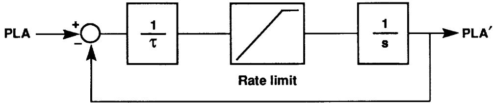

PLA  
+  
-  
 $\frac{1}{\tau}$   
Rate limit  
 $\frac{1}{s}$   
PLA'

```
graph LR
  PLA --> Sum((+ / -))
  Sum --> B1["1 / τ"]
  B1 --> B2["Rate limit"]
  B2 --> B3["1 / s"]
  B3 --> PLA_prime["PLA'"]
  B3 -->|-| Sum
```

A block diagram showing a feedback loop where the input PLA passes through a summing junction, a gain block 1/τ, a rate limit block, and an integrator 1/s to produce PLA', with a negative feedback path to the summing junction.

Schematic: Block diagram of a rate limit feedback control system.

$\tau_{\text{nonafterburning}} = 0.625 \text{ sec}$

$\tau_{\text{afterburning}} = 0.550 \text{ sec}$

Rate limit **nonafterburning** = + 19.03 deg/sec

Rate limit **afterburning** = + 26.81 deg/sec

900164

Fig. 5 PLA shaping model block diagram.

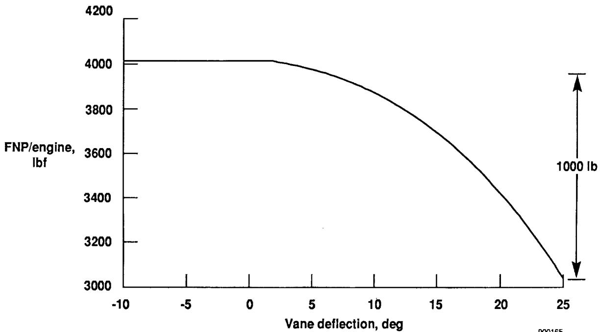

1000 lb  
000165

x: Vane deflection, deg, -10 to 25; y: FNP/engine, lbf, 3000 to 4200

| Vane deflection, deg | FNP/engine, lbf |
|----------------------|-----------------|
| -10                  | ~4010           |
| -5                   | ~4010           |
| 0                    | ~4010           |
| 2                    | ~4010           |
| 5                    | ~3980           |
| 10                   | ~3880           |
| 15                   | ~3700           |
| 20                   | ~3420           |
| 25                   | ~3030           |

A line plot of FNP/engine against vane deflection, showing a constant value of about 4010 lbf from -10 to 2 degrees, followed by a smooth downward curve to about 3030 lbf at 25 degrees.

Line chart: FNP/engine versus vane deflection.

900165

Fig. 6 Reduction of *FNP* for each engine caused by thrust vectoring. Symmetric inboard- and outboard-vane deflection,  $-10^\circ$  top vane, Mach 0.2,  $H = 35,000 \text{ ft}$ , Max AB.

{15}------------------------------------------------

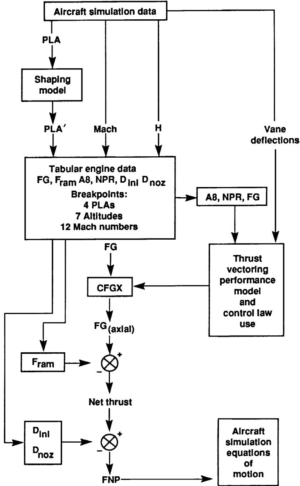

Aircraft simulation data  
PLA  
Shaping model  
PLA'  
Mach  
H  
Vane deflections  
Tabular engine data  
FG, Fram A8, NPR, DInl Dnoz  
Breakpoints:  
4 PLAs  
7 Altitudes  
12 Mach numbers  
A8, NPR, FG  
FG  
CFGX  
Thrust vectoring performance model and control law use  
FG(axial)  
Fram  
+  
-  
Net thrust  
DInl  
Dnoz  
+  
-  
FNP  
Aircraft simulation equations of motion

```
graph TD
    A[Aircraft simulation data] -->|PLA| B[Shaping model]
    B -->|PLA'| C[Tabular engine data<br/>FG, Fram A8, NPR, DInl Dnoz<br/>Breakpoints:<br/>4 PLAs<br/>7 Altitudes<br/>12 Mach numbers]
    A -->|Mach| C
    A -->|H| C
    A -->|Vane deflections| D[Thrust vectoring performance model and control law use]
    C --> E[A8, NPR, FG]
    E --> D
    C -->|FG| F[CFGX]
    D --> F
    F -->|FG(axial)| G((\otimes))
    Fram --> G
    G -->|Net thrust| H((\otimes))
    DInl --> H
    Dnoz --> H
    H --> I[FNP]
    I --> J[Aircraft simulation equations of motion]
```

A block diagram showing the flow of aircraft simulation data through a shaping model, tabular engine data, and thrust vectoring performance model to compute net thrust and FNP for the equations of motion.

Flowchart: Block diagram of aircraft simulation data flow and thrust calculation.

900166

Fig. 7 Schematic of the simple dynamic engine model and its incorporation into the thrust vectoring simulation.

{16}------------------------------------------------

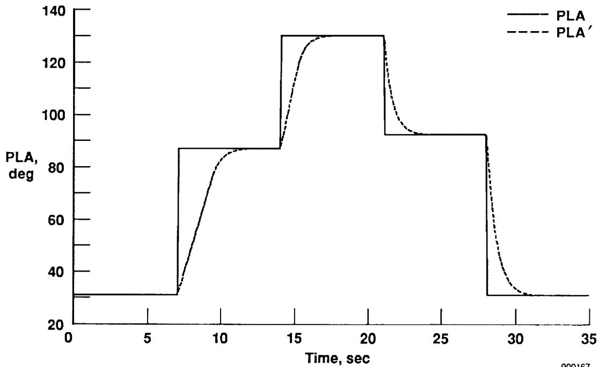

x: Time, sec, 0 to 35; y: PLA, deg, 20 to 140

| Time, sec | PLA  | PLA' |
|-----------|------|------|
| 0         | ~31  | ~31  |
| 5         | ~31  | ~31  |
| 7         | ~87  | ~31  |
| 10        | ~87  | ~84  |
| 14        | ~87  | ~87  |
| 15        | ~131 | ~110 |
| 20        | ~131 | ~131 |
| 21        | ~92  | ~120 |
| 25        | ~92  | ~92  |
| 28        | ~31  | ~80  |
| 30        | ~31  | ~33  |
| 35        | ~31  | ~31  |

A line plot of PLA and PLA' in degrees versus time in seconds, showing step increases and decreases with exponential-like rise and decay curves.

Line chart: PLA and PLA' response over time.

900167

Fig. 8 Comparison of the standard PLA input and the resulting simple dynamic engine model PLA response.

{17}------------------------------------------------

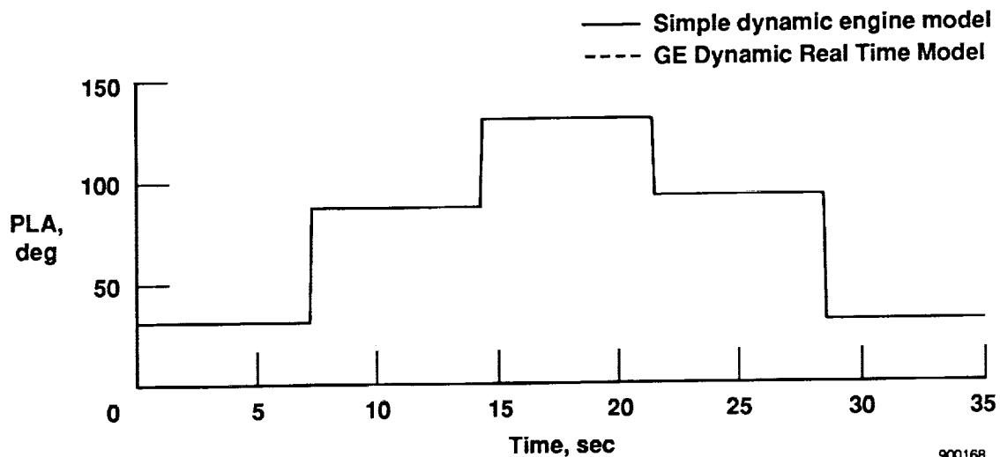

Simple dynamic engine model  
GE Dynamic Real Time Model  
900168

x: Time, sec, 0 to 35; y: PLA, deg, 0 to 150

| Time, sec | Simple dynamic engine model | GE Dynamic Real Time Model |
|-----------|-----------------------------|----------------------------|
| 0         | ~33                         | ~33                        |
| 5         | ~33                         | ~33                        |
| 7.5       | ~88                         | ~88                        |
| 10        | ~88                         | ~88                        |
| 14.5      | ~133                        | ~133                       |
| 15        | ~133                        | ~133                       |
| 20        | ~133                        | ~133                       |
| 21.5      | ~95                         | ~95                        |
| 25        | ~95                         | ~95                        |
| 28.5      | ~35                         | ~35                        |
| 30        | ~35                         | ~35                        |
| 35        | ~35                         | ~35                        |

A step-like line chart showing PLA in degrees versus time in seconds, comparing the Simple dynamic engine model and the GE Dynamic Real Time Model, which are identical throughout.

Line chart: Comparison of PLA over time between Simple dynamic engine model and GE Dynamic Real Time Model.

(a) Power lever angle input condition.

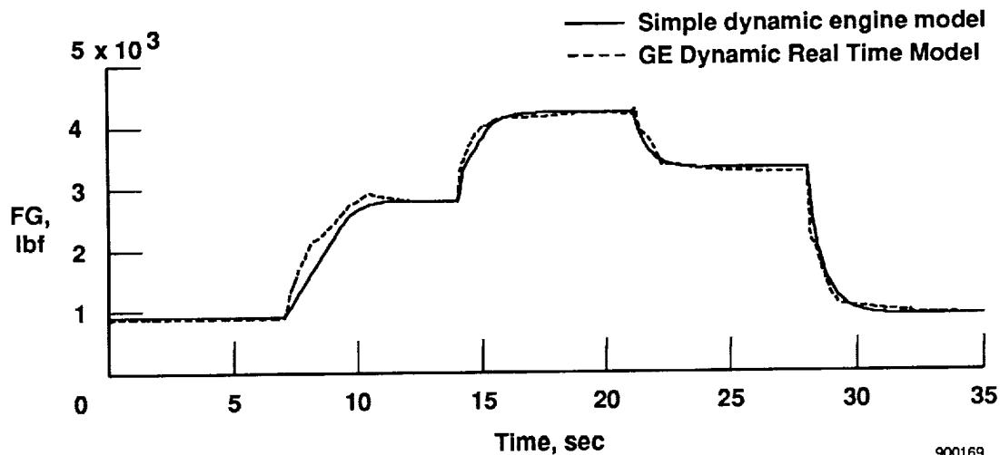

900169

x: Time, sec, 0 to 35; y: FG, lbf, 0 to 5 x 10^3

| Time, sec | Simple dynamic engine model | GE Dynamic Real Time Model |
|-----------|-----------------------------|----------------------------|
| 0         | ~0.9 x 10^3                 | ~0.9 x 10^3                |
| 5         | ~0.9 x 10^3                 | ~0.9 x 10^3                |
| 10        | ~2.7 x 10^3                 | ~2.9 x 10^3                |
| 15        | ~4.0 x 10^3                 | ~4.1 x 10^3                |
| 20        | ~4.2 x 10^3                 | ~4.2 x 10^3                |
| 25        | ~3.3 x 10^3                 | ~3.3 x 10^3                |
| 30        | ~1.1 x 10^3                 | ~1.1 x 10^3                |
| 35        | ~1.0 x 10^3                 | ~1.0 x 10^3                |

A line plot comparing the simple dynamic engine model and the GE dynamic real time model, showing force in lbf versus time in seconds with three distinct step-like phases.

Line chart: Comparison of simple dynamic engine model and GE dynamic real time model over time.

(b) Gross thrust comparison.

Fig. 9 Comparison of the simple dynamic engine model parameters and the GE Model engine parameters, Mach 0.2,  $H = 35,000$  ft, no vectoring.

{18}------------------------------------------------

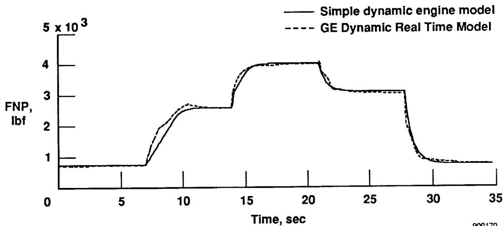

x: Time, sec, 0 to 35; y: FNP, lbf, 0 to 5 x 10^3

| Time, sec | Simple dynamic engine model | GE Dynamic Real Time Model |
|-----------|-----------------------------|----------------------------|
| 0         | ~0.7 x 10^3                 | ~0.7 x 10^3                |
| 5         | ~0.7 x 10^3                 | ~0.7 x 10^3                |
| 10        | ~2.4 x 10^3                 | ~2.6 x 10^3                |
| 15        | ~3.9 x 10^3                 | ~3.9 x 10^3                |
| 20        | ~4.0 x 10^3                 | ~4.0 x 10^3                |
| 25        | ~3.1 x 10^3                 | ~3.1 x 10^3                |
| 30        | ~0.9 x 10^3                 | ~0.9 x 10^3                |
| 35        | ~0.8 x 10^3                 | ~0.8 x 10^3                |

A line plot of FNP in lbf versus time in seconds, showing two models that closely match across three distinct step-like phases.

Line chart: Comparison of FNP over time between simple dynamic engine model and GE dynamic real time model.

(c) Net propulsive force comparison.

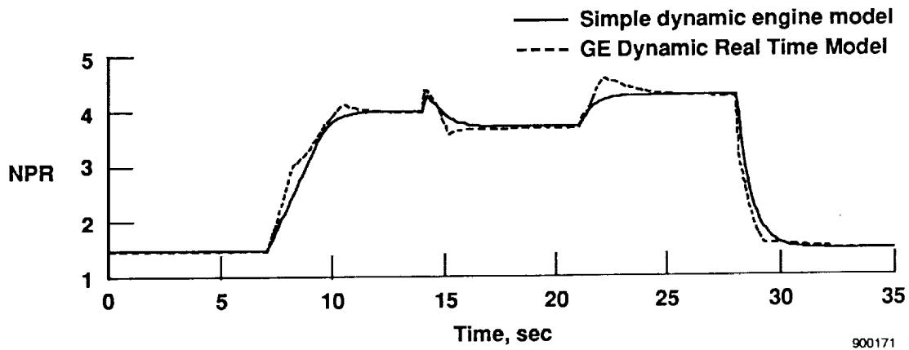

x: Time, sec, 0 to 35; y: NPR, 1 to 5

| Time, sec | Simple dynamic engine model | GE Dynamic Real Time Model |
|-----------|-----------------------------|----------------------------|
| 0         | ~1.5                        | ~1.5                       |
| 5         | ~1.5                        | ~1.5                       |
| 10        | ~3.8                        | ~4.1                       |
| 15        | ~3.8                        | ~3.7                       |
| 20        | ~3.8                        | ~3.8                       |
| 25        | ~4.4                        | ~4.4                       |
| 30        | ~1.7                        | ~1.6                       |
| 35        | ~1.6                        | ~1.6                       |

A line plot of NPR versus time in seconds comparing a simple dynamic engine model to a GE dynamic real time model, showing a rise from 1.5 to around 4.4, a slight dip, and a sharp drop back to 1.6.

Line chart: Comparison of NPR over time between Simple dynamic engine model and GE Dynamic Real Time Model.

(d) Nozzle pressure ratio comparison.

Fig. 9 Continued.

{19}------------------------------------------------

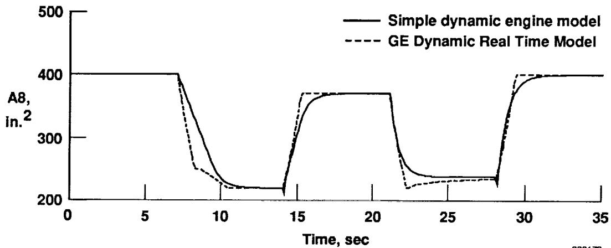

x: Time, sec, 0 to 35; y: A8, in.2, 200 to 500

| Time, sec | Simple dynamic engine model | GE Dynamic Real Time Model |
|-----------|-----------------------------|----------------------------|
| 0         | ~400                        | ~400                       |
| 5         | ~400                        | ~400                       |
| 7.5       | ~400                        | ~400                       |
| 10        | ~230                        | ~220                       |
| 14        | ~215                        | ~215                       |
| 15        | ~290                        | ~360                       |
| 20        | ~365                        | ~365                       |
| 21        | ~365                        | ~365                       |
| 25        | ~240                        | ~230                       |
| 28        | ~230                        | ~230                       |
| 30        | ~390                        | ~400                       |
| 35        | ~400                        | ~400                       |

A line graph showing A8 in square inches versus time in seconds, comparing a simple dynamic engine model with a GE dynamic real time model across three operational phases.

Line chart: Comparison of A8 area over time between simple dynamic engine model and GE dynamic real time model.

(e) Nozzle throat area comparison.

Fig. 9 Concluded.

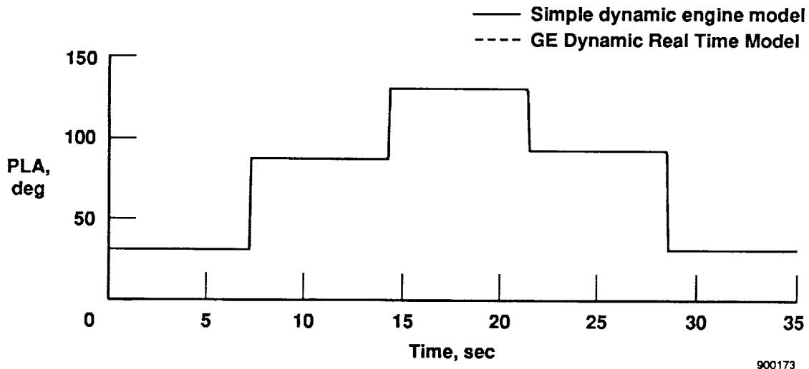

x: Time, sec, 0 to 35; y: PLA, deg, 0 to 150

| Time, sec | Simple dynamic engine model | GE Dynamic Real Time Model |
|-----------|-----------------------------|----------------------------|
| 0         | ~32                         | ~32                        |
| 5         | ~32                         | ~32                        |
| 7         | ~86                         | ~86                        |
| 10        | ~86                         | ~86                        |
| 15        | ~130                        | ~130                       |
| 20        | ~130                        | ~130                       |
| 25        | ~90                         | ~90                        |
| 30        | ~30                         | ~30                        |
| 35        | ~30                         | ~30                        |

A step-like line chart showing PLA in degrees versus time in seconds, comparing the Simple dynamic engine model and the GE Dynamic Real Time Model, which are identical throughout the 35 seconds.

Line chart: Comparison of PLA over time between Simple dynamic engine model and GE Dynamic Real Time Model.

(a) Power lever angle input condition.

Fig. 10 Comparison of the simple dynamic engine model parameters and the GE Model engine parameters, Mach 0.7,  $H = 35,000$  ft, no vectoring.

{20}------------------------------------------------

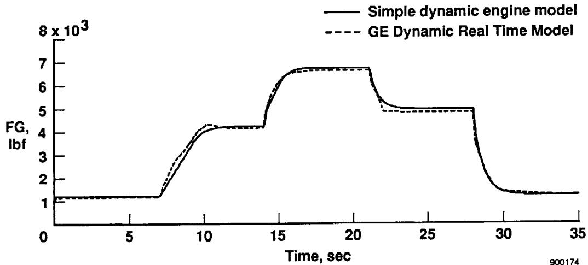

x: Time, sec, 0 to 35; y: FG, lbf, 1 to 8 x 10^3

| Time, sec | Simple dynamic engine model | GE Dynamic Real Time Model |
|-----------|-----------------------------|----------------------------|
| 0         | ~1.2 x 10^3                 | ~1.2 x 10^3                |
| 5         | ~1.2 x 10^3                 | ~1.2 x 10^3                |
| 10        | ~4.2 x 10^3                 | ~4.1 x 10^3                |
| 15        | ~6.2 x 10^3                 | ~6.0 x 10^3                |
| 20        | ~6.8 x 10^3                 | ~6.7 x 10^3                |
| 25        | ~5.1 x 10^3                 | ~5.0 x 10^3                |
| 30        | ~1.5 x 10^3                 | ~1.5 x 10^3                |
| 35        | ~1.4 x 10^3                 | ~1.4 x 10^3                |

A line plot of thrust (FG) versus time comparing a simple dynamic engine model with a GE dynamic real time model, showing three distinct step-like phases.

Line chart: Comparison of simple dynamic engine model and GE dynamic real time model over time.

(b) Gross thrust comparison.

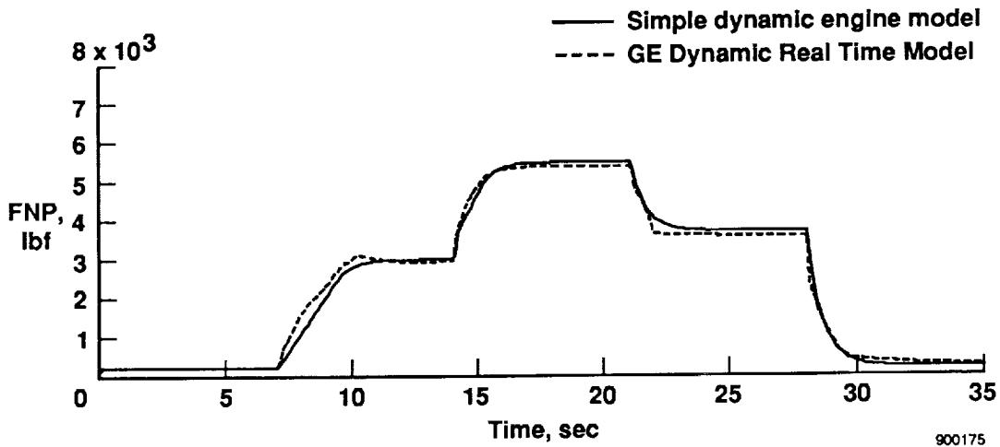

x: Time, sec, 0 to 35; y: FNP, lbf, 0 to 8 x 10^3

| Time, sec | Simple dynamic engine model | GE Dynamic Real Time Model |
|-----------|-----------------------------|----------------------------|
| 0         | ~0                          | ~0                         |
| 5         | ~0                          | ~0                         |
| 10        | ~3.0 x 10^3                 | ~3.1 x 10^3                |
| 15        | ~5.2 x 10^3                 | ~5.0 x 10^3                |
| 20        | ~5.5 x 10^3                 | ~5.5 x 10^3                |
| 25        | ~3.7 x 10^3                 | ~3.7 x 10^3                |
| 30        | ~0.6 x 10^3                 | ~0.6 x 10^3                |
| 35        | ~0.5 x 10^3                 | ~0.5 x 10^3                |

A line plot of FNP in lbf versus time in seconds, comparing a simple dynamic engine model with a GE dynamic real time model, showing three distinct step-like phases.

Line chart: Comparison of FNP over time between simple dynamic engine model and GE dynamic real time model.

(c) Net propulsive force comparison.

Fig. 10 Continued.

{21}------------------------------------------------

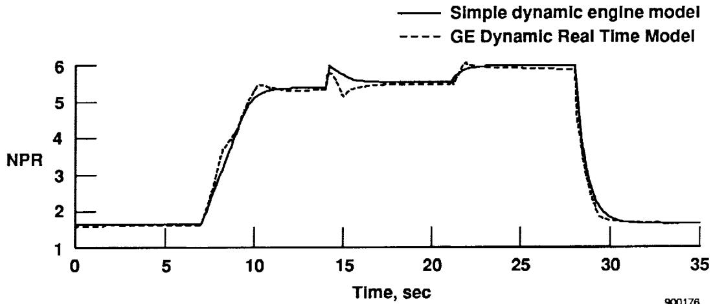

x: Time, sec, 0 to 35; y: NPR, 1 to 6

| Time, sec | Simple dynamic engine model | GE Dynamic Real Time Model |
|-----------|-----------------------------|----------------------------|
| 0         | ~1.6                        | ~1.6                       |
| 5         | ~1.6                        | ~1.6                       |
| 10        | ~5.2                        | ~5.4                       |
| 15        | ~5.5                        | ~5.2                       |
| 20        | ~5.5                        | ~5.5                       |
| 25        | ~6.0                        | ~6.0                       |
| 30        | ~1.8                        | ~1.7                       |
| 35        | ~1.7                        | ~1.7                       |

A line plot of NPR versus time comparing a simple dynamic engine model to a GE dynamic real-time model, showing a rise from 1.6 to 6.0 between 7 and 28 seconds, followed by a drop back to 1.7.

Line chart: Comparison of NPR over time between Simple dynamic engine model and GE Dynamic Real Time Model.

(d) Nozzle pressure ratio comparison.

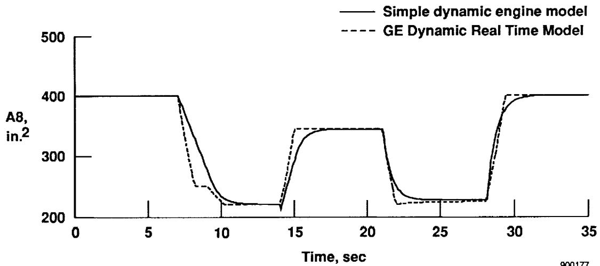

x: Time, sec, 0 to 35; y: A8, in.2, 200 to 500

| Time, sec | Simple dynamic engine model | GE Dynamic Real Time Model |
|-----------|-----------------------------|----------------------------|
| 0         | ~400                        | ~400                       |
| 5         | ~400                        | ~400                       |
| 7         | ~400                        | ~400                       |
| 10        | ~230                        | ~220                       |
| 15        | ~300                        | ~345                       |
| 20        | ~345                        | ~345                       |
| 25        | ~230                        | ~225                       |
| 30        | ~400                        | ~400                       |
| 35        | ~400                        | ~400                       |

A line graph showing A8 in square inches versus time in seconds, comparing a simple dynamic engine model (solid line) to a GE dynamic real time model (dashed line) across three operational phases.

Line chart: Comparison of A8 over time between simple dynamic engine model and GE dynamic real time model.

(e) Nozzle throat area comparison.

Fig. 10 Concluded.

{22}------------------------------------------------


{23}------------------------------------------------


{24}------------------------------------------------

|                                                                                                                                                                                                                                                                                                                                                                                                                                                                                                                                                                                                                                                                                                                                                                                                                                                                                                                                                                                                                                                                                                                                                                                               |                                                          |                                                                                       |                      |  |
|-----------------------------------------------------------------------------------------------------------------------------------------------------------------------------------------------------------------------------------------------------------------------------------------------------------------------------------------------------------------------------------------------------------------------------------------------------------------------------------------------------------------------------------------------------------------------------------------------------------------------------------------------------------------------------------------------------------------------------------------------------------------------------------------------------------------------------------------------------------------------------------------------------------------------------------------------------------------------------------------------------------------------------------------------------------------------------------------------------------------------------------------------------------------------------------------------|----------------------------------------------------------|---------------------------------------------------------------------------------------|----------------------|--|
| <b>NASA</b><br>National Aeronautics and Space Administration                                                                                                                                                                                                                                                                                                                                                                                                                                                                                                                                                                                                                                                                                                                                                                                                                                                                                                                                                                                                                                                                                                                                  |                                                          | <b>Report Documentation Page</b>                                                      |                      |  |
| 1. Report No.<br><br>NASA TM-4240                                                                                                                                                                                                                                                                                                                                                                                                                                                                                                                                                                                                                                                                                                                                                                                                                                                                                                                                                                                                                                                                                                                                                             | 2. Government Accession No.                              | 3. Recipient's Catalog No.                                                            |                      |  |
| 4. Title and Subtitle<br><br>A Simple Dynamic Engine Model for Use in a Real-Time Aircraft Simulation With Thrust Vectoring                                                                                                                                                                                                                                                                                                                                                                                                                                                                                                                                                                                                                                                                                                                                                                                                                                                                                                                                                                                                                                                                   |                                                          | 5. Report Date<br><br>October 1990                                                    |                      |  |
|                                                                                                                                                                                                                                                                                                                                                                                                                                                                                                                                                                                                                                                                                                                                                                                                                                                                                                                                                                                                                                                                                                                                                                                               |                                                          | 6. Performing Organization Code                                                       |                      |  |
| 7. Author(s)<br><br>Steven A. Johnson                                                                                                                                                                                                                                                                                                                                                                                                                                                                                                                                                                                                                                                                                                                                                                                                                                                                                                                                                                                                                                                                                                                                                         |                                                          | 8. Performing Organization Report No.<br><br>H-1643                                   |                      |  |
|                                                                                                                                                                                                                                                                                                                                                                                                                                                                                                                                                                                                                                                                                                                                                                                                                                                                                                                                                                                                                                                                                                                                                                                               |                                                          | 10. Work Unit No.<br><br>RTOP 533-02-01                                               |                      |  |
| 9. Performing Organization Name and Address<br>NASA Ames Research Center<br>Dryden Flight Research Facility<br>P.O. Box 273, Edwards, CA 93523-0273                                                                                                                                                                                                                                                                                                                                                                                                                                                                                                                                                                                                                                                                                                                                                                                                                                                                                                                                                                                                                                           |                                                          | 11. Contract or Grant No.                                                             |                      |  |
|                                                                                                                                                                                                                                                                                                                                                                                                                                                                                                                                                                                                                                                                                                                                                                                                                                                                                                                                                                                                                                                                                                                                                                                               |                                                          | 13. Type of Report and Period Covered<br><br>Technical Memorandum                     |                      |  |
| 12. Sponsoring Agency Name and Address<br><br>National Aeronautics and Space Administration<br>Washington, DC 20546-0001                                                                                                                                                                                                                                                                                                                                                                                                                                                                                                                                                                                                                                                                                                                                                                                                                                                                                                                                                                                                                                                                      |                                                          | 14. Sponsoring Agency Code                                                            |                      |  |
|                                                                                                                                                                                                                                                                                                                                                                                                                                                                                                                                                                                                                                                                                                                                                                                                                                                                                                                                                                                                                                                                                                                                                                                               |                                                          |                                                                                       |                      |  |
| 15. Supplementary Notes<br><br>Prepared as AIAA 90-2166 for presentation at the AIAA/SAE/ASME/ASEE Joint Propulsion Conference, Orlando, Florida, July 16-18, 1990.                                                                                                                                                                                                                                                                                                                                                                                                                                                                                                                                                                                                                                                                                                                                                                                                                                                                                                                                                                                                                           |                                                          |                                                                                       |                      |  |
| 16. Abstract<br><br>A simple dynamic engine model was developed at the NASA Ames Research Center, Dryden Flight Research Facility, for use in thrust vectoring control law development and real-time aircraft simulation. The simple dynamic engine model of the F404-GE-400 engine (General Electric, Lynn, Massachusetts) operates within the aircraft simulator. It was developed using tabular data generated from a complete nonlinear dynamic engine model supplied by the manufacturer. Engine dynamics were simulated using a throttle rate limiter and low-pass filter. This paper includes a description of a method to account for axial thrust loss resulting from thrust vectoring. In addition, this paper presents the development of the simple dynamic engine model and its incorporation into the F-18 high alpha research vehicle (HARV) thrust vectoring simulation. The simple dynamic engine model was evaluated at Mach 0.2, 35,000-ft altitude and at Mach 0.7, 35,000-ft altitude. The simple dynamic engine model is within 3 percent of the steady state response, and within 25 percent of the transient response of the complete nonlinear dynamic engine model. |                                                          |                                                                                       |                      |  |
| 17. Key Words (Suggested by Author(s))<br>Aircraft simulation<br>Engine model<br>Real-time simulation<br>Thrust vectoring                                                                                                                                                                                                                                                                                                                                                                                                                                                                                                                                                                                                                                                                                                                                                                                                                                                                                                                                                                                                                                                                     |                                                          | 18. Distribution Statement<br><br>Unclassified-Unlimited<br><br>Subject category - 05 |                      |  |
| 19. Security Classif. (of this report)<br><br>Unclassified                                                                                                                                                                                                                                                                                                                                                                                                                                                                                                                                                                                                                                                                                                                                                                                                                                                                                                                                                                                                                                                                                                                                    | 20. Security Classif. (of this page)<br><br>Unclassified | 21. No. of Pages<br><br>24                                                            | 22. Price<br><br>A02 |  |

{25}------------------------------------------------

---

## Related documents

- [[NASA TM 4140 - Measurement Effects on the Calculation of In-Flight Thrust for an F404 turbofan engine|NASA TM 4140]] - in-flight thrust calculation for the F404
- [[NASA TP 3001 - Evaluation of Various Thrust Calibration Techniques on an F404 Engine (April 1990)|NASA TP 3001]] - NASA F404 thrust calculation methods
- [[Powel 1990 - On the Leading Edge, Combining Maturity and Advanced Technology on the F404 Turbofan Engine|Powel 1990]] - GE overview of F404 design and growth
