{0}------------------------------------------------

# ERRATA

NASA Technical Paper 3001

# EVALUATION OF VARIOUS THRUST CALIBRATION TECHNIQUES ON AN F404 ENGINE

Ronald J. Ray  
April 1990

Title is incorrect. It should read "Evaluation of Various Thrust Calculation Techniques on an F404 Engine." Please replace cover, title page, and Report Documentation Page with the attached corrected pages.

Issue date: May 1990

{1}------------------------------------------------

April 1990

## Evaluation of Various Thrust Calibration Techniques on an F404 Engine

Ronald J. Ray

{2}------------------------------------------------

###### **NASA Technical Paper 3001**

1990

# Evaluation of Various Thrust Calibration Techniques on an F404 Engine

Ronald J. Ray  
*Ames Research Center  
Dryden Flight Research Facility  
Edwards, California*


National Aeronautics and  
Space Administration  
Office of Management  
Scientific and Technical  
Information Division

{3}------------------------------------------------

# **CONTENTS**

|                                                           |           |
|-----------------------------------------------------------|-----------|
| <b>SUMMARY</b>                                            | <b>1</b>  |
| <b>INTRODUCTION</b>                                       | <b>1</b>  |
| <b>NOMENCLATURE</b>                                       | <b>2</b>  |
| <b>AIRCRAFT DESCRIPTION</b>                               | <b>3</b>  |
| <b>ENGINE DESCRIPTION</b>                                 | <b>3</b>  |
| <b>INSTRUMENTATION</b>                                    | <b>3</b>  |
| <b>THRUST CALCULATION METHODS</b>                         | <b>4</b>  |
| In-Flight Thrust Program . . . . .                        | 4         |
| Simplified Gross Thrust Method . . . . .                  | 5         |
| Specification Program . . . . .                           | 5         |
| <b>CALIBRATION TESTING</b>                                | <b>5</b>  |
| <b>UNCERTAINTY ANALYSIS</b>                               | <b>6</b>  |
| In-Flight Thrust Program Uncertainties . . . . .          | 7         |
| Simplified Gross Thrust Method Uncertainties . . . . .    | 8         |
| <b>ACCURACY OF METHODS</b>                                | <b>8</b>  |
| <b>THRUST EFFECTS ON AIRCRAFT PERFORMANCE COMPUTATION</b> | <b>9</b>  |
| <b>REAL-TIME THRUST</b>                                   | <b>10</b> |
| <b>COMPARISON OF METHODS DURING FLIGHT TESTS</b>          | <b>10</b> |
| <b>CONCLUDING REMARKS</b>                                 | <b>11</b> |
| <b>REFERENCES</b>                                         | <b>12</b> |
| <b>TABLES</b>                                             | <b>14</b> |
| <b>FIGURES</b>                                            | <b>16</b> |

{4}------------------------------------------------

# SUMMARY

In support of performance testing of the X-29A aircraft at the NASA Ames Research Center, Dryden Flight Research Facility, various thrust calculation techniques have been developed and evaluated for use on the F404-GE-400 engine (General Electric, Lynn, Massachusetts). The engine was thrust calibrated at the NASA Lewis Research Center's Propulsion System Laboratory. Results from these tests were used to correct the manufacturer's in-flight thrust program to more accurately calculate thrust for the specific test engine. Data from these tests were also used to develop an independent, simplified thrust calculation technique for real-time thrust calculation. Comparisons were also made to thrust values predicted by the engine specification model. Results indicate uninstalled gross thrust accuracies on the order of 1 to 4 percent for the various in-flight thrust methods. The various thrust calculations are described and their usage, uncertainty, and measured accuracies are explained. In addition, the advantages of a real-time thrust algorithm for flight test use and the importance of an accurate thrust calculation to the aircraft performance analysis are described. Finally, actual data obtained from flight tests are presented.

# INTRODUCTION

The determination of in-flight thrust is important to any aircraft performance analysis. Because the direct measurement of thrust and drag in flight is not feasible, various methods have been devised to calculate thrust indirectly from the measurement of related engine parameters. There is no globally standard thrust calculation method because of the variety of engines, diversity of applications, and accuracy requirements.

A number of reports have been written on in-flight thrust calculation methodology and error assessment. Two of the more comprehensive references include AGARD (1979) and Society of Automotive Engineers (1986). The gas generator method of thrust calculation has been used on the XB-70 (Arnaiz and Schweikhard, 1970) and F-111 (Burcham, 1971) airplanes. A simplified gross thrust computing method, developed by Computing Devices Company (ComDev) of Ottawa, Ontario, Canada, has been evaluated on the F100 and

J85 engines (Kurtenbach, 1979; Baer-Riedhart, 1982) and flown in a KC-135 aircraft (Hughes, 1981) and an F-15 aircraft (Kurtenbach and Burcham, 1981).

To evaluate and to compare various thrust calculation procedures, the NASA Ames Research Center, Dryden Flight Research Facility (Ames-Dryden) conducted a comprehensive study on the F404 engine in the X-29A forward-swept-wing advanced technology demonstrator airplane. The determination of thrust is particularly important for the X-29A airplane because many of its advanced technology features are designed to improve aircraft performance. This study has included a calibration of the flight engine at NASA Lewis (Burns and Kirchgessner, 1987), sensitivity studies (Hughes et al., 1985; Hamer and Alexander, 1978), and a flight evaluation on the X-29A aircraft including the application of four thrust calculation techniques.

The four thrust calculation techniques investigated include two variations of the engine manufacturer's in-flight thrust (IFT) program, the engine specification model, and an independent, simplified thrust technique for real-time thrust calculation. Two gas generator methods are used to calculate thrust in the IFT program: one is sensitive to nozzle area and pressure, while the other is sensitive to mass flow and temperature. ComDev's simplified method of calculating thrust has advantages over the traditional in-flight methods in that it requires much less instrumentation and computational resources. The engine specification model is a large computer model that predicts all the internal characteristics of the engine and its performance. The flight F404 engine was calibrated for thrust at the NASA Lewis Research Center's Propulsion System Laboratory (PSL). Data from these tests were used to correct the IFT program to more accurately calculate thrust of the specific engine and to develop the simplified thrust method.

The four thrust calculation techniques, their usage, advantages and disadvantages, and their predicted uncertainties and measured accuracies are described in this report. The altitude thrust calibration test and the general procedures used to calibrate the models are also described. Finally, examples of flight data on the X-29A aircraft and the effect of thrust accuracy on aircraft performance are presented.

{5}------------------------------------------------

## NOMENCLATURE

|                     |                                                                  |                                                    |                                                              |
|---------------------|------------------------------------------------------------------|----------------------------------------------------|--------------------------------------------------------------|
| <b>AB</b>           | afterburner                                                      | <b>PLA</b>                                         | power lever angle, deg                                       |
| <b>AP</b>           | area-pressure thrust calculation method                          | <b>PSL</b>                                         | Propulsion System Laboratory<br>(NASA Lewis Research Center) |
| <b>A8</b>           | nozzle throat area, $\text{ft}^2$                                | $p_{ref}$                                          | reference pressure, $\text{lb/in}^2$                         |
| $a_x$               | longitudinal acceleration (body axis, positive-forward), $g$     | $p_s$                                              | static pressure, $\text{lb/in}^2$                            |
| $a_z$               | normal acceleration (body axis, positive-up), $g$                | $p_t$                                              | total pressure, $\text{lb/in}^2$                             |
| $C_D$               | aircraft drag coefficient                                        | $q$                                                | dynamic pressure, $\text{lb/in}^2$                           |
| $C_{FG}$            | gross thrust coefficient                                         | <b>S</b>                                           | reference wing area, $\text{ft}^2$                           |
| $C_i$               | influence coefficient                                            | <b>SGTM</b>                                        | simplified gross thrust method                               |
| $C_L$               | aircraft lift coefficient                                        | $T_T$                                              | total temperature, $^\circ\text{R}$                          |
| <b>ComDev</b>       | Computing Devices Company                                        | $U$                                                | uncertainty, percent                                         |
| $D_{\text{nozzle}}$ | external nozzle drag, lb                                         | $V$                                                | velocity, ft/sec                                             |
| $D_{\text{spill}}$  | inlet spillage drag, lb                                          | $W$                                                | engine airflow, lb/sec                                       |
| <b>ECU</b>          | electronic control unit                                          | $WF$                                               | fuel flow, lb/hr                                             |
| $F_{RAM}$           | ram drag, lb                                                     | $WT$                                               | mass flow-temperature thrust calculation method              |
| $FG$                | gross thrust, lb                                                 | $wt$                                               | airplane weight, lb                                          |
| $FN$                | net thrust, lb                                                   | $\alpha$                                           | angle of attack, deg                                         |
| $FNP$               | net propulsive thrust, lb                                        | $\beta$                                            | angle of sideslip, deg                                       |
| $FSE$               | full-scale error, percent                                        | $\Delta$                                           | difference                                                   |
| $FVG$               | fan inlet variable guide vanes                                   | $\partial$                                         | partial derivative                                           |
| $H$                 | total enthalpy, BTU/lb                                           | $\sigma$                                           | standard deviation                                           |
| <b>HPC</b>          | high-pressure compressor                                         | <b>Subscripts:</b>                                 |                                                              |
| $HPVG$              | high-pressure compressor variable guide vanes                    | $calc$                                             | calculated                                                   |
| $h_p$, alt          | pressure altitude, ft                                            | $E$                                                | main engine (core)                                           |
| <b>IFT</b>          | in-flight thrust (program)                                       | $I$                                                | ideal                                                        |
| <b>IRT</b>          | intermediate rated (maximum non-afterburning) thrust (PLA = 87°) | $meas$                                             | measured                                                     |
| $i$                 | thrust incidence angle, deg                                      | $P$                                                | pilot afterburner segment                                    |
| <b>LPT</b>          | low-pressure turbine                                             | $spec$                                             | specification                                                |
| $M$                 | Mach number                                                      | <b>F404 engine station identification numbers:</b> |                                                              |
| $N1$                | fan rotor speed, rpm                                             | 0                                                  | free stream                                                  |
| $N2$                | compressor rotor speed, rpm                                      | 1                                                  | engine inlet face                                            |
| $PD$                | percent difference (accuracy), percent                           | 3                                                  | high-pressure compressor discharge                           |
|                     |                                                                  | 4                                                  | combustor discharge                                          |
|                     |                                                                  | 6                                                  | afterburner inlet                                            |
|                     |                                                                  | 7                                                  | exhaust nozzle inlet                                         |
|                     |                                                                  | 8                                                  | exhaust nozzle throat                                        |
| 9                   | exhaust nozzle discharge                                         |                                                    |                                                              |
| 25                  | high-pressure compressor inlet                                   |                                                    |                                                              |
| 558                 | low-pressure turbine discharge-measuring plane                   |                                                    |                                                              |

{6}------------------------------------------------

## AIRCRAFT DESCRIPTION

The X-29A advanced technology demonstrator is a single-seat, fighter-type aircraft incorporating several new technology concepts developed to enhance aircraft performance. The most notable aircraft feature is the forward-swept wing with a 29.3° leading-edge sweep and a thin, supercritical airfoil section. Graphite-epoxy composite materials are used to aero-elastically tailor the wing and inhibit wing structural divergence. Another notable feature of the aircraft is its active three-surface pitch control configuration, including wing flaperons, canards, and aft-mounted strake flaps. The canards act as a powerful lift and pitch moment generator. The aircraft's 35-percent negative static margin requires a high level of stability augmentation provided by a triple-redundant digital fly-by-wire flight control system.

The X-29A airplane is 48 ft long and has a wing span of 27 ft. The aircraft's F404 engine is mounted in the fuselage with two side-mounted fixed geometry inlets designed for both subsonic and transonic operation. Maximum aircraft takeoff gross weight is 17,800 lb with a 4000-lb fuel capacity. Additional information on the design of the X-29A aircraft can be found in Moore and Frei (1983).

## ENGINE DESCRIPTION

The F404-GE-400 engine (General Electric, Lynn, Massachusetts) shown in figure 1 is a low-bypass, twin spool, augmented turbofan of the 16,000-lb thrust class. The engine incorporates a three-stage fan and a seven-stage high-pressure compressor, each driven by a single-stage turbine. Variable geometry is available on the fan inlet variable guide vanes (*FVG*) and on the high-pressure compressor variable guide vanes (*HPVG*). Bleed air extraction is provided at the seventh stage of the high-pressure compressor for environmental cooling control. The combustor is a through-flow annular type using atomizing fuel nozzles. The augmentor is fully modulating from minimum to maximum augmentation and uses fan discharge air and an augmentor liner to maintain a low

outer skin temperature on the engine. The hinged-flap, cam-linked exhaust nozzle is hydraulically actuated. An engine accessory gearbox is driven by the compressor spool. The gearbox powers the lubrication and scavenger oil pumps, variable exhaust nozzle power unit, generator, and both the main and afterburner fuel pumps. A schematic view of the F404-GE-400 engine with station designations is shown in figure 2.

The engine control system consists of the throttle, main fuel control, electric control unit, and afterburner fuel control. Throttle movement is mechanically transmitted to a power lever control. The power lever positions the main fuel control. Below the intermediate-rated thrust (IRT) power setting, compressor rotor speed ( $N_2$ ) is controlled by throttle movement and engine inlet total temperature ( $T_{T_1}$ ) through the main fuel control. At IRT and above, fan rotor speed ( $N_1$ ) is controlled by the electronic control unit (ECU) as a function of  $T_{T_1}$ . The ECU senses engine and aircraft parameters, computes engine schedules, and maintains engine limits. The afterburner fuel control schedules fuel flow to the pilot spraybar and main spraybars. When the throttle is advanced to an afterburner setting, the afterburner ignitors are turned on, the exhaust nozzle opens slightly above the IRT position, the low-pressure turbine discharge total temperature ( $T_{T_3}$ ) schedule is temporarily reset to a lower value, and afterburner pilot spraybar fuel flow and minimum main afterburner fuel flow begins. When afterburner light-off is detected, the ignitors are turned off, and the main afterburner fuel flow level increases to the level selected by the throttle position.

# INSTRUMENTATION

The instrumentation mounted on the engine for the calculation of in-flight thrust is shown in figure 2 and listed in table 1. With the exception of the nozzle static pressures ( $p_{s_6}$  and  $p_{s_7}$ ), this instrumentation was provided by the manufacturer as part of the F404 engine thrust instrumentation system. Volumetric flowmeters are used to measure fuel flows of the main engine core ( $WF_E$ ), afterburner ( $WF_{AB}$ ), and afterburner pilot ( $WF_{AB_P}$ ). These meters were individually calibrated with the aircraft upstream fuel lines in place to simulate installation in the X-29A aircraft. Fuel temperatures are measured in both the core and afterburner fuel lines to permit conversion of volumetric values to mass flow.

{7}------------------------------------------------

The low-pressure turbine discharge total pressure ( $p_{t_{558}}$ ) is measured by four 5-element total pressure rakes with all 20 elements individually measured and mathematically averaged. A single production  $p_{t_{558}}$  probe is also used to measure pressure at this location. The exhaust nozzle throat area  $A_8$  is measured by an electric signal from a linear variable position transmitter. This system is calibrated to give the throat area in engineering units ( $\text{in}^2$ ). Fan speed, fan variable guide vane positions, and  $T_{T_1}$  are all measured by electrical sensors. Compressor speed is also an electrical signal and is measured off the alternator. Compressor variable vane position and compressor discharge pressure ( $p_{s_3}$ ) are both hydromechanical sensors.

To incorporate the ComDev simplified gross thrust method (SGTM), the afterburner liner was equipped with static pressure taps at stations 6 and 7. Accurate pressure, representative of conditions in the afterburner, is required for the ComDev method, and, therefore, four static pressures are measured at each station and mathematically averaged to obtain  $p_{s_6}$  and  $p_{s_7}$ . The SGTM also uses the 20-port  $p_{t_{558}}$  pressure rakes. The  $p_{t_{558}}$ ,  $p_{s_6}$ , and  $p_{s_7}$  pressures are measured by a 32-channel,  $\pm 10 \text{ lb/in}^2$ , differential transducer unit referenced to a spare  $p_{s_6}$  tap. The reference pressure is measured by an accurate absolute transducer. The 32-channel differential transducer is thermally controlled by a heater insulation blanket to maintain a constant temperature during flight. The unit was calibrated at this temperature to provide the best accuracy during flight. The average of the pressures at each rake is calculated by a software routine that also determines if individual pressures are within a specified tolerance of the average. Pressures outside the tolerance are omitted from the average. This ensures the highest quality measurement at each station even in the event of a broken or damaged pressure line.

Both the IFT program and SGTM require ambient static pressure ( $p_{s_0}$ ) supplied by the aircraft air-data system. The IFT program also requires altitude ( $h_p$ ) and Mach number ( $M$ ) which are also supplied by the aircraft.

## THRUST CALCULATION METHODS

### In-Flight Thrust Program

The IFT program (General Electric, 1983) discussed in this report was developed by the General

Electric Company for the U.S. Navy. The purpose of this program is to provide an accurate calculation of airflow and thrust for the F404 engine throughout the flight envelope.

In general, the IFT program treats the engine as a gas generator, modeling compressor, combustion, and turbine components to determine mass flow, pressure, and temperature at the exhaust nozzle. Internal flow-path measurements within the gas generator are used, together with mass-, momentum-, and energy-continuity principles, to calculate flow conditions at various stations within the engine and to predict overall engine performance (Society of Automotive Engineers, 1986). Engine-to-engine variations are accounted for by the actual measurement variations.

The IFT program uses two correlating methods, the area-pressure ( $AP$ ) and the mass flow-temperature ( $WT$ ) equations, for determining ideal gross thrust. The  $AP$  method is strongly dependent upon an accurate measurement of  $A_8$  and nozzle pressure ratio  $p_{t_8}/p_{s_0}$ . The  $WT$  procedure requires an accurate determination of mass flow and exhaust gas temperature and thus requires an accurate afterburner efficiency model. Detailed development of the gas generator methods for gross thrust calculation is given in AGARD (1979) and Burcham (1971).

The F404 IFT program was developed from an extensive test database from which the necessary thrust correlations and engine performance models were derived. This database was the result of six engine test phases at the Naval Air Propulsion Center altitude test facility where in excess of 1500 data points were gathered over the flight envelope. This extensive altitude database in conjunction with sea level test data produced an accurate understanding of engine behavior over the flight envelope necessary to develop the IFT program.

The gas generator model calculation and data flows are shown in figure 3. The arrows show the input and flow of data, and the blocks within the schematic illustrate calculations. The model uses a combination of theoretical values, component test data, and full-scale engine data to generate the relationships necessary for the analysis.

The aircraft inlet, engine fan-compressor, combustor-turbine, afterburner, and nozzle are modeled separately as shown (fig. 3). The inlet model uses inlet pressure recovery values estimated from wind tunnel data along with altitude, Mach number,  $T_1$ ,  $N1$ , and  $FVG$  to calculate inlet conditions and engine airflow. The energy rise across the fan and compressor is then modeled to determine airflow, temperature, and specific total enthalpy at the combustor entrance. The combustor and afterburner are modeled separately using an energy balance with fuel flows and  $p_{t_{558}}$  as inputs. Ideal gross thrust ( $FG_I$ ) is then calculated as shown in figure 3. The nozzle analysis uses the input values of  $A8$  and  $p_{s_0}$  to calculate the gross thrust coefficient ( $C_{FG}$ ) and multiplies  $FG_I$  by this value to obtain actual gross thrust ( $FG$ ). The two gas generator methods use a common approach in determining engine flow parameters but differ in their schemes to correlate these parameters and correct  $FG_I$  to obtain the desired  $AP$  and  $WT$  values of  $FG$ . Finally, net thrust ( $FN$ ) is calculated from gross thrust by subtracting the ram drag term ( $F_{RAM}$ ). The ram drag or freestream momentum value is obtained by multiplying engine inlet airflow ( $W_1$ ) by the free-stream velocity ( $V_0$ ).

{8}------------------------------------------------

The  $FN$  value calculated by the IFT program accounts for installation effects of inlet internal performance, nozzle internal performance, bleed air extractions, and shaft power extractions. External forces are also present due to installation in the aircraft. The net propulsive force ( $FNP$ ) accounts for these external forces by subtracting the inlet spillage and nozzle drag terms from  $FN$ . External propulsive drag terms are typically less than 1 to 3 percent of the net thrust value. They are dependent on aircraft and engine interactions and vary with power setting. Normally, these values are determined from wind tunnel tests using scaled models with scaled power systems. For the X-29A aircraft, these values were estimated.

### Simplified Gross Thrust Method

The Computing Devices Company's SGTM computes jet engine gross thrust based on a one-dimensional analysis of flow in the engine afterburner and exhaust nozzle. Because this method requires little instrumentation and computational storage, it is easier to implement than the traditional gas generator methods, and, therefore, is useful for computing in-flight gross thrust in real time. A derivation of the equations in the SGTM algorithm is presented in Hughes (1981) and McDonald (1974). A flowchart of the algorithm is shown in figure 4.

The SGTM requires gas pressure measurements from three afterburner locations and free-stream static pressure to compute in-flight gross thrust. The three afterburner measurements are  $p_{t_{558}}$ , flameholder exit static pressure ( $p_{s_6}$ ), and exhaust nozzle inlet static pressure ( $p_{s_7}$ ). Calibration coefficients were determined during altitude testing at the NASA Lewis PSL facility. These coefficients are applied to the equations to correct for the effects of friction, mass transfer (leakage), three-dimensional effects, and the effect of the simplifying assumptions used in the theory. The algorithm analyzes the flow in the afterburner duct from the turbine exit (station 558) to the exhaust nozzle exit (station 9) and determines the total pressure at the nozzle inlet ( $p_{t_7}$ ). The effective exhaust nozzle throat area is also computed. Gross thrust is then computed from  $p_{t_7}$ , the nozzle throat area, and  $p_{s_0}$ .

The Computing Devices Company has developed a net thrust algorithm based on F404 data collected during altitude testing at the PSL facility. This algorithm was developed for real-time application on the X-29A aircraft and uses the simplified approach demonstrated with the SGTM. Preliminary results are encouraging (Ray et al., 1988).

#### Specification Program

The manufacturer's specification model is a full aerothermal, steady-state performance program (General Electric, 1981). The simulation provides the values of a number of internal flow parameters for the engine as well as its overall performance. These parameters include airflow, gross and net thrust, and all the required input parameters for the IFT program. Inputs to the specification model include altitude, Mach number, power lever angle, and ambient temperature. The model was derived from actual test data and represents the operation of an average F404-GE-400 engine.

## CALIBRATION TESTING

The specific F404 performance engine (S/N 215209) for the X-29A aircraft was calibrated for thrust and airflow at the NASA Lewis PSL facility from late 1985 through early 1986. The main objectives of this test were to tailor the IFT program to calculate more accurately the thrust of the specific test engine and to quantify the accuracy. Also, calibration data were needed to obtain the coefficients required to develop and evaluate the accuracy of the SGTM. Finally, an additional research objective was to evaluate the accuracy of the specification model using data gathered on the test engine.

{9}------------------------------------------------

Figure 5 shows the F404 engine installed in the PSL altitude test chamber. The engine was supported by an overhead mount coupled to the thrust bed. The thrust bed provided a calibrated load cell system for determining actual gross thrust. A bell-mouth inlet duct section was used and was specially instrumented for determining engine inlet mass flow. Inlet air temperature and pressure along with test chamber pressure were regulated to simulate proper altitude and Mach number conditions. The PSL facility is able to simulate various flight conditions by varying the flow conditions to the engine and the static pressure in the test chamber. This included varying ambient temperature of the air flowing to the engine so that the effects of an off-standard day could be determined. Over 150 test points were gathered at 11 flight conditions and at various power lever angle (PLA) settings.

The simulated flight conditions tested are presented in table 1. Engine power settings varied for each condition as shown. This matrix was chosen to represent the X-29A airplane's flight envelope and to concentrate on the two design points at 30,000 ft: Mach 0.9 and Mach 1.2. A general test procedure for each condition was to first establish the proper Mach number and altitude in the PSL test chamber. The engine was then allowed to stabilize at the test PLA setting for 5 min (2 min for afterburner PLA settings). Data were then recorded over 10- and 20-sec time periods. The data were time averaged, and statistical computations were made on the 20-sec-period data to verify stabilization of the recorded parameters. Data were also gathered by sequentially increasing and decreasing PLA to assess the presence of hysteresis in the throttle system. Burns and Kirchgessner (1987) give a detailed account of the calibration test and procedures.

The IFT program was calibrated by applying correction terms in a sequential manner to engine airflow, gross thrust, and net thrust for both the *WT* and *AP* thrust calculation methods. That is, first the airflow calibration was applied, then the gross thrust, and finally the net thrust. The calibration of airflow thus affects the calculation of gross and net thrust just as the calibration of gross thrust also affects the calculation of

net thrust. Both the *AP* and *WT* gross thrust methods were calibrated independently.

Correlation parameters were determined by plotting the individual calibration parameters against those parameters expected, from engineering judgment, to be influential in the calculation of that term. The airflow calculation, for example, was sensitive to parameters such as fan speed, inlet pressure ratio ( $p_{t_1}/p_{s_1}$ ),  $p_{s_3}$ , Mach number, and altitude. The percent difference between calculated and measured airflow was then plotted against each term along with calculated airflow itself. Polynomial curve fits were applied to determine which parameter showed the best correlation. The parameter with the best fit was determined using statistical methods, and the equation for the curve fit was then incorporated into the IFT program as a correction factor. More than one correction parameter could be used by repeating this process after implementing a correction. For airflow, inlet pressure ratio and  $p_{s_3}$  were determined to be the best correlating parameters.

# UNCERTAINTY ANALYSIS

Since the exact thrust value of an engine cannot be measured directly in flight, it is important to estimate the uncertainty ( $U$ ) of the calculated value. The uncertainty analysis can be applied to a thrust model before testing begins to evaluate its suitability for a flight experiment. It can also be useful in the posttest analysis of the data and can lead to a more thorough understanding of the results.

The term "uncertainty" in this report refers to the range of possible values of a parameter in a given test environment. For measurement data, it is based on estimations of instrumentation error (bias and random). For computed results, it is defined as the root-sum-square of the responses of the computation to each measurement uncertainty. The thrust uncertainty results presented in this report were predicted using estimated instrumentation accuracies and parameter measurement values obtained from the specification model.

Accuracy is defined as the deviation of values in relation to a defined reference, such as computed thrust compared with facility load cell measured thrust. The thrust and airflow accuracies presented in this report were derived using measured values from the calibration test as the reference. Both bias and random error values are presented.

{10}------------------------------------------------

The numbers for accuracy and uncertainty are valid only for the given test environment, but their relationship can be used to infer the accuracy of a computed parameter in an alternate test environment.

### In-Flight Thrust Program Uncertainties

An analysis was conducted to determine the effect of the measurement accuracy that the input parameters have on the uncertainty of calculated thrust. Hughes et al. (1985) give a comprehensive discussion on this technique where a sensitivity analysis is used to predict the uncertainty of calculated thrust using the IFT program. The data presented in this section come from Conners (1989) using updated instrumentation accuracy values, which give improved results.

In general, the IFT program uncertainties were calculated as the root-sum-square of the uncertainties owing to the influence of each measurement uncertainty. Table 2 shows each input measurement parameter, its associated uncertainty, and range of value. The influence of each measurement was determined from a sensitivity analysis where first the baseline input conditions to the IFT program were determined for a flight condition using data obtained from the specification model. Each input variable then was independently changed by  $\pm 1.0$  percent and run again in the IFT program. Technically, the influence coefficient ( $C_i$ ) is defined as the derivative of  $FG$  with respect to a change in influence or input parameter at the limit of zero change. This can be approximated as the percent change in thrust owing to a 1-percent change in a specified parameter:

$$C_i(\text{parameter}) = \Delta FG / FG \times 100 \text{ percent}$$

for a  $\pm 1$ -percent  $\Delta$  (parameter)

In the sensitivity analysis, the  $C_i$  values were approximated linearly by calculating the effect of a  $-1.0$  to  $2.0$ -percent change. Figure 6 shows the percent change in gross thrust because of a change in the parameter  $p_{t_{558}}$  for both the *AP* and *WT* thrust calculation methods. For the case shown, net thrust calculated using the *AP* method was more sensitive to a change in  $p_{t_{558}}$  than was the *WT* method. The expected uncertainty of calculated thrust was determined by multiplying the expected accuracy for each of the

12 input parameters by its associated  $C_i$  value and by taking a root-sum-square of all the parameters. The equation used in determining the uncertainty in gross thrust ( $U_{FG}$ ) was

$$U_{FG} = \sqrt{[(C_{i_{ALT}} \times U_{ALT})^2 + (C_{i_M} \times U_M)^2 + \dots]}$$

This procedure was used to determine the gross and net thrust uncertainty for both calculation methods over a range of six Mach number and altitude conditions for PLA settings from flight idle ( $30^\circ$ ) to maximum power ( $130^\circ$ ).

Figure 7 shows the results of the uncertainty analysis for the six simulated flight conditions. The gross thrust results indicate the *WT* method generally is superior to the *AP* method. For the *WT* method (fig. 7(a)), uncertainty decreases as PLA increases from  $30^\circ$  to intermediate power ( $87^\circ$ ). At IRT, gross thrust uncertainty for the *WT* method  $U_{FG_{WT}}$  varies from 1.4 to 3.1 percent as a function of flight condition. Note the value of  $U_{FG_{WT}}$  increases as PLA advances above IRT because of the addition of afterburner fuel flow  $WF_{AB}$  and its relatively large uncertainty (at low  $WF_{AB}$  values) and relatively large value of  $C_i$ , particularly at the middle afterburner power settings (PLA =  $109^\circ$ ). The  $U_{FG_{WT}}$  decreases above  $109^\circ$  PLA to a range of 1.0 to 2.2 percent. This decrease primarily is because of the decrease in  $WF_{AB}$  uncertainty. In comparison, the uncertainty in gross thrust for the *AP* method  $U_{FG_{AP}}$  (fig. 7(b)) continually decreases above IRT. Its uncertainty at IRT varies from 4.0 to 5.3 percent, depending on the flight condition. At maximum power,  $U_{FG_{AP}}$  ranges from 2.5 to 3.2 percent. Although the results show higher gross thrust uncertainties with the *AP* method, the method also shows less variation in uncertainty owing to changes in flight conditions. This holds true for all PLA values above  $70^\circ$ , indicating  $U_{FG_{AP}}$  is less sensitive to variations in flight conditions than  $U_{FG_{WT}}$ .

The large uncertainty values at low PLA settings in part are owing to the large values of parameter uncertainty. Most parameter accuracies are based on the manufacturer's full-scale accuracy which in absolute terms is constant. As a parameter value decreases, its expected percent accuracy worsens. Low thrust values also tend to increase the individual  $C_i$  values, compounding the problem. Thus, the combination of large  $C_i$  values and large input parameter uncertainties cause large uncertainty results at low PLA values. Actually, the absolute thrust uncertainty value, in pounds, may in fact decrease as PLA decreases even though its percent value increases.

{11}------------------------------------------------

The uncertainty in net thrust  $U_{FN}$  (figs. 7(c) and 7(d)) includes the effects of the gross thrust and the ram drag terms. Because both gross thrust methods use the same  $F_{RAM}$  value, one might expect the same difference between gross and net thrust uncertainties. However, because of the airflow term that appears both in the  $F_{GWT}$  and  $F_{RAM}$  calculations, a partial cancellation of the effect of this parameter's uncertainty occurs in the  $WT$  method. Thus, the  $WT$  method shows less overall increase in net thrust uncertainty compared to gross thrust uncertainty than with the  $AP$  method.

The uncertainty in net thrust results for the  $WT$  method is generally between 2 and 5 percent for PLA values above 70°, except for the 40,000 ft and Mach 0.8 condition where it approaches 8.0 percent at 109° PLA. In general, the uncertainty of the  $WT$  method  $U_{FN_{WT}}$  increases with increasing altitude and decreases with increasing Mach number (fig. 7(c)). The uncertainty of the  $AP$  method  $U_{FN_{AP}}$  varies from 4.0 to 10.5 percent for PLA values above 70° (fig. 7(d)). As in the  $WT$  method,  $U_{FN_{AP}}$  generally increases with increasing altitude. Unlike the  $WT$  method,  $U_{FN_{AP}}$  increases with increasing Mach number. It is interesting to note that the  $U_{FN_{AP}}$  results are much more sensitive to variations in flight conditions than the  $U_{FG_{AP}}$  results. In comparison, the  $U_{FN_{WT}}$  results show the same sensitivity when compared to the gross thrust results. The data also show both methods are unusable at very low PLA settings owing to large uncertainties.

### Simplified Gross Thrust Method Uncertainties

A sensitivity analysis was conducted to determine the amount that computed SGTM thrust changes with a change in each of the measured parameters. Uncertainties in instrumentation and their effect on calculated SGTM thrust are summarized in table 3. The sensitivity analysis produced influence coefficients for each parameter, which were multiplied by the expected error of the parameter to determine the expected error in SGTM-computed thrust resulting from measurement errors. Figure 8 shows the sensitivity of the SGTM

due to pressure measurement errors for various PLA settings at 30,000 ft and Mach 0.9. These results show that the SGTM is more sensitive at low PLA settings than at high settings, and that the algorithm is most sensitive to the  $p_s$  measurement.

An uncertainty analysis was made using the results of the sensitivity study, the uncertainty of the in-flight instrumentation, and the estimated SGTM model error (Hamer and Alexander, 1978). Table 4 shows a sample tabulation of SGTM uncertainty for the 30,000 ft and Mach 0.9 condition at an IRT. The results of the uncertainty analysis for three power settings at 10 flight conditions are summarized in table 5, which indicates a slight reduction in predicted uncertainty as Mach number increases. The results are also shown in figure 9 for various flight conditions and PLA settings, indicating a decrease in the predicted uncertainty as PLA increases. The total uncertainty of in-flight SGTM gross thrust is better than  $\pm 2.6$  percent of the reading for all conditions at a power setting of 70° PLA. At IRT, the gross thrust uncertainty is better than  $\pm 1.8$  percent for all Mach and altitude conditions. At maximum afterburner, it is better than  $\pm 1.1$  percent. At the aircraft design point of Mach 0.9 and 30,000 ft altitude, total uncertainty is  $\pm 1.5$  percent at IRT and  $\pm 1.1$  percent at maximum power.

# ACCURACY OF METHODS

The accuracy of the IFT program, SGTM, and specification models were determined by calculating the percent difference in calculated thrust as compared to measured thrust using data gathered during the calibration tests:

$$PD_{FG} = [(FG_{CALC} - FG_{MEAS}) / FG_{MEAS}] \\ \times 100 \text{ percent}$$

Because the data used in the calculation of gross thrust for the different calculation procedures come from the same instrumentation and the same test runs, their values are directly comparable. Figure 10 shows the gross thrust accuracy of the  $WT$  and  $AP$  methods from the IFT program after calibration, the ComDev SGTM, and the specification model plotted against facility-measured gross thrust. All four methods show a tendency to decrease in accuracy at low thrust values.

{12}------------------------------------------------

This corresponds to the predicted uncertainty for each calculated gross thrust method and with the uncertainty in measured gross thrust. The uncertainty in measured gross thrust improves as thrust increases. The *WT* method (fig. 10(a)) indicates the best overall accuracy, although the *AP* method (fig. 10(b)) is better below 5,000 lb measured thrust. The ComDev SGTM (fig. 10(c)) also shows good thrust accuracies, while the accuracy of predicted thrust from the specification model (fig. 11) is almost an order of magnitude worse than the other methods (note difference in scale), particularly at low thrust values.

The accuracy of the four gross thrust methods for various PLA settings is summarized in figure 12 and table 6. Bias values represent the average accuracy of each sample. Sigma ( $\sigma$ ) values represent the standard deviation of the sample from the bias value and indicate data scatter. Statistically, 95 percent of the data sample will fall within  $\pm 2$  standard deviations ( $\pm 2\sigma$ ) of the bias if the data follow a normal distribution. Calibration of the IFT program and the SGTM has greatly reduced the bias values as shown in table 6. The accuracies of gross thrust for the IFT program as well as the SGTM were all less than 2 percent for the PLA range from 40° to 130°. For this same PLA range, the *WT* method displayed the best  $\pm 2\sigma$  accuracy value at 1.12 percent followed by the *AP* method at 1.28 percent and the SGTM at 1.80 percent. The accuracy of the specification model, on the other hand, was 8.74 percent with a -1.30-percent bias for this PLA range. This result is somewhat expected since the specification model was not calibrated. These results clearly demonstrate that highly accurate in-flight gross thrust calculations are available and are being used on the X-29A aircraft.

The results confirm that *WT* is the most accurate of the methods evaluated. However, they also show the *AP* method to be more accurate than the SGTM at and below IRT, as shown in figure 12(a). On the other hand, the SGTM is slightly more accurate than the *AP* method during afterburner operation (fig. 12(b)). The accuracy results of the *AP* method were much better than those predicted by the uncertainty analysis. One reason for the improved accuracy is the use of calibration data to correct this method. Calibrating the *AP* method resulted in an improvement of over 1 percent in its measured accuracy.

## THRUST EFFECTS ON AIRCRAFT PERFORMANCE COMPUTATION

The determination of total airplane lift and drag in flight is necessary to analyze the performance characteristics of an airplane and to compare with the available wind tunnel model data for that airplane. The method used to determine lift and drag for the X-29A airplane is the accelerometer method. This method has commonly been used for a number of years because it permits a complete coverage of the Mach number and angle-of-attack capabilities of an airplane. Beeler et al. (1956) discuss the accelerometer method in more detail; in addition, Saltzman and Ayers (1982) survey a wide variety of aircraft that have used the accelerometer method.

The determination of lift and drag by the accelerometer method requires the following parameters: body-axis longitudinal acceleration ( $a_x$ ); body-axis normal acceleration ( $a_z$ ); angle of attack ( $\alpha$ ); dynamic pressure ( $q$ ); airplane weight ( $wt$ ); and  $FG$  and  $FNP$ . The equations used here for lift coefficient ( $C_L$ ) and drag coefficient ( $C_D$ ) assume a symmetric maneuver ( $\beta = 0^\circ$ ) and are

$$C_L = [W(a_x \sin \alpha + a_z \cos \alpha) - FG \sin(\alpha + i)]/q \cdot S$$

$$C_D = [FNP - W(a_x \cos \alpha + a_z \sin \alpha)]/q \cdot S$$

where,

$$FNP = FG \cos(\alpha + i) - F_{RAM} - D_{spill} - D_{nozzle}$$

$i$  = thrust incidence angle, deg (0° for the X-29A aircraft)

$D_{spill}$  = inlet spillage drag, lb

$D_{nozzle}$  = external nozzle drag, lb

The expressions relating the uncertainty in  $C_L$  and  $C_D$  to the variation of thrust were obtained by taking the partial derivatives of each equation with respect to  $FN$  and  $FG$ . From the above equation, it is evident that a relationship exists between  $FN$  and  $FG$ . However, for simplicity, the errors caused by  $FN$  and  $FG$  are treated as being independent, and the error caused by  $F_{RAM}$  is assumed to be included in the error estimate for  $FN$ . The resulting equations for the incremental errors in  $C_L$  and  $C_D$  with respect to  $FG$  and  $FN$  are

{13}------------------------------------------------

$$\partial C_L = \partial FG[-\sin(\alpha + i)]/q \cdot S$$

$$\partial C_D = \partial FN[\cos(\alpha + i)]/q \cdot S$$

The uncertainties of  $C_L$  and  $C_D$  due to thrust are determined by dividing  $\partial C_L$  by  $C_L$  and  $\partial C_D$  by  $C_D$  and multiplying by 100 percent. Powers (1985) discussed this method in detail and used this technique to calculate the uncertainty in lift and drag as a result of thrust for the X-29A airplane. The individual parameters used in this analysis were obtained from an X-29A simulation model. The results of this study show at  $\alpha = 0^\circ$ , that the uncertainty in  $C_D$  because of the uncertainty in thrust is at most equal to the uncertainty in  $FN$ ; that is, a 1-percent uncertainty in  $FN$  can result in a 1-percent uncertainty in  $C_D$ . As angle of attack increases or decreases from zero, the thrust uncertainty effect decreases because of the  $\cos \alpha$  term. Thrust uncertainty has little effect on  $C_L$  uncertainty as a result of the  $\sin \alpha$  term.

# REAL-TIME THRUST

Because of the relative small size of the ComDev SGTM algorithm, it has obvious computational advantages over the more complex IFT and specification programs. To evaluate these advantages, a study was made on an ELXSI system 6400 computer (ELXSI, San Jose, California) to determine the memory requirements and computation time required to run an equal number of data points. The results were standardized to the IFT values and are shown in table 7. The SGTM required less than 10 percent of the memory storage requirements of the IFT program. It also computed the same 131 data points in 2.2 percent of the computational time the IFT program required. These numbers reflect the time required for data computation only and do not include the time required to process the output of the results. Because of the computational advantages of the ComDev method and its comparable accuracy to the IFT program, it has been selected for real-time thrust monitoring and calculation of in-flight performance on the X-29A project. Ray et al. (1988) describe the real-time performance system in detail for the X-29A airplane.

Figure 13 shows the real-time performance data system for the X-29A airplane. Data from the aircraft and engine are measured onboard the X-29A aircraft and transmitted by way of a multiplex signal to a ground-based receiver. After demultiplexing the signal, the data are passed to the real-time computer where the SGTM software calculates thrust, and a performance routine calculates aircraft lift and drag. These values are then sent to the proper display device in the control room.

# COMPARISON OF METHODS DURING FLIGHT TESTS

A comparison of the gross thrust calculated by the various methods during flight is shown in figure 14. These data were gathered during performance flight testing of the X-29A aircraft. The results indicate good agreement between the methods for both the IRT (fig. 14(a)) and the maximum power (fig. 14(b)) accelerations presented. The *WT* method tends to calculate slightly higher thrust values than the *AP* and real-time methods (SGTM). Also, the *WT* method slightly diverges from the other two in-flight methods as Mach increases. The percent difference between methods is generally 1 to 5 percent. These values are within the predicted in-flight thrust uncertainties (methods summed together) presented in this report. As with the uncertainty predictions, the results show better agreement between methods for the maximum power case than for the IRT case.

Predicted test-day gross thrust, calculated by the specification program, is also presented for comparison in figure 14. The specification values tend to be generally higher than values from the other methods. This may be attributed to such things as the model error or uncertainty in the specification program, the uncertainty in various in-flight thrust calculation methods, the actual engine performance not being nominal (the specification program is not calibrated), and the lack of engine stabilization during the test manuever. In any case, the differences are small and indicate that reasonable thrust values are being calculated in flight.

These results help to validate the calibration of the various models and give confidence to their accuracies. They also show the real-time thrust method SGTM calculates similar results when compared to the postflight IFT methods. Additional comparisons can be found in Hughes (1981) for data obtained on a KC-135 airplane and in Kurtenback and Burcham (1981) for data obtained on an F-15 airplane.

{14}------------------------------------------------

# CONCLUDING REMARKS

Four methods of calculating thrust on an F404 engine have been discussed. These methods include the two gas generator techniques calculated by the in-flight thrust program: the mass flow-temperature method, and the area-pressure method used in postflight analysis of flight test data. The other methods are the predicted thrust values calculated by the engine specification model, and a simplified gross thrust method developed by the Computing Devices Company.

Four techniques have been evaluated with the following results:

1. An uncertainty analysis of the various in-flight thrust methods was made based on instrumentation accuracies. Results show the mass flow-temperature method with the lowest uncertainty followed by the simplified gross thrust and area-pressure methods.
2. An engine calibration test was performed at NASA Lewis Research Center's Propulsion System Laboratory altitude facility to calibrate the various thrust methods for more accurate calculation of thrust. Measured thrust data obtained from the calibration test were used to determine the accuracy of the various models. For a power lever angle range of 40° to 130°, results show the mass flow-temperature method to be the most accurate ( $\pm 1.12$  percent), followed by the area-pressure thrust calculation method ( $\pm 1.28$  percent), then the simplified gross thrust method ( $\pm 1.80$  percent). Calibration removed most of the bias in each method. For the same power lever angle range, the uncalibrated specification method ac-

curacy was measured to be only  $\pm 8.74$  percent about a  $-1.30$ -percent bias.

3. The effects of thrust uncertainty on the calculation of aircraft performance uncertainty were examined. Thrust effects on drag at most are one-to-one. That is, a 1-percent uncertainty in the thrust calculation can cause a 1-percent error in aircraft drag coefficient. The effects of thrust uncertainty on calculated aircraft lift coefficient are much smaller.
4. An evaluation of the various methods shows the Computing Devices Company's simplified gross thrust method requires significantly less instrumentation and computational requirements than the in-flight thrust program. For this reason, it was chosen for use on the X-29A airplane for real-time thrust monitoring and performance calculation.
5. Data obtained during flight test of the X-29A aircraft show good agreement between the various thrust methods. The differences between methods were generally within their predicted uncertainty, giving confidence to the results. This confirms that the calibration curves obtained from calibration test data were reasonable.

Finally, highly accurate thrust calculations are available and are being used in support of the X-29A project. The information documented in this report will help flight engineers assess the aircraft's in-flight performance.

*Ames Research Center  
Dryden Flight Research Facility  
National Aeronautics and Space Administration  
Edwards, California, June 21, 1988*

{15}------------------------------------------------

# REFERENCES

- AGARD, *Guide to In-Flight Thrust Measurement of Turbojets and Fan Engines*, AGARDograph no. 237, Jan. 1979.
- Arnaiz, Henry H., and William G. Schweikhard, *Validation of the Gas Generator Method of Calculating Jet-Engine Thrust and Evaluation of XB-70-1 Airplane Engine Performance at Ground Static Conditions*, NASA TN D-7028, 1970.
- Baer-Riedhart, Jennifer I., "Evaluation of a Simplified Gross Thrust Calculation Method for a J85-21 Afterburning Turbojet Engine in an Altitude Facility," AIAA 82-1044, 1982.
- Beeler, De E., Donald R. Bellman, and Edwin J. Saltzman, *Flight Techniques for Determining Airplane Drag at High Mach Numbers*, NACA TN D-3821, 1956.
- Burcham, Frank W., Jr., *An Investigation of Two Variations of the Gas Generator Method To Calculate the Thrust of the Afterburning Turbofan Engines Installed in an F-111A Airplane*, NASA TN D-6297, 1971.
- Burns, Maureen E., and Thomas A. Kirchgessner, *Airflow Calibration and Exhaust Pressure/Temperature Survey of an F-404, S/N 215-209, Turbofan Engine*, NASA TM-100159, 1987.
- Conners, T., "Measurement Effects on the Calculation of In-Flight Thrust for an F404 Turbofan Engine," AIAA 89-2364, 1989. Also available as NASA TM-4140, 1989.
- General Electric, "F404-GE-400 Engine Specification Model," G.E. program no. 80031A(U), General Electric Co., Aug. 1981.
- General Electric, "F404-GE-400 Engine In-flight Thrust Calculation Program," G.E. program no. 83112, General Electric Co., Aug. 1983.
- Hamer, M.J., and R.I. Alexander, *Algorithm Development and System Error Analysis for Extension of Thrust Computing System Technology to the F100 Engine*, R80312/FR, Computing Devices Company, Ottawa, Canada, 1978.
- Hughes, Donald L., *Comparison of Three Thrust Calculation Methods Using In-Flight Thrust Data*, NASA TM-81360, 1981.
- Hughes, Donald L., Ronald J. Ray, and James T. Walton, "Net Thrust Calculation Sensitivity of an Afterburning Turbofan Engine to Variations in Input Parameters," AIAA 85-4041, 1985.
- Kurtenbach, Frank J., *Evaluation of a Simplified Gross Thrust Calculation Technique Using Two Prototype F100 Turbofan Engines in an Altitude Facility*, NASA TP-1482, 1979.
- Kurtenbach, Frank J., and Frank W. Burcham, Jr., *Flight Evaluation of a Simplified Gross Thrust Calculation Technique Using an F100 Turbofan Engine in an F-15 Airplane*, NASA TP-1782, 1981.
- McDonald, G.B., *Theory and Design of an Airborne Thrust Computing System*, H036/119/FR/IV, Computing Devices Company, Ottawa, Canada, Aug. 1974.
- Moore M., and D. Frei, "X-29 Forward-Swept Wing Aerodynamic Overview," AIAA 83-1834, 1983.
- Powers, Sheryll Goecke, *Predicted X-29A Lift and Drag Coefficient Uncertainties Caused by Errors in Selected Parameters*, NASA TM-86747, 1985.
- Ray, R.J., J.W. Hicks, and R.I. Alexander, *Development of a Real-Time Aeroperformance Analysis Technique for the X-29A Advanced Technology Demonstrator*, NASA TM-100432, 1988.
- Saltzman, Edwin J., and Theodore G. Ayers, "Review of Flight-to-Wind-Tunnel Drag Correlation," *J. of Aircraft*, vol. 19, no. 10, Oct. 1982, pp. 801–811.
- Society of Automotive Engineers, *In-Flight Thrust Determination and Uncertainty*, SAE SP-674, 1986.

{16}------------------------------------------------

Table 1. Thrust calibration test points.

| $h_p$, ft | Mach | Flight<br>idle | $N_2$, percent |    |    |    | IRT | Min.<br>AB | PLA, deg |     |     | Max.<br>AB |
|-----------|------|----------------|----------------|----|----|----|-----|------------|----------|-----|-----|------------|
|           |      |                | 80             | 85 | 90 | 95 |     |            | 100      | 110 | 120 |            |
| 10,000    | 0.4  | X*             | X              | —  | X  | —  | X   | —          | —        | —   | X   | —          |
|           | 0.8  | X              | X              | —  | X  | X  | X   | X          | X        | X   | X   | —          |
| 20,000    | 0.6  | X              | X              | —  | X  | —  | X   | X          | —        | X   | —   | X          |
| 24,000    | 0.4  | —              | X              | —  | X  | —  | X   | X          | —        | X   | —   | X          |
|           | 0.9  | —              | —              | —  | —  | —  | X   | X          | —        | X   | —   | X          |
| 30,000    | 0.5  | X              | —              | X  | —  | X  | X   | —          | X        | —   | —   | X          |
|           | 0.9  | X              | —              | X  | X  | X  | X   | X          | X        | X   | X   | X          |
|           | 1.2  | X              | X              | —  | —  | —  | X   | —          | X        | —   | —   | X          |
| 40,000    | 0.8  | X              | —              | —  | X  | —  | X   | X          | —        | X   | —   | X          |
|           | 1.6  | X              | X              | —  | —  | —  | X   | X          | —        | X   | —   | X          |
| 45,000    | 1.8  | —              | —              | —  | —  | —  | X   | —          | —        | —   | —   | X          |

\*X indicates test point at simulated flight condition.

Table 2. Measurement ranges and uncertainties of various thrust input parameters.

| Parameter                 | No. of<br>sensors | Range                       | Uncertainty,<br>percent of<br>full-scale | Methods using parameter<br>(X = used) |      |                        |
|---------------------------|-------------------|-----------------------------|------------------------------------------|---------------------------------------|------|------------------------|
|                           |                   |                             |                                          | IFT<br>model                          | SGTM | Specification<br>model |
| $h_p^*$                   | 1                 | 0 – 60,000 ft               | $±0.1$                                   | X                                     | —    | X                      |
| $A8$                      | 1                 | 220 – 540 in<sup>2</sup>    | $±2.0$                                   | X                                     | —    | —                      |
| $FVG$                     | 1                 | 0 – 55°                     | $±2.0$                                   | X                                     | —    | —                      |
| $HPVG$                    | 1                 | –5 – +55°                   | $±2.0$                                   | X                                     | —    | —                      |
| $M^*$                     | 1                 | 0 – 2.0                     | $±0.25$                                  | X                                     | —    | X                      |
| $N1$                      | 1                 | 0 – 13,270 rpm              | $±1.0$                                   | X                                     | —    | —                      |
| PLA                       | 1                 | 0 – 130°                    | $±2.0$                                   | X                                     | —    | X                      |
| $p_{s_0}$                 | 1                 | 0 – 15 lb/in<sup>2</sup>    | $±0.2$                                   | X                                     | X    | —                      |
| $p_{s_3}$                 | 1                 | 0 – 500 lb/in<sup>2</sup>   | $±0.1$                                   | X                                     | —    | —                      |
| $p_{s_6} - p_{ref}$       | 8                 | –10 – +10 lb/in<sup>2</sup> | $±0.25$                                  | —                                     | X    | —                      |
| $p_{s_7} - p_{ref}$       | 4                 | –10 – +10 lb/in<sup>2</sup> | $±0.25$                                  | —                                     | X    | —                      |
| $p_{t_{558}} - p_{ref}$   | 20                | –10 – +10 lb/in<sup>2</sup> | $±0.25$                                  | X                                     | X    | —                      |
| $p_{ref} ext{ }(p_{s_6})$ | 1                 | 0 – 60 lb/in<sup>2</sup>    | $±0.1$                                   | X                                     | X    | —                      |
| $T_{T_1}$                 | 1                 | –60 – 400°F                 | $±1.0$                                   | X                                     | —    | —                      |
| $WF_{AB}$                 | 1                 | 0 – 30,000 lb/hr            | $±2.0$                                   | X                                     | —    | —                      |
| $WF_{AB_P}$               | 1                 | 0 – 1,500 lb/hr             | $±2.0$                                   | X                                     | —    | —                      |
| $WF_E$                    | 1                 | 0 – 12,000 lb/hr            | $±2.0$                                   | X                                     | —    | —                      |

\*Estimated from calculation.

{17}------------------------------------------------

Table 3. Change in computed SGTM gross thrust (percent of reading)  
resulting from pressure transducer errors.

#### (a) Pressure measurement error.

| Transducer              | Full-scale<br>value, lb/in<sup>2</sup> | <i>FSE</i>,<br>percent | <i>FSE</i>, lb/in<sup>2</sup> | No. of<br>transducers | Net error,<br>lb/in<sup>2</sup> |
|-------------------------|----------------------------------------|------------------------|-------------------------------|-----------------------|---------------------------------|
| $p_{s_0}$               | 19                                     | 0.2500                 | 0.0475                        | 1                     | 0.0475                          |
| $p_{ref}$               | 50                                     | 0.0160                 | 0.0080                        | 1                     | 0.0080                          |
| $p_{t_{55a}} - p_{ref}$ | 20                                     | 0.1640                 | 0.0328                        | 20                    | 0.0073                          |
| $p_{s_6} - p_{ref}$     | 20                                     | 0.1640                 | 0.0328                        | 4                     | 0.0164                          |
| $p_{s_7} - p_{ref}$     | 20                                     | 0.1640                 | 0.0328                        | 4                     | 0.0164                          |

#### (b) Error of SGTM gross thrust, percent of reading.

| PLA, deg | Transducer              | $h_p$, ft |        |        |        |        |        |        |        |        |        |        |
|----------|-------------------------|-----------|--------|--------|--------|--------|--------|--------|--------|--------|--------|--------|
|          |                         | 10,000    |        |        | 24,000 |        | 30,000 |        |        | 40,000 |        | 45,000 |
|          |                         | Mach      |        |        |        |        |        |        |        |        |        |        |
|          |                         | 0.3       | 0.6    | 0.8    | 0.3    | 0.9    | 0.5    | 0.9    | 1.2    | 0.8    | 1.5    | 1.8    |
| 70       | $p_{s_0}$               | ---       | -0.309 | -0.155 | -0.364 | ---    | ---    | -0.311 | ---    | -0.583 | ---    | ---    |
|          | $p_{ref}$               | ---       | 0.052  | 0.018  | 0.061  | ---    | ---    | 0.032  | ---    | 0.074  | ---    | ---    |
|          | $p_{t_{55a}} - p_{ref}$ | ---       | 0.054  | 0.101  | 0.052  | ---    | ---    | 0.220  | ---    | 0.072  | ---    | ---    |
|          | $p_{s_6} - p_{ref}$     | ---       | -0.211 | 0.113  | -0.255 | ---    | ---    | 0.242  | ---    | -0.380 | ---    | ---    |
|          | $p_{s_7} - p_{ref}$     | ---       | 0.179  | -0.306 | 0.245  | ---    | ---    | -0.688 | ---    | 0.332  | ---    | ---    |
| 87       | $p_{s_0}$               | -0.158    | -0.188 | -0.129 | -0.249 | -0.170 | -0.292 | -0.224 | -0.195 | -0.420 | -0.307 | -0.441 |
|          | $p_{ref}$               | 0.018     | 0.019  | 0.014  | 0.027  | 0.015  | 0.028  | 0.018  | 0.016  | 0.034  | 0.019  | 0.023  |
|          | $p_{t_{55a}} - p_{ref}$ | 0.124     | 0.170  | 0.088  | 0.226  | 0.160  | 0.294  | 0.208  | 0.129  | 0.359  | 0.132  | 0.179  |
|          | $p_{s_6} - p_{ref}$     | 0.137     | -0.186 | -0.099 | 0.241  | 0.173  | 0.310  | 0.218  | 0.141  | 0.373  | 0.144  | 0.181  |
|          | $p_{s_7} - p_{ref}$     | -0.385    | -0.541 | -0.271 | -0.719 | -0.512 | -0.958 | -0.667 | -0.404 | -1.170 | -0.406 | -0.542 |
| 130      | $p_{s_0}$               | ---       | -0.242 | ---    | -0.323 | -0.205 | -0.362 | -0.251 | -0.207 | -0.441 | -0.257 | -0.326 |
|          | $p_{ref}$               | ---       | 0.025  | ---    | 0.033  | 0.019  | 0.036  | 0.023  | 0.019  | 0.041  | 0.023  | 0.027  |
|          | $p_{t_{55a}} - p_{ref}$ | ---       | 0.068  | ---    | 0.094  | 0.061  | 0.112  | 0.081  | 0.051  | 0.141  | 0.050  | 0.067  |
|          | $p_{s_6} - p_{ref}$     | ---       | 0.032  | ---    | 0.043  | 0.028  | 0.051  | 0.037  | 0.024  | 0.064  | 0.024  | 0.028  |
|          | $p_{s_7} - p_{ref}$     | ---       | -0.135 | ---    | -0.185 | -0.126 | -0.231 | -0.171 | -0.101 | -0.299 | -0.089 | -0.122 |

{18}------------------------------------------------

**Table 4. Computation of SGTM gross thrust uncertainty at Mach 0.9, 30,000 ft altitude, IRT.**

|                                                   | Error in SGTM<br>gross thrust<br>(percent of reading) |
|---------------------------------------------------|-------------------------------------------------------|
| $[FG_{SGTM} - FG_{meas} \times 100] / FG_{meas}$  | 1.453*                                                |
| Number of points defining bias, $\sigma$, and $U$ | 48                                                    |
| NASA Lewis thrust error                           | 0.417                                                 |
| NASA Lewis pressure error                         | 0.557                                                 |
| Observed SGTM system error                        | 1.276                                                 |
| SGTM model error                                  | 1.274                                                 |
| Calibration bias limit                            | 0.184                                                 |
| NASA Ames-Dryden pressure error                   | 0.732                                                 |
| Total SGTM in-flight uncertainty, $U_{FG_{SGTM}}$ | 1.480                                                 |

\*Observed accuracy at NASA Lewis PSL.

**Table 5. Total uncertainty of SGTM gross thrust, percent of reading.**

| PLA, deg | $h_p$, ft |       |        |        |       |        |       |       |        |       |        |
|----------|-----------|-------|--------|--------|-------|--------|-------|-------|--------|-------|--------|
|          | 10,000    |       | 20,000 | 24,000 |       | 30,000 |       |       | 40,000 |       | 45,000 |
|          | Mach      |       |        |        |       |        |       |       |        |       |        |
|          | 0.3       | 0.8   | 0.6    | 0.3    | 0.9   | 0.5    | 0.9   | 1.2   | 0.8    | 1.5   | 1.8    |
| 70       | ---       | 2.518 | 2.511  | 2.521  | ---   | ---    | 2.608 | ---   | 2.547  | ---   | ---    |
| 87       | 1.356     | 1.322 | 1.419  | 1.511  | 1.405 | 1.660  | 1.480 | 1.362 | 1.815  | 1.364 | 1.419  |
| 130      | ---       | ---   | 1.046  | 1.056  | 1.044 | 1.067  | 1.052 | 1.041 | 1.088  | 1.039 | 1.044  |

{19}------------------------------------------------

Table 6. Comparison of gross thrust calculation methods based on Lewis calibration data.

| PLA, deg | No. of points | $FG_{SGTM}$ |              | $FG_{WT}$ method |              | $FG_{AP}$ method |              | $FG_{spec}$ method |              |
|----------|---------------|-------------|--------------|------------------|--------------|------------------|--------------|--------------------|--------------|
|          |               | Bias, %     | 2$\sigma$, % | Bias, %          | 2$\sigma$, % | Bias, %          | 2$\sigma$, % | Bias, %            | 2$\sigma$, % |
| 31       | 19            | *           | *            | -0.05            | 4.22         | 1.72             | 10.04        | -29.69             | 23.69        |
| 40-87    | 81            | -0.04       | 2.14         | 0.04             | 1.33         | -0.16            | 1.29         | -0.01              | 11.57        |
| 90-130   | 50            | 0.10        | 1.04         | 0.01             | 0.68         | 0.12             | 1.18         | -2.09              | 4.22         |
| 40-130   | 131           | -0.07       | 1.80         | 0.03             | 1.12         | -0.05            | 1.28         | -1.30              | 8.74         |

\*The minimum PLA for the ComDev gross thrust method is 40°.

Table values represent the percent difference between calculated and measured values; for the ComDev method, bias and 2 $\sigma$  were calculated using  $\frac{FG_{SGTM} - FG_{meas}}{FG_{meas}} \times 100$ .

Table 7. Comparison of thrust computational requirements on an ELXSI computer.

| Method                     | Memory requirements, percent of IFT model | Computational time, percent of IFT model | Application |
|----------------------------|-------------------------------------------|------------------------------------------|-------------|
| ComDev SGTM                | 9.50                                      | 2.21                                     | Real time   |
| G.E. IFT program           | 100.00                                    | 100.00                                   | Postflight  |
| G.E. specification program | 1745.50                                   | 248.35                                   | Predictions |

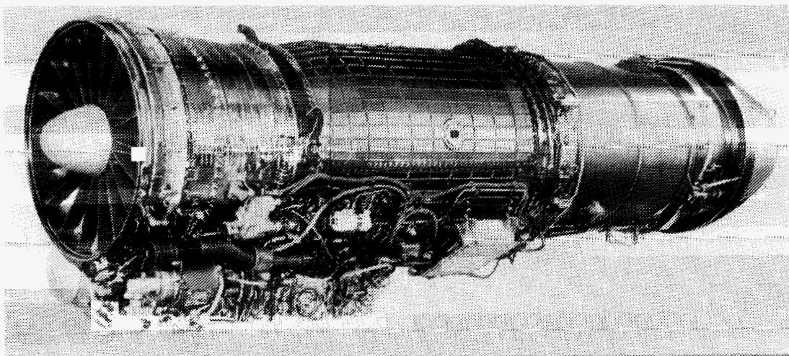

A black-and-white photograph of a jet engine viewed from the side, showing the large front fan, central cylindrical casing, and rear turbine assembly.

Photo: A jet engine with fan, compressor, and turbine sections.

ECN 33131-001

Figure 1. General Electric F404-GE-400 afterburning turbofan engine.

{20}------------------------------------------------


The diagram illustrates a turbojet engine with the following labels and symbols:

- Flow and Inlet:** Free stream (0), Engine inlet face (1).
- Inlet and Compressor:** HPC inlet (25), HPC discharge (3).
- Combustor and Turbine:** Combustor discharge (4), LPT rotor discharge (5), LPT discharge measuring plane (558).
- Afterburner:** Afterburner inlet (6).
- Exhaust:** Exhaust nozzle inlet (7), Exhaust nozzle throat (8), Exhaust nozzle discharge (9).
- Pressure and Temperature Symbols:**  $p_{s0}$ ,  $p_{t1}$ ,  $N1$ ,  $HPVG$ ,  $p_{s3}$ ,  $WF_E$ ,  $T_{T_5}$ ,  $p_{s6}$ ,  $WF_{AB}$ ,  $p_{s7}$ ,  $A8$ ,  $T_{T_1}$ ,  $FVG$ ,  $PLA$ ,  $p_{t558}$ ,  $WF_{ABP}$ .

The diagram is a cross-section of the engine, showing the flow of air and the locations of various measurement points. Key components and measurement points are labeled with their respective symbols and names.

Schematic diagram of a turbojet engine showing the flow of air and the locations of various measurement points. The diagram is a cross-section of the engine, showing the inlet, compressor, combustor, turbine, and exhaust nozzle. Key components and measurement points are labeled with their respective symbols and names.

Figure 2. Engine station and sensor locations.

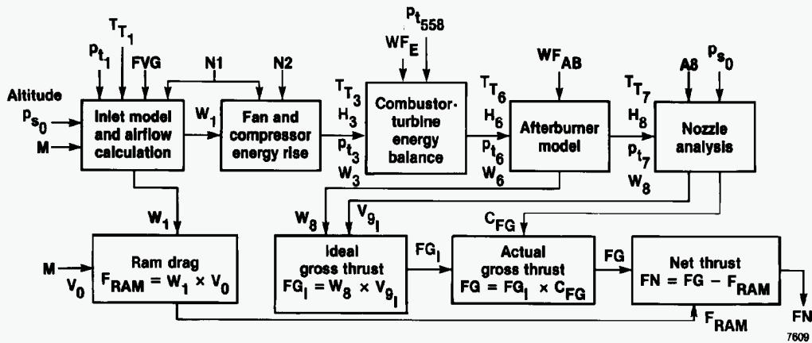

T\_{T\_1}  
Pt\_1  
FVG  
N1  
N2  
Pt\_{558}  
WFE  
WFAB  
ps\_0  
A8  
Altitude  
ps\_0  
M  
Inlet model and airflow calculation  
W\_1  
Fan and compressor energy rise  
TT\_3  
H\_3  
Pt\_3  
W\_3  
Combustor-turbine energy balance  
TT\_6  
H\_6  
Pt\_6  
W\_6  
Afterburner model  
TT\_7  
H\_8  
pt\_7  
W\_8  
Nozzle analysis  
W\_1  
M  
v\_0  
Ram drag  
F\_{RAM} = W\_1 \times v\_0  
W\_8  
v\_{g\_I}  
Ideal gross thrust  
FG\_I = W\_8 \times v\_{g\_I}  
FG\_I  
Actual gross thrust  
FG = FG\_I \times C\_{FG}  
FG  
Net thrust  
FN = FG - F\_{RAM}  
F\_{RAM}  
FN  
7609

```
graph LR
  subgraph Top
    Inlet["Inlet model and airflow calculation"] -->|W1| Fan["Fan and compressor energy rise"]
    Fan -->|TT3, H3, Pt3, W3| CT["Combustor-turbine energy balance"]
    CT -->|TT6, H6, Pt6, W6| AB["Afterburner model"]
    AB -->|TT7, H8, pt7, W8| Nozzle["Nozzle analysis"]
  end
  Inlet -->|W1| RD["Ram drag<br>F_RAM = W1 x v0"]
  CT -->|W8, vg_I| IG["Ideal gross thrust<br>FG_I = W8 x vg_I"]
  Nozzle -->|C_FG| AG["Actual gross thrust<br>FG = FG_I x C_FG"]
  RD -->|F_RAM| NT["Net thrust<br>FN = FG - F_RAM"]
  AG -->|FG| NT
  NT -->|FN| RD
```

A block diagram of a jet engine performance model showing the flow of thermodynamic and aerodynamic parameters through inlet, fan, combustor-turbine, afterburner, and nozzle models to calculate ram drag, ideal and actual gross thrust, and net thrust.

Flowchart: Block diagram of a jet engine performance and thrust calculation model.

Figure 3. F404 in-flight thrust flowchart.

{21}------------------------------------------------

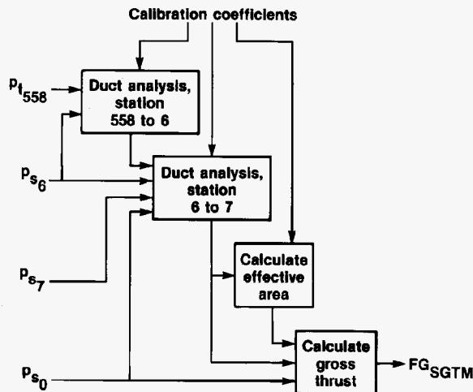

Calibration coefficients  
 $P_{t_{558}}$   
Duct analysis,  
station  
558 to 6  
Duct analysis,  
station  
6 to 7  
Calculate  
effective  
area  
Calculate  
gross  
thrust  
 $FG_{SGTM}$   
 $P_{s_6}$   
 $P_{s_7}$   
 $P_{s_0}$

```
graph TD
    CC[Calibration coefficients] --> DA558[Duct analysis,<br/>station<br/>558 to 6]
    CC --> DA67[Duct analysis,<br/>station<br/>6 to 7]
    CC --> CA[Calculate<br/>effective<br/>area]
    PT558["$P_{t_{558}}$"] --> DA558
    DA558 --> DA67
    PS6["$P_{s_6}$"] --> DA67
    PS6 --> CA
    PS7["$P_{s_7}$"] --> DA67
    PS7 --> CA
    PS0["$P_{s_0}$"] --> DA67
    PS0 --> CGT[Calculate<br/>gross<br/>thrust]
    CA --> CGT
    DA67 --> CGT
    CGT --> FGSGTM["$FG_{SGTM}$"]
```

A block diagram showing the flow of pressure and calibration coefficient inputs through duct analysis, effective area calculation, and gross thrust calculation to output FGSGTM.

Flowchart: Block diagram of duct analysis and gross thrust calculation.

Figure 4. Flowchart for the ComDev SGTM.

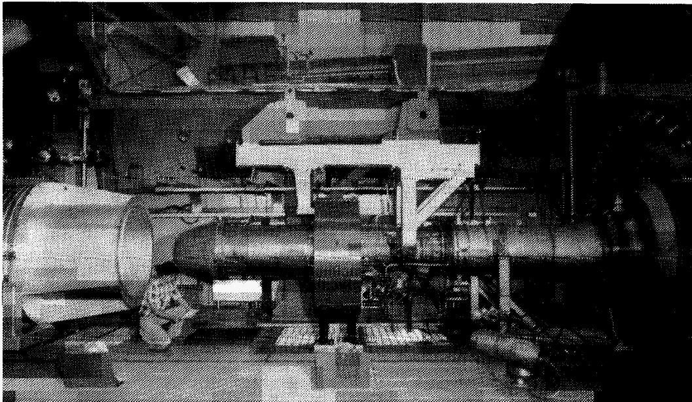

A black-and-white photograph shows a large industrial machine featuring a long horizontal cylindrical shaft supported by a central frame, flanked by large cylindrical housings on either side.

Photo: Industrial machinery with a large horizontal shaft and cylindrical components.

Figure 5. Engine installation in the test chamber.

ECN 33370-001

{22}------------------------------------------------

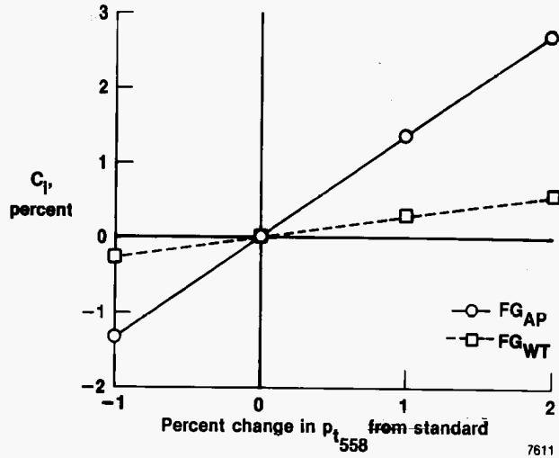

558  
7611

x: Percent change in  $p_t$  from standard, -1 to 2; y:  $C_1$ , percent, -2 to 3

| Percent change in $p_t$ from standard | FGAP  | FGWT  |
|---------------------------------------|-------|-------|
| -1                                    | ~-1.3 | ~-0.3 |
| 0                                     | ~0    | ~0    |
| 1                                     | ~1.3  | ~0.3  |
| 2                                     | ~2.7  | ~0.5  |

A line chart showing FGAP and FGWT as functions of percent change in pt from standard, with both lines passing through the origin (0, 0).

Line chart: Change in C1 percent versus percent change in pt from standard.

Figure 6. Comparison of  $FG_{AP}$  and  $FG_{WT}$  for a  $-1.0$ -percent to a  $2.0$ -percent change in  $p_{t_{558}}$  at Mach 0.9 and a 30,000-ft altitude at intermediate power.

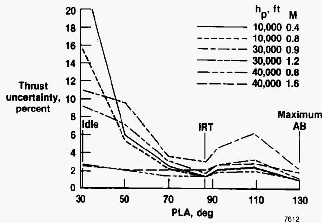

Idle  
IRT  
Maximum  
AB

x: PLA, deg, 30 to 130; y: Thrust uncertainty, percent, 0 to 20

| PLA, deg | 10,000 0.4 | 10,000 0.8 | 30,000 0.9 | 30,000 1.2 | 40,000 0.8 | 40,000 1.6 |
|----------|------------|------------|------------|------------|------------|------------|
| 30       | ~20        | ~15.5      | ~11        | ~10.5      | ~2.7       | ~2.5       |
| 50       | ~9.8       | ~7.2       | ~5.5       | ~5.0       | ~2.2       | ~2.0       |
| 70       | ~3.5       | ~2.8       | ~2.3       | ~1.8       | ~1.5       | ~1.4       |
| 90       | ~3.0       | ~2.8       | ~2.0       | ~1.5       | ~1.3       | ~1.2       |
| 110      | ~6.2       | ~3.2       | ~2.8       | ~2.3       | ~2.0       | ~1.8       |
| 130      | ~2.0       | ~1.8       | ~1.2       | ~1.0       | ~1.0       | ~0.9       |

A line chart showing thrust uncertainty percentage as a function of PLA in degrees, with curves decreasing sharply from 30 to 70 degrees and peaking around 110 degrees for various h\_p and M parameters.

Line chart: Thrust uncertainty percent versus PLA for different h\_p and M values.

(a)  $U_{FG_{WT}}$ .

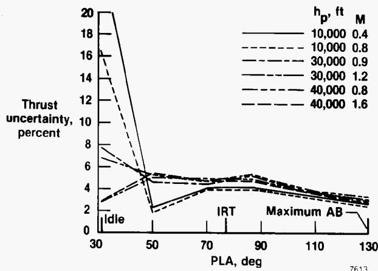

Idle  
IRT  
Maximum AB

x: PLA, deg, 30 to 130; y: Thrust uncertainty, percent, 0 to 20

| PLA, deg | 10,000 0.4 | 10,000 0.8 | 30,000 0.9 | 30,000 1.2 | 40,000 0.8 | 40,000 1.6 |
|----------|------------|------------|------------|------------|------------|------------|
| 30       | ~20        | ~16.2      | ~7.7       | ~6.7       | ~2.7       | ~2.7       |
| 50       | ~1.8       | ~2.3       | ~5.2       | ~4.8       | ~4.8       | ~5.2       |
| 70       | ~3.9       | ~3.9       | ~4.2       | ~4.2       | ~4.2       | ~4.2       |
| 90       | ~3.9       | ~3.9       | ~4.8       | ~4.8       | ~4.8       | ~5.2       |
| 110      | ~3.2       | ~3.2       | ~3.6       | ~3.6       | ~3.6       | ~3.6       |
| 130      | ~0         | ~2.6       | ~2.6       | ~2.6       | ~2.6       | ~2.6       |

A line chart showing thrust uncertainty percentage as a function of PLA in degrees across flight regimes (Idle, IRT, Maximum AB) for six combinations of h\_p and M.

Line chart: Thrust uncertainty percent versus PLA for different h\_p and M values.

(b)  $U_{FG_{AP}}$ .

Figure 7. Uncertainty in gross and net thrust for a range of flight conditions.

{23}------------------------------------------------

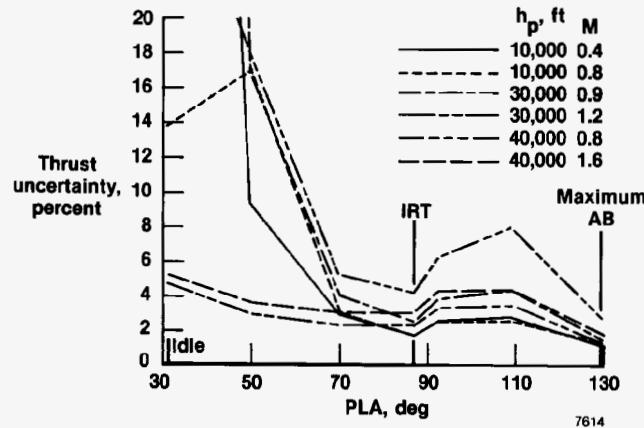

h\_p' ft M  
10,000 0.4  
10,000 0.8  
30,000 0.9  
30,000 1.2  
40,000 0.8  
40,000 1.6  
IRT  
Maximum  
AB  
Idle

x: PLA, deg, 30 to 130; y: Thrust uncertainty, percent, 0 to 20

| PLA, deg | 10,000 0.4 | 10,000 0.8 | 30,000 0.9 | 30,000 1.2 | 40,000 0.8 | 40,000 1.6 |
|----------|------------|------------|------------|------------|------------|------------|
| 30       | ~5.0       | ~5.0       | ~13.6      | ~5.0       | ~5.0       | ~5.0       |
| 50       | ~9.2       | ~17.0      | ~17.0      | ~17.0      | ~17.0      | ~17.0      |
| 70       | ~2.8       | ~2.8       | ~5.0       | ~5.0       | ~5.0       | ~5.0       |
| 90       | ~1.6       | ~2.4       | ~4.0       | ~3.2       | ~4.0       | ~4.0       |
| 110      | ~2.4       | ~2.4       | ~3.2       | ~4.0       | ~3.2       | ~7.8       |
| 130      | ~1.0       | ~1.0       | ~1.0       | ~1.0       | ~1.0       | ~2.4       |

A line chart showing thrust uncertainty percentage as a function of PLA in degrees, with curves dropping sharply around 50 degrees and rising again near 110 degrees for different h\_p' and M parameters.

Line chart: Thrust uncertainty percent versus PLA for various h\_p' and M values.

(c)  $U_{FNWT}$ .

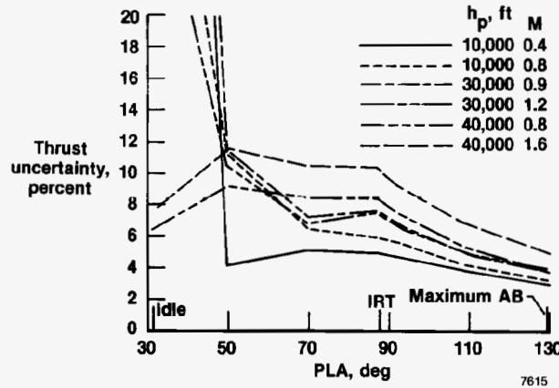

hp, ft M  
10,000 0.4  
10,000 0.8  
30,000 0.9  
30,000 1.2  
40,000 0.8  
40,000 1.6  
Idle  
IRT  
Maximum AB

x: PLA, deg, 30 to 130; y: Thrust uncertainty, percent, 0 to 20

| PLA, deg | 10,000 0.4 | 10,000 0.8 | 30,000 0.9 | 30,000 1.2 | 40,000 0.8 | 40,000 1.6 |
|----------|------------|------------|------------|------------|------------|------------|
| 30       | ~6.2       | ~7.8       | ~6.2       | ~7.8       | ~6.2       | ~7.8       |
| 50       | ~4.2       | ~9.0       | ~9.0       | ~11.4      | ~9.0       | ~11.4      |
| 70       | ~5.2       | ~6.6       | ~8.3       | ~8.3       | ~6.6       | ~10.3      |
| 90       | ~5.0       | ~5.8       | ~7.5       | ~8.3       | ~6.6       | ~10.3      |
| 110      | ~3.8       | ~4.6       | ~5.0       | ~5.0       | ~5.0       | ~6.8       |
| 130      | ~2.8       | ~3.2       | ~3.8       | ~3.8       | ~3.2       | ~5.0       |

A line chart showing thrust uncertainty percentage as a function of PLA in degrees, with curves decreasing overall as PLA increases, annotated with flight regimes Idle, IRT, and Maximum AB.

Line chart: Thrust uncertainty percent versus PLA for various hp and M values.

(d)  $U_{FNAP}$ .

Figure 7. Concluded.

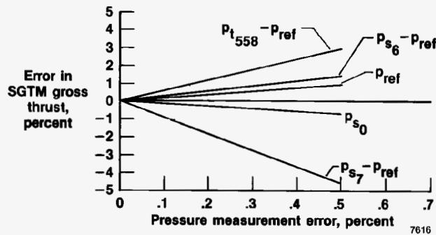

pt558 - pref  
ps6 - pref  
pref  
ps0  
ps7 - pref  
7616

x: Pressure measurement error, percent, 0 to .7; y: Error in SGTM gross thrust, percent, -5 to 5

| Pressure measurement error, percent | pt558 - pref | ps6 - pref | pref | ps0   | ps7 - pref |
|-------------------------------------|--------------|------------|------|-------|------------|
| 0                                   | ~0           | ~0         | ~0   | ~0    | ~0         |
| .1                                  | ~1.0         | ~0.5       | ~0.3 | ~-0.3 | ~-1.5      |
| .2                                  | ~2.0         | ~1.0       | ~0.6 | ~-0.6 | ~-3.0      |
| .3                                  | ~3.0         | ~1.5       | ~0.9 | ~-0.9 | ~-4.5      |
| .4                                  | ~4.0         | ~2.0       | ~1.2 | ~-1.2 | ~-6.0      |
| .5                                  | ~5.0         | ~2.5       | ~1.5 | ~-1.5 | ~-7.5      |

A line chart showing the error in SGTM gross thrust as a function of pressure measurement error for five different parameters, with positive slopes for pt558, ps6, and pref, and negative slopes for ps0 and ps7.

Line chart: Error in SGTM gross thrust versus pressure measurement error.

(a) PLA = 70°.

Figure 8. Sensitivity of SGTM to input errors. Mach 0.9, 30,000 ft.

{24}------------------------------------------------

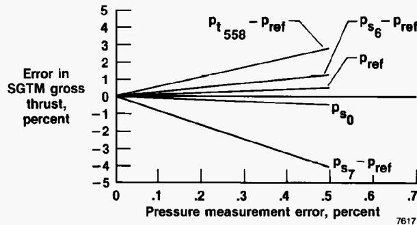

pt558 - pref  
ps6 - pref  
pref  
ps0  
ps7 - pref  
7617

x: Pressure measurement error, percent, 0 to .7; y: Error in SGTM gross thrust, percent, -5 to 5

| Pressure measurement error, percent | pt558 - pref | ps6 - pref | pref | ps0 | ps7 - pref |
|-------------------------------------|--------------|------------|------|-----|------------|
| 0                                   | ~0           | ~0         | ~0   | ~0  | ~0         |
| .1                                  | ~0.5         | ~0.2       | ~0.1 | ~0  | ~-0.5      |
| .2                                  | ~1.0         | ~0.4       | ~0.2 | ~0  | ~-1.0      |
| .3                                  | ~1.5         | ~0.6       | ~0.3 | ~0  | ~-1.5      |
| .4                                  | ~2.0         | ~0.8       | ~0.4 | ~0  | ~-2.0      |
| .5                                  | ~2.5         | ~1.0       | ~0.5 | ~0  | ~-2.5      |
| .6                                  |              | ~1.2       | ~0.6 | ~0  | ~-3.0      |
| .7                                  |              |            | ~0.7 | ~0  | ~-3.5      |

A line chart showing the error in SGTM gross thrust as a function of pressure measurement error for five different parameters, with positive slopes for pt558 - pref, ps6 - pref, and pref, and negative slopes for ps0 and ps7 - pref.

Line chart: Error in SGTM gross thrust versus pressure measurement error.

(b) PLA = 87°.

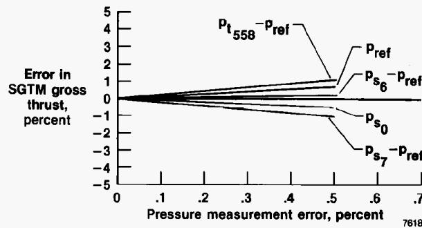

pt558 -pref  
pref  
ps6 -pref  
Error in  
SGTM gross  
thrust,  
percent  
ps0  
ps7 -pref  
7618

x: Pressure measurement error, percent, 0 to .7; y: Error in SGTM gross thrust, percent, -5 to 5

| Pressure measurement error, percent | pt558 -pref | pref  | ps6 -pref | ps0   | ps7 -pref |
|-------------------------------------|-------------|-------|-----------|-------|-----------|
| 0                                   | ~0          | ~0    | ~0        | ~0    | ~0        |
| .1                                  | ~0.1        | ~0.05 | ~0.02     | ~-0.1 | ~-0.05    |
| .2                                  | ~0.2        | ~0.1  | ~0.05     | ~-0.2 | ~-0.1     |
| .3                                  | ~0.3        | ~0.15 | ~0.08     | ~-0.3 | ~-0.15    |
| .4                                  | ~0.4        | ~0.2  | ~0.1      | ~-0.4 | ~-0.2     |
| .5                                  | ~0.5        | ~0.25 | ~0.12     | ~-0.5 | ~-0.25    |
| .6                                  | ~0.6        | ~0.3  | ~0.15     | ~-0.6 | ~-0.3     |
| .7                                  | ~0.7        | ~0.35 | ~0.18     | ~-0.7 | ~-0.35    |

A line chart showing the error in SGTM gross thrust as a function of pressure measurement error, with positive and negative slopes for different parameters.

Line chart: Error in SGTM gross thrust versus pressure measurement error.

(c) PLA = 130°.

Figure 8. Concluded.

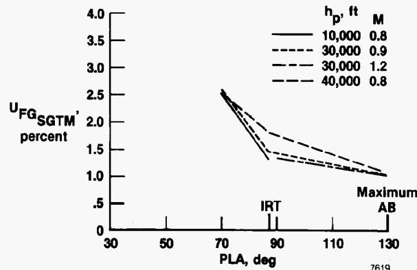

h\_p, ft  
M  
10,000 0.8  
30,000 0.9  
30,000 1.2  
40,000 0.8  
IRT  
Maximum  
AB

x: PLA, deg, 30 to 130; y: U\_{FGSGTM}', percent, 0 to 4.0

| PLA, deg | 10,000 0.8 | 30,000 0.9 | 30,000 1.2 | 40,000 0.8 |
|----------|------------|------------|------------|------------|
| ~72      | ~2.55      | ~2.55      | ~2.55      | ~2.55      |
| ~88      | ~1.3       | ~1.45      | ~1.8       | ~1.45      |
| ~128     | ~1.05      | ~1.05      | ~1.05      | ~1.05      |

A line chart showing UFGSGTM percent decreasing as PLA increases from about 72 to 128 degrees across four parameter combinations of h\_p and M, with vertical markers for IRT and Maximum AB.

Line chart: Plot of UFGSGTM percent versus PLA deg for different h\_p and M values.

Figure 9. Uncertainty in gross thrust, SGTM.

{25}------------------------------------------------

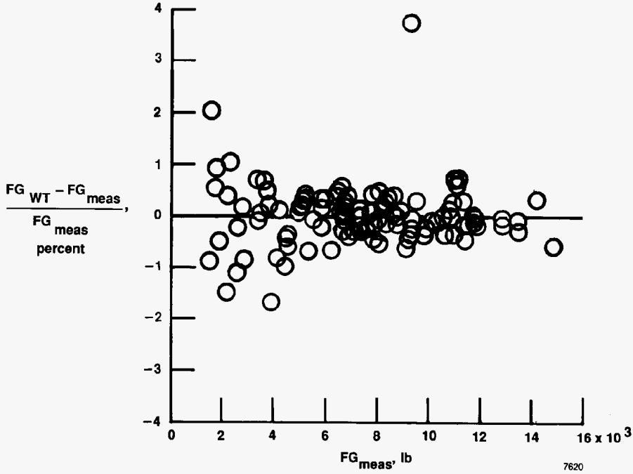

7620

x: FG\_meas', lb, 0 to 16 x 10^3; y: \frac{FG\_{WT} - FG\_{meas}}{FG\_{meas}} percent, -4 to 4

| FG_meas', lb | \frac{FG_{WT} - FG_{meas}}{FG_{meas}} percent |
|--------------|-----------------------------------------------|
| ~1.5         | ~2.0                                          |
| ~2.0         | ~1.0                                          |
| ~2.0         | ~0.5                                          |
| ~2.0         | ~0.0                                          |
| ~2.0         | ~-0.9                                         |
| ~2.5         | ~1.1                                          |
| ~2.5         | ~0.0                                          |
| ~2.5         | ~-0.5                                         |
| ~2.5         | ~-1.5                                         |
| ~3.0         | ~0.7                                          |
| ~3.0         | ~0.0                                          |
| ~3.0         | ~-0.2                                         |
| ~3.5         | ~0.7                                          |
| ~3.5         | ~0.0                                          |
| ~3.5         | ~-0.8                                         |
| ~4.0         | ~0.0                                          |
| ~4.0         | ~-1.8                                         |
| ~4.0         | ~-0.9                                         |
| ~4.5         | ~0.0                                          |
| ~4.5         | ~-0.5                                         |
| ~5.0         | ~0.5                                          |
| ~5.0         | ~0.0                                          |
| ~5.0         | ~-0.7                                         |
| ~5.5         | ~0.5                                          |
| ~5.5         | ~0.0                                          |
| ~6.0         | ~0.5                                          |
| ~6.0         | ~0.0                                          |
| ~6.0         | ~-0.7                                         |
| ~6.5         | ~0.5                                          |
| ~6.5         | ~0.0                                          |
| ~7.0         | ~0.5                                          |
| ~7.0         | ~0.0                                          |
| ~7.0         | ~-0.5                                         |
| ~7.5         | ~0.5                                          |
| ~7.5         | ~0.0                                          |
| ~8.0         | ~0.5                                          |
| ~8.0         | ~0.0                                          |
| ~8.0         | ~-0.5                                         |
| ~8.5         | ~0.5                                          |
| ~8.5         | ~0.0                                          |
| ~9.0         | ~3.6                                          |
| ~9.0         | ~0.0                                          |
| ~9.0         | ~-0.5                                         |
| ~9.5         | ~0.0                                          |
| ~10.0        | ~0.0                                          |
| ~10.5        | ~0.0                                          |
| ~11.0        | ~0.0                                          |
| ~11.0        | ~0.7                                          |
| ~11.0        | ~0.0                                          |
| ~11.5        | ~0.0                                          |
| ~12.0        | ~0.0                                          |
| ~12.5        | ~0.0                                          |
| ~13.0        | ~0.0                                          |
| ~14.0        | ~0.3                                          |
| ~14.5        | ~-0.6                                         |

A scatter plot showing the percentage difference between measured and true fat grams plotted against measured fat grams, with a horizontal reference line at zero.

Scatter plot: Scatter plot of percent difference versus measured fat grams.

(a)  $FG_{WT}$  after calibration.

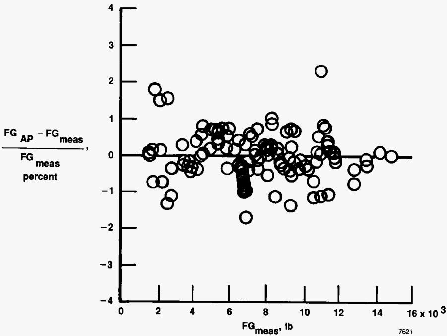

7621

x: FG\_meas', lb, 0 to 16 x 10^3; y: (FG\_AP - FG\_meas) / FG\_meas percent, -4 to 4

| FG_meas', lb | Relative Error (%) |
|--------------|--------------------|
| ~1.5 x 10^3  | ~1.8               |
| ~2.0 x 10^3  | ~1.5               |
| ~2.5 x 10^3  | ~1.5               |
| ~6.5 x 10^3  | ~-1.8              |
| ~10.5 x 10^3 | ~2.3               |
| ~14.5 x 10^3 | ~0.0               |

A scatter plot showing relative error percentage against measured force in pounds, with a horizontal zero line and a cluster of points around 6.5 x 10^3 lb.

Scatter plot: Scatter plot of relative error versus measured force.

(b)  $FG_{AP}$  after calibration.

Figure 10. Accuracy of the thrust calculation methods after calibration.

{26}------------------------------------------------

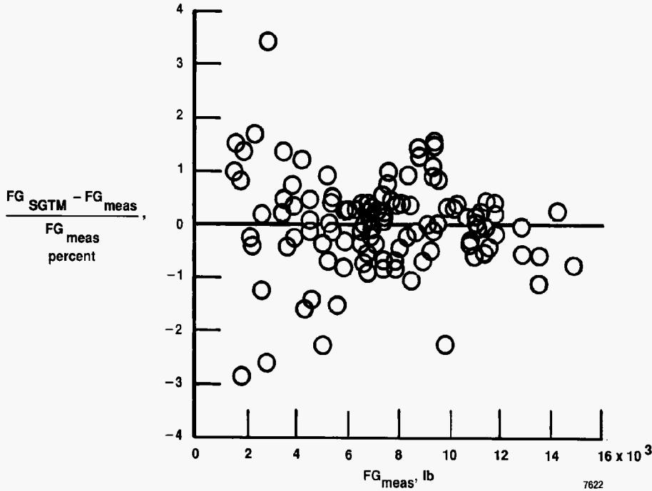

7622

x: FG\_meas', lb, 0 to 16 x 10^3; y: \frac{FG\_{SGTM} - FG\_{meas}}{FG\_{meas} percent}, -4 to 4

| FG_meas', lb | Relative Error |
|--------------|----------------|
| ~1.8         | ~1.5           |
| ~2.0         | ~1.0           |
| ~2.2         | ~3.4           |
| ~2.5         | ~-1.3          |
| ~3.0         | ~1.3           |
| ~4.0         | ~1.2           |
| ~5.0         | ~-2.3          |
| ~6.0         | ~0.3           |
| ~7.0         | ~0.5           |
| ~8.0         | ~0.9           |
| ~9.0         | ~1.6           |
| ~10.0        | ~-2.3          |
| ~11.0        | ~0.3           |
| ~12.0        | ~0.1           |
| ~13.0        | ~-1.3          |
| ~14.0        | ~0.3           |
| ~15.0        | ~-0.9          |

A scatter plot showing data points as open circles distributed around a horizontal zero line, with a dense cluster between 6 and 10 on the x-axis.

Scatter plot: Scatter plot of relative error versus measured fuel gas weight.

(c)  $FG_{SGTM}$ .

Figure 10. Concluded.

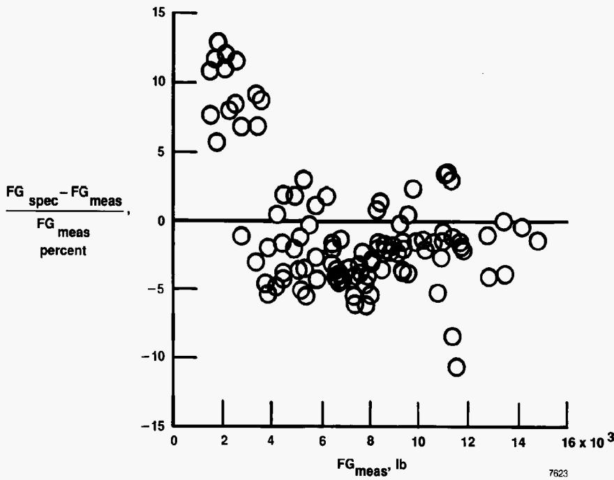

7623

x: FG\_meas, lb, 0 to 16 x 10^3; y: (FG\_spec - FG\_meas) / FG\_meas percent, -15 to 15

| FG_meas, lb | (FG_spec - FG_meas) / FG_meas percent |
|-------------|---------------------------------------|
| ~1.5        | ~11.5                                 |
| ~2.0        | ~10.5                                 |
| ~2.5        | ~7.5                                  |
| ~3.0        | ~5.5                                  |
| ~3.5        | ~8.5                                  |
| ~4.0        | ~0.5                                  |
| ~4.5        | ~2.5                                  |
| ~5.0        | ~3.5                                  |
| ~6.0        | ~1.5                                  |
| ~7.0        | ~-3.5                                 |
| ~8.0        | ~-1.5                                 |
| ~9.0        | ~2.0                                  |
| ~10.0       | ~-2.5                                 |
| ~11.0       | ~-8.5                                 |
| ~11.5       | ~3.5                                  |
| ~12.0       | ~-4.5                                 |
| ~13.0       | ~-4.0                                 |
| ~14.0       | ~-0.5                                 |

A scatter plot showing the percentage difference between specified and measured FG values against measured FG in pounds, with a horizontal reference line at zero.

Scatter plot: Scatter plot of relative FG error versus measured FG.

Figure 11. Accuracy of uncalibrated specification gross thrust.

{27}------------------------------------------------

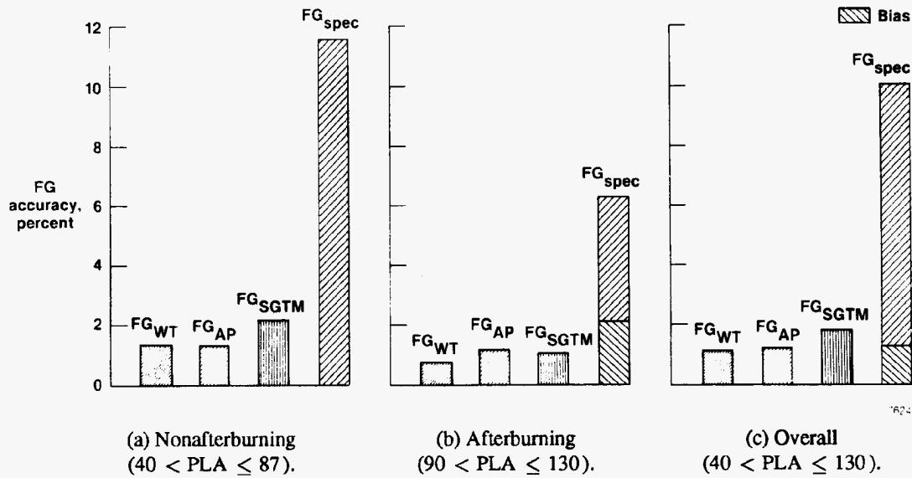

FG accuracy, percent  
FG\_{spec}  
FG\_{SGTM}  
FG\_{WT}  
FG\_{AP}  
FG\_{WT}  
FG\_{AP}  
FG\_{SGTM}  
FG\_{spec}  
FG\_{WT}  
FG\_{AP}  
FG\_{SGTM}  
FG\_{spec}  
(a) Nonafterburning (40 < PLA \le 87).  
(b) Afterburning (90 < PLA \le 130).  
(c) Overall (40 < PLA \le 130).

y: FG accuracy, percent, 0 to 12

| Category  | FG accuracy, percent |
|-----------|----------------------|
| FG_{WT}   | ~1.3                 |
| FG_{AP}   | ~1.3                 |
| FG_{SGTM} | ~2.1                 |
| FG_{spec} | ~11.6                |

| Category  | FG accuracy, percent |
|-----------|----------------------|
| FG_{WT}   | ~0.7                 |
| FG_{AP}   | ~1.2                 |
| FG_{SGTM} | ~1.0                 |
| FG_{spec} | ~6.3                 |

| Category  | FG accuracy, percent |
|-----------|----------------------|
| FG_{WT}   | ~1.1                 |
| FG_{AP}   | ~1.2                 |
| FG_{SGTM} | ~1.8                 |
| FG_{spec} | ~10.1                |

Three bar charts comparing FG accuracy across four methods (FG\_WT, FG\_AP, FG\_SGTM, and FG\_spec) for nonafterburning, afterburning, and overall conditions, with FG\_spec showing the highest accuracy in all panels.

Multi-panel chart: Comparison of FG accuracy and bias across different PLA ranges.

Figure 12. Comparison of  $2\sigma$  accuracies of the gross thrust methods.

{28}------------------------------------------------

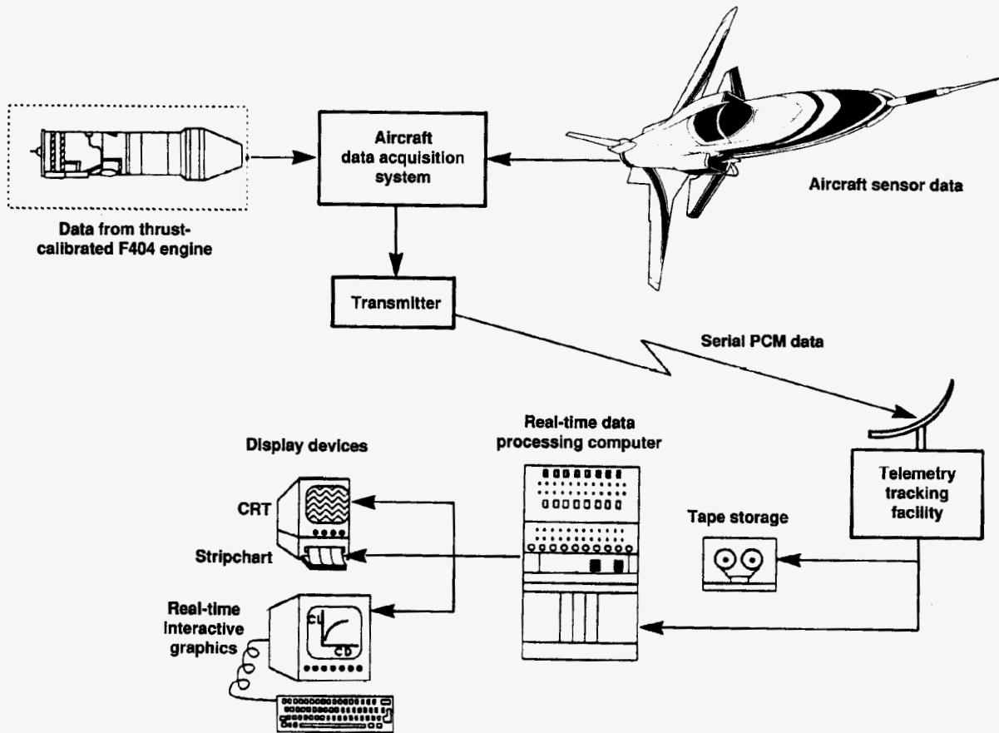

Aircraft  
data acquisition  
system  
Aircraft sensor data  
Data from thrust-  
calibrated F404 engine  
Transmitter  
Serial PCM data  
Real-time data  
processing computer  
Display devices  
CRT  
Tape storage  
Telemetry  
tracking  
facility  
Stripchart  
Real-time  
interactive  
graphics

```
graph TD
    A[Data from thrust-calibrated F404 engine] --> B[Aircraft data acquisition system]
    C[Aircraft sensor data] --> B
    B --> D[Transmitter]
    D -->|Serial PCM data| E[Telemetry tracking facility]
    E --> F[Tape storage]
    E --> G[Real-time data processing computer]
    G --> H[CRT]
    G --> I[Stripchart]
    G --> J[Real-time interactive graphics]
```

A block diagram showing data flow from an engine and aircraft sensors to an acquisition system and transmitter, which sends serial PCM data to a telemetry tracking facility and a real-time data processing computer connected to display devices and tape storage.

Schematic: System architecture for aircraft data acquisition, telemetry, and real-time processing.

Figure 13. X-29A real-time performance data system.

8144

{29}------------------------------------------------

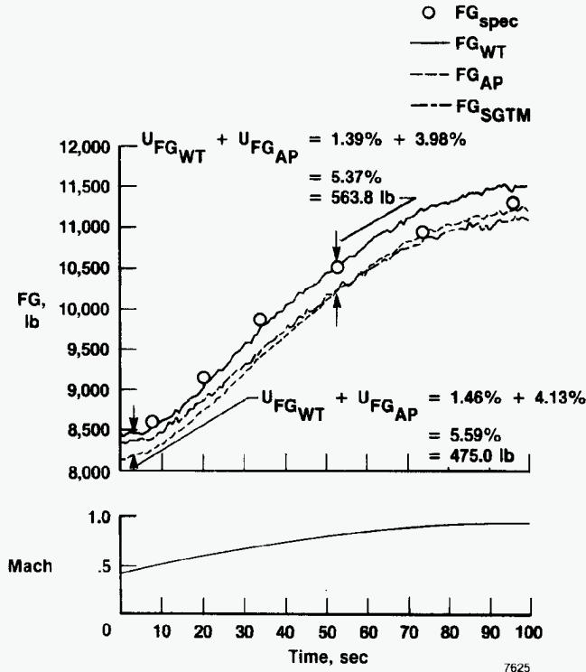

O FG\_{spec}  
— FG\_{WT}  
- - - FG\_{AP}  
- - - FG\_{SGTM}  
U\_{FG\_{WT}} + U\_{FG\_{AP}} = 1.39% + 3.98%  
= 5.37%  
= 563.8 lb  
U\_{FG\_{WT}} + U\_{FG\_{AP}} = 1.46% + 4.13%  
= 5.59%  
= 475.0 lb

x: Time, sec, 0 to 100; y: FG, lb, 8,000 to 12,000; y: Mach, 0 to 1.0

| Time, sec | FG_{WT} | FG_{AP} | FG_{SGTM} | FG_{spec} |
|-----------|---------|---------|-----------|-----------|
| 0         | ~8200   | ~8300   | ~8400     | ~8500     |
| 10        | ~8400   | ~8500   | ~8600     | ~8650     |
| 20        | ~8800   | ~8900   | ~9000     | ~9150     |
| 30        | ~9500   | ~9400   | ~9500     | ~9850     |
| 40        | ~10000  | ~9800   | ~9900     |           |
| 50        | ~10300  | ~10200  | ~10300    |           |
| 60        | ~10700  | ~10500  | ~10600    |           |
| 70        | ~11000  | ~10800  | ~10900    | ~10950    |
| 80        | ~11300  | ~11000  | ~11100    |           |
| 90        | ~11400  | ~11100  | ~11200    |           |
| 98        | ~11500  | ~11200  | ~11300    | ~11300    |

| Time, sec | Mach  |
|-----------|-------|
| 0         | ~0.45 |
| 10        | ~0.52 |
| 20        | ~0.58 |
| 30        | ~0.63 |
| 40        | ~0.68 |
| 50        | ~0.72 |
| 60        | ~0.76 |
| 70        | ~0.80 |
| 80        | ~0.84 |
| 90        | ~0.88 |
| 100       | ~0.92 |

A two-panel plot showing flight weight (FG) in pounds and Mach number as functions of time in seconds, with annotated weight increments and a data point circle on the upper curve.

Multi-panel chart: Flight weight and Mach number versus time.

(a) IRT, 10,000 ft.

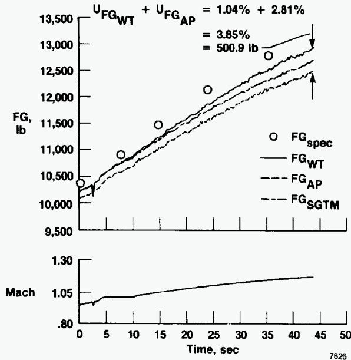

U\_{FG\_{WT}} + U\_{FG\_{AP}} = 1.04% + 2.81%  
= 3.85%  
= 500.9 lb  
FG\_{spec}  
FG\_{WT}  
FG\_{AP}  
FG\_{SGTM}

top panel: x: Time, sec, 0-50; y: FG, lb, 9,500-13,500; bottom panel: x: Time, sec, 0-50; y: Mach, .80-1.30

| Time, sec | FG_{spec} | FG_{WT} | FG_{AP} | FG_{SGTM} |
|-----------|-----------|---------|---------|-----------|
| 0         | ~10350    | ~10250  | ~10200  | ~10150    |
| 5         | ~10850    | ~10750  | ~10650  | ~10600    |
| 10        | ~11250    | ~11200  | ~11100  | ~11050    |
| 15        | ~11500    | ~11400  | ~11300  | ~11250    |
| 20        | ~12000    | ~11800  | ~11700  | ~11650    |
| 25        | ~12150    | ~12150  | ~12050  | ~11950    |
| 30        | ~12400    | ~12400  | ~12250  | ~12150    |
| 35        | ~12750    | ~12700  | ~12500  | ~12350    |
| 40        | ~12900    | ~12900  | ~12650  | ~12500    |

| Time, sec | Mach  |
|-----------|-------|
| 0         | ~1.00 |
| 5         | ~1.04 |
| 10        | ~1.04 |
| 15        | ~1.05 |
| 20        | ~1.06 |
| 25        | ~1.07 |
| 30        | ~1.08 |
| 35        | ~1.09 |
| 40        | ~1.10 |
| 43        | ~1.11 |

A two-panel plot showing gross weight increasing over time with experimental and model curves, and Mach number slightly increasing from 1.00 to about 1.11 over 43 seconds.

Multi-panel chart: Flight gross weight and Mach number over time.

(b) Maximum power, 30,000 ft.

Figure 14. Comparison of gross thrust methods during level accelerations.

{30}------------------------------------------------

### Report Documentation Page

|                                                                                                                                                                                                                                                                                                                                                                                                                                                                                                                                                                                                                                                                                                                                                                                                                                                                                                                                                                                                                                                                                                                                                                                                                                                                            |                                                                 |                                                                                                     |                             |
|----------------------------------------------------------------------------------------------------------------------------------------------------------------------------------------------------------------------------------------------------------------------------------------------------------------------------------------------------------------------------------------------------------------------------------------------------------------------------------------------------------------------------------------------------------------------------------------------------------------------------------------------------------------------------------------------------------------------------------------------------------------------------------------------------------------------------------------------------------------------------------------------------------------------------------------------------------------------------------------------------------------------------------------------------------------------------------------------------------------------------------------------------------------------------------------------------------------------------------------------------------------------------|-----------------------------------------------------------------|-----------------------------------------------------------------------------------------------------|-----------------------------|
| 1. Report No.<br><b>NASA TP-3001</b>                                                                                                                                                                                                                                                                                                                                                                                                                                                                                                                                                                                                                                                                                                                                                                                                                                                                                                                                                                                                                                                                                                                                                                                                                                       |                                                                 | 2. Government Accession No.                                                                         | 3. Recipient's Catalog No.  |
| 4. Title and Subtitle<br><br><b>Evaluation of Various Thrust Calibration Techniques<br/>on an F404 Engine</b>                                                                                                                                                                                                                                                                                                                                                                                                                                                                                                                                                                                                                                                                                                                                                                                                                                                                                                                                                                                                                                                                                                                                                              |                                                                 | 5. Report Date<br><b>April 1990</b>                                                                 |                             |
|                                                                                                                                                                                                                                                                                                                                                                                                                                                                                                                                                                                                                                                                                                                                                                                                                                                                                                                                                                                                                                                                                                                                                                                                                                                                            |                                                                 | 6. Performing Organization Code                                                                     |                             |
| 7. Author(s)<br><br><b>Ronald J. Ray</b>                                                                                                                                                                                                                                                                                                                                                                                                                                                                                                                                                                                                                                                                                                                                                                                                                                                                                                                                                                                                                                                                                                                                                                                                                                   |                                                                 | 8. Performing Organization Report No.<br><br><b>H-1505</b>                                          |                             |
| 9. Performing Organization Name and Address<br><b>NASA Ames Research Center<br/>Dryden Flight Research Facility<br/>P.O. Box 273, Edwards, CA 93523-0273</b>                                                                                                                                                                                                                                                                                                                                                                                                                                                                                                                                                                                                                                                                                                                                                                                                                                                                                                                                                                                                                                                                                                               |                                                                 | 10. Work Unit No.<br><br><b>RTOP 533-02-51</b>                                                      |                             |
|                                                                                                                                                                                                                                                                                                                                                                                                                                                                                                                                                                                                                                                                                                                                                                                                                                                                                                                                                                                                                                                                                                                                                                                                                                                                            |                                                                 | 11. Contract or Grant No.                                                                           |                             |
| 12. Sponsoring Agency Name and Address<br><br><b>National Aeronautics and Space Administration<br/>Washington, DC 20546</b>                                                                                                                                                                                                                                                                                                                                                                                                                                                                                                                                                                                                                                                                                                                                                                                                                                                                                                                                                                                                                                                                                                                                                |                                                                 | 13. Type of Report and Period Covered<br><br><b>Technical Paper</b>                                 |                             |
|                                                                                                                                                                                                                                                                                                                                                                                                                                                                                                                                                                                                                                                                                                                                                                                                                                                                                                                                                                                                                                                                                                                                                                                                                                                                            |                                                                 | 14. Sponsoring Agency Code                                                                          |                             |
| 15. Supplementary Notes                                                                                                                                                                                                                                                                                                                                                                                                                                                                                                                                                                                                                                                                                                                                                                                                                                                                                                                                                                                                                                                                                                                                                                                                                                                    |                                                                 |                                                                                                     |                             |
| 16. Abstract<br><br><p>In support of performance testing of the X-29A aircraft at the NASA Ames Research Center, Dryden Flight Research Facility, various thrust calculation techniques have been developed and evaluated for use on the F404-GE-400 engine. The engine was thrust calibrated at the NASA Lewis Research Center's Propulsion System Laboratory. Results from these tests were used to correct the manufacturer's in-flight thrust program to more accurately calculate thrust for the specific test engine. Data from these tests were also used to develop an independent, simplified thrust calculation technique for real-time thrust calculation. Comparisons were also made to thrust values predicted by the engine specification model. Results indicate uninstalled gross thrust accuracies on the order of 1 to 4 percent for the various in-flight thrust methods. The various thrust calculations are described and their usage, uncertainty, and measured accuracies are explained. In addition, the advantages of a real-time thrust algorithm for flight test use and the importance of an accurate thrust calculation to the aircraft performance analysis are described. Finally, actual data obtained from flight test are presented.</p> |                                                                 |                                                                                                     |                             |
| 17. Key Words (Suggested by Author(s))<br><br><b>Calibrated thrust<br/>Performance<br/>Real-time thrust<br/>Thrust</b>                                                                                                                                                                                                                                                                                                                                                                                                                                                                                                                                                                                                                                                                                                                                                                                                                                                                                                                                                                                                                                                                                                                                                     |                                                                 | 18. Distribution Statement<br><br><b>Unclassified — Unlimited</b><br><br><b>Subject category 05</b> |                             |
| 19. Security Classif. (of this report)<br><br><b>Unclassified</b>                                                                                                                                                                                                                                                                                                                                                                                                                                                                                                                                                                                                                                                                                                                                                                                                                                                                                                                                                                                                                                                                                                                                                                                                          | 20. Security Classif. (of this page)<br><br><b>Unclassified</b> | 21. No. of pages<br><br><b>30</b>                                                                   | 22. Price<br><br><b>A03</b> |

---

## Related documents

- [[Exhaust-Gas P & T Survey of F404-GE-400 engine|Exhaust-Gas]] - exhaust pressure and temperature survey data
- [[ADA164562 The General Electric F404 - Engine of the RAAF's New Fighter|ADA164562]] - RAAF F404 engine description
- [[Powel 1990 - On the Leading Edge, Combining Maturity and Advanced Technology on the F404 Turbofan Engine|Powel 1990]] - GE overview of F404 design and growth
