{0}------------------------------------------------

The Society shall not be responsible for statements or opinions advanced in papers or in discussion at meetings of the Society or of its Divisions or Sections, or printed in its publications. Discussion is printed only if the paper is published in an ASME Journal. Papers are available from ASME for fifteen months after the meeting.

Printed in USA.

Copyright © 1990 by ASME

# On the Leading Edge: Combining Maturity and Advanced Technology on the F404 Turbofan Engine

**S. F. POWEL IV**  
Manager, F404 Advanced Programs  
GE Aircraft Engines  
Lynn, Massachusetts

## ABSTRACT

The overall design concept of the F404 afterburning turbofan engine is reviewed together with some of the lessons learned from over 2 million flight hours in service. GE Aircraft Engines' derivative and growth plans for the F404 family are then reviewed including the "Building Block" component development approach. Examples of advanced technologies under development for introduction into new F404 derivative engine models are presented in the areas of materials, digital and fiber optic controls systems, and vectoring exhaust nozzles. The design concept and details of the F404-GE-402, F412-GE-400 and other derivative engines under full scale development are described. Studies for future growth variants and the benefits of the F404 derivative approach to development of afterburning engines in the 18-24,000 pounds (80-107 kN) thrust class and non-afterburning engines in the 12-19,000 pounds (53-85 kN) class are discussed.

## INTRODUCTION

The medium thrust class of fighter aircraft engines, from 14,000 to 22,000 pounds (62-98 kN) thrust, has been the beneficiary of the most modern, innovative technology available over the last 35 years because engines in this thrust class have powered the majority of front line Western fighter/attack aircraft produced in this period. State-of-the-art second generation fighter engine designs, developed beginning in the middle 1950's, were characterized by pressure ratios in the 10-15 range, turbine inlet temperatures of 1700-1900°F (1200-1300°K) and thrust-to-weight ratios of 4-5. State-of-the-art third generation engines developed since the 1970's are characterized by pressure ratios in the 25-30 range, turbine inlet temperatures of 2400-2950°F (1600-1900°K) and thrust-to-weight ratios in the 7-10 range. This paper traces the F404 engine family evolution from its inception to models currently under development and into growth derivatives projected for development in the 1990's up to the 9-10 thrust-to-weight ratio class. The planned, continuous infusion into F404 model engines of advanced technology derived from other F404, military, or

commercial engine programs at GE Aircraft Engines (GEAE) is designed to achieve growth in pressure ratio, turbine inlet temperature and thrust-to-weight ratio, while maintaining or improving the outstanding operability, reliability, maintainability and durability of the basic F404 engine, matured in over 2 million flight hours of experience.

The benefits offered by F404 derivatives in the 18-24,000 pounds (80-107 kN) afterburning thrust class and the 12-19,000 pounds (53-85 kN) non-afterburning thrust class, in contrast to development of completely new engines, are:

- economic, low-risk qualification programs
- an optimal balance of advanced technology and proven component design
- low engine unit cost due to high volume production
- mature engine reliability, maintainability, durability, and life cycle cost

## REVIEW OF F404 TECHNICAL DESIGN CONCEPT

Full Scale Development (FSD) of the 16,000 pounds (71 kN) thrust F404-GE-400 afterburning turbofan (Figure 1) began in 1975 for the U.S. Navy/McDonnell Douglas F/A-18 Hornet, following a successful prototype development and flight test program as the YJ101 engine for the Northrop YF-17 aircraft. reliability & maintainability (R&M) and performance tradeoffs. The emphasis on low cost and R&M also drove a simplified control system. A complete description of the F404 FSD Program and design emphasis may be found in Reference (1). The basic design layout and development philosophy of the F404 are being emulated in other fighter aircraft engine designs projected to enter service in the 1990's.

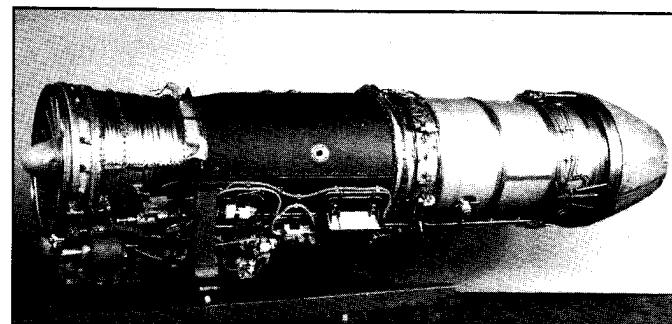

A black-and-white photograph shows a long, cylindrical rocket engine or motor with a nose cone on the right and a base on the left, featuring external wiring and components along the lower section.

Photo: A large cylindrical rocket engine or missile motor assembly.

Figure 1 F404-GE-400 Augmented Turbofan Engine

{1}------------------------------------------------

The highly simplified low-bypass, 2-spool turbofan engine design layout includes 3 frames, 3 fan stages, 7 compressor stages, and single stage high and low pressure turbines - made possible by advanced technology aerodynamics, materials, cooling design, and control systems. The F404 design concept was revolutionary at its inception due to a balanced approach that traded the ultimate in achievable engine thrust-to-weight ratio to accomplish the higher priority objectives of operability, reliability, maintainability, durability and low cost. A deliberate effort was made to reduce parts count dramatically over the previous generation of engines (1/3 fewer parts than the J79; see Figure 2) because it was recognized that parts count was a direct driver of engine reliability and cost. A low bypass turbofan cycle was selected after extensive study to optimize thrust and specific fuel consumption in the primary fighter combat regimes of the flight envelope. This cycle also resulted in stall free operation and outstanding afterburner performance throughout the envelope, in addition to the installation benefits of a self-cooled engine skin. The simplified engine aerodynamic and mechanical layout was arrived at following cost, weight,

## PROGRAM STATUS

Over 2000 engines have been shipped since the F404's first flight powering the F/A-18 in November 1978. The F404 or its derivatives have been specified on five production aircraft programs: the F/A-18 (Engine Models: F404-GE-400; F404-GE-402), the Swedish JAS 39 Gripen (F404/RM12), the Singapore A-4S-1 Super Skyhawk (F404-GE-100D), the Lockheed F-117A (F404-GE-F1D2) and the McDonnell Douglas/General Dynamics A-12 (F412-GE-400). In addition, F404 derivatives have powered or are under development for demonstrator and production prototype programs including the French Rafale (F404-GE-400), Indian Light Combat Aircraft (F404/F2J3), Northrop F-20 Tiger shark (F404-GE-100), Grumman A-6F Intruder (F404-GE-400) and X-29 Forward Swept Wing Demonstrator (F404-GE-400), and Rockwell/MBB X-31 Enhanced Fighter Maneuverability Demonstrator (F404-GE-400). See Figure 3.

In the more than 2 million engine hours flown in 10 years of operation, and in over 54,000 factory engine test hours logged on all models, the F404 has proven the success of the original design concept. Its excellent field reliability as measured by the key indices of Shop Visit Rate (SVR) and In Flight Shut Down (IFSD) has been the standard of the industry, as shown in Figure 4. The simple design, modular construction,

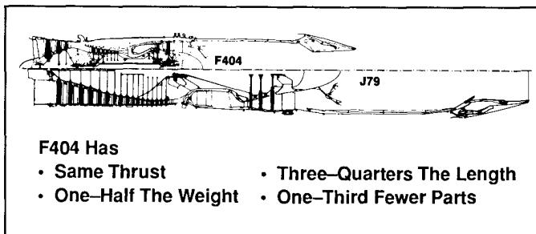

Technical illustration of the F404 and J79 jet engines. The F404 is shown on the left, and the J79 is shown on the right, with a dashed line indicating a comparison of their lengths. The F404 is significantly shorter than the J79.

Figure 2 F404 Technology Payoff

### Production Programs

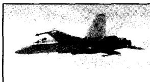

A black-and-white, high-contrast photograph of a fighter jet flying towards the left, enclosed within a rectangular border.

Photo: A military jet aircraft in flight viewed from the side.

McDonnell Douglas F/A-18

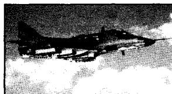

A black-and-white, high-contrast photograph of a fighter jet flying towards the right, carrying external ordnance or fuel tanks under its wings.

Photo: A military jet aircraft in flight with external stores.

Singapore A-4

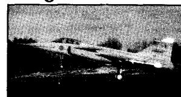

A black-and-white, halftone photograph of a twin-engine propeller aircraft positioned on a dark ground surface with trees in the background.

Photo: A twin-engine propeller airplane on a runway or taxiway.

Swedish JAS 39

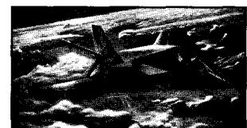

A black-and-white, high-contrast photograph showing a jet aircraft in flight with its tail fin and wings visible against a background of terrain and sky.

Photo: A military jet aircraft flying over a landscape.

Lockheed F-117 A

### Demonstrators

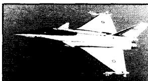

A black-and-white photograph shows a fighter jet angled toward the left, viewed from the rear and side, with visible markings and insignia on its fuselage and wings.

Photo: A military fighter jet in flight against a dark background.

French Rafale

A black and white photograph of a space shuttle in flight, angled upwards and to the right, with its solid rocket boosters deployed. The shuttle is white with dark markings on the nose and tail. The background is a dark, grainy texture, likely representing the sky or a long exposure of the Earth's surface.

Grumman X-29

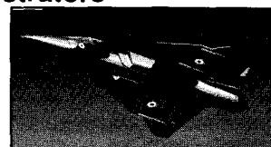

A black and white photograph of a dark, angular object, possibly a piece of furniture or a mechanical part, with a small circular detail on it.

India LCA

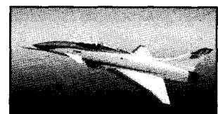

A black-and-white, halftone photograph of a sleek, delta-winged supersonic aircraft banking in flight against a dark background.

Photo: A supersonic aircraft in flight.

Rockwell X-31A EFM

### Production Prototypes / Potential Applications

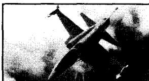

A black and white photograph of a military jet aircraft in flight, banking sharply to the left. The aircraft is silhouetted against a bright, hazy background, likely from a sunrise or sunset. The image is framed by a thick black border.

Northrop F-20

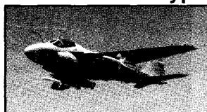

A black-and-white, high-contrast photograph of a military jet aircraft flying towards the left against a dark background.

Photo: A military jet aircraft in flight.

Grumman A-6F

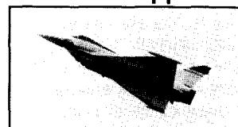

A black and white photograph of a stealth-like fighter jet in flight, angled upwards and to the left. The jet has a dark, angular, and faceted design, characteristic of stealth technology. The background is a light, textured sky.

Advanced Fighters

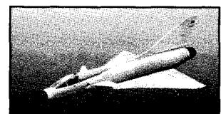

A black-and-white photograph shows a flying-wing stealth aircraft with a pointed nose and a vertical stabilizer fin at the rear, viewed from a low angle against a dark background.

Photo: A stealth or flying-wing aircraft in flight.

Aircraft Upgrades

Figure 3 F404 Aircraft Applications

{2}------------------------------------------------

and careful layout of controls and accessories has resulted in exceptional maintainability, both installed and in the shop. The stall-free performance without throttle restrictions has been consistently praised by pilots. And the ongoing initiatives to reduce engine manufacturing cost have resulted in a continuous decline in selling price to the customer, as shown in Figure 5.

The F404 continues to be selected for new installations because of its outstanding operational performance, reliability and maintainability characteristics, its low development, acquisition and operating cost, and its flexible adaptability to the varying mission requirements imposed by the various aircraft installations.

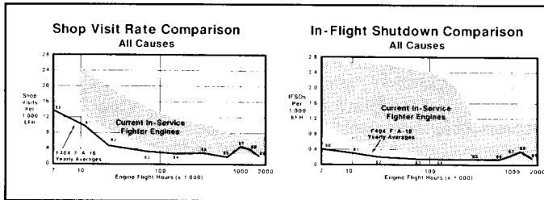

Shop Visit Rate Comparison  
All Causes  
Current In-Service Fighter Engines  
F404 F/A-18 Yearly Averages  
In-Flight Shutdown Comparison  
All Causes  
Current In-Service Fighter Engines  
F404 F/A-18 Yearly Averages

x: Engine Flight Hours (x 1,000), 7 to 2000; y: Shop Visits Per 1,000 (LH), 0 to 28; y: IFSDs Per 1,000 b/H, 0 to 2.8

| Engine Flight Hours (x 1,000) | F404 F/A-18 Yearly Averages | Current In-Service Fighter Engines |
|-------------------------------|-----------------------------|------------------------------------|
| 7                             | ~14.5                       | ~12.5                              |
| 10                            | ~10.5                       | ~10.5                              |
| 100                           | ~1.5                        | ~1.5                               |
| 1000                          | ~1.0                        | ~1.0                               |
| 2000                          | ~1.0                        | ~1.0                               |

| Engine Flight Hours (x 1,000) | F404 F/A-18 Yearly Averages | Current In-Service Fighter Engines |
|-------------------------------|-----------------------------|------------------------------------|
| 7                             | ~0.35                       | ~0.35                              |
| 10                            | ~0.25                       | ~0.25                              |
| 100                           | ~0.15                       | ~0.15                              |
| 1000                          | ~0.10                       | ~0.10                              |
| 2000                          | ~0.10                       | ~0.10                              |

Two scatter and line charts showing shop visit rate and in-flight shutdowns per 1,000 b/H decreasing as engine flight hours increase from 7 to 2000.

Multi-panel chart: Comparison of shop visit rate and in-flight shutdowns versus engine flight hours.

Figure 4 F404 Reliability

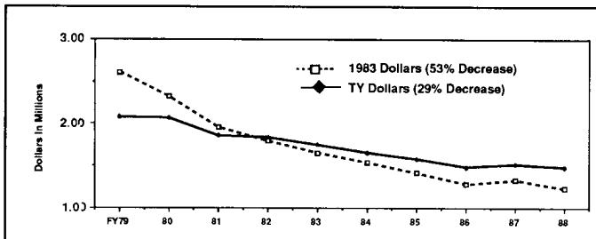

x: fiscal year, FY79 to 88; y: Dollars in Millions, 1.00 to 3.00

| Fiscal Year | 1983 Dollars (53% Decrease) | TY Dollars (29% Decrease) |
|-------------|-----------------------------|---------------------------|
| FY79        | ~2.60                       | ~2.05                     |
| 80          | ~2.30                       | ~2.05                     |
| 81          | ~1.95                       | ~1.85                     |
| 82          | ~1.80                       | ~1.80                     |
| 83          | ~1.60                       | ~1.70                     |
| 84          | ~1.50                       | ~1.65                     |
| 85          | ~1.40                       | ~1.55                     |
| 86          | ~1.25                       | ~1.45                     |
| 87          | ~1.30                       | ~1.50                     |
| 88          | ~1.20                       | ~1.45                     |

A line chart showing a downward trend in dollars in millions from FY79 to FY88 for both 1983 dollars and TY dollars, with 1983 dollars experiencing a steeper decline.

Line chart: Comparison of dollars in millions from FY79 to FY88.

Figure 5 F404 Production Engine Cost

## LESSONS LEARNED IN OPERATIONAL EXPERIENCE

Several key lessons learned from operational use of the F404 relative to the initial design are described below and illustrated in Figure 6.

The afterburner nozzle outer flaps and seals experienced early joint wear caused by a combination of the unique configuration of the F/A-18 boattail and the leading edge extension (LEX) vortices which also excited the aircraft vertical tails. The impact of this type of installation effect is extremely difficult to predict, model, or factory engine test cost-effectively. Instead, operational experience was used to develop the shingled outer flap design which combined the flap and seal into a single part while incorporating improved joints and wear strips. These improvements will be included in future F404 engine designs.

The afterburner liner design has been proven to have good aerothermodynamic performance and life characteristics. Unlike previous designs such as the original J85 which used axial rods for assembly of the liner sections and for buckling strength, the F404 liner is a brazed band assembly which depends upon circumferential stiffening rings for buckling strength. As the F404 reached the 1 million engine flight hour plateau, several incidents occurred in the high Mach number/low altitude regime, in which a high pressure differential across the liner resulted in buckling of the liner. The problem was solved by retrofitting the liners with increased strength stiffening rings, which have flown without incident since 1988.

At virtually the same 1 million engine flight hour mark in 1987, compressor rotor blade failures caused by aeromechanical vibration, foreign object damage (FOD) or maintenance assembly errors resulted in enough debris to rub through the casing wear coating and cause friction-induced titanium fires which burned/melted through the titanium compressor casing and fan outer duct. The problems were solved by the introduction of improved design stage 1 and 3 compressor blades and variable geometry vane lever arms. A unique viton rubber coating was also applied to the inside of the titanium outer duct. This coating was proven in bench testing to inhibit the melt-through of this duct, thereby reducing potential damage to the aircraft. The viton-coated titanium outer duct was a short-term solution to the molten titanium containment problem and was retrofitted on all field engines. It has now been replaced in production by a PMR-15 composite outer duct. This part, in development for several years under a U.S. Navy sponsored Manufacturing Technology program to reduce weight and cost relative to the chemically-milled titanium version, has proven to have superior fire resistance properties. In addition, an M152 steel compressor casing has been qualified to replace the titanium casing which will eliminate the possibility of titanium fires from jammed debris. The change to the steel casing and composite duct results in a net weight increase of only one pound.

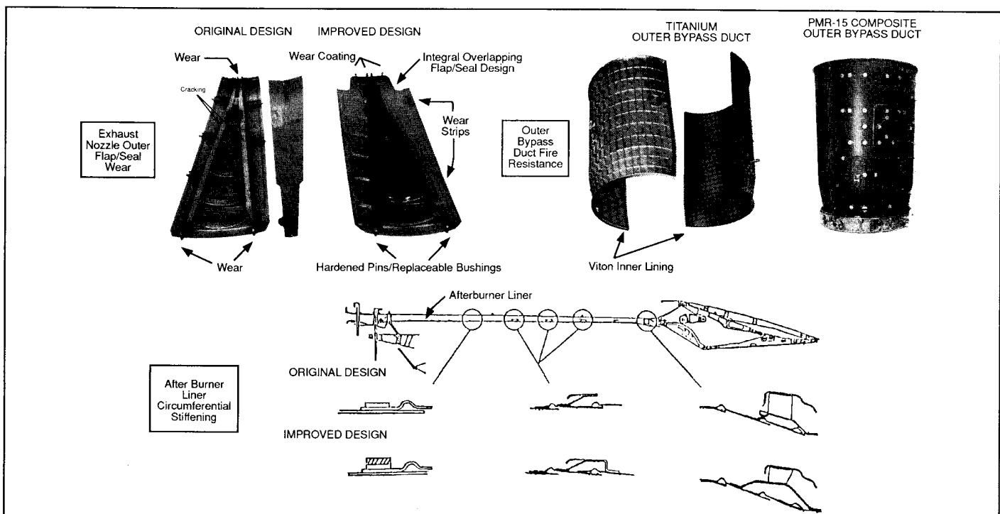

ORIGINAL DESIGN  
IMPROVED DESIGN  
TITANIUM  
OUTER BYPASS DUCT  
PMR-15 COMPOSITE  
OUTER BYPASS DUCT  
Wear  
Wear Coating  
Integral Overlapping  
Flap/Seal Design  
Cracking  
Wear  
Strips  
Exhaust  
Nozzle Outer  
Flap/Seal  
Wear  
Outer  
Bypass  
Duct Fire  
Resistance  
Wear  
Hardened Pins/Replaceable Bushings  
Viton Inner Lining  
Afterburner Liner  
ORIGINAL DESIGN  
After Burner  
Liner  
Circumferential  
Stiffening  
IMPROVED DESIGN

Technical diagrams comparing original and improved designs for an exhaust nozzle outer flap/seal, a titanium outer bypass duct, a PMR-15 composite outer bypass duct, and an afterburner liner with circumferential stiffening.

Technical illustration: Comparison of original and improved designs for exhaust nozzle, bypass duct, and afterburner liner.

Figure 6 F404 Lessons Learned

{3}------------------------------------------------

The lesson learned from these two relatively high time failures is that subtle changes in aircraft usage and engine characteristics over time can result in problems which could not have been discovered under even the most exhaustive factory test program. The advantage of the mature F404 engine is that these subtleties have been discovered through operational experience and are being taken into account with relative confidence in designing subsequent derivative engines, such as the F404-GE-402 and F412-GE-400. As shown in Figure 4, F404 reliability was back on track in 1989, proving the effectiveness of these design improvements.

The F404 control system has also contributed to the success of the engine by being easily adaptable to various afterburning and non-afterburning aircraft installations, by its “no-trim” capability and by its successful balance of performance, stall margin and life requirements. The F404 control system was designed to schedule core and fan speed and limit turbine exhaust temperature (T5). As the engine ages, fan speed and the T5 limit are maintained by increasing the variable exhaust nozzle area, resulting in a lower fan operating line which eventually results in reduced engine performance. With constant T5, engine operability and hot section life are maintained. In actual operation, the F404 control concept has been extremely successful. Although fleet average age is over 1000 flight hours, engine performance and stall-free operability remain outstanding and the full 2000 hour hot section life is expected to be achieved.

In summary, the F404 design has proven to be very flexible in adapting to its many aircraft installations without major changes to the basic design. The highly mature design of the engine, building on the experience of over 2 million flight hours, has also proven to be a strong base from which to launch reliable, low cost derivatives, as described in the following sections.

## F404 ADVANCED TECHNOLOGY PLAN

A systematic, product-oriented component technology development plan has been in place since the early 1980's to integrate advanced technology into current models and growth derivatives of the F404 in order to keep the engine on the leading edge of technology in its thrust class. This technology plan includes initiatives in the following areas:

- Growth Component/Engine Development and Test - For example, advanced fans, core engines, combustors, and afterburners.
- Advanced System Technology Development - For example, single engine reliability features, Full Authority Digital Electronic Controls (FADEC), fiber optic control systems technology, and Axisymmetric Vectoring Exhaust Nozzles (AVEN).
- Advanced Manufacturing/Materials Technologies - For example, thermal barrier coatings, complex structural and airfoil castings, composites, ceramics, monocrystal turbine blade and nozzle materials, and low aspect ratio integrally bladed disks (blisks).

These initiatives are combined with identified product requirements to create F404 engine derivatives of varying thrust levels. The F404/RM12, F404-GE-402 Enhanced Performance Engine (EPE) and the F412-GE-400 are examples of the first phase of this growth plan now under Full Scale Development. The following sections of this paper describe these three components of the F404 advanced technology plan, and ways they have been combined to define afterburning and non-afterburning F404 derivatives for the mid-1990's.

### Growth Component/Engine Development and Test

GE Aircraft Engines uses the proven “building block” approach to the development of growth engine derivatives of the F404. It should also be noted that the F404 draws on the technology base developed in other GEAE military engines such as the F101, F110 and F120 and from commercial engine experience on the CF6 and CFM56. For example, the original F404 compressor design was derived from the F101 engine and the F110 fan was subsequently derived from the F404 fan design. Subcomponent designs also draw on this technology base. For example, the shingled outer flap nozzle design described in the F404-GE-400 lessons learned section of this paper was developed from the successful F110 nozzle design. Higher temperature capability turbine materials to be used on F404 derivatives have also been developed for and are in production on other GEAE military and commercial engine programs. See Figure 7.

Since 1983, GEAE has conducted advanced fan, compressor, core engine, and full engine tests under the F404/RM12 and GEAE/U.S. Government sponsored Advanced Turbine Engine Gas Generator (ATEGG) and Joint Technology Demonstrator Engine (JTDE) programs as shown in Figure 8. The status of current F404 component development is described below.

Fans. Fan components defined for F404 afterburning derivatives include the original F404-GE-400 fan at 145 pounds per second (pps) airflow, the F404/RM12 fan at 160 pps airflow, and advanced fans at 170-180 pps airflow. Pressure ratios range from 4.2 to almost 5. These F404 derivative fans share the rugged, low aspect ratio, high pressure ratio, compact 3-stage design characteristics of the -400 fan and will maintain the exceptional distortion tolerance and attentuation characteristics demonstrated by the -400 fan in service. The F404/RM12 fan completed all Production Verification Tests (PVT) for production qualification under the JAS 39 program in August 1989 and has demonstrated distortion tolerance levels even better than the -400 fan, in addition to successfully demonstrating ingestion of a 1.1 pound bird. These qualification test results enhance confidence in GEAE design and performance prediction methodology for future F404 derivative fans.

{4}------------------------------------------------

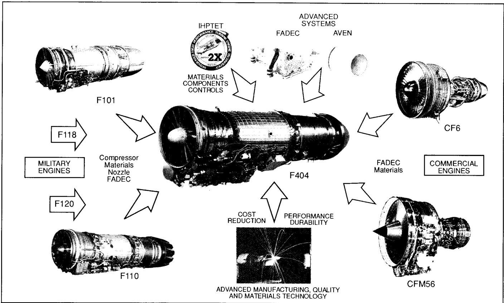

IHPTET  
ADVANCED  
SYSTEMS  
FADEC  
AVEN  
2X  
INFORMATION TECHNOLOGY  
MATERIALS  
COMPONENTS  
CONTROLS  
F101  
CF6  
F118  
MILITARY  
ENGINES  
Compressor  
Materials  
Nozzle  
FADEC  
F404  
FADEC  
Materials  
COMMERCIAL  
ENGINES  
F120  
COST  
REDUCTION  
PERFORMANCE  
DURABILITY  
F110  
CFM56  
ADVANCED MANUFACTURING, QUALITY  
AND MATERIALS TECHNOLOGY

A central photograph of the F404 engine is surrounded by arrows pointing inward from various military and commercial engines (F101, F118, F120, F110, CF6, CFM56) and associated technology areas.

Infographic: F404 engine development and technology contributions from military and commercial engines.

Figure 7 F404 Technology Base

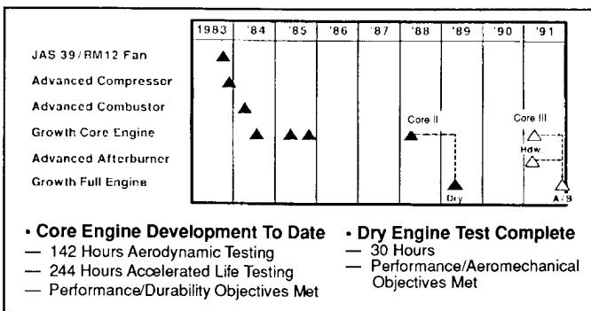

1983  
'84  
'85  
'86  
'87  
'88  
'89  
'90  
'91  
JAS 39 / RM12 Fan  
Advanced Compressor  
Advanced Combustor  
Growth Core Engine  
Advanced Afterburner  
Growth Full Engine  
Core II  
Core III  
Hdw  
Dry  
A-B  
• Core Engine Development To Date  
— 142 Hours Aerodynamic Testing  
— 244 Hours Accelerated Life Testing  
— Performance/Durability Objectives Met  
• Dry Engine Test Complete  
— 30 Hours  
— Performance/Aeromechanical Objectives Met

A timeline chart spanning 1983 to 1991 showing development milestones for various engine components, with a legend detailing core engine development and dry engine test completion criteria.

Timeline: Core engine development timeline and test milestones from 1983 to 1991.

Figure 8 F404 Technology Demonstrator Program

In addition to the above, studies of non-afterburning F404 derivatives have included fans in the 200-550 pps airflow classes for engines with bypass ratios from .8-5.0.

**Compressors/Core Engines.** Core sizes defined for F404 derivatives include the original F404-GE-400 engine core and the advanced technology Core II and Core III. Core II technology, characterized by +200°F (+111°K) turbine inlet temperature, +5% airflow and +2% high pressure turbine efficiency over the -400 model, was demonstrated under the ATEGG/JTDE programs in 1988 and 1989. Core III technology, characterized by +300°F (+167°K) turbine inlet temperature, +10% airflow, +2% compressor efficiency and +2% high pressure turbine efficiency compared to the -400, is to be demonstrated in core and full afterburning engine testing scheduled for 1991-92.

**Combustors.** Thermal barrier coatings on F404 combustor shells were demonstrated during component and engine testing under the F404-GE-100 engine program and were successfully flight tested in the F-20 Tigershark from 1983 to 1985. This technology has also been well proven on GEAE commercial engines and is being used on near term derivatives such as the F404/RM12 and F404-GE-402 EPE. The multihole combustor design, shown in Figure 9, was successfully demonstrated on the ATEGG/JTDE programs and promises substantial reductions in manufacturing cost, weight, and cooling requirements, with improved durability.

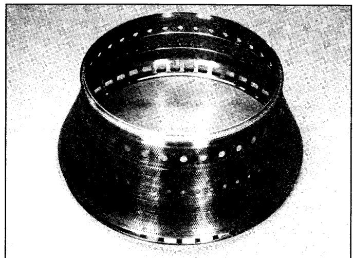

A black-and-white photograph shows a hollow, flared metal ring with a circular top rim, a wider base, and rows of small circular holes and rectangular notches along its inner and outer edges.

Photo: A conical metal ring component with perforations and notches.

Figure 9 Multihole Combustor Inner Shell

{5}------------------------------------------------

**Turbines.** Turbine technology research has focused on higher efficiency and turbine inlet temperature capability along with reduced cooling requirements. Among the technologies demonstrated on the ATEGG program are a 3% high pressure turbine (HPT) efficiency improvement, a simplified higher work capability HPT design with 1/3 fewer vanes and 10% fewer buckets, reduced cooling requirements through improved internal design and thermal barrier coated airfoils, ceramic shrouds, and improved clearance control. Monocrystal alloy material vanes and buckets have also been demonstrated on ATEGG/JTDE, F404-GE-400, F110, F120, and GE36 engines. A 3-vane F404/ATEGG nozzle segment with thermal barrier coating is shown in Figure 10.

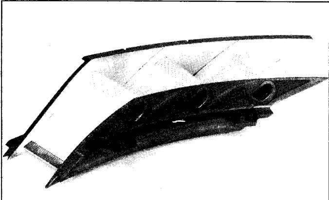

A black-and-white photograph shows a car's front bumper and grille assembly, featuring a dark lower bumper with circular air intakes and a lighter upper grille section.

Photo: Automotive front bumper and grille assembly.

Figure 10 3-Vane F404/ATEGG Turbine Nozzle

**Afterburners.** Near term growth afterburner development has been conducted principally under the F404/RM12 Full Scale Development program. Efficiency improvements of 5-6% have been demonstrated in official sea level and altitude tests by means of reduced cooling and optimized fuel distribution and mixing, while liner, flameholder and nozzle parts lives have been maintained by thermal barrier coatings and cooling pattern improvements. F404/RM12 afterburner configuration changes from the -400 are shown in Figure 11. A higher temperature capability afterburner for higher thrust F404 derivatives is scheduled for demonstration on the JTDE program in 1991-92.

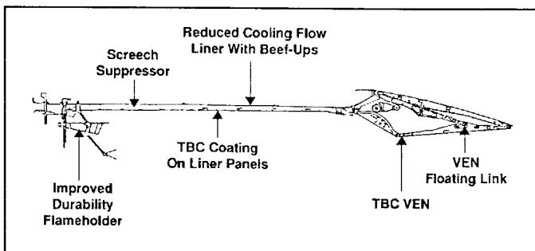

Reduced Cooling Flow  
Liner With Beef-Ups  
Screech  
Suppressor  
TBC Coating  
On Liner Panels  
VEN  
Floating Link  
TBC VEN  
Improved  
Durability  
Flameholder

A longitudinal cross-section of a scramjet engine showing internal components including the flameholder, screech suppressor, TBC-coated liner panels, beef-ups, and the floating link with TBC VEN.

Technical illustration: Cross-sectional diagram of a scramjet engine with labeled components.

Figure 11 RM12/-402 Afterburner Configuration

### F404 Growth Engine Derivatives in Development

The F404/RM12, F404-GE-402 Enhanced Performance Engine, and F412-GE-400 are examples of GEAE's building block approach to F404 growth derivatives now undergoing Full Scale Development. In addition, the F404/F2J3 has completed flight qualification to power the prototype Indian Light Combat Aircraft (LCA).

**F404/RM12.** The F404/RM12 engine, rated at 18,100 pounds (80 kN) thrust, makes use of the proven -400 engine core with minor modifications to hardware, materials and cooling flows, primarily to handle the higher operating temperatures of the engine. This program is developing and qualifying the 160 pps airflow fan and improved efficiency afterburner as described previously. The F404/RM12 also makes use of a Digital Electronic Control and single engine reliability features as described in the Advanced Systems Technology section of this paper. A complete description of this engine and its associated development program may be found in Reference (2).

**F404-GE-402 Enhanced Performance Engine (EPE).** The F404-GE-402 EPE was defined in response to customer interest in improved F/A-18 time-to-climb and combat performance and will become the standard F/A-18 powerplant beginning in 1992. The engine has so far been specified for U.S. Navy, Swiss, Kuwaiti and Korean Hornets. The -402 model will be rated at 17,700 pounds (79 kN) thrust at sea level static conditions and will provide up to a 10-20% increase in installed thrust over the -400 model in key areas of the envelope, providing significant performance improvement for the F/A-18 at key combat conditions as shown in Figure 12.

| • Specific Excess Power, $P_s$     | <u>Improvement</u> |
|------------------------------------|--------------------|
| — 0.9M/10k/1G/Max Power            | 18%                |
| • <b>Sustained Gs</b>              |                    |
| — 0.65M/10k/Max Power              | 2%                 |
| • <b>Time To Accelerate</b>        |                    |
| — 0.8M to 1.2M/35k/Max Power       | 5% (Time Reduced)  |
| — 0.8M to 1.6M/35k/Max Power       | 27% (Time Reduced) |
| • <b>Mmax</b>                      |                    |
| — 10k/Intermediate Power           | 1%                 |
| • <b>Time To Climb/Intercept</b>   |                    |
| — From Brake Release to 1.4M/50k   | 31% (Time Reduced) |
| <b>No Change In Mission Radius</b> |                    |

Figure 12 F/A-18 Performance Improvement with -402 EPE

Full Scale Development is being executed under a unique partnership arrangement between McDonnell Douglas, GEAE, and the U.S. Navy whereby development costs, hardware and engine/aircraft testing are shared by the three parties. The U.S. Navy is the U.S. Government authority for specification requirements and production qualification.

The -402 engine configuration philosophy was driven by the following development criteria:

- Meet minimum time-to-climb performance - driven by the international competitive environment where the F/A-18 is frequently designated as the first line interceptor
- Maintain existing F/A-18 inlet and engine bay configuration
- Maintain 2000 hour U.S. Navy mission hot section life
- Maximize engine parts commonality with existing -400 and F404/RM12 programs to reduce development cost and logistics impact.

The increased thrust of the -402 model will be achieved by increasing fan speed up to 2%, improving afterburner efficiency and raising turbine inlet temperature by +100°F (+56°K) at intermediate rated power, increasing to +175°F (+97°K) at maximum power. The dual level temperature schedule concept was developed to maintain the 2000 hour hot section life in the U.S. Navy mission.

{6}------------------------------------------------

Consistent with the building block approach, the -402 will use the -400 fan and F404/RM12 afterburner with hot section materials changes made to meet the hot section life requirement. Figure 13 shows the basic configuration changes made to the engine. Details of these changes are highlighted below:

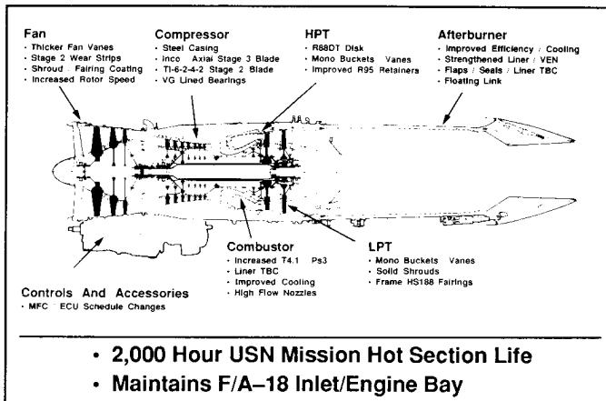

The diagram is a side-profile view of a jet engine. It features several callout lines pointing to specific parts:

- Fan:** Points to the front section of the engine.
  - Thicker Fan Vanes
  - Stage 2 Wear Strips
  - Shroud / Fairing Coating
  - Increased Rotor Speed
- Compressor:** Points to the section after the fan.
  - Steel Casing
  - Inco / Axial Stage 3 Blade
  - Ti-6-2-4-2 Stage 2 Blade
  - VG Lined Bearings
- HPT (High Pressure Turbine):** Points to the top section of the turbine.
  - R88DT Disk
  - Mono Buckets / Vanes
  - Improved R95 Retainers
- Afterburner:** Points to the rear section of the engine.
  - Improved Efficiency / Cooling
  - Strengthened Liner / VEN
  - Flaps / Seals / Liner TBC
  - Floating Link
- Combustor:** Points to the section between the compressor and the turbine.
  - Increased T4.1 Ps3
  - Liner TBC
  - Improved Cooling
  - High Flow Nozzles
- LPT (Low Pressure Turbine):** Points to the bottom section of the turbine.
  - Mono Buckets / Vanes
  - Solid Shrouds
  - Frame HS188 Fairings

**Controls And Accessories**

- MFC / ECU Schedule Changes

---

• **2,000 Hour USN Mission Hot Section Life**

• **Maintains F/A-18 Inlet/Engine Bay**

Technical illustration of a jet engine with callouts for various components and their descriptions.

Figure 13 F404-GE-402 Configuration

- Fan - thickened stage 1 & 2 vanes for improved aeromechanical margin
- Compressor - stage 2 & 3 blade material change to accommodate increased temperatures
- Combustor - thermal barrier coating, high flow fuel nozzles, modified casing for improved engine hot parts cooling
- HP Turbine - Monocrystal alloy material nozzles and buckets (both of which maintain the -400 aerodynamic/cooling design), improved process R95 material forward and aft blade retainers, improved powder metal alloy material disk
- LP Turbine - Monocrystal alloy material nozzles/buckets
- Afterburner - F404/RM12 design (as described in previous section)

The decision to use the -400 fan instead of the F404/RM12 fan was consistent with the -402 configuration philosophy. Although the F404/RM12 fan would have provided greater thrust in the upper left corner of the envelope, the -400 fan provided sufficient flow in the low and central portions of the envelope where the engine was temperature, not airflow, limited. This better matched the optimum intercept time-to-climb profile of the aircraft. In addition, the need for significant inlet compatibility testing for the F404/RM12 fan in the F/A-18 was avoided, which would have increased the development flight test expense considerably.

Another significant feature of the selected configuration was the emphasis on fit and function interchangeability of improved -402 part designs in the -400 engine. This will provide the option for current users of the F404 engine to improve the life capability of their current engines by selective replacement of -400 parts with the -402 design if they do not wish to completely upgrade their engines to the -402 configuration. For example, the -402 HPT bucket maintains the mechanical and aerodynamic configuration of the -400 design, so use of the

improved material -402 design will result in a significant improvement in bucket life if operated at the -400 cycle conditions. This also makes it possible to upgrade -400 engines to the full -402 configuration and performance level at the hot section replacement interval at only the incremental cost of the -402 unique parts versus the regular -400 parts replacement cost.

The engine Full Scale Development program schedule is shown in Figure 14. Five engines will accumulate over 3000 test hours covering stress, vibration, overtemperature (O/T), Accelerated Simulated Mission Endurance Testing (ASMET), Fighter Accelerated Mission Testing (FAMT), durability, Preliminary Flight Qualification (PFQ), Limited Production Qualification (LPQ), and Full Production Qualification (FPQ) requirements. These requirements are able to be met with this relatively small quantity of test hours because of the extensive component and material development testing performed under other initiatives and because of the minimum configuration changes incorporated on the -402.

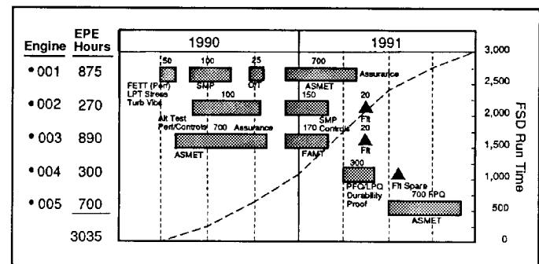

1990  
1991  
50  
100  
25  
700  
FETT (PMT)  
LPT Stree  
Turb V104  
SMP  
100  
Off  
ASMET  
150  
20  
Ft  
20  
Ft  
20  
Aix Test  
Fert/Controls  
700  
Assurance  
SMP  
170  
Control  
ASMET  
FAMT  
300  
Ft/LPQ  
Durability  
Proof  
Ft Spare  
700 RPQ  
ASMET

y: FSD Run Time, 0 to 3,000

| Engine | EPE Hours |
|--------|-----------|
| •001   | 875       |
| •002   | 270       |
| •003   | 890       |
| •004   | 300       |
| •005   | 700       |
|        | 3035      |

A combination chart showing EPE hours in a table on the left and FSD run time in a bar and dashed line chart on the right, categorized by engine numbers from 1990 to 1991.

Bar chart: EPE hours and FSD run time across engines from 1990 to 1991.

Figure 14 F404-GE-402 Development Test Plan

Only a limited flight test program will be required to qualify the -402 in the F/A-18. No aircraft structural or inlet ducting modifications are necessary and only minor changes will be required in the aircraft software for engine condition monitoring, and autothrottle limits. Since the software modification will allow the installation of either a -400 or -402 engine in an F/A-18, a discrete signal will also be provided to identify which model engine is installed and to provide a caution against the installation of a -402 and -400 engine in the same aircraft. The flight test program will consist of some 55 hours covering engine/airframe compatibility, engine operability, carrier suitability, single engine operation, and performance verification.

**F412-GE-400.** The F412 engine, a derivative F404 design optimized for the U.S. Navy's A-12 Advanced Tactical Aircraft, will incorporate many of the technologies demonstrated under the ATEGG/JTDE programs, including the advanced Core II compressor, multihole combustor, turbine aerodynamics, and monocrystal turbine materials. The engine also includes design improvements based on the lessons learned from F404 operating experience to enhance reliability, maintainability and safety, many of which could not be cost-effectively retrofitted into the operational F404-GE-400 engine.

The medium bypass engine will employ an advanced 3-stage 200 pps airflow fan scaled from the -400 design with improved birdstrike, ice and FOD resistance. The increased flow 7-stage high pressure compressor section incorporates a steel compressor case and composite fan bypass duct for improved safety. The combustor's multihole design with "wavy wall" outer shell and a bolted dome produces a light, low cost component with a more uniform temperature profile which eliminates the need for thermal barrier coating. The 2-stage low pressure turbine design is derived from the high efficiency F110 design.

{7}------------------------------------------------

The engine control system features an advanced Full Authority Digital Electronic Control (FADEC) with a fail-operational backup system. The FADEC incorporates extensive troubleshooting capability to improve maintainability and reduce life cycle costs. This capability includes control system fault isolation at the squadron maintenance level, as well as intermediate maintenance testability down to the subcomponent level.

F412 Full Scale Development engine testing, which began in 1989, consists of over 9000 qualification test hours. This program will qualify many F404 growth components, such as the advanced compressor, combustor and turbine designs, which will then be available for other afterburning and non-afterburning F404 derivatives for the middle 1990's, thus reducing the cost and risk of these derivative engines.

**F404/F2J3.** This engine utilizes the F404/RM12 fan at the full 160 pps airflow rating, the -400 core with F404/RM12 modifications, and an F404/RM12 afterburner. The engine uses the -100/-100D gearbox and control system hardware with single engine features (described in the Advanced Systems section of this paper). The engine cycle has been optimized for the hot day temperatures of India. Flight Worthiness Testing was completed on this engine in 1989, including altitude testing, and flight test engines are being delivered to India for the Light Combat Aircraft (LCA) flight test program.

### F404 Growth Engines Under Study

The F404 family growth roadmap is shown in Figure 15. The F404 Growth II and Growth III engine configurations have undergone intensive study over the last two years in conjunction with increased interest in the McDonnell Douglas/U.S. Navy Hornet 2000 studies as well as for other aircraft applications. The precise cycles, configurations and advanced system features of these engines will be determined by customer requirements in areas such as sustained supersonic cruise capability, low observables, high horsepower extraction for offensive and defensive avionics, and vectoring nozzles. These engines will make use of the building block approach to reduce development risk and cost. Users can have confidence in performance predictions due to the significant component development testing that has been completed, is underway or contemplated.

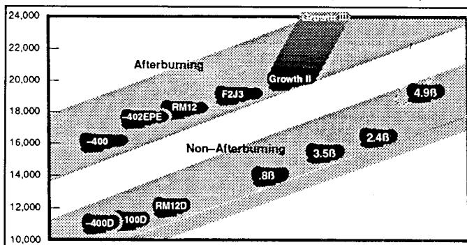

Growth III  
Afterburning  
Growth II  
F2J3  
4.9B  
RM12  
-402EPE  
2.4B  
-400  
Non-Afterburning  
3.5B  
.8B  
RM12D  
-400D  
100D

y: 10,000 to 24,000

| Aircraft   | Value   |
|------------|---------|
| -400       | ~16,000 |
| -402EPE    | ~17,500 |
| RM12       | ~18,000 |
| F2J3       | ~19,000 |
| Growth II  | ~20,000 |
| Growth III | ~23,500 |
| -400D      | ~11,500 |
| 100D       | ~11,500 |
| RM12D      | ~12,000 |
| .8B        | ~14,000 |
| 3.5B       | ~16,000 |
| 2.4B       | ~17,000 |
| 4.9B       | ~19,000 |

A two-dimensional plot showing aircraft models positioned within bands for Afterburning and Non-Afterburning categories, with values indicated in billions of dollars.

Other chart: Comparison of aircraft models by value and afterburning capability.

Figure 15 F404 Family Growth Roadmap

**F404 Growth II.** Growth II models currently defined are in the 8.5-9 thrust-to-weight ratio class. One design utilizes the F404/RM12 fan scheduled at 160 pps airflow and the Core II technology core coupled with an advanced low pressure turbine and afterburner to produce 20,000 pounds (89 kN) of thrust. A more powerful version of Growth II utilizes a 170 pps airflow fan and either Core II or Core III technology to produce an engine in the 21,500-23,000 pounds (96-102 kN) thrust class. The control system will be commanded by a FADEC derived from the F412 FADEC.

**F404 Growth III.** The Growth III model utilizes a 180 pps airflow fan and the Core II technology core coupled with an advanced low pressure turbine, afterburner and FADEC to produce 22,500 pounds (100 kN) thrust. A higher thrust version of Growth III, in the 9.5:1 thrust-to-weight ratio class, is also under study coupling the Core III technology core with the 180 pps fan to produce over 24,000 pounds (107 kN) of thrust. Growth II and III technology engines are depicted in Figure 16.

#### **+25–50% Takeoff Thrust**

### **Utilizes Components From Other Development/ Demonstrator Programs**

- RM12 (160 pps) or 170–180 pps Airflow Fans
- Advanced Core II or III
- Advanced LPT, Afterburner
- FADEC

### **Advanced System Options**

- Conventional, 2DCD, AVEN Exhaust Nozzles
- Single Engine Features

### **Production Potential: 48-54 Months After Go**

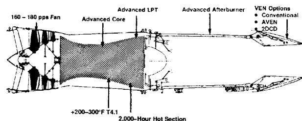

Advanced LPT  
Advanced Afterburner  
VEN Options  
160 - 180 pps Fan  
Advanced Core  
• Conventional  
• AVEN  
• 2DCD  
23 g  
+200-300°F T4.1  
2,000-Hour Hot Section

A horizontal cross-section of a jet engine showing internal components from the fan on the left to the afterburner on the right, with callouts indicating the advanced core, LPT, afterburner, and VEN options.

Technical illustration: Cross-sectional diagram of an advanced jet engine with labeled components and options.

**20,000 — 24,000 Lbs Thrust**

Figure 16 F404 Growth II and III

Advanced system options for Growth II and III model engines include conventional, two-dimensional convergent-divergent (2DCD) or AVEN exhaust nozzles and single engine features. Growth II and III technology engines are depicted in Figure 16.

Figure 17 summarizes the unmatched test experience gained in F404 derivative qualification and component technology programs which will serve to greatly reduce the cost and risk of a Full Scale Development program of either the Growth II or Growth III model engines.

{8}------------------------------------------------

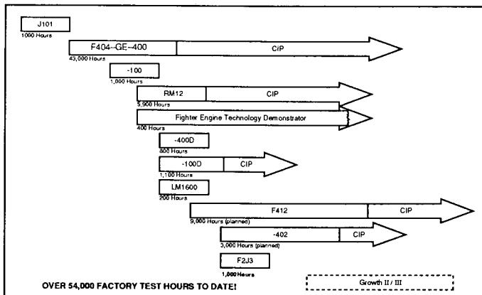

J101  
1000 Hours  
F404-GE-400  
CIP  
43,000 Hours  
-100  
1,000 Hours  
RM12  
CIP  
5,000 Hours  
Fighter Engine Technology Demonstrator  
400 Hours  
-400D  
800 Hours  
-100D  
CIP  
1,100 Hours  
LM1600  
200 Hours  
F412  
CIP  
9,000 Hours (planned)  
-402  
CIP  
3,000 Hours (planned)  
F2J3  
1,000 Hours  
Growth II / III  
OVER 54,000 FACTORY TEST HOURS TO DATE!

A horizontal Gantt chart showing scheduled and actual factory test hours for programs J101, F404-GE-400, RM12, Fighter Engine Technology Demonstrator, LM1600, F412, and F2J3, with a total of over 54,000 hours.

Timeline: Gantt chart of factory test hours to date for various engine programs.

Figure 17 F404 Engine Test Experience

### Advanced System Technology

A second area emphasized in the F404 technology development plan is integration of advanced system technology into current and future derivative engines. The following examples describe advanced system features which are either incorporated in existing F404 models, are under Full Scale Development, or are under study for incorporation on future F404 models.

**Single Engine Features.** Single Engine Features (SEF) were developed to reduce or eliminate the consequences of control system component or sensor failures in a single engine aircraft application. The system architecture was developed under the F404-GE-100/F-20 and F404/RM12/JAS 39 programs and is also being used in the F404-GE-100D/A-4S-1 production program and the F404/F2J3/India LCA development program. The original -400 control system consists of two main control components: a hydromechanical Main Fuel Control (MFC) and the Electrical Control Unit (ECU). The SEF design includes an MFC Backup mode in a Digital Electronic Control (DEC), which provides full authority electrical control in the event of hydromechanical failures, and a DEC Disable mode which provides hydromechanical backup in the event of electrical sensor or DEC failures. In addition, there are modes to limit failure-caused overspeed, overtemperature, and fan variable geometry system problems. The system also features dual exciters and main igniter plugs, and gearbox pads for backup aircraft hydraulic and generator components. Besides ensuring sufficient power to return the aircraft safely, these features provide nearly full mission capability of the engine in the event of control system failures.

**FADEC.** GEAE is using the lessons learned from nearly 10 years of development, test, flight test, and operational use of digital controls in both military (F404, T700, F110, F120, T407, LV100) and commercial (CF6-80, CFM56) applications to develop the F412 FADEC system architecture, hardware and software. In particular, the fail-operational architecture of the design was heavily influenced by software/hardware experience gained during development and operational use of the F404-GE-100/-100D/RM12 control systems and by the F110-GE-129 FADEC design now in production. The FADEC design incorporates fault isolation circuitry and a digital databus to allow monitoring and analysis of engine control system faults on the aircraft cockpit displays or through a ground station without opening engine access doors. The circuitry can distin-

guish between faults in the control system sensors/cabling and in the FADEC to avoid unnecessary and expensive removal and troubleshooting of the control when it is not at fault. In addition, the plug-in circuit card design eliminates potting and incorporates multiple test points to allow troubleshooting of individual circuit card subcomponents, providing exceptional troubleshooting and repair capability at the intermediate maintenance level.

The qualification of this FADEC design will significantly reduce cost and risk of developing a derivative control system for the F404 Growth II or Growth III engines. FADEC control systems are uniquely suited to the future demands of increasing integration of aircraft and engine control systems and to improved control system diagnostic capability.

**Fiber Optic Control System Development.** Fiber optic control system components and system architecture are promising areas for technology development for advanced engine designs due to their inherent immunity to Electro-Magnetic Interference (EMI), low weight, low cost and improved response and bandwidth capability compared to components and cabling designed with metallic conductors. Optical technologies/materials also are uniquely suited to the aircraft engine environment because of their high temperature capability. GEAE has been involved in ongoing development and assessment of these technologies since the early 1980's and participated in the NASA sponsored Fiber Optic Control System Integration (FOCSI) contract study between 1985 and 1987, followed by a contract aimed at optimizing the architecture of an electro-optical control system. GEAE recently won a sole-source 3-year contract for the NASA FOCSI II initiative which will design and test a prototype passive optics and electro-optics control system which will be tested on an F404 engine in an F/A-18 test aircraft. GEAE was also selected to participate in the Phase I Opto-Electronic Control program sponsored by the U.S. Navy's Broad Agency Announcement. The goal of this program is to develop and build an active engine control system. A prototype optical T5 sensor, now on test in an F404, is shown in Figure 18.

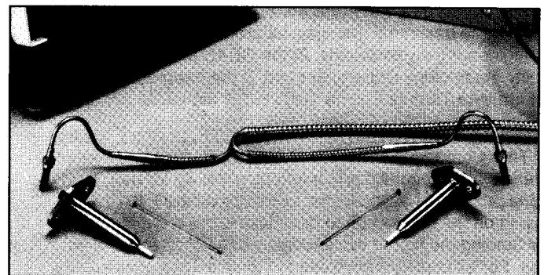

A black-and-white photograph shows two metallic probes with attached coiled wires lying horizontally, accompanied by two small thin pins placed between them on a textured surface.

Photo: Two metal probes with attached wires and small pins on a surface.

Figure 18 Fiber Optic F404 T5 Sensor Prototype

**Axisymmetric Vectoring Exhaust Nozzle (AVEN).** A final example of advanced system technology under development at GEAE is the AVEN. The GEAE concept design features pitch/yaw vectoring capability around a 360 degree arc and independent A8 and A9 variability. Studies including aircraft simulator work have demonstrated significant operational performance benefits of vectoring in addition to the added benefit of improved overall engine performance of independent A8/A9.

{9}------------------------------------------------

The configuration of this nozzle design also lends itself to retrofit on current aircraft installations because of its similarity to the current F404 nozzle design. See Figure 19.

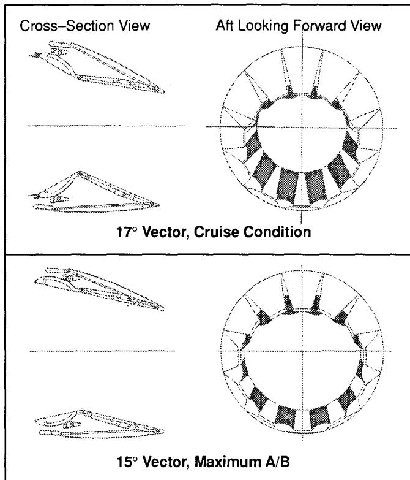

Cross-Section View  
Aft Looking Forward View  
17° Vector, Cruise Condition  
15° Vector, Maximum A/B

A two-part technical diagram showing cross-section views on the left and aft-looking-forward views on the right of a propeller blade configuration at 17° vector (cruise) and 15° vector (maximum A/B).

Technical illustration: Cross-section and aft looking forward views of a propeller at 17 and 15 degrees vector.

Figure 19 Axisymmetric Vectoring Exhaust Nozzle (AVEN)

### Advanced Manufacturing/Materials Technology

The third element of the F404 technology development plan is the development and incorporation of advanced manufacturing methods and materials to reduce engine cost and weight and improve engine performance. GEAE has been carrying out initiatives in these areas through three integrated paths: 1) the traditional materials laboratories and manufacturing engineering organizations, 2) the GEAE Manufacturing & Quality Technology Department and 3) the Integrated High Performance Turbine Engine Technology initiative.

**Materials Laboratories/Advanced Manufacturing Engineering.** These organizations are tasked with developing advanced materials and manufacturing methods primarily for near term engine production applications. Initiatives on the F404 have focused on the hot section to develop materials capable of withstanding the higher cycle temperatures of the growth engines. For example, the evolution of the high pressure turbine bucket material from the original Rene 125 material, to directionally solidified DSR80H (for the -100, F404/RM12 and to improve life on the -400), to monocrystal alloy (for the -402 and F412). Other hot section materials developments include thermal barrier coated combustor, turbine, and afterburner components, and ceramic shrouds.

Casting technology development has been of particular interest, not only to develop the methods to cast the intricate turbine bucket cooling passages, but also to reduce the cost and weight of the engine. For example, a titanium version of

the INCO 718 midframe, which is manufactured from a large casting and designed to save 30 pounds of weight, is in production for the -100D model and may be specified on other F404 models. A similar design is used on the F412 engine. All-cast versions of the Rene 41 engine nozzle flaps and seals are expected to reduce the shop cost of these parts versus the fabricated sheet metal versions by over 10%, as shown in Figure 20.

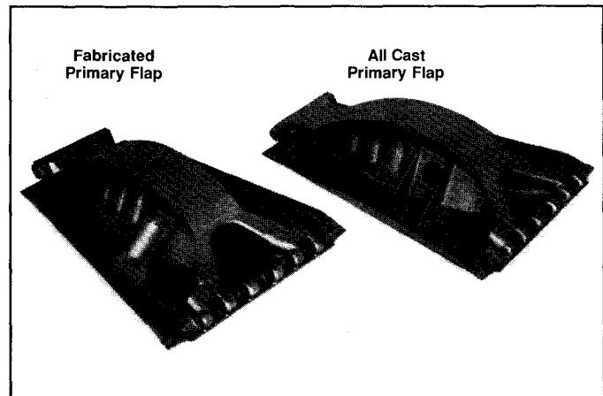

Fabricated  
Primary Flap  
All Cast  
Primary Flap

A photograph showing two dark, contoured primary flaps side by side, labeled Fabricated Primary Flap on the left and All Cast Primary Flap on the right.

Photo: Comparison of fabricated primary flap and all cast primary flap.

Figure 20 F404 Subcomponent Cost Reduction  
— Exhaust Nozzle Primary Flap

The previously-mentioned composite fan outer bypass duct is another example of advanced materials development now in production -400 engines and specified for the -402 model and F412 derivative engines to reduce weight and improve safety.

**Manufacturing and Quality Technology Department.** The M&QTD is tasked with developing advanced manufacturing methods to ensure cost and quality superiority of GEAE products and to assure the producibility of new engine materials and designs. Once developed by the M&QTD, these technologies are integrated into the product design during the engineering phase or incorporated into product-specific manufacturing processes at the individual manufacturing/production facility. Examples of manufacturing/quality methods developed by the M&QTD in use on the F404 include laser drilling of cooling holes in combustors and turbine buckets/vanes, X-Ray Computed Tomography inspection of internal cooling cavities of turbine blades, and eddy current parts inspection. These methods significantly increase productivity and reduce costs of F404 parts manufacturing. For instance, the cooling holes on a turbine nozzle vane can be laser drilled 4-5 times faster than with Electro-Discharge Machining (EDM).

Another area of interest to growth F404 engines is the manufacture of integrally-bladed disks (blisks). A blisk fan or compressor rotor provides significant benefits to engine performance, cost, and weight through the reduction of dovetail mass, part complexity and air leakage. GEAE has over 10 years' experience in the production of compressor rotor blisks for the T700 engine using both conventional 5-axis machining centers and Electrochemical Machining (ECM). The M&QTD is further developing processes to manufacture blisks by ECM and pressure welding processes. See Figure 21. F404 blisk fan and compressor rotors have been and will continue to be tested under the ongoing F404 Technology Demonstrator program, and are under development for the F120.

{10}------------------------------------------------

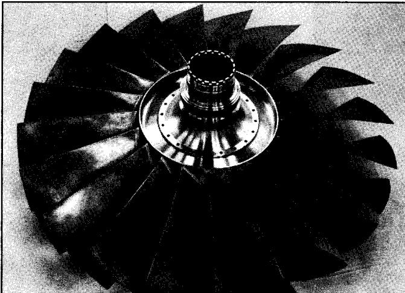

A black-and-white photograph shows a circular rotor assembly with numerous curved blades radiating from a central hub and disc.

Photo: A multi-bladed turbine or compressor rotor assembly.

Figure 21 Integrally Bladed Disk (Blisk)

Integrated High Performance Turbine Engine Technology (IHPTET). GEAE is participating in the IHPTET initiative of the U.S. Government whose goal is to double turbine engine technology capability by the year 2003. In particular, these goals are to double engine thrust-to-weight ratio and core specific energy, and reduce fuel burn by 50%. A strong emphasis is being placed on developing the revolutionary material technologies required to reach these goals, followed by designs to use them. These materials include polymeric, metal matrix and ceramic composites, intermetallics, high temperature titanium, carbon-carbon material, refractory metal, coatings, and dry lubricants. It is estimated that these advanced materials will make up approximately 50% of engine volume by the turn of the century. As these new materials and manufacturing methods are proven and design applications are developed, they will be incorporated on advanced versions of the F404. Examples of IHPTET component payoffs, which are readily adaptable to nearer term F404 derivatives, are shown in Figure 22.

## SUMMARY AND CONCLUSION

After over 2 million flight hours of operation, the basic F404 design has reached a full level of design maturity. This maturity is reflected in the excellent reliability, maintainability and durability measures of its operators. The growth plan described in this paper is providing a systematic framework for introducing advanced technology into current and future derivatives of the engine. Careful attention is being paid to balance advanced technology with component designs proven and improved by factory testing - and by the lessons learned from extensive operational experience - so that the mature reliability, maintainability and durability characteristics of the F404 will be maintained or improved.

The F404 family of engines in production, under development or under study covers the 16-24,000 pounds (71-107 kN) afterburning engine thrust range and the 11-19,000 pounds (48-84 kN) non-afterburning engine thrust range. The simplified design made possible by advanced technology and the F404 family development philosophy has been very successful, based on operational experience, and has been emulated by other fighter engines projected to enter service in the late 1990's. The extension of the F404 engine design to the 20-24,000 pound (89-107 kN) thrust class, with thrust-to-weight ratio in the 9-10 class, is a low risk proposition that will require substantially less funding for Full Scale Development than a completely new engine design due to the extensive component and full engine testing that has been carried out under the F404 Technology Demonstrator program and under F404, F412 and other GE Aircraft Engines derivative engine programs already under development or in production. Advanced aircraft propulsion system requirements such as supersonic cruise capability, extremely high horsepower extraction for advanced electronic warfare avionics, FADEC, integrated aircraft/engine control systems, and single engine features can be readily incorporated in F404 growth derivatives due to advanced system development programs in process at GE Aircraft Engines.

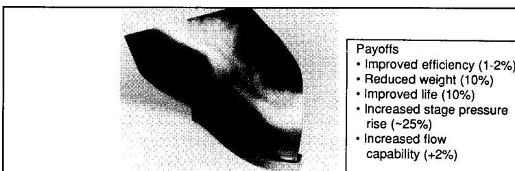

A 3D rendering of a turbine blade, showing its complex airfoil shape and the internal cooling channels.

JTDE Hollow Wide Chord Fan

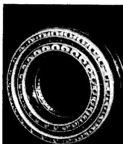

A high-contrast, black-and-white image of a circular mechanical bearing with visible inner and outer rings and rolling elements.

Photo: High-contrast black and white photograph of a mechanical bearing.

- Payoffs**
- Improved combustion efficiency (~5% at max  $\Delta T$ )
- Lower weight (~50 lb)
- Improved liner cooling effectiveness (10-40%)
- Improved R&M
- Reduced length
- Reduced cost relative to shingle (>50%)

High  $\Delta T$ /Multihole Combustor

### HPT TBC Coated Blades and Vanes

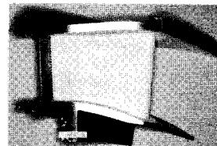

A black-and-white photograph shows a cylindrical roll of material, such as paper or tape, mounted on a dark mechanical bracket or frame.

Photo: A roll of paper or tape mounted on a mechanical holder.

A small, high-contrast black and white photograph of a person's hand holding a pen or pencil, positioned as if writing or drawing.

- Payoffs**
- +150° F TRIT at constant cooling flow OR
- Reduced cooling flow (10%) at constant TRIT OR
- Improved life (80%) at constant TRIT
- TBC applicable to other components

Figure 22 IHPTET Component payoffs

{11}------------------------------------------------

The large production base of the F404, with over 2000 engines shipped to date, has resulted in low engine cost for the -400 and -402 model engines. New derivatives will benefit from the manufacturing lessons learned both in production engines and in the advanced manufacturing methods research being undertaken by GEAE as described in this paper. The low development, acquisition cost, and proven low operating costs which have resulted from the high reliability and maintainability of the F404 family of engines will contribute to a low life cycle cost for these future F404 engine derivatives.

## REFERENCES

1. Rapp, G.C., "The F404 Development Program - A New Approach," AIAA Paper AIAA-82-1180, AIAA/SAE/ASME 18th Joint Propulsion Conference, Cleveland, Ohio, AIAA, New York, N.Y., June 1982.
2. Daub, W.J., Larsson, L., Veno, L.B., "Development of the F404/RM12 for the JAS 39 Gripen," ASME Paper 88-GT-305, ASME Gas Turbine and Aeroengine Congress, Amsterdam, The Netherlands, ASME, New York, N.Y. June 1988.

---

## Related documents

- [[ADA164562 The General Electric F404 - Engine of the RAAF's New Fighter|ADA164562]] - RAAF F404 engine description
- [[Exhaust-Gas P & T Survey of F404-GE-400 engine|Exhaust-Gas]] - NASA F404-GE-400 exhaust survey
- [[NASA TP 3001 - Evaluation of Various Thrust Calibration Techniques on an F404 Engine (April 1990)|NASA TP 3001]] - NASA F404 thrust calculation methods
- [[Yuhas 1992 - Effects of Bleed ir Extraction of Thrust Levels of the F404-GE-400 Turbofan Engine|Yuhas 1992]] - effects of bleed air extraction on F404 thrust
- [[NASA TM 4140 - Measurement Effects on the Calculation of In-Flight Thrust for an F404 turbofan engine|NASA TM 4140]] - in-flight thrust calculation for the F404
- [[Hadzic 2010 - Limited Qualification Tests of an F404 Engine with Blended FT-SPK and NATO F-34 Fuel|Hadzic 2010]] - F404 fuel qualification tests (performance and operability)
