{0}------------------------------------------------

# --- **Effects of Bleed Air Extraction on Thrust Levels of the F404-GE-400 Turbofan Engine** ---

Andrew J. Yuhas  
PRC Inc., Edwards, California

Ronald J. Ray  
NASA Dryden Flight Research Facility, Edwards, California

1992

Logo of the National Aeronautics and Space Administration (NASA) in bold, stylized lettering.

National Aeronautics and  
Space Administration

**Dryden Flight Research Facility**  
Edwards, California 93523-0273

{1}------------------------------------------------

{2}------------------------------------------------

# EFFECTS OF BLEED AIR EXTRACTION ON THRUST LEVELS OF THE F404-GE-400 TURBOFAN ENGINE

Andrew J. Yuhas\*  
PRC Inc.  
P.O. Box 273  
Edwards, California 93523-0273

Ronald J. Ray\*\*  
NASA Dryden Flight Research Facility  
P.O. Box 273  
Edwards, California 93523-0273

## Abstract

A ground test was performed to determine the effects of compressor bleed flow extraction on the performance of F404-GE-400 afterburning turbofan engines. The two engines were installed in the F/A-18 High Alpha Research Vehicle at the NASA Dryden Flight Research Facility. A specialized bleed ducting system was installed onto the aircraft to control and measure engine bleed airflow while the aircraft was tied down to a thrust measuring stand. The test was conducted on each engine and at various power settings. The bleed air extraction levels analyzed included flow rates above the manufacturer's maximum specification limit. The measured relationship between thrust and bleed flow extraction was shown to be essentially linear at all power settings with an increase in bleed flow causing a corresponding decrease in thrust. A comparison with the F404-GE-400 steady-state engine simulation showed the estimation to be within  $\pm 1$  percent of measured thrust losses for large increases in bleed flow rate.

## Nomenclature

|            |                                                                 |
|------------|-----------------------------------------------------------------|
| ALT        | pressure altitude, ft                                           |
| AOA        | angle-of-attack, deg                                            |
| <i>A</i>8  | nozzle throat area, in2 or percent                   |
| <i>BV</i>1 | excess bleed air system control valve 1                         |
| <i>BV</i>2 | excess bleed air system control valve 2                         |
| DTAMB      | ambient temperature increment from standard day temperature, °R |

|             |                                               |
|-------------|-----------------------------------------------|
| EAFB        | Edwards Air Force Base, Edwards, CA           |
| EBAS        | excess bleed air system                       |
| ECS         | environmental control system                  |
| FFC         | forebody flow control                         |
| GE          | General Electric                              |
| HATP        | High Alpha Technology Program                 |
| HARV        | High Alpha Research Vehicle                   |
| HPC         | high-pressure compressor                      |
| HPT         | high-pressure turbine                         |
| LPT         | low-pressure turbine                          |
| LPC         | low-pressure compressor                       |
| <i>M</i>    | Mach number                                   |
| <i>N</i>1   | fan rotor speed, rpm or percent               |
| <i>N</i>2   | high compressor rotor speed, rpm or percent   |
| PAMB        | ambient pressure, psia                        |
| PLA         | power lever angle, deg                        |
| <i>PS</i>3  | compressor discharge static pressure, psia    |
| <i>PT</i>56 | turbine exhaust total pressure, psia          |
| TVCS        | thrust vectoring control system               |
| <i>T</i>1   | fan inlet temperature, °R                     |
| <i>T</i>25  | compressor inlet temperature, °R              |
| <i>T</i>56  | low rotor turbine exit temperature, °R or °C) |
| <i>WFE</i>  | combustor fuel flow, (lb/hr)                  |

\*Senior Propulsion Research Engineer.

\*\* Aerospace engineer.

Copyright ©1992 by the American Institute of Aeronautics and Astronautics, Inc. No copyright is asserted in the United States under Title 17, U.S. Code. The U.S. Government has a royalty-free license to exercise all rights under the copyright claimed herein for Governmental purposes. All other rights are reserved by the copyright owner.

## Introduction

The High Alpha Technology Program (HATP) was initiated within NASA to develop and demonstrate concepts that provide favorable control and maneuverability for high-performance aircraft at high-angle of attack.1 Current fighters have degraded maneuverability at high-angle of attack because of loss in aerodynamic control surface effectiveness. One of the technologies studied to enhance aerodynamic control is the use of pneumatic forebody flow control (FFC). The FFC injects air from a slot on the aircraft forebody to manipulate the forebody vortices that form at high-angles of attack. For pneumatic FFC to be feasible, a significant supply of high-pressure airflow is required.

{3}------------------------------------------------

Experiments have demonstrated that the manipulation of the asymmetric forebody vortices of a fighter at high-angle of attack through various blowing schemes can have a strong effect on the yawing moment.2-4 Forebody flow control feasibility studies into various issues have been conducted by various government agencies including NASA. The X-29 Advanced Technology Demonstrator will test a simple pneumatic blowing system to demonstrate FFC effectiveness.5 The X-29 system will use a compressed air bottle to supply the high-pressure air and is limited to a total of 20 sec of operation. The HATP supported research on pneumatic FFC applications to an F/A-18, including various wind tunnel tests. One feasibility study looked at various ways to obtain the estimated flow rates required. These included compressed or liquefied gas bottles, an auxiliary compressor, or engine bleed air. The results of this study predicted that only engine bleed air would meet the mass flow requirements over an extended time period.6 Bleed extraction however, has a negative effect on engine performance. A past study on an F100-PW-220 engine predicts up to 2 percent of net thrust loss for each percent of airflow extracted for bleed.7

Because the pneumatic FFC studies for the F/A-18 were encouraging, the HATP initiated a feasibility study for a full-scale flight-test program to be conducted. To support this goal, the NASA Ames Research Center at Moffett Field, CA, formed a research team from Dryden and Moffett to evaluate engine bleed air capability and aircraft environmental bleed air requirements on a full-scale aircraft. The F/A-18 High Alpha Research Vehicle (HARV) was equipped with a specially designed ducting system known as the excess bleed air system (EBAS) and tested on the universal horizontal test stand at Edwards Air Force Base (EAFB). This ducting system branches off from the aircraft environmental control system (ECS) and allows engine bleed extraction to be controlled and measured. Various ground test objectives were performed using EBAS, including the determination of bleed air extraction effects on engine performance and operability.

This paper addresses the measurement of thrust loss during increases in bleed air extraction for an F404-GE-400 engine installed on the F/A-18 HARV. A comparison of the predicted thrust loss provided by an engine computer simulation and the measured values will be presented. The analysis offers a comparison of each engine at various power settings. A detailed description of EBAS and its function will also be presented.

## Description of Equipment and Model

### F-18 High Alpha Research Vehicle

The HARV (Fig. 1) is a one-of-a-kind research aircraft located at the NASA Dryden Flight Research Facility. This pre-production, single-seat F/A-18 aircraft has been uniquely modified to perform extensive flight testing in the high-angle-of-attack (AOA) region. These modifications include a thrust vectoring control system (TVCS). The incorporation of the TVCS required modifications to the aircraft avionics, flight controls, hydraulics, cockpit, and engines.1

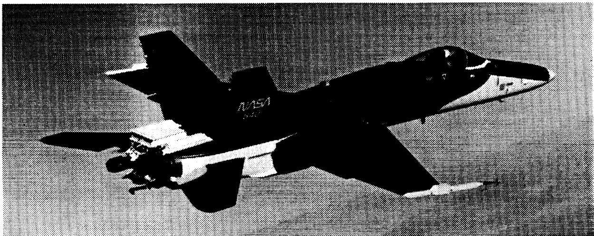

NASA  
[illegible]

A black-and-white photograph shows a NASA F/A-18 Hornet aircraft banking in flight, viewed from a high rear-quarter angle.

Photo: NASA F/A-18 Hornet fighter jet in flight.

EC 91-201-9

Fig. 1. F/A-18 High Alpha Research Vehicle (HARV).

{4}------------------------------------------------

### **F404-GE-400 Turbofan Engines**

Two pre-production F404-GE-400 engines (General Electric, Lynn, Massachusetts) are installed in the HARV. The F404-GE-400 (Fig. 2) is a two-spool, low bypass axial-flow turbofan with afterburner. The engine consists of a 3-stage fan, 7-stage high-pressure compressor, annular combustor, 1-stage high-pressure turbine, and 1-stage low-pressure turbine. Variable geometry is incorporated into the fan and high-pressure compressor along with a convergent-divergent nozzle.

The F404 engines on the HARV have the divergent portion of the nozzle and external flaps removed to incorporate the TVCS. The engine control system was

modified to provide a selectable turbine discharge temperature bias for additional engine stall margin at high AOA.

The control system has two basic modes of operation which are dependent on the throttle setting (PLA). Below Military power, high compressor rotor speed (*N2*) and exhaust nozzle area (*A8*) are scheduled. Throttle position and compressor inlet temperature (*T25*) schedule *N2*. The throttle position schedules *A8*. At Military and above, the control system schedules maximum fan speed (*N1*) and maximum low-pressure turbine exit temperature (*T56*). Fan speed is controlled as a function of engine inlet temperature (*T1*). The variable exhaust nozzle is modulated to maintain the scheduled *T56* which is a function of *T1* and ambient pressure (PAMB).

### **Aircraft-Engine Bleed Air System**

Bleed air comes from an annular manifold at the exit of the high-pressure compressor of each engine (Fig. 3). A bleed air pressure regulator and shutoff valve in each engine compartment is controlled by the bleed air knob located in the cockpit. The cockpit control allows bleed air to be selected from either or both engine sources, or to be turned off. The bleed air passes through a check valve which prevents reverse flow from one engine to the other. The bleed air lines are then teed together. The bleed air line is routed up the backbone of the aircraft over the fuel tanks and then down into the ECS and heat exchanger ejectors (Fig. 4). Bleed flow is regulated by the ECS. Maximum engine bleed is limited by the size of the bleed port on the engine but can exceed the manufacturer's maximum specification limit (Fig. 5).

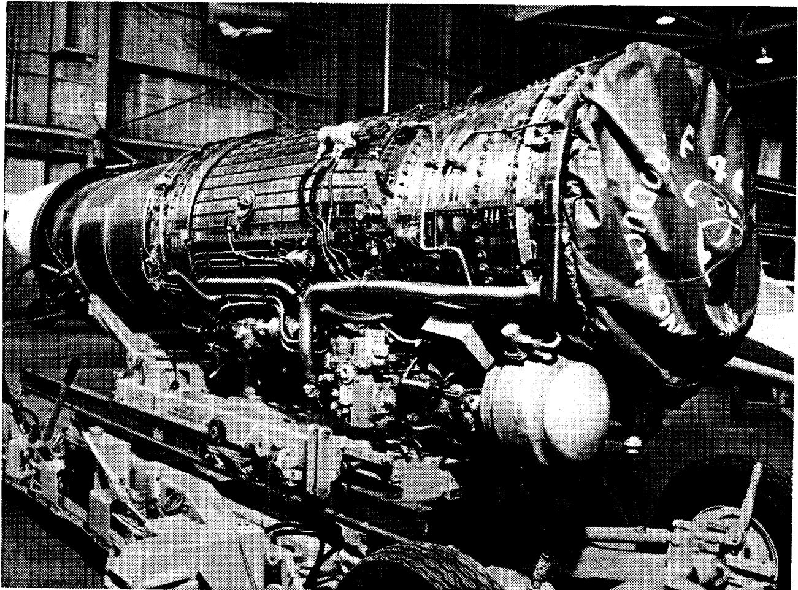

E 40  
W. D. [illegible]

A black-and-white photograph shows a large aircraft jet engine resting on a heavy-duty wheeled dolly inside a hangar, with a protective cover partially wrapped around the rear section.

Photo: A large jet engine mounted on a wheeled transport cart in a hangar.

Fig. 2. F404-GE-400 turbofan engine.

EC91-201-9

{5}------------------------------------------------

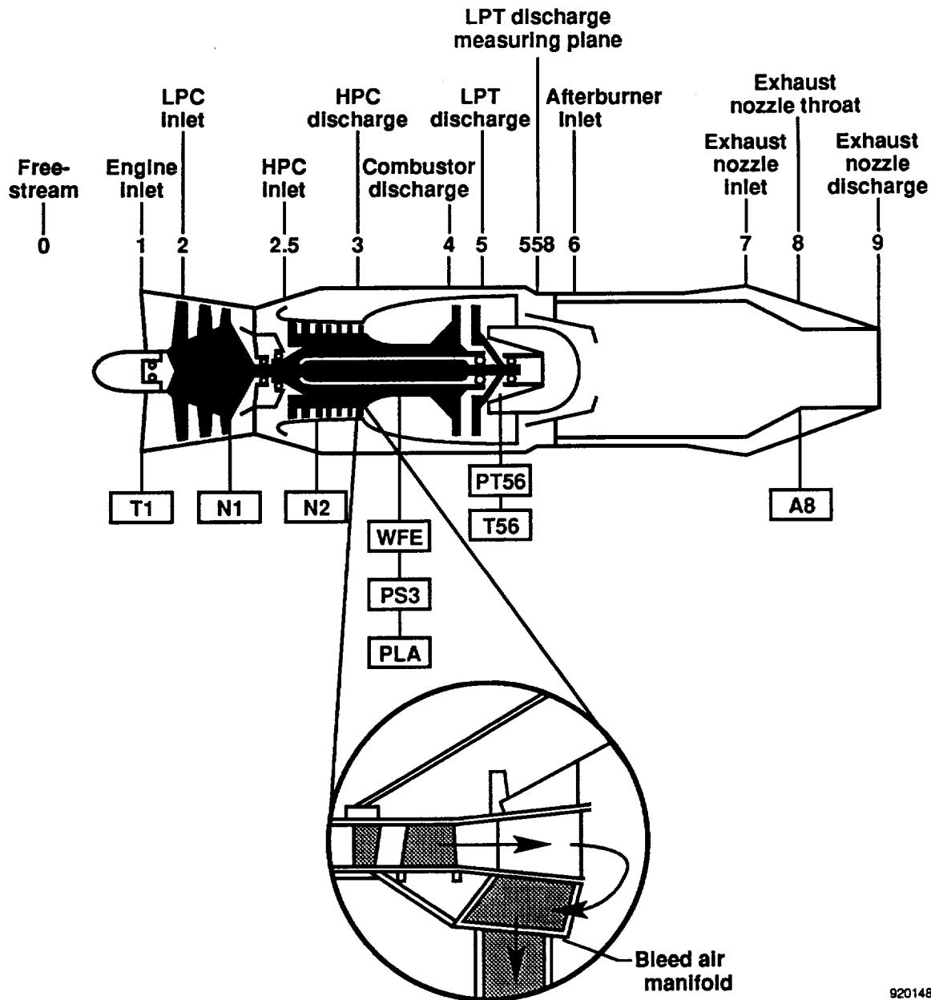

LPT discharge  
measuring plane  
LPC  
Inlet  
HPC  
discharge  
LPT  
discharge  
Afterburner  
inlet  
Exhaust  
nozzle throat  
Exhaust  
nozzle  
inlet  
Exhaust  
nozzle  
discharge  
Free-  
stream  
Engine  
Inlet  
HPC  
Inlet  
Combustor  
discharge  
0  
1  
2  
2.5  
3  
4  
5  
558  
6  
7  
8  
9  
T1  
N1  
N2  
PT56  
A8  
T56  
WFE  
PS3  
PLA  
Bleed air  
manifold  
920148

A longitudinal cross-section of a jet engine showing numbered measurement points from 0 to 9, with a magnified circular inset detailing the bleed air manifold and flow direction.

Technical illustration: Cross-sectional diagram of a jet engine with numbered measurement stations and a bleed air manifold inset.

Fig. 3. F404 engine showing compressor bleed and measured engine parameters.

### Excess Bleed Air System

The EBAS was a specially designed ducting system for measuring bleed air flow rates from the F/A-18 HARV (Fig. 6). The EBAS hardware was designed by NASA Ames Research Center at Moffett Field, CA and is illustrated schematically in Fig. 7. The system consists of two principal sections, the ECS flow measurement section and the bleed airflow dump section. The ECS flow measurement section required a section of ECS duct along the backbone of the aircraft to be removed and replaced with modified ducting and a Venturi flowmeter (Fig. 4). This section of ECS ducting could also be replaced with a capped off duct section, thereby allowing no airflow to the ECS from the engines. The bleed airflow dump section required an additional ECS line to be replaced with a modified duct. The duct teed the bleed flow out of the ECS line, away from the aircraft and was dumped to atmosphere. This ducting had two butterfly valves installed, one (*BV1*), immediately after the teed duct (Fig. 7, item 1) and the other (*BV2*), before the end of the ducting. This ducting was also equipped with a Venturi flowmeter. The entire system was instrumented with pressure and temperature measurements along with the flowmeters. The ECS line modifications for EBAS were downstream of the bleed air pressure regulator and shutoff valves and upstream of the aircraft ECS and ejectors.

{6}------------------------------------------------

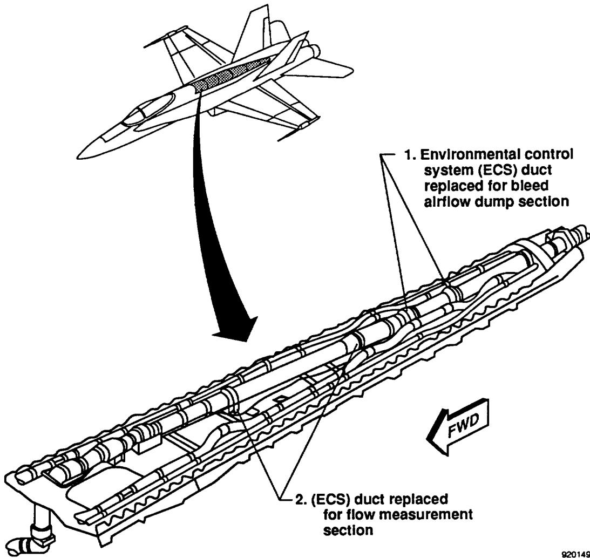

1. Environmental control system (ECS) duct replaced for bleed airflow dump section

2. (ECS) duct replaced for flow measurement section

FWD

920149

Technical illustration of a jet aircraft and a detailed cutaway of its fuselage showing the ECS duct modifications.

Fig. 4. Bleed air duct assemblies.

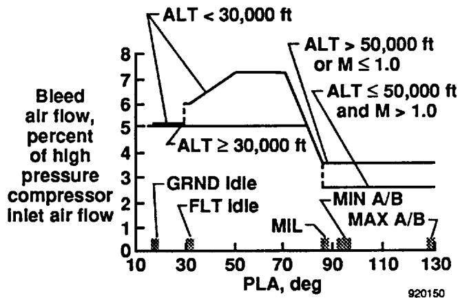

ALT < 30,000 ft  
ALT > 50,000 ft  
or M ≤ 1.0  
ALT ≤ 50,000 ft  
and M > 1.0  
ALT ≥ 30,000 ft  
GRND Idle  
FLT Idle  
MIL  
MIN A/B  
MAX A/B  
920150

x: PLA, deg, 10 to 130; y: Bleed air flow, percent of high pressure compressor inlet air flow, 0 to 8

| PLA, deg | ALT < 30,000 ft | ALT > 50,000 ft or M ≤ 1.0 | ALT ≤ 50,000 ft and M > 1.0 | ALT ≥ 30,000 ft |
|----------|-----------------|----------------------------|-----------------------------|-----------------|
| 10       | ~5.0            | ~5.0                       | ~5.0                        | ~5.0            |
| 30       | ~6.0            | ~6.0                       | ~6.0                        | ~5.0            |
| 50       | ~7.3            | ~7.3                       | ~7.3                        | ~5.0            |
| 70       | ~7.3            | ~7.3                       | ~7.3                        | ~5.0            |
| 90       | ~3.5            | ~3.5                       | ~3.5                        | ~3.5            |
| 110      | ~2.7            | ~2.7                       | ~2.7                        | ~3.5            |
| 130      | ~2.7            | ~2.7                       | ~2.7                        | ~3.5            |

A line chart showing bleed air flow percentage across engine power lever angle (PLA) for different altitude and Mach number regimes, with idle and MIL points marked.

Line chart: Bleed air flow percent of high pressure compressor inlet air flow versus PLA.

Fig. 5. Customer bleed air extraction limits.

{7}------------------------------------------------

### General Electric F404 Steady-State Engine Model

The manufacturer's specification model (GE Reference LP005S) is a full aerothermal steady-state performance program. This model was modified to reflect the F/A-18 HARV configuration. The simulation provides values of a number of internal flow parameters for the engine as well as its overall performance. The model was derived from actual test data and represents the operation of an average F404-GE-400 engine.

Input into the steady-state model includes altitude, Mach number (*M*), power level angle (PLA), and ambient temperature. The program allows for determining the effects on engine operation of engine bleed air extraction from 0 to the manufacturer maximum specification limit (Fig. 5).

## Test Setup—Procedure

### Thrust Stand Description

The EAFB universal horizontal thrust stand, operated by the Air Force, was used to measure installed thrust. The thrust stand consists of four force measuring tables arranged in a cross formation (Fig. 8). This layout accommodates a wide variety of aircraft. A pair of load cells is attached to each platform. The HARV was positioned on platform 3 and tied down with chains. Special care was taken to ensure no support equipment or EBAS structure was positioned on the measuring platform.

A control room bunker is located underground near platform 1 and was used to monitor load data, local weather information, and aircraft status during the test. Load and weather data are measured and stored in computer memory and on hardcopy printouts in the bunker. The thrust stand operator had radio contact with the aircraft and ground support personnel as well as the NASA Dryden control room during the testing.

**BV2 valve**

**To aircraft**

**Venturi  
flowmeter**

920151

A black and white photograph of an outdoor test area with a venturi flowmeter and a BV2 valve. A label 'Venturi flowmeter' points to the flowmeter, and a label 'BV2 valve' points to the valve. A label 'To aircraft' points to a white vehicle in the background. The ground is paved, and a large structure is visible in the background.

Fig. 6. Excess bleed air system ducting, bleed flow dump section.

{8}------------------------------------------------

Weather data recorded at the thrust stand included ambient pressure and temperature as well as wind speed and direction. Wind limits were maintained during the test to prevent data biasing caused by wind forces, variable inlet recovery, and tailpipe gas recirculation: maximum headwinds, 15 kts.; maximum crosswinds, 5 kts; and maximum tailwinds, 0 kts.

### Excess Bleed Air System Configuration

The setup of EBAS for steady-state thrust measurement required the following configuration modifications from the prior hardware description: (1) The ECS flow measurement section was replaced with a duct section containing a cap. An external ground supply provided aircraft ECS cooling flow. This insured that all engine bleed flow was sent down the bleed airflow dump section. (2) The *BV1* valve was full open, and (3) the *BV2* valve was used to control bleed flow through the measurement ducting.

![Schematic diagram of the EBAS bleed airflow dump section. The diagram shows a duct system with two engines at the top. Airflow from the engines goes through a series of components: 3 (Engine bleed air pressure regulating and shutoff valves), 4 (Engine bleed air check valves), 5 (Secondary engine bleed air pressure regulating and shutoff valve), 1 (ECS duct replaced for flow measurement section), and 2 (ECS duct capped off). The flow then passes through BV1 and a Venturi flowmeter before exiting through BV2 to the atmosphere. A note indicates that on the F/A-18 HARV, the ECS duct is capped off to allow no flow to the ECS during the test.](images/yuhas-1992/b3baf3a29b67c7425d2562ddbc52f0cc_img.jpg)

**1. ECS duct replaced for EBAS bleed airflow dump section (see Fig. 4)**  
**2. ECS duct replaced for flow measurement section or capped duct (see Fig. 4)**  
**3. Engine bleed air pressure regulating and shutoff valves**  
**4. Engine bleed air check valves**  
**5. Secondary engine bleed air pressure regulating and shutoff valve**

**To atmosphere**

**BV2**

**Venturi flowmeter**

**BV1**

**Engine**

**Engine**

**3**

**4**

**4**

**5**

**1**

**2**

**ECS duct capped off, allowing no flow to ECS during test.**

**On F/A-18 HARV**

**To ECS**

Schematic diagram of the EBAS bleed airflow dump section. The diagram shows a duct system with two engines at the top. Airflow from the engines goes through a series of components: 3 (Engine bleed air pressure regulating and shutoff valves), 4 (Engine bleed air check valves), 5 (Secondary engine bleed air pressure regulating and shutoff valve), 1 (ECS duct replaced for flow measurement section), and 2 (ECS duct capped off). The flow then passes through BV1 and a Venturi flowmeter before exiting through BV2 to the atmosphere. A note indicates that on the F/A-18 HARV, the ECS duct is capped off to allow no flow to the ECS during the test.

Fig. 7. Excess bleed air system for F/A-18 HARV.

{9}------------------------------------------------

![Schematic diagram of a test setup with four platforms (1-4) and a central aircraft. Platform 3 is at the top (15 ft 0 in. x 42 ft 6 in.), Platform 1 is to the right (27 ft 0 in. x 15 ft 0 in.), Platform 2 is to the left (27 ft 0 in. x 15 ft 0 in.), and Platform 4 is at the bottom (15 ft 0 in. x 42 ft 6 in.). A central vertical platform connects them. An 'EBAS' line is shown on the left. A north arrow indicates a 45-degree angle. A legend shows a load cell as a dashed rectangle. An arrow points 'To bunker' to the right.](images/yuhas-1992/a5ee5c23b6dc52ec1d724b76d5a5f58f_img.jpg)

**Platform 3**  
15 ft 0 in. x 42 ft 6 in.

**EBAS**

**Platform 2**  
27 ft 0 in. x 15 ft 0 in.

**Platform 1**  
27 ft 0 in. x 15 ft 0 in.

**North**

45°

**To bunker** →

**Legend**

**Load cell**

**Platform 4**  
15 ft 0 in. x 42 ft 6 in.

92015

Schematic diagram of a test setup with four platforms (1-4) and a central aircraft. Platform 3 is at the top (15 ft 0 in. x 42 ft 6 in.), Platform 1 is to the right (27 ft 0 in. x 15 ft 0 in.), Platform 2 is to the left (27 ft 0 in. x 15 ft 0 in.), and Platform 4 is at the bottom (15 ft 0 in. x 42 ft 6 in.). A central vertical platform connects them. An 'EBAS' line is shown on the left. A north arrow indicates a 45-degree angle. A legend shows a load cell as a dashed rectangle. An arrow points 'To bunker' to the right.

Fig. 8. Thrust stand platforms.

{10}------------------------------------------------

The operation of control valves and recording of measurements on the EBAS was located in a data van located near the thrust stand. All EBAS parameters (Table 1) were recorded on a portable data acquisition system. The system enabled real-time parameter readouts including bleed mass flow rates. The EBAS

Table 1. Excessive bleed air system parameters.

| Name       | Description                            | Units         |
|------------|----------------------------------------|---------------|
| <i>P1</i>  | Pressure before branch                 | psig          |
| <i>P2</i>  | Pressure on 3-in. Venturi              | psig          |
| <i>P3</i>  | Pressure on 6-in. Venturi              | psig          |
| <i>P4</i>  | Pressure before <i>BV2</i>             | psig          |
| <i>P5</i>  | Pressure after <i>BV2</i>              | psig          |
| <i>DP2</i> | Differential pressure on 3-in. Venturi | in. of water  |
| <i>DP3</i> | Differential pressure on 6-in. Venturi | in. of water  |
| <i>T1</i>  | Temperature before branch              | °F            |
| <i>T2</i>  | Temperature on 3-in. Venturi           | °F            |
| <i>T3</i>  | Temperature on 6-in. Venturi           | °F            |
| <i>T4</i>  | Temperature after <i>BV2</i>           | °F            |
| <i>BV1</i> | Butterfly valve 1 position             | degree (0-90) |
| <i>BV2</i> | Butterfly valve 2 position             | degree (0-90) |

data van had radio contact with the aircraft and ground support personnel, thrust stand operator, and the NASA control room during the testing.

### Instrumentation

Along with the thrust stand and EBAS measurements, the F/A-18 HARV aircraft and F404 engines had extensive instrumentation installed. The engine parameters measured are shown in Fig. 3. All engine and aircraft measurements were telemetered to the NASA control room and recorded. The engine operation during the test was monitored in the NASA control room by way of CRT displays and stripchart recordings.

### Test Procedure

Testing was conducted on each F404 engine at three power settings: part power (92-percent *N2*), Military, and maximum afterburning. For each engine-power setting condition, the following procedure was used.

At idle power, the cockpit bleed air switch was selected to the required engine. The *BV2* valve was set to full closed (0° position). The required power level was selected and the engine was allowed to stabilize. The control room monitored engine operation to determine a stabilized condition. At part power, *N2*,

combustor fuel flow (WFE), and *T56* were used to confirm stabilization. At Military and above, *A8* and *T56* were used. The EBAS flow measurements were also monitored to confirm stabilization. After a stabilized condition was reached, measurements were recorded in the EBAS data van and thrust stand. Aircraft and engine measurements were continually recorded in the NASA data facilities. After measurement recording was complete, the *BV2* valve was opened in a 5- or 10°-increment. Engine and EBAS measurements were allowed to stabilize and data was again recorded. This incremental opening of the *BV2* valve continued until an engine limitation was reached or bleed flow no longer increased.

## Results and Discussion

A comparison of the estimated and measured effects of bleed flow extraction on thrust levels of the F404-GE-400 engine at ground level is presented. Predictions using the manufacturer's engine model indicate a significant increase in bleed flow extraction from the F404 compressor will cause a substantial decrease in thrust. All power settings tested had predictions which showed a thrust loss with increasing bleed flow demand.

Differences between measured and predicted thrust values were caused by engine-to-engine variations, engine degradation, and aircraft installation variations. The manufacturer's model assumes a nominal engine. Predictions were made using the measured bleed flow, power settings, atmospheric pressure and temperature conditions. Because the EBAS valves would not seal completely in the closed position, about 0.7 lb/sec of bleed flow was measured at the minimum setting.

### 92-percent *N2* - Left and Right Engine

The comparison of estimated and measured thrust loss at 92-percent *N2* showed good agreement. The left and right engine comparisons are presented in Figs. 9 and 10. The thrust loss with bleed flow extraction at part power shows a gradual thrust decrease with increasing bleed flow rate. At part power, the relationship between bleed flow and thrust is nearly linear. For analysis comparison a least-squares curve fit was performed on the data. The least-squares curve fit of the estimated and measured data is given in Table 2. The estimated loss of 89 to 97 lb of thrust per lb/sec of bleed flow is less than the 100 to 125 lb/lb/sec value measured. The simulation at part power underpredicts the thrust loss due to bleed flow extraction.

### Military Power - Left and Right Engine

The estimated and measured thrust loss at Military power with bleed flow demand was compared for each engine (Figs. 11 and 12). The thrust loss at Military power has an essentially linear relationship with bleed

{11}------------------------------------------------

Table 2. Least-squares curve fit of predicted and measured thrust loss due to bleed flow extraction.

$$\text{Thrust} = \text{bleed flow rate (slope)} + \text{Y-intercept}$$

| Power setting | Engine | Data source | Slope: lb thrust/ lb/sec bleed | Y-intercept:* lb thrust | Percentage thrust loss bleed = 1 lb/sec |
|---------------|--------|-------------|--------------------------------------|----------------------------|-----------------------------------------------|
| 92 percent N2 | Left   | Predicted   | -97                                  | 5,875                      | 1.65                                          |
|               |        | Measured    | -125                                 | 6,311                      | 1.98                                          |
|               | Right  | Predicted   | -89                                  | 5,503                      | 1.62                                          |
|               |        | Measured    | -100                                 | 6,079                      | 1.64                                          |
| Military      | Left   | Predicted   | -245                                 | 9,194                      | 2.66                                          |
|               |        | Measured    | -177                                 | 8,774                      | 2.02                                          |
|               | Right  | Predicted   | -246                                 | 9,086                      | 2.7                                           |
|               |        | Measured    | -189                                 | 8,690                      | 2.17                                          |
| Maximum       | Left   | Predicted   | -421                                 | 13,241                     | 3.18                                          |
|               |        | Measured    | -371                                 | 12,873                     | 2.88                                          |
|               | Right  | Predicted   | -428                                 | 12,983                     | 3.29                                          |
|               |        | Measured    | -344                                 | 12,033                     | 2.85                                          |

\*Ideal zero bleed thrust value

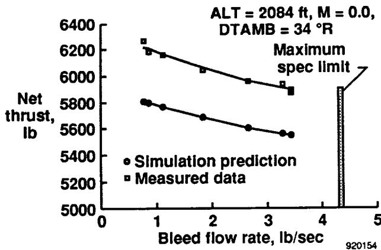

ALT = 2084 ft, M = 0.0,  
DTAMB = 34 °R  
Maximum  
spec limit  
• Simulation prediction  
■ Measured data

x: Bleed flow rate, lb/sec, 0 to 5; y: Net thrust, lb, 5000 to 6400

| Bleed flow rate, lb/sec | Simulation prediction | Measured data |
|-------------------------|-----------------------|---------------|
| ~0.7                    | ~5810                 | ~6270         |
| ~1.0                    | ~5770                 | ~6160         |
| ~1.8                    | ~5690                 | ~6050         |
| ~2.6                    | ~5610                 | ~5970         |
| ~3.4                    | ~5560                 | ~5890         |
| ~3.5                    | ~5550                 | ~5890         |

A line plot of net thrust decreasing as bleed flow rate increases, showing simulation predictions and measured data, with a vertical bar indicating the maximum specification limit around 4.3 lb/sec.

Line chart: Net thrust versus bleed flow rate comparing simulation prediction and measured data.

Fig. 9. Thrust loss due to bleed air extraction 92-percent N2, left engine.

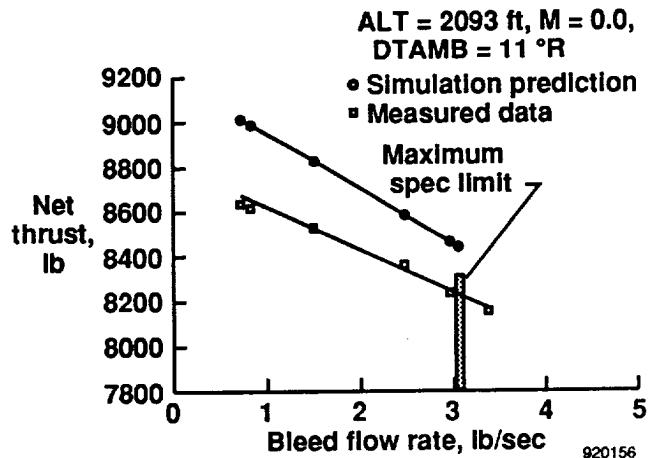

ALT = 2093 ft, M = 0.0,  
DTAMB = 11 °R  
• Simulation prediction  
■ Measured data  
Maximum  
spec limit  
920156

x: Bleed flow rate, lb/sec, 0 to 5; y: Net thrust, lb, 7800 to 9200

| Bleed flow rate, lb/sec | Simulation prediction | Measured data |
|-------------------------|-----------------------|---------------|
| ~0.7                    | ~9000                 | ~8630         |
| ~1.5                    | ~8830                 | ~8530         |
| ~2.5                    | ~8590                 | ~8370         |
| ~3.1                    | ~8460                 | ~8250         |
| ~3.2                    |                       | ~8170         |

A line plot showing net thrust decreasing linearly with increasing bleed flow rate, with a vertical maximum specification limit bar at approximately 3.1 lb/sec.

Line chart: Net thrust versus bleed flow rate comparing simulation prediction and measured data.

Fig. 11. Thrust loss due to bleed air extraction; Military power, left engine.

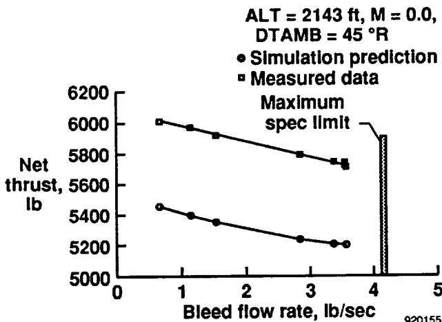

ALT = 2143 ft, M = 0.0,  
DTAMB = 45 °R  
• Simulation prediction  
▣ Measured data  
Maximum  
spec limit  
920155

x: Bleed flow rate, lb/sec, 0 to 5; y: Net thrust, lb, 5000 to 6200

| Bleed flow rate, lb/sec | Simulation prediction | Measured data |
|-------------------------|-----------------------|---------------|
| ~0.6                    | ~5460                 | ~6020         |
| ~1.0                    | ~5410                 | ~5980         |
| ~1.5                    | ~5360                 | ~5930         |
| ~2.8                    | ~5250                 | ~5810         |
| ~3.4                    | ~5220                 | ~5750         |
| ~3.5                    | ~5220                 | ~5740         |

A line plot showing net thrust decreasing as bleed flow rate increases, with a vertical bar indicating the maximum specification limit around 4.1 lb/sec.

Line chart: Net thrust versus bleed flow rate comparing simulation prediction and measured data.

Fig. 10. Thrust loss due to bleed air extraction 92-percent N2, right engine.

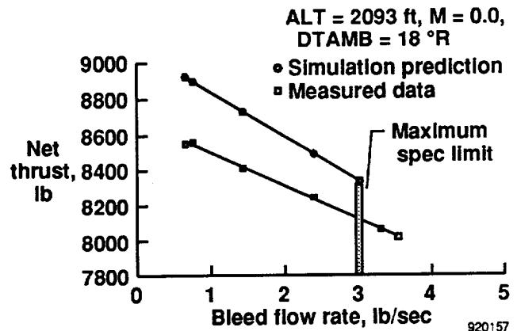

ALT = 2093 ft, M = 0.0,  
DTAMB = 18 °R  
• Simulation prediction  
■ Measured data  
Maximum  
spec limit  
920157

x: Bleed flow rate, lb/sec, 0 to 5; y: Net thrust, lb, 7800 to 9000

| Bleed flow rate, lb/sec | Simulation prediction | Measured data |
|-------------------------|-----------------------|---------------|
| ~0.65                   | ~8930                 | ~8560         |
| ~1.5                    | ~8740                 | ~8420         |
| ~2.4                    | ~8510                 | ~8270         |
| ~3.0                    | ~8350                 | ~8350         |
| ~3.25                   |                       | ~8080         |
| ~3.5                    |                       | ~8040         |

A line plot showing net thrust decreasing as bleed flow rate increases, with a vertical maximum spec limit bar at 3.0 lb/sec.

Line chart: Net thrust versus bleed flow rate comparing simulation prediction and measured data.

Fig. 12. Thrust loss due to bleed air extraction; Military power, right engine.

{12}------------------------------------------------

flow demand. A least-squares curve fit of the estimated and measured data is given in Table 2. A slope comparison shows the predicted loss of 245 lb of thrust per lb/sec of bleed flow is greater than the measured value of 177 to 189 lb/lb/sec for both engines. The estimated thrust loss at Military power is overpredicted compared to the measured results.

### Maximum Power - Left and Right Engine

The maximum power comparison of the estimated and measured thrust loss on the left and right engine is shown in Figs. 13 and 14. The maximum power thrust loss due to bleed flow shows the same linear relationship as Military power. A least-squares curve fit study of the estimated and measured data is presented in Table 2. A slope comparison shows the estimated thrust loss of 421 to 428 lb of thrust per lb/sec of bleed flow is greater than the measured value of 344 to 371 lb/lb/sec. The maximum power thrust loss estimation over predicts thrust loss when compared to the measured data.

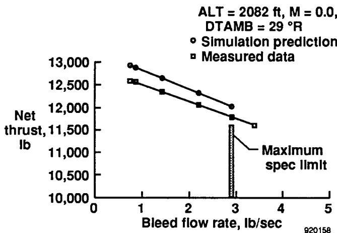

ALT = 2082 ft, M = 0.0,  
DTAMB = 29 °R  
Simulation prediction  
Measured data  
Maximum  
spec limit  
920158

x: Bleed flow rate, lb/sec, 0 to 5; y: Net thrust, lb, 10,000 to 13,000

| Bleed flow rate, lb/sec | Simulation prediction | Measured data |
|-------------------------|-----------------------|---------------|
| ~0.8                    | ~12,900               | ~12,600       |
| ~1.4                    | ~12,650               | ~12,350       |
| ~2.3                    | ~12,300               | ~12,050       |
| ~2.9                    | ~11,950               | ~11,800       |
| ~3.4                    |                       | ~11,600       |

A line plot showing net thrust decreasing linearly with increasing bleed flow rate, with a vertical bar indicating the maximum specification limit at approximately 2.95 lb/sec.

Line chart: Net thrust versus bleed flow rate comparing simulation prediction and measured data.

Fig. 13. Thrust loss due to bleed air extraction; maximum power, left engine.

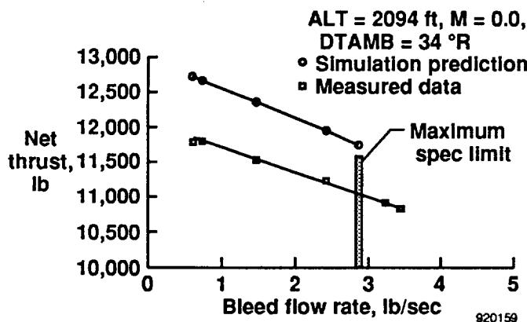

ALT = 2094 ft, M = 0.0,  
DTAMB = 34 °R  
Simulation prediction  
Measured data  
Maximum  
spec limit  
920159

x: Bleed flow rate, lb/sec, 0 to 5; y: Net thrust, lb, 10,000 to 13,000

| Bleed flow rate, lb/sec | Simulation prediction | Measured data |
|-------------------------|-----------------------|---------------|
| ~0.65                   | ~12700                | ~11750        |
| ~1.5                    | ~12350                | ~11500        |
| ~2.5                    | ~11950                | ~11250        |
| ~2.9                    | ~11700                | ~11550        |
| ~3.4                    |                       | ~10900        |
| ~3.5                    |                       | ~10850        |

A line plot showing net thrust decreasing as bleed flow rate increases, with a vertical maximum specification limit bar at approximately 2.9 lb/sec.

Line chart: Net thrust versus bleed flow rate comparing simulation prediction and measured data.

Fig. 14. Thrust loss due to bleed air extraction; maximum power, right engine.

The effect of power setting on thrust loss due to bleed extraction is summarized in Fig. 15. This comparison of percentage thrust loss for 1 lb/sec of bleed extraction shows a definite sensitivity to power setting. For a given bleed flow value, the percent thrust loss increases with increasing power settings. The model tends to slightly over predict this tendency when compared to the measured values. Left to right engine comparisons were very good at Military power and above and only off by 0.4 percent at 92-percent  $N_2$ . The estimated and measured losses were within  $\pm 0.5$  percent of each other. Overall, the steady-state simulation deck was able to provide good estimates for thrust loss due to bleed flow extraction. These results encourage the use of the manufacturer's model to predict thrust loss due to bleed extraction at other flight conditions.

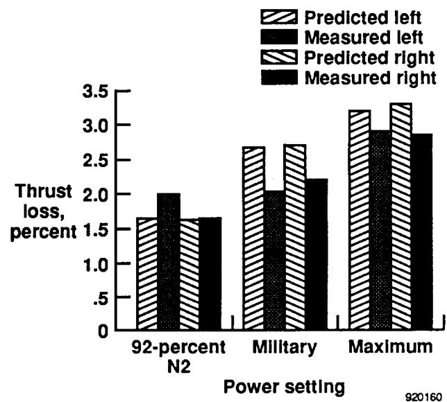

920160

x: Power setting; y: Thrust loss, percent, 0 to 3.5

| Power setting | Predicted left | Measured left | Predicted right | Measured right |
|---------------|----------------|---------------|-----------------|----------------|
| 92-percent N2 | ~1.65          | ~2.0          | ~1.65           | ~1.65          |
| Military      | ~2.7           | ~2.05         | ~2.7            | ~2.2           |
| Maximum       | ~3.2           | ~2.9          | ~3.3            | ~2.85          |

A grouped bar chart comparing predicted and measured thrust loss percentages across three power settings: 92-percent N2, Military, and Maximum.

Bar chart: Thrust loss percent across power settings for predicted and measured left and right sides.

Fig. 15. The effect of power setting on the percent of thrust loss for 1 lb of bleed extraction.

The maximum bleed flow rate obtained during testing was limited by choked conditions in the aircraft-EBAS ducting. Bleed flow rates above the manufacturer's maximum specification limit were reached during the military and maximum afterburning power test conditions as shown in Figs. 11 through 14. Thrust loss showed the same linear characteristic as predicted below the maximum specification limit. Operation above the maximum specification limit was limited during testing because of turbine life concerns.

## Concluding Remarks

A ground test at the NASA Dryden Flight Research Facility was performed on the F/A-18 High Alpha Research Vehicle to determine the bleed air availability of the F404-GE-400 engines for a pneumatic forebody flow control system. One objective was to measure the thrust loss due to bleed air extraction and to confirm the predicted relationship by the General Electric steady-state simulation deck. The comparison of estimated and measured thrust loss showed good agreement. For a 1 lb/sec increase in bleed flow demand, comparisons of the percent thrust loss between estimated and measured characteristics were within  $\pm 0.5$  percent of each other for all power settings tested. The percent thrust loss for a given bleed setting increased with higher power settings. At military power, a 1-percent increase in bleed airflow caused a 2-percent loss in thrust. The measured thrust loss above the manufacturer's maximum specification bleed flow limit showed the same linear relationship as predicted below the limit. The results encourage the use of the manufacturer's model to predict in-flight performance loss due to bleed extraction.

{13}------------------------------------------------

## References

1Schneider, Edward T. and Robert R. Meyer, Jr., "F-18 High Alpha Research Vehicle Description, Results and Plans," ISSN#0742-3705, presented at the 33rd SETP Symposium, Sept. 1989.

2Malcolm, Gerald N., T. Terry Ng, Liane C. Lewis, and Daniel G. Murri, "Development of Nonconventional Control Methods For High Angle of Attack

Flight Using Vortex Manipulation," AIAA 89-2192, AIAA 7th Applied Aerodynamics Conference, Seattle, WA, July-Aug. 1989.

3Williams, D. and J. Bernhardt, "Proportional Control of Asymmetric Forebody Vortices with the Unsteady Bleed Technique," AIAA 90-1629, AIAA 21st Fluid Dynamics, Plasma Dynamics and Lasers Conference, Seattle, WA, June 1990.

4Ng, T.T. and G.N. Malcolm, "Aerodynamic Control Using Forebody Blowing and Suction," AIAA 91-0619, 29th Aerospace Sciences Meeting, Reno, NV, Jan. 1991.

5Guyton, R.W. and G. Maerki, "X-29 Forebody Jet Blowing," AIAA 92-0017, 30th Aerospace Science Meeting and Exhibit, Reno, NV, Jan. 1992.

6Kroo, I. and L. Roberts, *Forebody Tangential Blowing for Control at High Angles of Attack - Feasibility Study Final Report*, JIAA TR-101, Joint Institute for Aeronautics and Acoustics, Stanford University, Stanford, CA, June, 1991.

7Evans, Alison B., *The Effects of Compressor Seventh-Stage Bleed Air Extraction on Performance of the F100-PW-220 Afterburning Turbofan Engine*, NASA CR-179447, 1991.

{14}------------------------------------------------

{15}------------------------------------------------

## REPORT DOCUMENTATION PAGE

Form Approved  
OMB No. 0704-0188

Public reporting burden for this collection of information is estimated to average 1 hour per response, including the time for reviewing instructions, searching existing data sources, gathering and maintaining the data needed, and completing and reviewing the collection of information. Send comments regarding this burden estimate or any other aspect of this collection of information, including suggestions for reducing this burden, to Washington Headquarters Services, Directorate for Information Operations and Reports, 1215 Jefferson Davis Highway, Suite 1204, Arlington, VA 22202-4302, and to the Office of Management and Budget, Paperwork Reduction Project (0704-0188), Washington, DC 20503.

|                                                                                                                                                                                                                                                                                                                                                                                                                                                                                                                                                                                                                                                                                                                                                                                                                                                                                                                                                                                                                                                                                                                    |                                                                 |                                                                             |
|--------------------------------------------------------------------------------------------------------------------------------------------------------------------------------------------------------------------------------------------------------------------------------------------------------------------------------------------------------------------------------------------------------------------------------------------------------------------------------------------------------------------------------------------------------------------------------------------------------------------------------------------------------------------------------------------------------------------------------------------------------------------------------------------------------------------------------------------------------------------------------------------------------------------------------------------------------------------------------------------------------------------------------------------------------------------------------------------------------------------|-----------------------------------------------------------------|-----------------------------------------------------------------------------|
| <b>1. AGENCY USE ONLY (Leave blank)</b>                                                                                                                                                                                                                                                                                                                                                                                                                                                                                                                                                                                                                                                                                                                                                                                                                                                                                                                                                                                                                                                                            | <b>2. REPORT DATE</b> July 1992                              | <b>3. REPORT TYPE AND DATES COVERED</b> Technical Memorandum             |
| <b>4. TITLE AND SUBTITLE</b> Effects of Bleed Air Extraction on Thrust Levels of the F404-GE-400 Turbofan Engine                                                                                                                                                                                                                                                                                                                                                                                                                                                                                                                                                                                                                                                                                                                                                                                                                                                                                                                                                                                                |                                                                 | <b>5. FUNDING NUMBERS</b>  RTOP-505-68-30                             |
| <b>6. AUTHOR(S)</b>  Andrew J. Yuhas and Ronald J. Ray                                                                                                                                                                                                                                                                                                                                                                                                                                                                                                                                                                                                                                                                                                                                                                                                                                                                                                                                                                                                                                                       |                                                                 |                                                                             |
| <b>7. PERFORMING ORGANIZATION NAME(S) AND ADDRESS(ES)</b>  NASA Dryden Flight Research Facility P.O. Box 273 Edwards, California 93523-0273                                                                                                                                                                                                                                                                                                                                                                                                                                                                                                                                                                                                                                                                                                                                                                                                                                                                                                                                                            |                                                                 | <b>8. PERFORMING ORGANIZATION REPORT NUMBER</b>  H-1806               |
| <b>9. SPONSORING/MONITORING AGENCY NAME(S) AND ADDRESS(ES)</b>  National Aeronautics and Space Administration Washington, DC 20546-3191                                                                                                                                                                                                                                                                                                                                                                                                                                                                                                                                                                                                                                                                                                                                                                                                                                                                                                                                                                   |                                                                 | <b>10. SPONSORING/MONITORING AGENCY REPORT NUMBER</b>  NASA TM-104247 |
| <b>11. SUPPLEMENTARY NOTES</b>  Presented as AIAA 92-3092 at the AIAA 28th Joint Propulsion Conference, Nashville, TN, July 6-8, 1992.                                                                                                                                                                                                                                                                                                                                                                                                                                                                                                                                                                                                                                                                                                                                                                                                                                                                                                                                                                       |                                                                 |                                                                             |
| <b>12a. DISTRIBUTION/AVAILABILITY STATEMENT</b>  Unclassified — Unlimited Subject Category 07                                                                                                                                                                                                                                                                                                                                                                                                                                                                                                                                                                                                                                                                                                                                                                                                                                                                                                                                                                                                             |                                                                 | <b>12b. DISTRIBUTION CODE</b>                                               |
| <b>13. ABSTRACT (Maximum 200 words)</b>  
A ground test was performed to determine the effects of compressor bleed flow extraction on the performance of F404-GE-400 afterburning turbofan engines. The two engines were installed in the F/A-18 High Alpha Research Vehicle at the NASA Dryden Flight Research Facility. A specialized bleed ducting system was installed onto the aircraft to control and measure engine bleed airflow while the aircraft was tied down to a thrust measuring stand. The test was conducted on each engine and at various power settings. The bleed air extraction levels analyzed included flow rates above the manufacturer's maximum specification limit. The measured relationship between thrust and bleed flow extraction was shown to be essentially linear at all power settings with an increase in bleed flow causing a corresponding decrease in thrust. A comparison with the F404-GE-400 steady-state engine simulation showed the estimation to be within <math>\pm 1</math> percent of measured thrust losses for large increases in bleed flow rate.
 |                                                                 |                                                                             |
| <b>14. SUBJECT TERMS</b>  Bleed air extraction, Engine simulation, FFC, HARV, Pneumatic flight control, Thrust loss, Turbofan engine                                                                                                                                                                                                                                                                                                                                                                                                                                                                                                                                                                                                                                                                                                                                                                                                                                                                                                                                                                         |                                                                 | <b>15. NUMBER OF PAGES</b> 15 <b>16. PRICE CODE</b> A02            |
| <b>17. SECURITY CLASSIFICATION OF REPORT</b> Unclassified                                                                                                                                                                                                                                                                                                                                                                                                                                                                                                                                                                                                                                                                                                                                                                                                                                                                                                                                                                                                                                                       | <b>18. SECURITY CLASSIFICATION OF THIS PAGE</b> Unclassified | <b>19. SECURITY CLASSIFICATION OF ABSTRACT</b> Unclassified              |
| <b>20. LIMITATION OF ABSTRACT</b>  Unlimited                                                                                                                                                                                                                                                                                                                                                                                                                                                                                                                                                                                                                                                                                                                                                                                                                                                                                                                                                                                                                                                                 |                                                                 |                                                                             |

---

## Related documents

- [[NASA TP 3001 - Evaluation of Various Thrust Calibration Techniques on an F404 Engine (April 1990)|NASA TP 3001]] - same NASA Dryden F404 thrust work (shared author R. J. Ray)
- [[NASA TM 4140 - Measurement Effects on the Calculation of In-Flight Thrust for an F404 turbofan engine|NASA TM 4140]] - in-flight thrust calculation for the F404
- [[Exhaust-Gas P & T Survey of F404-GE-400 engine|Exhaust-Gas]] - NASA F404-GE-400 exhaust survey
- [[Powel 1990 - On the Leading Edge, Combining Maturity and Advanced Technology on the F404 Turbofan Engine|Powel 1990]] - GE overview of F404 design and growth
